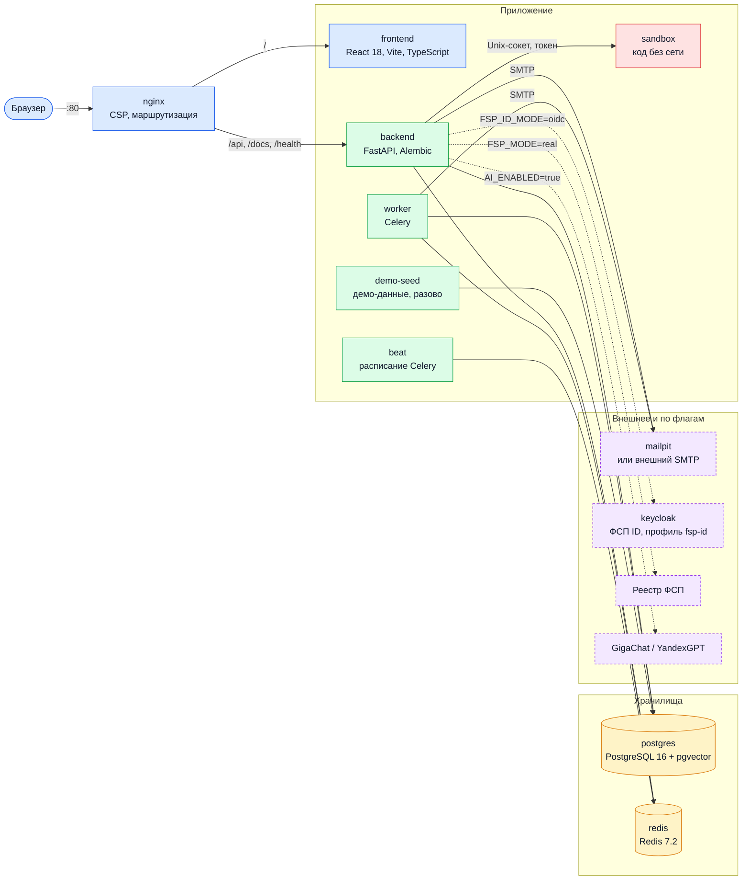
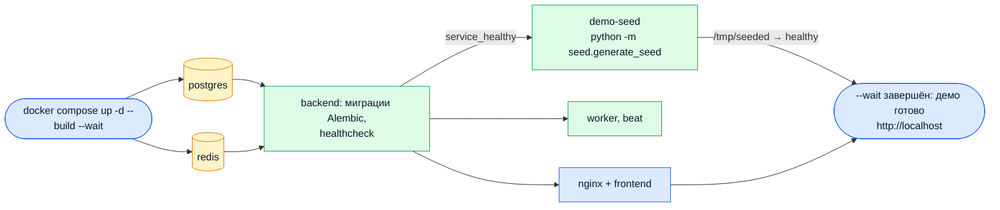

# Архитектурные решения FSP Talent

Здесь коротко собраны наши архитектурные решения. Полное описание лежит в [docs/SOLUTION.md](docs/SOLUTION.md), соответствие заданию разобрано в [docs/REQUIREMENTS.md](docs/REQUIREMENTS.md), а опубликованные числа и команды есть в [README](README.md).

Раздел 6 технического задания — критерии оценки жюри (механика подбора 35 %, тест 25 %, интерфейс 10 %, техника 7 %, документация 6 %, дополнительное 7 %). Это не веса балла кандидата.

## Схема

Состав сервисов совпадает с `docker-compose.yml`: девять контейнеров по умолчанию, Keycloak — с профилем `fsp-id`. На сервере вход принимает Caddy с HTTPS и добавляется контейнер `backup` (`deploy/docker-compose.prod.yml`).

## Тест

Тест решает вопрос «дотягивает ли кандидат до порога грейда», а не ставит балл по всей шкале. Модель IRT 3PL связывает уровень человека, сложность задания и шанс угадать. Уровень после каждого ответа пересчитывается как среднее апостериорного распределения (оценка EAP) на сетке от −4 до 4 с шагом 0,05, исходное предположение — N(0, 1). Следующее задание берётся там, где оно лучше всего разделяет порог заявленного грейда.

Остановка: не раньше 8 заданий и не позже 20. Тест заканчивается, когда обе вероятности (порог и следующий грейд) вышли из интервала 0,10–0,90, либо сработала последовательная проверка гипотез по Томпсону (GLR). У GLR α = 0,10, β = 0,10, ширина зоны δ = 0,25. Статистика Вальда в коде есть, но в остановке не используется. Грейд подтверждается при вероятности порога от 0,75. Уверенный результат выше (от 0,90) только советует отдельный тест на ступень выше и сам грейд не ставит.

Показы ключа: цель 0,40. Среди пяти лучших заданий ключ, который уже показывали чаще цели, берётся с вероятностью цель/доля. Пока истории показов нет, выбор среди этих пяти равномерный. Так ограничивается частота показа одного задания (метод Симпсона–Хеттера); обученная константа этого метода в живую сессию не передаётся.

Пробный проход жюри — 15 заданий и 5 минут, грейд не подтверждает.

```mermaid
flowchart TD
  ST([Старт: заявленный грейд G<br/>априорное N&#40;0, 1&#41;]):::ui --> SEL
  subgraph LOOP["Цикл теста — cat.py"]
    SEL[choose: информация 3PL на активном пороге<br/>× дефицит плана тем × штраф показов]:::core
    SEL --> SH[Симпсон–Хеттер среди 5 лучших<br/>RANDOMESQUE = 5, не больше 5 из семейства]:::core
    SH --> ANS[Ответ кандидата, ввод без вариантов]:::ui
    ANS --> EAP[EAP-апостериор на сетке −4…4, шаг 0,05<br/>p_pass, p_upgrade]:::data
    EAP --> EV{evaluate}
  end
  EV -->|"n < 8 или вероятности в 0,10–0,90"| SEL
  EV -->|"decided: n ≥ 8, обе вне 0,10–0,90"| DEC
  EV -->|"glr: последовательный тест согласен"| DEC
  EV -->|"max_items: n = 20"| DEC
  DEC{p_pass ≥ 0,75?}
  DEC -->|да| OK[Грейд G подтверждён]:::core
  DEC -->|нет| NO[Грейд не подтверждён]:::warn
  OK -.->|"p_upgrade ≥ 0,90"| UP[Совет: отдельный тест на G+1]:::ext
  classDef ui fill:#dbeafe,stroke:#2563eb,color:#0f172a
  classDef core fill:#dcfce7,stroke:#16a34a,color:#0f172a
  classDef data fill:#fef3c7,stroke:#d97706,color:#0f172a
  classDef ext fill:#f3e8ff,stroke:#9333ea,color:#0f172a,stroke-dasharray:4 3
  classDef warn fill:#fee2e2,stroke:#dc2626,color:#0f172a
```

## Подбор

Балл разложен на факторы. Соответствие — взвешенное среднее тех факторов, которые есть у пары потребность — кандидат: недостающий фактор выпадает из числителя и знаменателя.

Соответствие потребности: навыки 0,45, грейд 0,30, роль 0,25, текст запроса 0,05, предметная область 0,05, город и формат вместе 0,05, когда потребность их назвала. Заявленный грейд весит 0,85 от подтверждённого тестом.

Рядом с соответствием стоит доказательство E с весом 0,30: `employer = (fit + 0,30·E·близость) / 1,30`. E = T + 0,5·max(0, F − T), где T — фактор теста, F — нижняя граница оси ФСП: ФСП только поднимает доказательство над тестом и никогда его не опускает, без истории ФСП E = T. Вес умножается на близость к запрошенной категории, поэтому сильный профиль из другой категории не обгоняет подходящий. Нижняя граница оси ФСП грейд не задаёт.

Опубликованная проверка на трёх зёрнах: nDCG@10 0,658 у полной модели и 0,620 у сортировки по резюме. Спирмен порядка внутри категории со скрытой силой 0,374 против 0,011 у резюме. Команда и доверительные интервалы — в README и [docs/VALIDATION_MATCHING.md](docs/VALIDATION_MATCHING.md).

```mermaid
flowchart LR
  subgraph FIT["Соответствие потребности (fit)"]
    SK[навыки 0,45]:::core
    GR[грейд 0,30<br/>заявленный = 0,85 от подтверждённого]:::core
    RO[роль 0,25]:::core
    TX[текст запроса 0,05]:::core
    IN[предметная область 0,05]:::core
    CO[город и формат 0,05]:::core
  end
  subgraph EVD["Доказательство E"]
    TE[тест T]:::data
    FS[нижняя граница оси ФСП F]:::data
    TE --> EE["E = T + 0,5·max&#40;0, F − T&#41;"]:::data
    FS --> EE
  end
  FIT -->|"взвешенное среднее,<br/>нет фактора — выпадает"| FT[fit]:::core
  EE --> SC
  PX[близость к категории]:::ui --> SC
  FT --> SC["employer = &#40;fit + 0,30·E·близость&#41; / 1,30"]:::ui
  SC --> OUT[Подборка: порядок + «Почему в выдаче»]:::ui
  classDef ui fill:#dbeafe,stroke:#2563eb,color:#0f172a
  classDef core fill:#dcfce7,stroke:#16a34a,color:#0f172a
  classDef data fill:#fef3c7,stroke:#d97706,color:#0f172a
  classDef ext fill:#f3e8ff,stroke:#9333ea,color:#0f172a,stroke-dasharray:4 3
  classDef warn fill:#fee2e2,stroke:#dc2626,color:#0f172a
```

## Ось ФСП

Эмпирический Байес: у человека с короткой историей оценка ближе к средней. Методика `v4.1.0`. Вес события падает вдвое за 18 месяцев. Нижняя граница — максимум по подмножествам результатов не длиннее пяти, не больше двух результатов за месяц; участие весит 0. Новое событие никогда не опускает нижнюю границу. Нижняя граница μ − σ (LCB, осторожная оценка уровня) — отдельная ось порядка внутри категории. Статус соревнования не весит. Разряд — факт реестра и в балл не входит.
