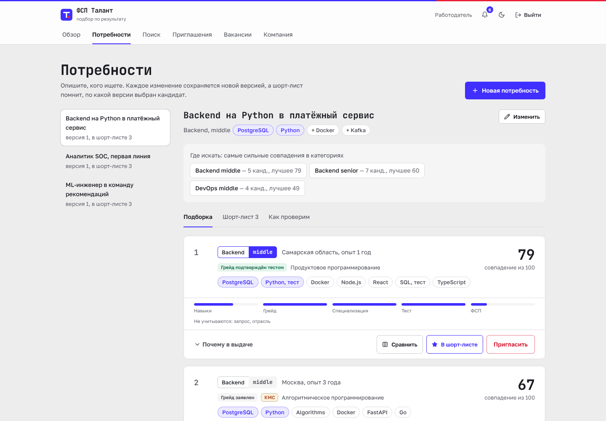
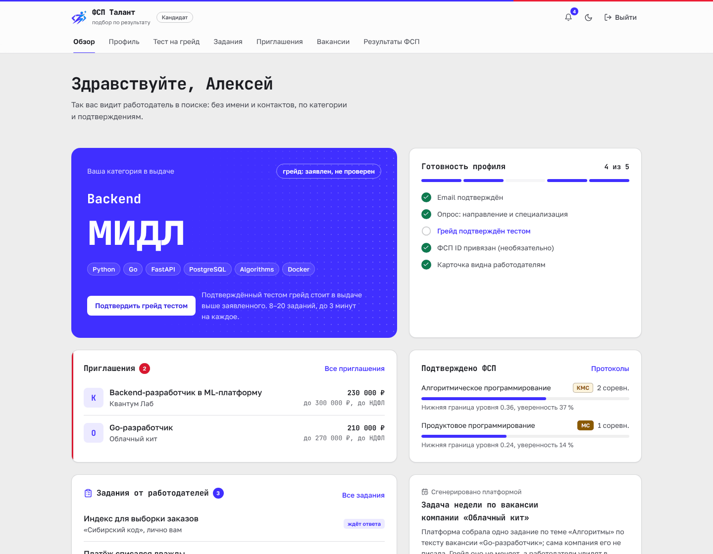
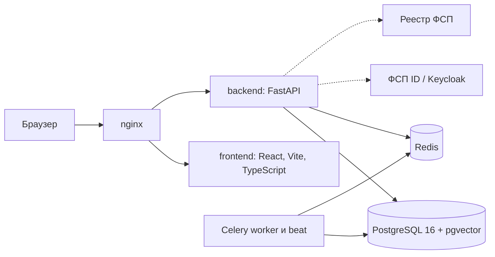

<p align="center">
  
</p>

# ФСП Талант

[](https://github.com/KonkovDV/fsp-talent/actions/workflows/ci.yml)

Платформа обратного найма ИТ-специалистов с подтверждённым профилем (ЛЦТ 2026, кейс Федерации спортивного программирования).

Кандидат входит через ФСП ID или регистрируется по email, проходит опрос и адаптивный тест, и платформа присваивает ему категорию «специализация × грейд». Результаты соревнований ФСП добавляются отдельной подтверждённой осью. Работодатель не ждёт откликов: он описывает потребность, получает подборку, где у каждого места есть объяснение, даёт кандидатам свои задания и сам отправляет приглашение с зарплатной вилкой. Имя и контакты кандидата открываются только после его согласия, дальше стороны переписываются на платформе. Кандидат может закрыть контакты для любой компании.

> **Эксперту за минуту.** Запуск: `make demo` (Windows — [три команды](docs/INSTALL.md#3-запустить-одной-командой)), первый раз 5–10 минут. Сайт http://localhost, API http://localhost/docs, почта http://localhost:8025. Вход работодателя `hr@sibcode.demo`, кандидата `fsp001@demo.talent`, пароль `demo12345`. Документация по разделу 3.4 ТЗ — [docs/SOLUTION.md](docs/SOLUTION.md), она же одним файлом — [PDF](docs/FSP_Talent_documentation.pdf).

<p align="center">
  
</p>

## Содержание

- [Запуск](#запуск)
- [Демо-входы](#демо-входы)
- [Сквозной сценарий из ТЗ 3.3](#сквозной-сценарий-из-тз-33)
- [Как решение отвечает на критерии оценки](#как-решение-отвечает-на-критерии-оценки)
- [Цифры, которые можно проверить](#цифры-которые-можно-проверить)
- [Механика тестирования](#механика-тестирования)
- [Механика подбора](#механика-подбора)
- [Две оси профиля](#две-оси-профиля)
- [ФСП ID и реестр ФСП](#фсп-id-и-реестр-фсп)
- [Персональные данные и безопасность](#персональные-данные-и-безопасность)
- [Архитектура](#архитектура)
- [Что дальше](#что-дальше)
- [Документация](#документация)

## Запуск

Нужны Docker 24+ с Compose 2.17+, 4 ГБ свободной памяти и свободные порты 80 и 8025.

```bash
git clone https://github.com/KonkovDV/fsp-talent.git
cd fsp-talent
make demo
```

<details>
<summary>Windows (PowerShell), без make</summary>

```powershell
git clone https://github.com/KonkovDV/fsp-talent.git
cd fsp-talent
if (-not (Test-Path .env)) { Copy-Item .env.example .env }
docker compose up -d --build --wait
docker compose exec -T -u appuser backend python -m seed.generate_seed
```

</details>

`make demo` создаёт `.env` из примера (править не нужно), собирает и поднимает восемь контейнеров, ждёт проверки здоровья, применяет миграции и загружает демо-данные. Keycloak в этот набор не входит: он нужен только для проверки настоящего ФСП ID.

| Адрес | Что там |
|---|---|
| http://localhost | Кабинеты кандидата и работодателя |
| http://localhost/docs | Swagger UI, спецификация OpenAPI 3.1 |
| http://localhost:8025 | Mailpit: письма с кодами подтверждения и уведомления |

Проверить стенд одной командой: `make check` (регистрация, привязка ФСП ID и вход через ФСП ID, тест, поиск, задания работодателя, приглашение, раскрытие контактов, переписка, закрытие контактов для компании). Порт 80 занят, нет make, что-то не стартует — [подробная инструкция](docs/INSTALL.md) с разделом частых проблем. CI на каждом изменении проходит этот же путь на чистой машине.

## Демо-входы

Пароль у всех `demo12345`. Компании и люди вымышленные.

| Роль | Email | Что показывает |
|---|---|---|
| Работодатель | `hr@sibcode.demo` | Три потребности с подборками, приглашения во всех статусах, две вакансии с откликами, три задания для кандидатов (открытое ждёт проверки) |
| Кандидат | `fsp001@demo.talent` | ФСП ID привязан (вход также «Войти через ФСП ID» → `FSP001` / `test`), результаты из протоколов, ожидающие приглашения с зарплатой, адресное задание от работодателя, задача недели |
| Кандидат | `fsp002@demo.talent` | Информационная безопасность, командные результаты ФСП |
| Кандидат | `nofsp@demo.talent` | Без истории ФСП: категория по опросу и тесту, ничего не теряет в выдаче |

В демо-данных 153 вымышленных кандидата. 40 из них уже прошли адаптивный тест через тот же сервис, что работает в API. У пяти компаний девять вакансий с описаниями, есть одиннадцать приглашений и восемнадцать откликов в разных статусах. У `hr@sibcode.demo` три задания для кандидатов и пять ответов на них. Синтетические кандидаты выбирают разные специализации, поэтому у каждой потребности находятся свои: backend, ML, ИБ, DevOps, встраиваемые системы, инженерия данных.

## Сквозной сценарий из ТЗ 3.3

Шаги идут в том порядке, в каком их требует показать ТЗ. Примерно 10 минут.

| # | Кто | Что сделать | Что увидеть |
|---|---|---|---|
| 1 | Новый кандидат | http://localhost/register: email, пароль, «Мне исполнилось 18 лет», согласия. Код из письма в Mailpit | Регистрация по email с подтверждением (ТЗ 2.2, п. 4). Истории ФСП не нужно |
| 1а | Кандидат через ФСП ID | http://localhost/login → «Войти через ФСП ID», свободный номер из FSP2000–FSP2099, пароль `test` | Единая точка входа: пароль вводится на странице провайдера, затем экран согласий, аккаунт создаётся из реестра. `FSP001` / `test` сразу входит в привязанный аккаунт |
| 2 | Он же | Обзор → опрос: направление и специализация, цель, предметная область (необязательно) | Категория появилась, грейд помечен как заявленный и в подборке стоит ниже подтверждённого |
| 3 | Он же | «Тест на грейд»: уровень и язык кода (Python, JavaScript, Go, Java, Kotlin, C#) | 8–20 заданий, у каждого кандидата свои параметры. Числовой ответ вводится, вариантов нет. В конце — итог по темам и подтверждённый грейд; при уверенном результате выше — предложение отдельного теста на ступень выше |
| 4 | Он же | Профиль → «Войти через ФСП ID», FSP2000–FSP2099, пароль `test` | Вход как в Keycloak (OIDC): пароль вводится на странице провайдера. Результаты из протоколов появляются отдельной осью |
| 5 | Работодатель `hr@sibcode.demo` | Потребности → «Backend на Python в платёжный сервис» | «Где искать»: рекомендованные категории. Подборка по одной оценке соответствия с полосами факторов и «Почему в выдаче» |
| 6 | Он же | Отметить трёх кандидатов «Сравнить»; вкладка «Как проверим» | Факторы рядом, без имён. Доли тем из текста потребности, цитаты и три примера заданий |
| 7 | Он же | Поиск: специализация, грейд, стек, «Только грейд, подтверждённый тестом», «Разряд не ниже» | Поиск по всему банку с фильтрами (ТЗ 2.1) |
| 8 | Он же | Задания → «Платёж списался дважды» → ответ кандидата → «Зачтено» с комментарием; или «Дать задание» в карточке кандидата | Задание пишет работодатель. С эталоном проверяет система, открытое — работодатель. Вердикт появляется строкой в анонимной карточке |
| 9 | Он же | «Пригласить»: роль, вилка до вычета НДФЛ, способ связи | Без вилки приглашение не отправить. Кандидат получает уведомление и письмо |
| 10 | Кандидат `fsp001@demo.talent` | Задания → «Индекс для выборки заказов» → ответить | Адресное задание от работодателя проверено системой сразу, эталон виден только после ответа. Грейд не меняется |
| 11 | Он же | Приглашения → «Принять» → «Переписка» | Компания, вакансия, вилка и профиль компании видны до решения. У работодателя открываются контакты, в журнале доступа — запись. Стороны пишут друг другу в переписке по приглашению |
| 12 | Он же | Вакансии → «Откликнуться»; Обзор → «Задача недели» | Классический отклик со статусами. Короткое задание, собранное платформой из вакансии: грейд не меняет, работодатель видит свежий результат |
| 13 | Он же | Приглашения → «Закрыть контакты для этой компании»; или Профиль → согласия → отозвать согласие | Контакты закрываются сразу: для одной компании (она видит `contacts_revoked`, переписка только для чтения) или для всех |

<p align="center">
  
</p>

## Как решение отвечает на критерии оценки

| Критерий ТЗ 6 | Вес | Что сделано | Где проверить |
|---|---|---|---|
| Новая механика подбора | 35 % | Потребность → рекомендованные категории → подборка с разложимой оценкой и объяснением → приглашение с вилкой → контакты после согласия. Версии потребности не теряют подборку. Сравнение до четырёх кандидатов. Свои задания кандидатам с проверкой системой или вручную, переписка после принятия | Шаги 5–11, [гл. 4](docs/SOLUTION.md#4-механика-подбора-и-категоризация), [проверка подбора](docs/VALIDATION_MATCHING.md) |
| Тестирование, валидация, категоризация | 25 % | Параметрические семейства вместо банка вопросов, IRT 3PL, адаптивный выбор у порога грейда, вводимый ответ, карантин утёкших ключей. Симуляция на 2000 кандидатах со скрытой правдой: точность, повторяемость, различающая сила, устойчивость к утечке | Шаг 3, [гл. 3](docs/SOLUTION.md#3-механика-тестирования), [проверка теста](docs/VALIDATION_ASSESSMENT.md) |
| Удобство интерфейса | 10 % | Дизайн-система «Протокол» по брендбуку ФСП, обе роли без пояснений, светлая и тёмная темы, от 390 px, контраст ключевых пар посчитан по WCAG, axe-core на 15 экранах | [Дизайн-система](docs/DESIGN.md), [проверка интерфейса](docs/DESIGN.md#проверка-интерфейса) |
| Техническая проработка | 7 % | Слои FastAPI, начальная миграция и дополнение с откатом, 777 юнит-тестов, покрытие приложения 68,1 %, сквозная проверка стенда в CI, 40 пользователей без ошибок, OIDC-клиент Keycloak и HTTP-клиент реестра ФСП | [Архитектура](docs/SOLUTION.md#2-компонентная-архитектура), [нагрузка](docs/LOAD_TEST.md) |
| Полнота и документация | 6 % | Все пункты ТЗ 2.1 и 2.2 и ответы постановщика на Q&A, кандидат без истории ФСП, документация по всем восьми пунктам 3.4 | [Матрица требований](docs/REQUIREMENTS.md), [SOLUTION.md](docs/SOLUTION.md) |
| Дополнительный функционал | 7 % | Вакансии и отклики, задания от работодателя и задача недели, пробный тест на стенде, переписка, закрытие контактов для одной компании, мобильная вёрстка, проверка ИНН, лимит приглашений, жалоба с паузой компании, собеседование слотами после принятия, концепция ATS | Шаги 8–13, [защита и ATS](docs/TRUST_AND_ATS.md) |

## Цифры, которые можно проверить

| Что | Результат | Команда (в `backend/` или через `docker compose exec -T backend`) |
|---|---|---|
| Точность решения о грейде вдали от границы (2000 кандидатов) | 91,5 % | `python -m app.validation.assessment --n 2000 --seed 7` |
| Повторная сдача с новыми заданиями, каппа Коэна | 0,47 | та же |
| Различающая сила, медиана r для вводимого ответа | 0,22 | та же |
| Точность при утечке ответов у 30 % кандидатов, с карантином | 91,4 % | та же |
| Ложные сдачи при утечке: без карантина и с ним, на тех же людях | 18,2 % и 13,2 % | та же |
| Случайное угадывание проходит тест | 0 % | та же |
| Итоговый грейд после пути: точно и ±1 | 65,1 % и 98,6 % | та же |
| Максимальная доля показов одного ключа (2000 кандидатов) | 34 % | та же |
| Максимальная доля одного ключа внутри специализации | 69 % | та же |
| Атака «20 чужих сессий»: сдача и честная сдача | 0,0 % и 6,2 % | та же |
| Ошибка модели σ = 0,30: точность вдали от порога и ложные сдачи | 92,8 % и 11,6 % | та же |
| Подбор, nDCG@10 на трёх зёрнах: полная модель и сортировка по резюме | 0,652 и 0,620 | `python -m app.validation.matching` |
| Доля подходящих в первой десятке, P@10 на трёх зёрнах: полная модель и по резюме | 0,632 и 0,559 | та же |
| Порядок внутри категории, Спирмен со скрытой силой: полная модель и по резюме | 0,240 и 0,011 | та же |
| Завышенный грейд в первой десятке: полная модель и по резюме | 19,8 % и 28,1 % | та же |
| Настоящий грейд ниже грейда потребности, первая десятка: полная модель и по резюме | 19,3 % и 30,9 % | та же |
| Ось ФСП, Спирмен со скрытой силой на трёх зёрнах: LCB, среднее место, число строк | 0,707 ± 0,011, 0,681 ± 0,014 и 0,127 ± 0,033 | `python -m app.validation.fsp_axis --seeds 3` |
| Ферма из 40 онлайн-участий и две победы, LCB | 0,01 и 0,54 | та же |
| 40 пользователей одновременно: ошибок, p95 поиска | 0, 69 мс | `make load` |
| Подборка на 10 000 профилях, 2 процесса API, p95 | 360 мс | `python tests/load_api.py --scenario shortlist --seconds 60 --reuse`, банк 10 000 |
| Юнит-тесты (в CI, со всеми компиляторами) | 777 | `python -m pytest tests/unit --collect-only -q` |
| Покрытие приложения, сервисы и API | 68,1 %, 73 % и 40 % | `python -m pytest tests/unit -q --cov=app --cov-report=json --cov-fail-under=65` и `python tests/coverage_lines.py` |
| Покрытие вместе с интеграционными тестами | порог: приложение от 72 %, pipeline и assessment от 60 % | `python tests/integration_coverage.py` |
| Тесты интерфейса | 57 | `npm test` в `frontend/` |
| Проверки Playwright | 67 | `npx playwright test --list` в `frontend/`: 7 сквозных сценариев и 60 проверок доступности |

Методика и полные таблицы: [проверка теста](docs/VALIDATION_ASSESSMENT.md), [проверка подбора](docs/VALIDATION_MATCHING.md), [ось ФСП](docs/FSP_INTEGRATION.md#4-как-результат-становится-доказательством), [нагрузка](docs/LOAD_TEST.md). Жюри может проверить подбор на своей разметке: `python -m app.validation.matching --import pairs.json`.

## Механика тестирования

ТЗ отвергает единый набор заданий (ответы разойдутся) и генерацию нейросетью (сложность несравнима). Мы используем третий путь — **параметрические семейства**: шаблон задания, параметры и код, который вычисляет правильный ответ.

- Каждый кандидат получает новые числа, строки и фрагменты кода, а сложность задаёт уровень семейства. Выученный ответ не подходит.
- Семнадцать семейств с вычисляемым ответом (Python, SQL, JavaScript, алгоритмы, графы, сети, безопасность, ML-метрики, встраиваемые системы, границы и расхождения тестов, метрики и доли аналитика, непокрытые требования и шаги цепочки, пакеты и опоздания в конвейере данных) и пулы вопросов на понимание. Юнит-тест перезапускает каждый фрагмент в Python, Node.js, Go, Java, Kotlin, C# или SQLite и сверяет ключ.
- Если ответ — целое число, его вводят с клавиатуры. Угадать нельзя, и на границе грейда задание даёт в 1,7 раза больше информации, чем выбор из четырёх.
- **IRT 3PL и адаптивный выбор:** следующее задание точнее всего различает уровни у порога заявленного грейда. Тест заканчивается за 8–20 заданий, как только уровень определён с уверенностью 90 %.
- **Решение:** грейд подтверждён при вероятности от 75 %. Тест на уровень подтверждает только этот уровень: если результат уверенно выше (от 90 % за следующий порог), платформа предлагает отдельный тест на ступень выше, но сама грейд не повышает. Подтверждённый грейд не понижается. Не сдали — тест на уровень ниже доступен сразу; пересдача того же уровня — через 7 дней; после смены грейда следующее повышение — через 90 дней.
- **Защита сессии:** правильный ответ не уходит в браузер до конца теста, ответ принимается по HMAC-токену только на текущее задание, время засекает сервер.
- **Защита от утечки:** если доля верных ответов по ключу растёт сверх ожидаемой (z или накопленная сумма избытка), ключ уходит в карантин. Статистика открыта: `GET /api/v1/public/assessment/items`.
- **Пробный проход** на демонстрационном стенде: 15 заданий за 5 минут, нейтральный итог «уровень подтвердился бы или нет» с вероятностью, грейд не подтверждается и в поиске не учитывается. Аккаунты `jury1@demo.talent` … `jury10@demo.talent` проходят и полный тест без пауз.
- **Тест зависит от вакансии:** названные в тексте навыки меняют доли тем. Работодатель видит, какой тест получится, до публикации. Тест по вакансии показывает результат по темам и подтверждает навыки, но грейд не меняет: грейд даёт только основной тест специализации.
- **Регулярные задания пишет работодатель:** с эталоном (число, выбор варианта) ответ проверяет система, открытое задание (скрипт, бизнес-решение) — работодатель. Задание выкладывается для всех кандидатов специализации или даётся одному кандидату из поиска. Вердикт виден в карточке. Дополнительно раз в неделю платформа сама собирает короткую задачу из вакансии его специализации.

Языковая модель во время теста не используется, поэтому сложность сравнима между кандидатами.

## Механика подбора

Работодатель описывает **потребность**: специализация, грейд, обязательные и желательные навыки, предметная область, чем занимается команда. Каждое изменение сохраняется новой версией, отобранные кандидаты помнят, по какой версии их выбрали. Специализация — это направление разработки из ТЗ; предметная область — индустрия компании и в подборе весит слабо.

Порядок выдачи задаёт одна оценка соответствия, которую можно разложить на части (`backend/app/services/matching.py`):

- попадание в список решает соответствие потребности: навыки 0,50, грейд 0,20, специализация 0,20, текст 0,05, предметная область 0,05;
- навык весит по силе доказательства: подтверждён тестом 1,0, найден цитатой в резюме 0,75, заявлен 0,55; грейд без теста — 0,85 от подтверждённого (ожидаемая релевантность грейда проверена и не включена);
- внутри категории выше тот, у кого сильнее тест и протокол ФСП: они добавляются с весом 0,4, и подтверждённый грейд с сильным тестом стоит выше лишнего заявленного навыка; вклад теста и ФСП виден в карточке;
- нет истории ФСП — эта ось не учитывается и не штрафует;
- имя, пол, возраст и регион в оценку не входят.

Под каждой карточкой — строки «плюс / минус / инфо» по факторам, у каждой строки свой код, «лучше N % кандидатов категории», результат последней практики и вердикт по заданию работодателя с давностью. Прошлую версию потребности можно вернуть, отобранные кандидаты остаются. Вилка ниже ожиданий кандидата показывает подсказку и не мешает отправить приглашение.

## Две оси профиля

Грейд и результаты соревнований — разные вещи, и платформа их не смешивает. Грейд подтверждает только основной тест специализации. Результаты ФСП влияют на место внутри категории, но не на грейд. Ось «подтверждено ФСП» считается отдельно, версия методики `v3.2.0` (состав балла тот же, что в `v3.1.0`; изменилась только справка о разряде):

```
q = класс результата по месту и размеру поля N:
    победитель 1,00 · призёр (2–3 место) 0,85 · топ-10 % 0,65 · верхняя половина 0,45 · участие 0
    (победитель и призёр — при N ≥ 6; статус соревнования не учитывается)
w = 2^(-месяцы / 18) / sqrt(размер команды)
в сумму входят 5 событий с наибольшим q·w
μ = (Σ w q + K μ0) / (Σ w + K)            K=2, μ0=0.30
σ = sqrt(0.04 / (Σ w + K))
ранжирование по LCB = μ - σ
```

Федерация посоветовала не ранжировать соревнования по статусу: все соревнования одинаково важны. Поэтому качество результата зависит только от места: победа, призовое место или участие. В подборке по потребности профильная дисциплина входит целиком, а результат другой дисциплины — с весом 0,5. Для безопасности протокол по ИБ важнее протокола по робототехнике. Специализация без профильной дисциплины берёт лучший результат по всем дисциплинам. Это байесовская оценка с нормальным априорным распределением N(0,30; τ²/K) и известной дисперсией наблюдения τ² = 0,04; веса w работают как дробные наблюдения. Ранжирование по нижней границе LCB = μ − σ (около 84 % односторонней уверенности), поэтому один случайный успех не обгоняет стабильную серию. Участие весит 0 и в сумму не поднимает среднее. Из длинного списка берутся пять сильнейших событий. Командный результат снижает вес доказательства и расширяет σ, но не снижает уровень; вклад внутри команды не разделяется. Разряд (МС, КМС, I–III, I–III юношеские) приходит из реестра ФСП вместе с датой и номером приказа. Платформа его не вычисляет из места. В оценку он не входит, фильтр «Разряд не ниже» смотрит на этот факт реестра.

## ФСП ID и реестр ФСП

- **Вход через ФСП ID — OpenID Connect**, поток кода с PKCE, как будет работать Keycloak Федерации. ФСП ID — единая точка входа: кнопка «Войти через ФСП ID» на входе и регистрации, новый человек проходит экран согласий, аккаунт создаётся из реестра; регистрация по email осталась, ФСП ID можно и привязать к готовому аккаунту. Пароль ФСП вводится только на странице провайдера, платформа получает проверенный ID-токен. В демо роль Keycloak играет помеченная страница этого сайта с тем же протоколом. Подключить настоящий ФСП ID — пять настроек в `.env`.
- **Из реестра берём строки протокола и присвоенные разряды:** дисциплина, статус по ЕКП, место, число участников, командность, дата, а также разряд, дата присвоения и номер приказа. Пол, контакты и документы не запрашиваем.
- **Удостоверения:** каждая строка протокола выдаётся как W3C Verifiable Credential 2.0 (`eddsa-jcs-2022`), подпись проверяет любой: `POST /api/v1/public/credentials/verify`.

Схема обмена, контракт реестра и настройка Keycloak: [docs/FSP_INTEGRATION.md](docs/FSP_INTEGRATION.md).

## Персональные данные и безопасность

- Отдельные согласия на обработку (ст. 9 152-ФЗ) и на распространение для публичной страницы (ст. 10.1), в базе — версия и SHA-256 принятого текста.
- Карточка в выдаче анонимна. Контакты — только после принятия приглашения или собственного отклика и при действующем согласии. Каждый просмотр записывается в журнал доступа.
- Отзыв согласия закрывает контакты сразу, через 30 дней данные стираются (ст. 21). Удаление аккаунта стирает их немедленно, вместе с ответами на задания и сообщениями.
- Контакты можно закрыть для одной компании, не отзывая согласие: компания получает 403 `contacts_revoked`, переписка с ней остаётся только для чтения.
- Зарплатная вилка указывается до вычета НДФЛ, это написано у полей.
- Несовершеннолетние скрыты из поиска без согласия законного представителя.
- Пароли — bcrypt, коды подтверждения — только HMAC, ключ подписи токенов уникален для установки. Лимиты на вход, регистрацию, письма, приглашения и поиск.
- Решение о найме принимает человек: платформа ранжирует и объясняет, но не отсеивает.

## Архитектура



Монолит с явными слоями: роутеры API, сервисы предметной области, модели и миграции. Внешние системы (реестр ФСП, ФСП ID, GigaChat, почта) подключены через адаптеры с флагом режима, поэтому демо работает без них. Подробно: [docs/SOLUTION.md](docs/SOLUTION.md#2-компонентная-архитектура).

Стек: Python 3.12, FastAPI, SQLAlchemy 2, Alembic, Celery, PostgreSQL 16, Redis 7.2, React 18, Vite 6, TypeScript, Tailwind CSS. Версии и лицензии всех библиотек — в [гл. 8 документации](docs/SOLUTION.md#8-библиотеки-и-компоненты).

## Что дальше

- Подключить настоящий ФСП ID вместо демо-провайдера (вход и привязка уже идут по OIDC, настройки Keycloak готовы) и реестр по контракту из [FSP_INTEGRATION.md](docs/FSP_INTEGRATION.md). Дельта протоколов уже забирается по расписанию и сдвигается только после успешной обработки.
- Контакты в базе остаются в открытом виде. Шифрование AES-GCM — отдельная миграция, её откроем, когда будет известен срок до дедлайна.
- Задания работодателя: шаблоны и вложения в переписке. Открытый ответ по-прежнему смотрит человек.
- Порог по слабой теме и запись оценённой различимости в банк заданий не включены: на `python -m app.validation.assessment --n 2000 --seed 7` порог роняет точность с 78,5 % до 55,4 %, а оценка различимости увеличивает ошибку с 0,146 до 0,283.
- Получать от ATS работодателей статусы найма и калибровать подбор на реальных исходах ([TRUST_AND_ATS.md](docs/TRUST_AND_ATS.md)).
- Откалибровать трудность заданий по реальным ответам: инструмент готов (`python -m app.validation.calibrate`).
- Короткий адрес публичной страницы кандидата (slug) — когда появится стенд с постоянным именем.
- Уровни доверия к компаниям: проверка по ЕГРЮЛ, домену и отзывам кандидатов.
- Оформление согласия законного представителя в интерфейсе для участников младше 18 лет.
- Перекалибровать подбор на реальных откликах. Веса сейчас зафиксированы до замера.
- Обучать ранжирование на том, кто принял приглашение, только после накопления этих исходов.
- Выдача удостоверений по OID4VCI и вход через ЕСИА — когда появятся контуры ФСП и государства. Сейчас удостоверение подписывается `eddsa-jcs-2022`, вход идёт по OIDC. Выборочное раскрытие отдельных утверждений удостоверения — вместе с OID4VCI.
- Вторая категория у одного человека, если тест подтвердит ещё одну специализацию. Сейчас категория одна. Для второй ячейки нужна отдельная миграция, её откроем после ответа модератора.
- Монитор утечки ключей с поправкой на множество проверок и расходом допустимой ошибки. Сейчас карантин ставит z или CUSUM по ключу.
- Полоса «Тест» в шкале θ, а не только нижняя граница доли верных ответов.
- Правило, при котором ось ФСП только поднимает доказательства, и отдельная цена ошибки ранжирования. Опыт «только подъём» на отложенных зёрнах просел по nDCG и в продукт не вошёл.
- CUSUM по остаткам ответа, а не только по ключу.
- Время ответа как логнормальная величина.
- Глубина банка и поправка стандартной ошибки на зависимость заданий внутри семейства. Она же относится к разрыву повторного решения 2,5 п. п. при пороге приёмки 2 п. п.
- Разброс изоморфов одного ключа.
- Покрытие кода API от 55 %. Сейчас в отчёте покрытия слой API ниже.
- Дизайнеры в справочнике, когда появится объективная проверка портфолио двумя проверяющими по одной рубрике.
- Задачи прошлых соревнований ФСП как дополнительный сигнал, с исключением тех, кто эти задачи уже решал.

## Документация

| Документ | О чём |
|---|---|
| [docs/SOLUTION.md](docs/SOLUTION.md) | Сопроводительная документация по разделу 3.4 ТЗ: архитектура, механики, валидация, интеграция, API, библиотеки |
| [docs/FSP_Talent_documentation.pdf](docs/FSP_Talent_documentation.pdf) | Вся документация одним PDF (п. 5.2 ТЗ) |
| [docs/INSTALL.md](docs/INSTALL.md) | Сборка, развёртывание и локальный запуск, частые проблемы, сценарий на три минуты |
| [docs/pitch.pdf](docs/pitch.pdf) | Презентация для жюри: обязательные слайды шаблона ЛЦТ и слайды решения, у каждой цифры команда. Файл [pitch.pptx](docs/pitch.pptx) собирают `node docs/tools/build_pitch.mjs` и `python3 docs/tools/build_pitch_template.py`, PDF сохраняется из PowerPoint |
| [docs/REQUIREMENTS.md](docs/REQUIREMENTS.md) | Каждое требование ТЗ и ответы постановщика на Q&A: где увидеть и где в коде |
| [docs/VALIDATION_ASSESSMENT.md](docs/VALIDATION_ASSESSMENT.md) | Проверка теста на грейд |
| [docs/VALIDATION_MATCHING.md](docs/VALIDATION_MATCHING.md) | Проверка подбора |
| [docs/LOAD_TEST.md](docs/LOAD_TEST.md) | Нагрузочная проверка |
| [docs/FSP_INTEGRATION.md](docs/FSP_INTEGRATION.md) | ФСП ID (OIDC, Keycloak) и контракт реестра ФСП |
| [docs/TRUST_AND_ATS.md](docs/TRUST_AND_ATS.md) | Защита от фиктивных вакансий, интеграция с ATS |
| [docs/API_ERRORS.md](docs/API_ERRORS.md) | Коды ошибок API |
| [docs/DESIGN.md](docs/DESIGN.md) | Дизайн-система «Протокол» по брендбуку ФСП |
| [deploy/README.md](deploy/README.md) | Публичный стенд с HTTPS и резервными копиями |

Код открыт под лицензией [MIT](LICENSE).
