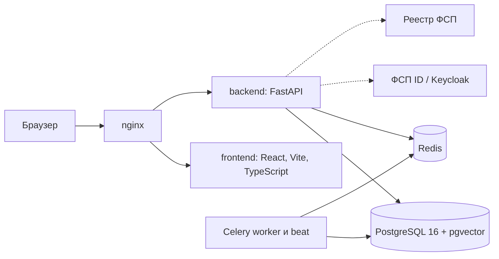

<p align="center">
  
</p>

# ФСП Талант

Платформа обратного найма ИТ-специалистов с подтверждённым профилем (ЛЦТ 2026, кейс Федерации спортивного программирования).

Кандидат проходит опрос и адаптивный тест, и платформа присваивает ему категорию «специализация × грейд». Результаты соревнований ФСП добавляются отдельной подтверждённой осью. Работодатель не ждёт откликов: он описывает потребность, получает подборку, где у каждого места есть объяснение, и сам отправляет приглашение с зарплатной вилкой. Имя и контакты кандидата открываются только после его согласия.

> **Эксперту за минуту.** Запуск: `make demo` (Windows — [три команды](docs/INSTALL.md#3-запустить-одной-командой)), первый раз 5–10 минут. Сайт http://localhost, API http://localhost/docs, почта http://localhost:8025. Вход работодателя `hr@sibcode.demo`, кандидата `fsp001@demo.talent`, пароль `demo12345`. Документация по разделу 3.4 ТЗ — [docs/SOLUTION.md](docs/SOLUTION.md), она же одним файлом — [PDF](docs/FSP_Talent_documentation.pdf).

<p align="center">
  
</p>

## Содержание

- [Запуск](#запуск)
- [Демо-входы](#демо-входы)
- [Сквозной сценарий из ТЗ 3.3](#сквозной-сценарий-из-тз-33)
- [Как решение отвечает на критерии оценки](#как-решение-отвечает-на-критерии-оценки)
- [Цифры, которые можно проверить](#цифры-которые-можно-проверить)
- [Механика тестирования](#механика-тестирования)
- [Механика подбора](#механика-подбора)
- [Две оси профиля](#две-оси-профиля)
- [ФСП ID и реестр ФСП](#фсп-id-и-реестр-фсп)
- [Персональные данные и безопасность](#персональные-данные-и-безопасность)
- [Архитектура](#архитектура)
- [Что дальше](#что-дальше)
- [Документация](#документация)

## Запуск

Нужны Docker 24+ с Compose 2.17+, 4 ГБ свободной памяти и свободные порты 80 и 8025.

```bash
git clone https://github.com/KonkovDV/fsp-talent.git
cd fsp-talent
make demo
```

<details>
<summary>Windows (PowerShell), без make</summary>

```powershell
git clone https://github.com/KonkovDV/fsp-talent.git
cd fsp-talent
if (-not (Test-Path .env)) { Copy-Item .env.example .env }
docker compose up -d --build --wait
docker compose exec -T -u appuser backend python -m seed.generate_seed
```

</details>

`make demo` создаёт `.env` из примера (править не нужно), собирает и поднимает восемь контейнеров, ждёт проверки здоровья, применяет миграции и загружает демо-данные.

| Адрес | Что там |
|---|---|
| http://localhost | Кабинеты кандидата и работодателя |
| http://localhost/docs | Swagger UI, спецификация OpenAPI 3.1 |
| http://localhost:8025 | Mailpit: письма с кодами подтверждения и уведомления |

Проверить стенд одной командой: `make check` (регистрация, привязка ФСП ID, тест, поиск, приглашение, раскрытие контактов). Порт 80 занят, нет make, что-то не стартует — [подробная инструкция](docs/INSTALL.md) с разделом частых проблем. CI на каждом изменении проходит этот же путь на чистой машине.

## Демо-входы

Пароль у всех `demo12345`. Компании и люди вымышленные.

| Роль | Email | Что показывает |
|---|---|---|
| Работодатель | `hr@sibcode.demo` | Три потребности с подборками, приглашения во всех статусах, две вакансии с откликами |
| Кандидат | `fsp001@demo.talent` | ФСП ID привязан, результаты из протоколов, ожидающие приглашения с зарплатой, задача недели |
| Кандидат | `fsp002@demo.talent` | Информационная безопасность, командные результаты ФСП |
| Кандидат | `nofsp@demo.talent` | Без истории ФСП: категория по опросу и тесту, ничего не теряет в выдаче |

В демо-данных 153 вымышленных кандидата. 40 из них уже прошли адаптивный тест через тот же сервис, что работает в API. У пяти компаний девять вакансий с описаниями, есть одиннадцать приглашений и восемнадцать откликов в разных статусах. Синтетические кандидаты выбирают разные специализации, поэтому у каждой потребности находятся свои: backend, ML, ИБ, DevOps, встраиваемые системы.

## Сквозной сценарий из ТЗ 3.3

Шаги идут в том порядке, в каком их требует показать ТЗ. Примерно 7 минут.

| # | Кто | Что сделать | Что увидеть |
|---|---|---|---|
| 1 | Новый кандидат | http://localhost/register: email, пароль, «Мне исполнилось 18 лет», согласия. Код из письма в Mailpit | Регистрация по email с подтверждением (ТЗ 2.2, п. 4). Истории ФСП не нужно |
| 2 | Он же | Обзор → опрос: специализация, отрасль, цель | Категория появилась, грейд помечен как заявленный |
| 3 | Он же | «Тест на грейд»: уровень и язык кода (Python, JavaScript, Go, Java, Kotlin, C#) | 8–20 заданий, у каждого кандидата свои параметры. Числовой ответ вводится, вариантов нет. В конце — итог по темам и подтверждённый грейд |
| 4 | Он же | Профиль → «Войти через ФСП ID», FSP2000–FSP2099, пароль `test` | Вход как в Keycloak (OIDC): пароль вводится на странице провайдера. Результаты из протоколов появляются отдельной осью |
| 5 | Работодатель `hr@sibcode.demo` | Потребности → «Backend на Python в платёжный сервис» | «Где искать»: рекомендованные категории. Подборка по одной оценке соответствия с полосами факторов и «Почему в выдаче» |
| 6 | Он же | Отметить трёх кандидатов «Сравнить»; вкладка «Как проверим» | Факторы рядом, без имён. Доли тем из текста потребности, цитаты и три примера заданий |
| 7 | Он же | Поиск: специализация, грейд, стек, «Только грейд, подтверждённый тестом», «Разряд не ниже» | Поиск по всему банку с фильтрами (ТЗ 2.1) |
| 8 | Он же | «Пригласить»: роль, вилка, способ связи | Без вилки приглашение не отправить. Кандидат получает уведомление и письмо |
| 9 | Кандидат `fsp001@demo.talent` | Приглашения → «Принять» | Компания, вакансия, вилка и профиль компании видны до решения. У работодателя открываются контакты, в журнале доступа — запись |
| 10 | Он же | Вакансии → «Откликнуться»; Обзор → «Задача недели» | Классический отклик со статусами. Короткое задание из вакансии работодателя: грейд не меняет, работодатель видит свежий результат |
| 11 | Он же | Профиль → согласия → отозвать согласие на обработку | Контакты у работодателя закрываются сразу |

<p align="center">
  
</p>

## Как решение отвечает на критерии оценки

| Критерий ТЗ 6 | Вес | Что сделано | Где проверить |
|---|---|---|---|
| Новая механика подбора | 35 % | Потребность → рекомендованные категории → подборка с разложимой оценкой и объяснением → приглашение с вилкой → контакты после согласия. Версии потребности не теряют подборку. Сравнение до трёх кандидатов. Задача недели даёт работодателю свежий сигнал | Шаги 5–9, [гл. 4](docs/SOLUTION.md#4-механика-подбора-и-категоризация), [проверка подбора](docs/VALIDATION_MATCHING.md) |
| Тестирование, валидация, категоризация | 25 % | Параметрические семейства вместо банка вопросов, IRT 3PL, адаптивный выбор у порога грейда, вводимый ответ, карантин утёкших ключей. Симуляция на 2000 кандидатах со скрытой правдой: точность, повторяемость, различающая сила, устойчивость к утечке | Шаг 3, [гл. 3](docs/SOLUTION.md#3-механика-тестирования), [проверка теста](docs/VALIDATION_ASSESSMENT.md) |
| Удобство интерфейса | 10 % | Дизайн-система «Протокол» по брендбуку ФСП, обе роли без пояснений, светлая и тёмная темы, от 390 px, 0 нарушений WCAG 2.2 AA по axe-core | [Дизайн-система](docs/DESIGN.md), [проверка интерфейса](docs/UI_AUDIT_2026-10-06.md) |
| Техническая проработка | 7 % | Слои FastAPI, 21 обратимая миграция, 441 юнит-тест, сквозная проверка стенда в CI, 40 пользователей без ошибок, OIDC-клиент Keycloak и HTTP-клиент реестра ФСП | [Архитектура](docs/SOLUTION.md#2-компонентная-архитектура), [нагрузка](docs/LOAD_TEST.md) |
| Полнота и документация | 6 % | Все пункты ТЗ 2.1 и 2.2, кандидат без истории ФСП, документация по всем восьми пунктам 3.4 | [Матрица требований](docs/REQUIREMENTS.md), [SOLUTION.md](docs/SOLUTION.md) |
| Дополнительный функционал | 7 % | Вакансии и отклики, регулярные задания, мобильная вёрстка, проверка ИНН и лимиты против фиктивных работодателей, концепция ATS | Шаг 10, [защита и ATS](docs/TRUST_AND_ATS.md) |

## Цифры, которые можно проверить

| Что | Результат | Команда (в `backend/` или через `docker compose exec -T backend`) |
|---|---|---|
| Точность решения о грейде вдали от границы (2000 кандидатов) | 92,7 % | `python -m app.validation.assessment --n 2000 --seed 7` |
| Повторная сдача с новыми заданиями, каппа Коэна | 0,48 | та же |
| Различающая сила, медиана r для вводимого ответа | 0,26 | та же |
| Точность при утечке ответов у 30 % кандидатов, с карантином | 88,4 % | та же |
| Случайное угадывание проходит тест | 0 % | та же |
| Подбор против поиска по ключевым словам, nDCG@10 | +0,064 и +0,048 | `python -m app.validation.matching` и `--seed 7` |
| 40 пользователей одновременно: ошибок, p95 поиска | 0, 69 мс | `make load` |
| Юнит-тесты (в CI, со всеми компиляторами) | 441 | `make test` |

Методика и полные таблицы: [проверка теста](docs/VALIDATION_ASSESSMENT.md), [проверка подбора](docs/VALIDATION_MATCHING.md), [нагрузка](docs/LOAD_TEST.md). Жюри может проверить подбор на своей разметке: `python -m app.validation.matching --import pairs.json`.

## Механика тестирования

ТЗ отвергает единый набор заданий (ответы разойдутся) и генерацию нейросетью (сложность несравнима). Мы используем третий путь — **параметрические семейства**: шаблон задания, параметры и код, который вычисляет правильный ответ.

- Каждый кандидат получает новые числа, строки и фрагменты кода, а сложность задаёт уровень семейства. Выученный ответ не подходит.
- Девять семейств с вычисляемым ответом (Python, SQL, JavaScript, алгоритмы, графы, сети, безопасность, ML-метрики, встраиваемые системы) и пулы вопросов на понимание. Юнит-тест перезапускает каждый фрагмент в Python, Node.js, Go, Java, Kotlin, C# или SQLite и сверяет ключ.
- Если ответ — целое число, его вводят с клавиатуры. Угадать нельзя, и на границе грейда задание даёт в 1,7 раза больше информации, чем выбор из четырёх.
- **IRT 3PL и адаптивный выбор:** следующее задание точнее всего различает уровни у порога заявленного грейда. Тест заканчивается за 8–20 заданий, как только уровень определён с уверенностью 90 %.
- **Решение:** грейд подтверждён при вероятности от 75 %, повышение на ступень — от 90 %. Подтверждённый грейд не понижается. Повышение — раз в 90 дней, пересдача того же уровня — через 7 дней.
- **Защита сессии:** правильный ответ не уходит в браузер до конца теста, ответ принимается по HMAC-токену только на текущее задание, время засекает сервер.
- **Защита от утечки:** если доля верных ответов по ключу растёт сверх ожидаемой, ключ уходит в карантин. Статистика открыта: `GET /api/v1/public/assessment/items`.
- **Тест зависит от вакансии:** названные в тексте навыки меняют доли тем. Работодатель видит, какой тест получится, до публикации.
- **Регулярные задания:** раз в неделю платформа предлагает кандидату короткую задачу из вакансии работодателя его специализации.

Языковая модель во время теста не используется, поэтому сложность сравнима между кандидатами.

## Механика подбора

Работодатель описывает **потребность**: специализация, грейд, обязательные и желательные навыки, отрасль, чем занимается команда. Каждое изменение сохраняется новой версией, отобранные кандидаты помнят, по какой версии их выбрали.

Порядок выдачи задаёт одна оценка соответствия, которую можно разложить на части (`backend/app/services/matching.py`):

- попадание в список решает соответствие потребности: навыки 0,50, грейд 0,20, специализация 0,20, текст 0,05, отрасль 0,05;
- навык весит по силе доказательства: подтверждён тестом 1,0, найден цитатой в резюме 0,75, заявлен 0,55;
- среди кандидатов с одинаковым соответствием выше тот, у кого сильнее тест и протокол ФСП;
- нет истории ФСП — эта ось не учитывается и не штрафует;
- имя, пол, возраст и регион в оценку не входят.

Под каждой карточкой — строки «плюс / минус / инфо» по факторам, «лучше N % кандидатов категории» и результат последней практики с давностью.

## Две оси профиля

Грейд и результаты соревнований — разные вещи, и платформа их не смешивает. Грейд подтверждает тест. Ось «подтверждено ФСП» считается отдельно, версия методики `v2.0.0`:

```
p = 1 - (place - 0.5) / N                 процентиль Хазена
q = W(разряд ЕВСК) * p                    качество результата
w = 2^(-месяцы / 18) / sqrt(размер команды)
μ = (Σ w q + K μ0) / (Σ w + K)            K=2, μ0=0.30
σ = sqrt(0.04 / (Σ w + K))
ранжирование по LCB = μ - σ
```

Это байесовская оценка с нормальным априорным распределением N(0,30; τ²/K) и известной дисперсией наблюдения τ² = 0,04; веса w работают как дробные наблюдения. Ранжирование по нижней границе LCB = μ − σ (около 84 % односторонней уверенности), поэтому один случайный успех не обгоняет стабильную серию. Командный результат снижает вес доказательства и расширяет σ, но не снижает уровень. Разряды МС и КМС требуют не меньше шести участников.

## ФСП ID и реестр ФСП

- **Вход через ФСП ID — OpenID Connect**, поток кода с PKCE, как будет работать Keycloak Федерации. Пароль ФСП вводится только на странице провайдера, платформа получает проверенный ID-токен. В демо роль Keycloak играет помеченная страница этого сайта с тем же протоколом. Подключить настоящий ФСП ID — пять настроек в `.env`.
- **Из реестра берём только строки протокола:** дисциплина, статус по ЕКП, место, число участников, командность, дата. Пол, контакты и документы не запрашиваем.
- **Удостоверения:** каждая строка протокола выдаётся как W3C Verifiable Credential 2.0 (`eddsa-jcs-2022`), подпись проверяет любой: `POST /api/v1/public/credentials/verify`.

Схема обмена, контракт реестра и настройка Keycloak: [docs/FSP_INTEGRATION.md](docs/FSP_INTEGRATION.md).

## Персональные данные и безопасность

- Отдельные согласия на обработку (ст. 9 152-ФЗ) и на распространение для публичной страницы (ст. 10.1), в базе — версия и SHA-256 принятого текста.
- Карточка в выдаче анонимна. Контакты — только после принятия приглашения или собственного отклика и при действующем согласии. Каждый просмотр записывается в журнал доступа.
- Отзыв согласия закрывает контакты сразу, через 30 дней данные стираются (ст. 21). Удаление аккаунта стирает их немедленно.
- Несовершеннолетние скрыты из поиска без согласия законного представителя.
- Пароли — bcrypt, коды подтверждения — только HMAC, ключ подписи токенов уникален для установки. Лимиты на вход, регистрацию, письма, приглашения и поиск.
- Решение о найме принимает человек: платформа ранжирует и объясняет, но не отсеивает.

## Архитектура



Монолит с явными слоями: роутеры API, сервисы предметной области, модели и миграции. Внешние системы (реестр ФСП, ФСП ID, GigaChat, почта) подключены через адаптеры с флагом режима, поэтому демо работает без них. Подробно: [docs/SOLUTION.md](docs/SOLUTION.md#2-компонентная-архитектура).

Стек: Python 3.12, FastAPI, SQLAlchemy 2, Alembic, Celery, PostgreSQL 16, Redis 7.2, React 18, Vite 6, TypeScript, Tailwind CSS. Версии и лицензии всех библиотек — в [гл. 8 документации](docs/SOLUTION.md#8-библиотеки-и-компоненты).

## Что дальше

- Подключить настоящий ФСП ID (настройки Keycloak готовы) и реестр по контракту из [FSP_INTEGRATION.md](docs/FSP_INTEGRATION.md), добавить дельта-синхронизацию протоколов.
- Получать от ATS работодателей статусы найма и калибровать подбор на реальных исходах ([TRUST_AND_ATS.md](docs/TRUST_AND_ATS.md)).
- Откалибровать трудность заданий по реальным ответам: инструмент готов (`python -m app.validation.calibrate`).
- Уровни доверия к компаниям: проверка по ЕГРЮЛ, домену и отзывам кандидатов.
- Оформление согласия законного представителя в интерфейсе для участников младше 18 лет.

## Документация

| Документ | О чём |
|---|---|
| [docs/SOLUTION.md](docs/SOLUTION.md) | Сопроводительная документация по разделу 3.4 ТЗ: архитектура, механики, валидация, интеграция, API, библиотеки |
| [docs/FSP_Talent_documentation.pdf](docs/FSP_Talent_documentation.pdf) | Вся документация одним PDF (п. 5.2 ТЗ) |
| [docs/INSTALL.md](docs/INSTALL.md) | Сборка, развёртывание и локальный запуск, частые проблемы |
| [docs/REQUIREMENTS.md](docs/REQUIREMENTS.md) | Каждое требование ТЗ: где увидеть и где в коде |
| [docs/VALIDATION_ASSESSMENT.md](docs/VALIDATION_ASSESSMENT.md) | Проверка теста на грейд |
| [docs/VALIDATION_MATCHING.md](docs/VALIDATION_MATCHING.md) | Проверка подбора |
| [docs/LOAD_TEST.md](docs/LOAD_TEST.md) | Нагрузочная проверка |
| [docs/FSP_INTEGRATION.md](docs/FSP_INTEGRATION.md) | ФСП ID (OIDC, Keycloak) и контракт реестра ФСП |
| [docs/TRUST_AND_ATS.md](docs/TRUST_AND_ATS.md) | Защита от фиктивных вакансий, интеграция с ATS |
| [docs/API_ERRORS.md](docs/API_ERRORS.md) | Коды ошибок API |
| [docs/DESIGN.md](docs/DESIGN.md) | Дизайн-система «Протокол» по брендбуку ФСП |
| [docs/UI_AUDIT_2026-10-06.md](docs/UI_AUDIT_2026-10-06.md) | Проверка интерфейса и доступности |
| [deploy/README.md](deploy/README.md) | Публичный стенд с HTTPS и резервными копиями |

Код открыт под лицензией [MIT](LICENSE).
