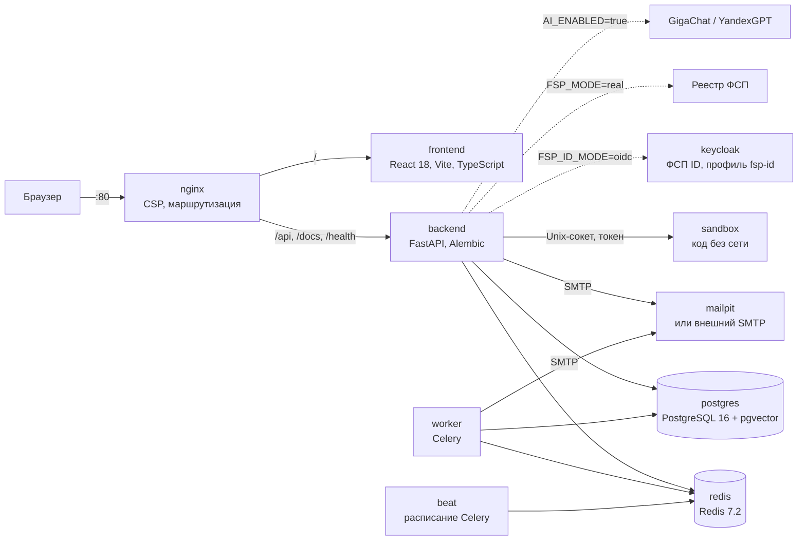

<p align="center">
  
</p>

# ФСП Талант

**Отраслевая платформа подбора ИТ-специалистов с обратной механикой.** Кандидат входит через ФСП ID или по почте, проходит опрос и адаптивный тест и получает категорию «специализация × грейд»: грейд подтверждает только тест, результаты соревнований ФСП стоят отдельной подтверждённой осью и могут только поднять кандидата внутри категории. Работодатель описывает потребность, видит рекомендованные категории и подборку, где у каждого места есть разложение балла и объяснение, и сам отправляет приглашение с вилкой «от–до». Имя и контакты открываются только после согласия кандидата. Кейс Федерации спортивного программирования, ЛЦТ-2026.

| | |
|---|---|
| **Стенд** | https://89-124-65-102.sslip.io — страница для жюри: [/jury](https://89-124-65-102.sslip.io/jury) |
| **Демо-входы** | `jury1@demo.talent` … `jury10@demo.talent`, `hr@sibcode.demo`, `fsp001@demo.talent`; пароль `demo12345` ([все аккаунты](#демо-аккаунты)) |
| **Презентация** | [docs/pitch.pdf](docs/pitch.pdf) |
| **Документация (PDF)** | [docs/FSP_Talent_documentation.pdf](docs/FSP_Talent_documentation.pdf), исходник — [docs/SOLUTION.md](docs/SOLUTION.md) |
| **API** | Swagger UI [/docs](https://89-124-65-102.sslip.io/docs), спецификация [/openapi.json](https://89-124-65-102.sslip.io/openapi.json), снимок в репозитории [docs/openapi.json](docs/openapi.json) |
| **Запуск у себя** | `make demo`, подробно — [docs/INSTALL.md](docs/INSTALL.md) |
| **Руководство пользователя** | [docs/USER_GUIDE.md](docs/USER_GUIDE.md): кандидат, работодатель, жюри, законный представитель |

<p align="center">
  
</p>

## Содержание

- [Для жюри: 5 минут](#для-жюри-5-минут)
- [Демо-аккаунты](#демо-аккаунты)
- [Соответствие ТЗ](#соответствие-тз)
- [Архитектура](#архитектура)
- [Как работают тест, подбор и ось ФСП](#как-работают-тест-подбор-и-ось-фсп)
- [Цифры, которые можно проверить](#цифры-которые-можно-проверить)
- [Персональные данные и безопасность](#персональные-данные-и-безопасность)
- [Быстрый старт](#быстрый-старт)
- [Развёртывание на сервере](#развёртывание-на-сервере)
- [Тесты и проверки](#тесты-и-проверки)
- [Ограничения и демо-режим](#ограничения-и-демо-режим)
- [Сторонние компоненты и лицензии](#сторонние-компоненты-и-лицензии)
- [Команда](#команда)
- [Документация](#документация)

## Для жюри: 5 минут

Всё ниже проходится на стенде https://89-124-65-102.sslip.io без установки. Пароль везде `demo12345`. Удобно открыть три вкладки: кандидат, работодатель и второй кандидат.

| # | Кто | Что сделать | Что увидеть |
|---|---|---|---|
| 1 | Кандидат | [/login](https://89-124-65-102.sslip.io/login) → «Взять свободный аккаунт жюри» (или вручную `jury1@demo.talent`) → войти | Кабинет кандидата с пустым опросом: путь с первого шага. Кнопка берёт тот из `jury1`…`jury10`, в который дольше всех не входили |
| 2 | Он же | «Обзор» → опрос: направление, специализация (например, Backend), грейд, цель | Появилась категория. Грейд помечен как заявленный и в подборке весит 0,85 от подтверждённого |
| 3 | Он же | «Тест на грейд» → «Пробный тест» (до 15 заданий, 5 минут) или полный тест (8–20 заданий) | У каждого кандидата свои числа и фрагменты кода, ответ вводится, вариантов нет. После полного теста — итог по темам и подтверждённый грейд. У аккаунтов жюри паузы между попытками нет |
| 4 | Работодатель | Вторая вкладка: `hr@sibcode.demo` → «Потребности» → «Backend на Python в платёжный сервис» | «Где искать»: рекомендованные категории. Подборка с полосами факторов и «Почему в выдаче». Карточки без имён |
| 5 | Он же | Отметить трёх кандидатов «Сравнить»; затем «Пригласить»: роль, вилка до вычета НДФЛ, способ связи | Без вилки приглашение не отправить. Подсказка показывает, сколько людей добавит другая вилка, и не блокирует отправку |
| 6 | Кандидат с историей ФСП | Третья вкладка: `fsp001@demo.talent` → «Приглашения» → «Принять» у любого ожидающего | Компания, вакансия, вилка и страница компании видны до решения. После принятия этой компании открываются имя и контакты, появляется «Переписка» |
| 7 | Работодатель | `hr@sibcode.demo` → «Приглашения» | Контакты видны только у принятых приглашений, у ожидающих их нет ни в карточке, ни в ответе API. Каждый просмотр контактов записан в журнал доступа |
| 8 | Кандидат | `fsp001`: «Результаты ФСП»; затем выйти и войти кнопкой «Войти через ФСП ID» → `FSP001` / `test` | Строки протоколов стоят отдельной осью и грейд не меняют. Вход по OpenID Connect с PKCE: пароль вводится на странице провайдера |
| 9 | Он же | «Приглашения» → «Закрыть контакты для этой компании» | Компания сразу теряет доступ к контактам (`contacts_revoked`), переписка становится только для чтения |

Полный сценарий из ТЗ 3.3 на 15 шагов (регистрация по почте, задания работодателя, отклик на вакансию, паспорт навыков) — в [руководстве пользователя](docs/USER_GUIDE.md). Без входа на странице [/jury](https://89-124-65-102.sslip.io/jury) открываются методика теста, проверка подписи удостоверения и расчёт подбора на своей разметке ([/evaluate](https://89-124-65-102.sslip.io/evaluate)).

Стенд каждую ночь в 04:10 МСК возвращается в исходное состояние: у `jury1@demo.talent`…`jury10@demo.talent` снова пустой опрос и нет тестов, пароли демо-аккаунтов прежние.

## Демо-аккаунты

Пароль у всех `demo12345`. Компании и люди вымышленные. Самопроверка стенда `make demo-check` сверяет каждую строку таблицы с базой.

| Роль | Вход | Что внутри |
|---|---|---|
| Жюри (кандидат с нуля) | `jury1@demo.talent` … `jury10@demo.talent` | Пустой опрос, дата рождения уже указана. При `DEMO_MODE=true` полный тест проходится без пауз и лимитов попыток, результат сразу попадает в категорию и поиск |
| Работодатель | `hr@sibcode.demo` | Компания «Сибирский код»: три потребности с подборками, приглашения во всех статусах, вакансии с откликами, три задания для кандидатов (одно открытое ждёт проверки). На демо-стенде ему открыты разделы «Модерация» и «Методист» |
| Кандидат с ФСП ID | `fsp001@demo.talent` | ФСП ID привязан, результаты из протоколов, ожидающие приглашения с зарплатой, адресное задание от работодателя, задача недели |
| Кандидат, ИБ | `fsp002@demo.talent` | Информационная безопасность, командные результаты ФСП |
| Кандидат без ФСП | `nofsp@demo.talent` | Категория только по опросу и тесту; отсутствие истории ФСП не штрафуется |
| Вход через ФСП ID | `FSP001` / `test` | Открывает аккаунт `fsp001@demo.talent` |
| Новый человек через ФСП ID | любой из `FSP2000`…`FSP2099` / `test` | Экран согласий, затем аккаунт создаётся из демо-реестра |

В демо-данных 153 вымышленных кандидата. 40 из них уже прошли адаптивный тест через тот же сервис, что работает в API. У пяти компаний девять вакансий с описаниями, есть одиннадцать приглашений и восемнадцать откликов в разных статусах. На демо-стенде есть и «Войти гостем без почты»: пустой аккаунт кандидата или компании на 48 часов, гостя-кандидата нет в поиске.

## Соответствие ТЗ

Короткая сводка по ключевым требованиям. Построчная матрица со статусами и ответами постановщика на Q&A — [docs/REQUIREMENTS.md](docs/REQUIREMENTS.md). Автоматическая проверка без базы: `make accept` ([список проверок](docs/requirements_trace.md)).

| Требование ТЗ | Где реализовано | Как проверить |
|---|---|---|
| Обратная механика: работодатель находит категорию и выходит на кандидата с вакансией и зарплатой (п. 2) | `app/services/matching.py`, `app/api/v1/needs.py`, `app/api/v1/offers.py` | Шаги 4–5 выше |
| Категория «специализация × грейд» по опросу и тесту, а не по резюме (п. 2) | `app/services/survey.py`, `categorization.py`, `assessment.py` | Шаги 2–3 выше |
| Тест устойчив к распространению заданий, сложность сопоставима (п. 2) | `app/items/`, `app/services/cat.py`, `item_monitor.py` | `python -m app.validation.assessment --n 2000 --seed 7`, [проверка теста](docs/VALIDATION_ASSESSMENT.md) |
| Грейд не понижается принудительно, тест ниже или выше, смена ограничена по времени (п. 2) | `app/services/assessment.py` | «Тест на грейд» → история и сроки; `make accept` (FR-04) |
| Регулярные задания от работодателя (п. 2.1) | `app/services/tasks.py`, `app/api/v1/tasks.py` | Работодатель → «Задания», кандидат → «Задания» |
| Профиль из PDF-резюме и стандартный PDF-профиль (п. 2.1) | `app/services/resumes.py`, `pdf_profile.py` | Кандидат → «Профиль» → «Загрузить PDF», «Скачать PDF профиля» |
| Связь с ФСП ID, совместимость с Keycloak, данные реестра ФСП (п. 2) | `app/services/fsp/`, `deploy/keycloak/` | Шаг 8 выше, [FSP_INTEGRATION.md](docs/FSP_INTEGRATION.md) |
| Кандидат без истории ФСП обрабатывается корректно (п. 2) | `combine_evidence` в `app/services/matching.py` | `nofsp@demo.talent`; `make accept` (FR-06, FR-07) |
| Вилка «от–до» в рублях обязательна в вакансии и приглашении (п. 2.2) | `OfferCreate` в `app/api/v1/offers.py`, `VacancyIn` в `vacancies.py` | Шаг 5 выше |
| Контакты только после принятия приглашения или отклика (п. 2.2) | `app/api/v1/offers.py`, `candidates.py`, таблица `access_logs` | Шаги 6–7 выше, `make check` |
| Статусы приглашений и откликов видны обеим сторонам (п. 2.2) | `offers.status`, `applications.status`, `app/services/notify.py` | «Приглашения» и «Вакансии» в обоих кабинетах |
| Регистрация по email с подтверждением (п. 2.2) | `app/services/identity.py` | `/register`, код в Mailpit http://localhost:8025 |
| Документированный API (п. 3) | FastAPI, OpenAPI 3.1, снимок `docs/openapi.json` | `/docs` на стенде; тест `test_openapi_paths.py` сверяет снимок с приложением |
| 152-ФЗ (п. 3) | `app/services/privacy.py`, `guardian.py`, `app/legal/docs/` | Кандидат → «Профиль» → согласия; [раздел ниже](#персональные-данные-и-безопасность) |
| Docker и инструкция по развёртыванию (п. 3) | `docker-compose.yml`, `deploy/docker-compose.prod.yml` | `make demo`, [docs/INSTALL.md](docs/INSTALL.md) |
| Сопроводительная документация по восьми пунктам 3.4 | [docs/SOLUTION.md](docs/SOLUTION.md), PDF | Таблица «пункт ТЗ → глава» в начале SOLUTION.md |
| Собственная процедура валидации и её результаты (п. 2) | `app/validation/` | `make validate`, [цифры ниже](#цифры-которые-можно-проверить) |

### Как решение отвечает на критерии оценки

| Критерий ТЗ 6 | Вес | Что сделано | Где проверить |
|---|---|---|---|
| Новая механика подбора | 35 % | Потребность → рекомендованные категории → подборка с разложимой оценкой и объяснением → приглашение с вилкой → контакты после согласия. Версии потребности не теряют подборку. Сравнение до четырёх кандидатов. Свои задания кандидатам с проверкой системой или вручную, переписка после принятия | Шаги 5–11, [гл. 4](docs/SOLUTION.md#4-механика-подбора-и-категоризация), [проверка подбора](docs/VALIDATION_MATCHING.md) |
| Тестирование, валидация, категоризация | 25 % | Параметрические семейства вместо банка вопросов, IRT 3PL, адаптивный выбор у порога грейда, вводимый ответ, карантин утёкших ключей. Симуляция на 2000 кандидатах со скрытой правдой: точность, повторяемость, различающая сила, устойчивость к утечке | Шаг 3, [гл. 3](docs/SOLUTION.md#3-механика-тестирования), [проверка теста](docs/VALIDATION_ASSESSMENT.md) |
| Удобство интерфейса | 10 % | Дизайн-система «Протокол» по брендбуку ФСП, обе роли без пояснений, светлая и тёмная темы, от 390 px, контраст ключевых пар посчитан по WCAG, axe-core на 15 экранах | [Дизайн-система](docs/DESIGN.md), [проверка интерфейса](docs/DESIGN.md#проверка-интерфейса) |
| Техническая проработка | 7 % | Слои FastAPI, одна начальная миграция с откатом, 1117 юнит-тестов, покрытие приложения 73,1 %, сквозная проверка стенда (smoke API и Playwright), 40 пользователей без ошибок, OIDC-клиент Keycloak и HTTP-клиент реестра ФСП | [Архитектура](docs/SOLUTION.md#2-компонентная-архитектура), [нагрузка](docs/LOAD_TEST.md) |
| Полнота и документация | 6 % | Все пункты ТЗ 2.1 и 2.2 и ответы постановщика на Q&A, кандидат без истории ФСП, документация по всем восьми пунктам 3.4 | [Матрица требований](docs/REQUIREMENTS.md), [SOLUTION.md](docs/SOLUTION.md) |
| Дополнительный функционал | 7 % | Вакансии и отклики, задания от работодателя и задача недели, пробный тест на стенде, переписка, закрытие контактов для одной компании, мобильная вёрстка, проверка ИНН, лимит приглашений, жалоба с паузой компании, собеседование слотами после принятия, концепция ATS. Паспорт навыков по ссылке и QR-коду, мнение ИИ по карточке (балл не меняет), задачи с кодом в песочнице без сети, избранное компании, до трёх резюме у кандидата, гостевой вход на демо-стенде | Шаги 8–15, [защита и ATS](docs/TRUST_AND_ATS.md) |


## Архитектура

Состав сервисов совпадает с `docker-compose.yml`. Девять контейнеров поднимаются по умолчанию, Keycloak — только с профилем `fsp-id`. На сервере вместо nginx вход принимает Caddy с HTTPS, и добавляется контейнер ночного резервного копирования (`deploy/docker-compose.prod.yml`).



Монолит с явными слоями: роутеры API (`app/api/v1/`) проверяют права и формат, предметная логика живёт в сервисах (`app/services/`), модели и миграции отвечают за хранение. Внешние системы (реестр ФСП, ФСП ID, языковая модель, почта) подключены через адаптеры с флагом режима, поэтому стенд работает без них. Пунктир на схеме — внешние системы, которые включаются настройкой. Подробно: [docs/SOLUTION.md](docs/SOLUTION.md#2-компонентная-архитектура), коротко о ключевых решениях — [ARCHITECTURE.md](ARCHITECTURE.md).

Стек: Python 3.12, FastAPI, SQLAlchemy 2, Alembic, Celery, PostgreSQL 16, Redis 7.2, React 18, Vite 6, TypeScript, Tailwind CSS.

## Как работают тест, подбор и ось ФСП

### Тест на грейд

ТЗ отвергает единый набор заданий (ответы разойдутся) и генерацию нейросетью (сложность несравнима). Решение — **параметрические семейства**: шаблон задания, параметры и код, который вычисляет правильный ответ.

- Каждый кандидат получает новые числа, строки и фрагменты кода, а сложность задаёт уровень семейства. Выученный ответ не подходит: ключ чужого экземпляра того же семейства сдаёт 0 %.
- Семнадцать семейств с вычисляемым ответом и пулы вопросов на понимание. Юнит-тест перезапускает каждый фрагмент в Python, Node.js, Go, Java, Kotlin, C# или SQLite и сверяет ключ.
- Целочисленный ответ вводится с клавиатуры: угадать нельзя, и на границе грейда такое задание даёт в 1,7 раза больше информации, чем выбор из четырёх.
- **IRT 3PL и адаптивный выбор:** следующее задание точнее всего различает уровни у порога заявленного грейда. Тест заканчивается за 8–20 заданий, как только уровень определён с уверенностью 90 %.
- **Решение:** грейд подтверждён при вероятности от 75 %. Уверенный результат выше (от 90 % за следующий порог) только предлагает отдельный тест на ступень выше. Подтверждённый грейд не понижается. Не сдали — тест на уровень ниже доступен сразу, пересдача того же уровня — через 7 дней, следующее повышение после смены грейда — через 90 дней.
- **Защита сессии и банка:** правильный ответ не уходит в браузер до конца теста, ответ принимается по HMAC-токену только на текущее задание, время засекает сервер. Ключ, доля верных ответов по которому растёт сверх ожидаемой (z или накопленная сумма), уходит в карантин; статистика открыта: `GET /api/v1/public/assessment/items`.
- **Регулярные задания пишет работодатель:** с эталоном ответ проверяет система, открытое задание — работодатель. Вердикт виден в карточке и грейд не меняет. Раз в неделю платформа сама собирает короткую задачу из вакансии специализации кандидата.

Во время теста языковая модель не вызывается: сложность у всех измеряется одной шкалой. Подробно: [SOLUTION.md, гл. 3](docs/SOLUTION.md#3-механика-тестирования).

### Подбор

Работодатель описывает **потребность**: специализация, грейд, обязательные и желательные навыки, предметная область, чем занимается команда. Каждое изменение сохраняется новой версией, отобранные кандидаты помнят, по какой версии их выбрали.

Порядок выдачи задаёт одна оценка, которую можно разложить на части (`backend/app/services/matching.py`):

```
fit       = взвешенное среднее названных факторов потребности:
            навыки 0,50 · грейд 0,20 · специализация 0,20 · текст 0,05 · предметная область 0,05 · город и формат 0,05
            (фактор, которого потребность не называет, выпадает, остальные веса перенормируются)
E         = T + 0,5 · max(0, F − T)        T — фактор теста, F — фактор оси ФСП (FSP_LIFT = "boost")
            нет истории ФСП → E = T;  нет теста → E = F
employer  = (fit + 0,40 · E · близость) / (1 + 0,40)
итог      = гармоническое среднее employer и вероятности, что кандидат примет вилку (если вилку назвали обе стороны),
            минус шаг 0,02 за каждое открытое приглашение сверх двух (не больше 0,10)
```

- Навык весит по силе доказательства: подтверждён тестом 1,0, найден цитатой в резюме 0,75, заявлен 0,55. Заявленный грейд весит 0,85 от подтверждённого.
- «Близость» — насколько кандидат совпадает с запрошенной специализацией и грейдом. Поэтому сильный профиль из другой категории не обгоняет подходящий, а внутри категории выше тот, у кого сильнее тест и протокол ФСП.
- Ось ФСП может только поднять оценку над тестом: привязка ФСП ID никогда не опускает кандидата (property-тест `tests/unit/test_fsp_lift_property.py`). Нет истории ФСП — ось не учитывается и не штрафует.
- Имя, пол, возраст и регион в оценку не входят.

Под каждой карточкой — строки «плюс / минус / инфо» по факторам с кодом причины, «лучше N % кандидатов категории», результат последней практики и вердикт по заданию работодателя. Подробно: [SOLUTION.md, гл. 4](docs/SOLUTION.md#4-механика-подбора-и-категоризация).

### Ось «подтверждено ФСП»

Грейд и результаты соревнований — разные вещи, и платформа их не смешивает. Грейд подтверждает только основной тест специализации. Результаты ФСП влияют на место внутри категории, но не на грейд. Ось «подтверждено ФСП» считается отдельно, версия методики `v4.1.0` (с 11.10.2026: участие не входит в балл, нижняя граница — лучшее подмножество, поэтому ось монотонна: новый результат никогда не понижает оценку):

```
q = класс результата по месту и размеру поля N:
    победитель 1,00 · призёр (2–3 место) 0,85 · топ-10 % 0,65 · верхняя половина 0,45 · участие 0
    (победитель и призёр — при N ≥ 6; статус соревнования не учитывается)
w = 2^(-месяцы / 18) / sqrt(размер команды) · (1 − e^(−N/30))
не больше 2 результатов в месяц на дисциплину (сильнейшие)
в сумму входят только события с результатом (q > 0); участие учитывается в профиле, но не в балле
μ = (Σ w q + K μ0) / (Σ w + K)            K=2, μ0=0.30
σ = sqrt(0.04 / (Σ w + K))
LCB = max по подмножествам до 5 событий (μ − σ); пустое подмножество — нижняя граница
ранжирование по LCB
```

Федерация посоветовала не ранжировать соревнования по статусу: все соревнования одинаково важны. Поэтому качество результата зависит только от места: победа, призовое место или участие. В подборке по потребности профильная дисциплина входит целиком, а результат другой дисциплины — с весом 0,5. Для безопасности протокол по ИБ важнее протокола по робототехнике. Специализация без профильной дисциплины берёт лучший результат по всем дисциплинам. Это байесовская оценка с нормальным априорным распределением N(0,30; τ²/K) и известной дисперсией наблюдения τ² = 0,04; веса w работают как дробные наблюдения. Ранжирование по нижней границе LCB = μ − σ. Это консервативная оценка, а не доверительный уровень: выбор лучшего подмножества смещает её вверх, поэтому процент уверенности мы не указываем. Поэтому один случайный успех не обгоняет стабильную серию. Участие весит 0 и в балл не входит: оно не поднимает и не опускает оценку, ферма участий равна пустой истории. Из результатов берётся подмножество до пяти событий с наибольшей нижней границей, поэтому добавленный результат не может понизить LCB (property-тест `tests/unit/test_fsp_engine_monotone.py`). Вес результата растёт с размером поля N как 1 − e^(−N/30): место среди 6 весит около пятой доли места среди 200. В пул идут не больше двух результатов за календарный месяц. Любое число призовых мест в полях по 6 человек остаётся ниже одной победы среди 200 (`tests/unit/test_fsp_small_field.py`). Командный результат снижает вес доказательства и расширяет σ, но не снижает уровень; вклад внутри команды не разделяется. Разряд (МС, КМС, I–III, I–III юношеские) приходит из реестра ФСП вместе с датой и номером приказа. Платформа его не вычисляет из места. В оценку он не входит, фильтр «Разряд не ниже» смотрит на этот факт реестра.


Вход через ФСП ID — OpenID Connect с PKCE, как в Keycloak Федерации; подключение настоящего провайдера — пять настроек в `.env`. Из реестра берутся строки протокола и присвоенные разряды; пол, контакты и документы не запрашиваются. Каждая строка протокола выдаётся как W3C Verifiable Credential 2.0 (`eddsa-jcs-2022`), подпись проверяет любой: `POST /api/v1/public/credentials/verify`. Схема обмена и контракт реестра: [docs/FSP_INTEGRATION.md](docs/FSP_INTEGRATION.md).

## Цифры, которые можно проверить

| Что | Результат | Команда (в `backend/` или через `docker compose exec -T backend`) |
|---|---|---|
| Точность решения о грейде вдали от границы (2000 кандидатов) | 91,5 % | `python -m app.validation.assessment --n 2000 --seed 7` |
| Повторная сдача с новыми заданиями, каппа Коэна | 0,47 | та же |
| Зона неопределённости (решение в пределах SE от порога): доля и тот же итог на повторе у уверенных и пограничных; зерно 7 и отложенные 201–205 | 28,2 %; 79,5 % (ДИ 76,5–82,5 %) и 58,5 %; на 201–205 — 30,4 %, 82,2 % и 59,3 % в среднем. Целевой порог для уверенных решений — 85 % | та же, `--seed 201` … `205` |
| Различающая сила, медиана r для вводимого ответа | 0,22 | та же |
| Точность при утечке ответов у 30 % кандидатов, с карантином | 91,4 % | та же |
| Ложные сдачи при утечке: без карантина и с ним, на тех же людях | 18,2 % и 13,2 % | та же |
| Случайное угадывание проходит тест | 0 % | та же |
| Итоговый грейд после пути: точно и ±1 | 65,8 % и 98,8 % | та же |
| Максимальная доля показов одного ключа (2000 кандидатов) | 34 % | та же |
| Максимальная доля одного ключа внутри специализации | 69 % | та же |
| Атака «20 чужих сессий»: сдача и честная сдача | 0,0 % и 6,2 % | та же |
| Ошибка модели σ = 0,30: точность вдали от порога и ложные сдачи | 92,8 % и 11,6 % | та же |
| Подбор, nDCG@10 на трёх зёрнах: полная модель и сортировка по резюме | 0,649 и 0,620 | `python -m app.validation.matching` |
| Подбор, nDCG@10: строка «без теста и без ФСП» (парная Δ полной модели −0,012…−0,026, значима на 2 зёрнах из 3; вклад теста и ФСП — порядок внутри категории и меньше завышенных грейдов, строки ниже) | 0,669 | та же |
| Эксперимент (не в продукте): ранжирование по ожидаемому выигрышу, отложенные зёрна 5001–5010 по предрегистрации. Полная минус своя абляция: Δ nDCG@10 +0,0052 (95 % ДИ +0,0007…+0,0097, p 0,022). Цена: Спирмен в категории 0,140 против 0,231 у продукта, завышенный грейд 25,2 % против 21,2 %. При генераторе без завышения выигрыш исчезает (−0,014) | 0,693 | `python -m app.validation.expected_gain --holdout` |
| Доля подходящих в первой десятке, P@10 на трёх зёрнах: полная модель и по резюме | 0,632 и 0,559 | та же |
| Порядок внутри категории, Спирмен со скрытой силой: полная модель и по резюме | 0,236 и 0,011 | та же |
| Завышенный грейд в первой десятке: полная модель и по резюме | 20,1 % и 28,1 % | та же |
| Настоящий грейд ниже грейда потребности, первая десятка: полная модель и по резюме | 19,5 % и 30,9 % | та же |
| Ось ФСП, Спирмен со скрытой силой на трёх зёрнах: LCB, среднее место, число строк | 0,768 ± 0,002, 0,681 ± 0,014 и 0,127 ± 0,033 | `python -m app.validation.fsp_axis --seeds 3` |
| Ферма из 40 онлайн-участий и две победы, LCB (0,16 = пустая история: участие добавляет ровно 0) | 0,16 и 0,54 | та же |
| 40 пользователей одновременно: ошибок, p95 поиска | 0, 69 мс | `make load` |
| Подборка на 10 000 профилях, 2 процесса API, p95 | 360 мс | `python tests/load_api.py --scenario shortlist --seconds 60 --reuse`, банк 10 000 |
| Юнит-тесты (в CI, со всеми компиляторами) | 1117 | `python -m pytest tests/unit --collect-only -q` |
| Покрытие приложения, сервисы и API | 73,1 %, 75 % и 61 % (Python 3.12, допуск ±0,5 п. п.) | `python -m pytest tests/unit -q --cov=app --cov-report=json --cov-fail-under=65` и `python tests/coverage_lines.py` |
| Покрытие вместе с интеграционными тестами | порог: приложение от 72 %, pipeline и assessment от 60 % | `python tests/integration_coverage.py` |
| Тесты интерфейса | 110 | `npm test` в `frontend/` |
| Проверки Playwright | 67 | `npx playwright test --list` в `frontend/`: 7 сквозных сценариев и 60 проверок доступности |

Методика и полные таблицы: [проверка теста](docs/VALIDATION_ASSESSMENT.md), [проверка подбора](docs/VALIDATION_MATCHING.md), [ось ФСП](docs/FSP_INTEGRATION.md#4-как-результат-становится-доказательством), [нагрузка](docs/LOAD_TEST.md). Жюри может проверить подбор на своей разметке: `python -m app.validation.matching --import pairs.json`.

Сквозные сценарии Playwright (`frontend/e2e/journeys.spec.ts`) сами читают код подтверждения из Mailpit на http://localhost:8025: регистрация, письмо, вход. Почта наружу не уходит. Запуск: `npx playwright test e2e/journeys.spec.ts` в `frontend/` при поднятом `make demo`.

## Персональные данные и безопасность

- Отдельные согласия на обработку (ст. 9 152-ФЗ) и на распространение для публичной страницы (ст. 10.1), в базе — версия и SHA-256 принятого текста.
- Карточка в выдаче анонимна. Контакты — только после принятия приглашения или собственного отклика и при действующем согласии. Каждый просмотр записывается в журнал доступа.
- Отзыв согласия закрывает контакты сразу, через 30 дней данные стираются (ст. 21). Удаление аккаунта стирает их немедленно, вместе с ответами на задания и сообщениями. Контакты можно закрыть и для одной компании: она получает 403 `contacts_revoked`.
- Кандидат 15–17 лет попадает в поиск только после согласия законного представителя по подписанной ссылке (ч. 6 ст. 9).
- Зарплатная вилка указывается до вычета НДФЛ, это написано у полей.
- Пароли — Argon2id (параметры OWASP; старый хеш bcrypt при входе проверяется и сразу переписывается), коды подтверждения хранятся только как HMAC, ключ подписи токенов уникален для установки. Лимиты на вход, регистрацию, письма, приглашения и поиск; при недоступном хранилище лимитов вход закрывается.
- Контакты в базе зашифрованы AES-256-GCM. Строки закрыты политиками PostgreSQL (RLS): на сервере API, worker и beat входят ролью `fsp_app` без прав суперпользователя и без `BYPASSRLS`. Обход всех маршрутов с чужим идентификатором в `tests/smoke_api.py`: 0 ответов 2xx из 240 запросов.
- Решение о найме принимает человек: платформа ранжирует и объясняет, но не отсеивает (ст. 16).
- Языковая модель (GigaChat или YandexGPT, только российские облака) получает обезличенный текст и предлагает навыки с дословной цитатой из резюме. Балл, порядок выдачи и грейд она не меняет. Без ключа или при сбое модели резюме разбирается правилами.
- Пульт модерации закрывается вторым фактором (TOTP, RFC 6238). Код кандидата выполняется в контейнере `sandbox` без сети, с корнем только для чтения и лимитами памяти, процессора и времени.

Полный разбор и сверка с OWASP ASVS: [SOLUTION.md, гл. 10](docs/SOLUTION.md#10-безопасность-и-152-фз).

## Быстрый старт

Нужны Docker 24+ с Compose 2.17+, 4 ГБ свободной памяти и свободные порты 80 и 8025. Видеокарта не используется.

```bash
git clone https://github.com/KonkovDV/fsp-talent.git
cd fsp-talent
make demo
```

<details>
<summary>Windows (PowerShell), без make</summary>

```powershell
git clone https://github.com/KonkovDV/fsp-talent.git
cd fsp-talent
if (-not (Test-Path .env)) { Copy-Item .env.example .env }
docker compose up -d --build --wait
docker compose exec -T -u appuser backend python -m seed.generate_seed
```

Те же шаги одной командой: `powershell -ExecutionPolicy Bypass -File scripts\start-local.ps1`.

</details>

`make demo` создаёт `.env` из примера (править не нужно), собирает и поднимает девять контейнеров, ждёт проверки здоровья, применяет миграции и загружает демо-данные. Первый запуск занимает 5–10 минут.

| Адрес | Что там |
|---|---|
| http://localhost | Кабинеты кандидата и работодателя, страница жюри `/jury` |
| http://localhost/docs | Swagger UI, спецификация OpenAPI 3.1 |
| http://localhost:8025 | Mailpit: письма с кодами подтверждения и уведомления |
| http://localhost/health | Состояние и коммит сборки (поле `build`) |

Порт 80 занят, нет make или что-то не стартует — [docs/INSTALL.md](docs/INSTALL.md), раздел частых проблем.

## Развёртывание на сервере

Сервер с Docker и открытыми портами 80 и 443; домен не нужен — подходит адрес вида `203-0-113-10.sslip.io`.

```bash
cp deploy/.env.example deploy/.env      # заполнить SITE_ADDRESS, SECRET_KEY, POSTGRES_PASSWORD, APP_DB_PASSWORD, SANDBOX_TOKEN, SMTP_*
GIT_SHA=$(git rev-parse HEAD) docker compose -f deploy/docker-compose.prod.yml --env-file deploy/.env up -d --build
docker compose -f deploy/docker-compose.prod.yml --env-file deploy/.env exec -T -u appuser backend python -m seed.generate_seed
curl https://<SITE_ADDRESS>/health
```

Caddy сам получает сертификат Let's Encrypt, контейнер `backup` каждую ночь делает `pg_dump` и хранит 14 копий. Обязательные ключи `.env`, обновление, откат и восстановление из копии: [docs/INSTALL.md](docs/INSTALL.md), раздел 11.

## Тесты и проверки

| Что | Команда |
|---|---|
| Требования ТЗ без базы (38 проверок) | `make accept` |
| Самопроверка демо-данных | `make demo-check` |
| Сквозной сценарий API на запущенном стенде | `make check` (печатает `SMOKE OK`) |
| Юнит-тесты | `make test` |
| Стиль Python | `make lint` |
| Тест и подбор на синтетике, с порогами | `make validate` |
| Нагрузка: 40 пользователей минуту | `make load` |
| Интерфейс | `npm test` и `npx playwright test` в `frontend/` |
| Числа документации против свежего прогона | `python tests/doc_numbers.py` в `backend/` |

Перед каждым слиянием в `main` проходит полный локальный гейт: ruff, юнит-тесты, `doc_numbers`, сборка и тесты интерфейса, миграции вверх, вниз и снова вверх, интеграционные тесты на PostgreSQL, сид, `demo_check` и `make check`. Тот же путь записан в `.github/workflows/ci.yml`; запуски GitHub Actions в аккаунте сейчас недоступны по биллингу, поэтому зелёный результат фиксируется журналом локального гейта.

## Ограничения и демо-режим

- **Качество измерено на синтетике со скрытой правдой.** Так можно посчитать точность грейда и порядок выдачи, чего нельзя сделать на живых данных без разметки. Калибровка трудностей и весов на настоящих ответах и откликах — `python -m app.validation.calibrate`. Подбор на своей разметке жюри проверяет на [/evaluate](https://89-124-65-102.sslip.io/evaluate) или командой `python -m app.validation.matching --import pairs.json`.
- **ФСП ID и реестр ФСП работают в режиме имитации** с тем же протоколом: OIDC с PKCE и контракт реестра из [FSP_INTEGRATION.md](docs/FSP_INTEGRATION.md). Переход на Keycloak Федерации — пять настроек в `.env`, на HTTP-клиент реестра — `FSP_MODE=real`.
- **Публичный стенд — процессор и 8 ГБ.** Смысловой поиск по эмбеддингам и локальная модель пары там выключены; локально они включаются аргументом сборки `INSTALL_RERANKER=1`.
- **Локализация ПДн (ч. 5 ст. 18 152-ФЗ)** обеспечивается местом установки; демонстрационный стенд её не обещает.
- Проверка компании по ЕГРЮЛ, вход через ЕСИА и выдача удостоверений в кошелёк по OID4VCI подключаются на контурах Федерации и государства; формат удостоверений (`eddsa-jcs-2022`) менять для этого не придётся.

Демо-режим (`DEMO_MODE=true`) включён только на стенде для жюри:

| На демо-стенде | В установке для настоящих пользователей (`DEMO_MODE=false`) |
|---|---|
| Аккаунты `jury1@demo.talent`…`jury10@demo.talent` проходят полный тест без пауз и лимитов попыток; кнопка «Взять свободный аккаунт жюри» (`GET /api/v1/public/jury-free`) | Обычные правила: пересдача уровня через 7 дней, повышение после смены грейда через 90 дней; эндпоинт выключен |
| Пробный тест: до 15 заданий за 5 минут, грейд не подтверждает | Нет |
| «Войти гостем без почты» на 48 часов | Нет |
| Вход через ФСП ID — помеченная страница провайдера на этом сайте (`FSP_ID_MODE=mock`) | Keycloak Федерации (`FSP_ID_MODE=oidc`); имитация без `DEMO_MODE` не запускается |
| Без почтовой учётки код подтверждения показывается на экране тому, кто регистрируется (`DEMO_SHOW_CODE=true`) | Код только в письме |
| Ночной сброс стенда в 04:10 МСК (`DEMO_RESET_CRON`) | Нет |
| Разделы «Модерация» и «Методист» открыты работодателю `hr@sibcode.demo` | Только сотрудникам с правами методиста |

## Сторонние компоненты и лицензии

Решение собрано только из открытого ПО; собственный код — под лицензией [MIT](LICENSE). Библиотеки backend и frontend с версиями из `backend/requirements.lock` и `frontend/package-lock.json`, образы контейнеров и прочие материалы (шрифты, Swagger UI, брендбук ФСП) перечислены в [docs/THIRD_PARTY.md](docs/THIRD_PARTY.md) и в [SOLUTION.md, гл. 8](docs/SOLUTION.md#8-библиотеки-и-компоненты). Демо-компании, люди и вакансии вымышлены.

## Команда

<!-- TODO(владелец): название команды, состав как в заявке на ЛЦТ-2026, роли и контакты (только с согласия участников). Не заполнять за участников. -->

Состав команды, роли и контакты указаны в заявке на участие.

Репозиторий: [KonkovDV/fsp-talent](https://github.com/KonkovDV/fsp-talent).

## Документация

| Документ | О чём |
|---|---|
| [docs/SOLUTION.md](docs/SOLUTION.md) | Сопроводительная документация по восьми пунктам раздела 3.4 ТЗ: архитектура, механики, валидация, интеграция, API, библиотеки |
| [docs/FSP_Talent_documentation.pdf](docs/FSP_Talent_documentation.pdf) | Вся документация одним PDF |
| [docs/USER_GUIDE.md](docs/USER_GUIDE.md) | Руководство пользователя стенда: кандидат, работодатель, жюри, законный представитель |
| [docs/INSTALL.md](docs/INSTALL.md) | Локальный запуск, развёртывание на сервере, обновление, откат, резервные копии, частые проблемы |
| [docs/pitch.pdf](docs/pitch.pdf) | Презентация для жюри |
| [docs/REQUIREMENTS.md](docs/REQUIREMENTS.md) | Каждое требование ТЗ и ответы постановщика на Q&A: где увидеть и где в коде |
| [docs/VALIDATION_ASSESSMENT.md](docs/VALIDATION_ASSESSMENT.md) | Проверка теста на грейд |
| [docs/VALIDATION_MATCHING.md](docs/VALIDATION_MATCHING.md) | Проверка подбора |
| [docs/LOAD_TEST.md](docs/LOAD_TEST.md) | Нагрузочная проверка |
| [docs/FSP_INTEGRATION.md](docs/FSP_INTEGRATION.md) | ФСП ID (OIDC, Keycloak) и контракт реестра ФСП |
| [docs/TRUST_AND_ATS.md](docs/TRUST_AND_ATS.md) | Защита от фиктивных вакансий, интеграция с ATS |
| [docs/API_ERRORS.md](docs/API_ERRORS.md) | Коды ошибок API |
| [docs/DESIGN.md](docs/DESIGN.md) | Дизайн-система «Протокол» по брендбуку ФСП |
| [docs/THIRD_PARTY.md](docs/THIRD_PARTY.md) | Сторонние компоненты и лицензии |
| [ARCHITECTURE.md](ARCHITECTURE.md) | Ключевые архитектурные решения коротко |
