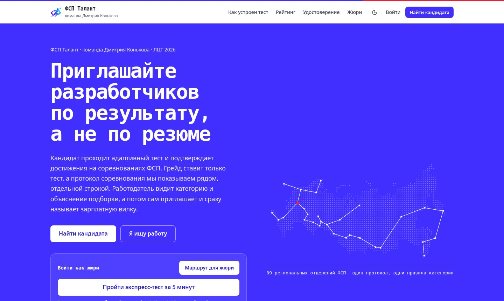
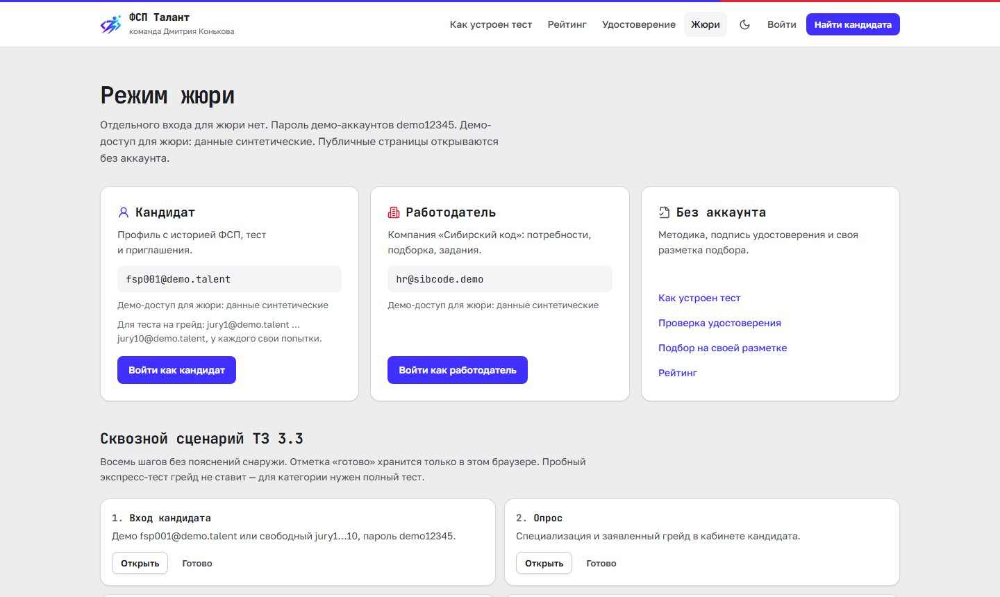
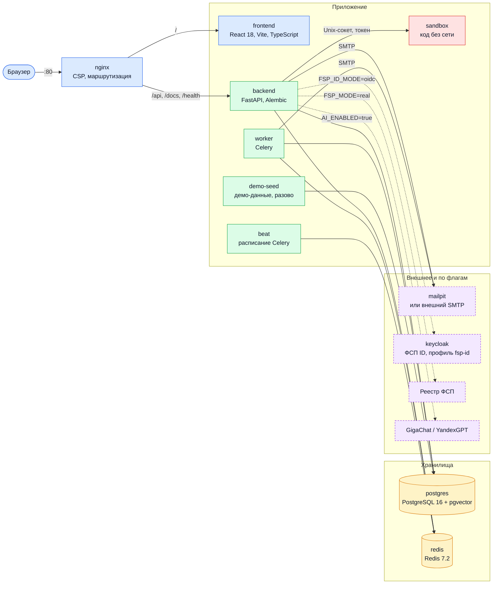

<p align="center">
  
</p>

<p align="center">
  <a href="https://github.com/KonkovDV/fsp-talent/actions/workflows/ci.yml"></a>
  <a href="LICENSE"></a>
  
  
  
  <a href="docs/openapi.json"></a>
  
</p>

# ФСП Талант

**Работодатель приглашает разработчика по подтверждённому тестом грейду, а не по резюме.**

ФСП Талант — платформа обратного найма в ИТ. Кандидат проходит опрос и адаптивный тест и попадает в категорию «специализация × грейд». Результаты соревнований Федерации спортивного программирования (ФСП) — отдельная проверяемая ось: они поднимают человека внутри категории и не заменяют тест. Работодатель описывает потребность обычным текстом, получает подборку с объяснением каждого места и сам приглашает кандидата, сразу называя зарплатную вилку. Имя и контакты открываются только после согласия кандидата.

Это самостоятельный проект. Код открыт по лицензии [MIT](LICENSE).

[Быстрый старт](#быстрый-старт) · [Документация](docs/README.md) · [Цифры с командами](#цифры-которые-можно-проверить) · [Видео 3:17](submission/05-additional/fsp-talent-demo.mp4) · [Презентация PDF](submission/03-presentation/FSP_Talent_presentation.pdf) · [Безопасность](SECURITY.md) · [Участие в разработке](CONTRIBUTING.md)

<table>
<tr>
<td width="50%"></td>
<td width="50%"></td>
</tr>
</table>

## Содержание

- [Возможности](#возможности)
- [Быстрый старт](#быстрый-старт) и [демо-аккаунты](#демо-аккаунты)
- [Проверка за 3 минуты](#проверка-за-3-минуты)
- [Как устроено](#как-устроено)
- [Почему ФСП Талант](#почему-фсп-талант)
- [Цифры на общепринятой шкале](#наши-цифры-на-общепринятой-шкале) и [цифры с командами](#цифры-которые-можно-проверить)
- [Стандарты и современная практика](#стандарты-и-современная-практика)
- [Персональные данные и безопасность](#персональные-данные-и-безопасность)
- [Демо-режим и промышленный контур](#демо-режим-и-промышленный-контур)
- [Интеграция с ФСП](#интеграция-с-фсп) и [развёртывание на сервере](#развёртывание-на-сервере)
- [Разработка](#разработка)
- [Исходные требования](#исходные-требования)
- [Частые вопросы](#частые-вопросы)
- [Документация](#документация), [лицензия](#лицензия-и-сторонние-компоненты), [авторы](#авторы)

## Возможности

| Кандидату | Работодателю | ФСП |
|---|---|---|
| 1. Опрос и заявленный грейд | 1. Потребность обычным текстом | 1. Вход через ФСП ID |
| 2. Адаптивный тест подтверждает грейд | 2. Подборка с объяснением «почему он здесь» | 2. Результаты соревнований — отдельная ось подбора |
| 3. Приглашения с вилкой, контакты — после согласия | 3. Приглашение с вилкой, выгрузка в ATS | 3. Удостоверение W3C VC 2.0 с проверкой подписи |

- **Тест, который нельзя выучить.** Задания собираются из параметрических семейств: у каждого кандидата свои числа и фрагменты кода, ответ вводится, вариантов на экране нет. IRT 3PL, 8–20 заданий у порога заявленного грейда.
- **Подбор, который объясняет себя.** Одна разложимая оценка: у каждого места полосы факторов и «Почему в выдаче». Вилка и шанс ответа видны на карточке и порядок не двигают.
- **Ось ФСП, которую не накрутить участиями.** Результат соревнования только поднимает кандидата внутри категории. Участие без результата весит 0, отсутствие истории ФСП не штрафует.
- **Приватность по умолчанию.** Анонимные карточки, контакты после согласия, причём кандидат сам выбирает, какие из них открыть компании. Журнал каждого просмотра, шифрование контактов, политики строк PostgreSQL.
- **Результат теста можно оспорить.** Обращение рассматривает методист и отвечает в течение 30 дней (ст. 16 152-ФЗ). Он может оставить результат или аннулировать неудачную попытку, но не поставить грейд руками.
- **Интеграции.** Вход через ФСП ID (OpenID Connect с PKCE, совместимо с Keycloak), HTTP-клиент реестра ФСП, подписанные вебхуки для ATS, удостоверения с публичной проверкой подписи.
- **Проверяемость.** Каждая опубликованная цифра печатается командой с фиксированным зерном, а CI сверяет цифры в документации со свежим прогоном.

## Быстрый старт

Нужны Docker 24+ с Compose 2.24+ (Docker Desktop 4.27+), 4 ГБ свободной памяти, 5 ГБ на диске и свободный порт 80. Python, Node.js, `make` и видеокарта не нужны.

```bash
git clone https://github.com/KonkovDV/fsp-talent.git
cd fsp-talent
docker compose up -d --build --wait
```

Команда возвращает управление, когда готовы база, API, фоновые задачи и демо-данные. Первый запуск занимает 5–10 минут, повторный — секунды. Файл `.env` не обязателен. С `make` то же самое: `make demo`; проверка окружения до запуска — `make doctor`.

| Адрес | Что там |
|---|---|
| http://localhost | Кабинеты кандидата и работодателя, страница `/jury` («Режим жюри»: демо-входы и проверки без аккаунта) |
| http://localhost/docs | Swagger UI, спецификация OpenAPI 3.1 |
| http://localhost:8025 | Mailpit: письма с кодами подтверждения |
| http://localhost/health | Состояние и коммит сборки |

Проверить демо-данные (ожидается «18/18 OK»): `docker compose run --rm backend python -m seed.demo_check`. Сквозная проверка API на запущенном стенде: `make check`, в конце `SMOKE OK`. Остановить и удалить всё вместе с данными: `docker compose down -v`.

<details>
<summary><b>Если что-то не так</b></summary>

| Ситуация | Что сделать |
|---|---|
| Порт 80 занят (`port is already allocated`) | `HTTP_PORT=8081 PUBLIC_BASE_URL=http://localhost:8081 docker compose up -d --build --wait`, сайт будет на http://localhost:8081. Порты почты и API так же: `MAIL_PORT`, `API_PORT`, `FRONTEND_PORT`. Значения можно записать в `.env` |
| Mac на Apple Silicon (M1–M4) | Команды те же. Базовые образы публикуются под arm64, сборка идёт нативно |
| Windows | Docker Desktop с WSL 2. Команды те же, в PowerShell. Клонируйте лучше внутрь WSL (`\\wsl$\...`), так сборка быстрее. Без `make` есть `powershell -ExecutionPolicy Bypass -File scripts\start-local.ps1` |
| `unknown flag: --wait` или ошибка про `env_file` | Старый Compose. Обновите Docker Desktop, или создайте `.env` (`cp .env.example .env`) и запустите `make demo` |
| Сборка упала на `apt-get`, `pip` или `npm` | Нет доступа к зеркалам или к прокси. Повторите команду: кэш сохранится, сборка продолжится с места остановки |
| Что-то не стало `healthy` | `docker compose ps` и `docker compose logs backend demo-seed` |

**Без интернета.** Интернет нужен только для первой сборки (образы, pip, npm). После неё стенд работает полностью офлайн: внешних вызовов нет, языковые модели по умолчанию выключены, почта уходит в локальный Mailpit. Для машины без сети соберите образы там, где сеть есть, и перенесите их: `docker save` и `docker load`.

Подробности, настройки `.env` и разбор ошибок — [docs/INSTALL.md](docs/INSTALL.md).

</details>

### Демо-аккаунты

Пароль у всех `demo12345`. Компании, люди и вакансии вымышлены.

| Роль | Вход | Что внутри |
|---|---|---|
| Кандидат с нуля | `jury1@demo.talent` … `jury10@demo.talent` | Пустой опрос, дата рождения уже указана. При `DEMO_MODE=true` полный тест проходится без пауз и лимитов попыток, результат сразу попадает в категорию и поиск. Кнопка «Взять свободный аккаунт жюри» на странице входа берёт тот адрес, в который дольше всех не входили |
| Работодатель | `hr@sibcode.demo` | Компания «Сибирский код»: три потребности с подборками, приглашения в статусах «ожидает», «принято» и «отклонено», вакансии с откликами, три задания для кандидатов (одно открытое ждёт проверки). Разделы «Модерация» и «Методист» ему закрыты: логин опубликован, а там видны имена кандидатов |
| Кандидат с ФСП ID | `fsp001@demo.talent` | ФСП ID привязан, результаты из протоколов, ожидающие приглашения с зарплатой, адресное задание от работодателя, задача недели |
| Кандидат, ИБ | `fsp002@demo.talent` | Информационная безопасность, командные результаты ФСП |
| Кандидат без ФСП | `nofsp@demo.talent` | Категория только по опросу и тесту; отсутствие истории ФСП не штрафуется |
| Вход через ФСП ID | `FSP001` / `test` | Открывает аккаунт `fsp001@demo.talent` |
| Новый человек через ФСП ID | любой из `FSP2000`…`FSP2099` / `test` | Экран согласий, затем аккаунт создаётся из демо-реестра |

<details>
<summary><b>Что лежит в демо-данных</b></summary>

Базовый сид (`python -m seed.generate_seed`) создаёт **153** вымышленных кандидата с профилями (FSP001, FSP002, FSP1000–FSP1149 и `nofsp@demo.talent`) и отдельно 10 аккаунтов `jury1`…`jury10`. Из базовых 40 уже проходят адаптивный тест через тот же сервис, что работает в API (`seed.demo_activity`). У пяти демо-компаний девять вакансий, есть приглашения и отклики в разных статусах. Затем `fill_showcase` и `seed.topup_public` добавляют витринные профили, чтобы ячейки банка и публичного рейтинга не пустели (k-анонимность). Четыре числа на главной — живые счётчики из `/api/v1/public/stats`: неудалённые участники, участники с результатами ФСП, семейства заданий (`len(FAMILIES)`) и компании. 153 — размер базового сида, а не счётчик главной.

`make demo-check` сверяет каждую строку таблицы аккаунтов с базой. В демо-режиме beat каждую ночь в 04:10 МСК возвращает демо-аккаунты к исходному виду (`DEMO_RESET_CRON`), пароли остаются прежними. На демо-стенде есть и «Войти гостем без почты»: пустой аккаунт кандидата или компании на 48 часов, гостя-кандидата нет в поиске.

</details>

### Основной сценарий за 5 минут

Удобно открыть три вкладки: кандидат, работодатель и второй кандидат. Пароль везде `demo12345`.

<details>
<summary><b>9 шагов</b></summary>

| # | Кто | Что сделать | Что увидеть |
|---|---|---|---|
| 1 | Кандидат | `/login` → «Взять свободный аккаунт жюри» (или вручную `jury1@demo.talent`) → войти | Кабинет кандидата с пустым опросом: путь с первого шага |
| 2 | Он же | «Обзор» → опрос: направление, специализация (например, Backend), грейд, цель | Появилась категория. Грейд помечен как заявленный и в подборке весит 0,85 от подтверждённого |
| 3 | Он же | «Тест на грейд» → «Пробный тест» (до 15 заданий, 5 минут) или полный тест (8–20 заданий) | У каждого кандидата свои числа и фрагменты кода, ответ вводится, вариантов нет. После полного теста — итог по темам и решение о грейде (подтверждён или нет). У демо-аккаунтов паузы между попытками нет. Ответ наугад оставляет уровень неподтверждённым: тест так и задуман |
| 4 | Работодатель | Вторая вкладка: `hr@sibcode.demo` → «Потребности» → «Backend на Python в платёжный сервис» | «Где искать»: рекомендованные категории. Подборка с полосами факторов и «Почему в выдаче». Карточки без имён |
| 5 | Он же | Отметить трёх кандидатов «Сравнить»; затем «Пригласить»: роль, вилка до вычета НДФЛ, способ связи | Без вилки приглашение не отправить. Подсказка показывает, сколько людей добавит другая вилка, и не блокирует отправку |
| 6 | Кандидат с историей ФСП | Третья вкладка: `fsp001@demo.talent` → «Приглашения» → «Принять» у любого ожидающего | Компания, вакансия, вилка и страница компании видны до решения. «Да, если…» оставляет приглашение в ожидании и контакты закрытыми, место в подборке не двигает. После принятия этой компании открываются имя и контакты, появляется «Переписка» |
| 7 | Работодатель | `hr@sibcode.demo` → «Приглашения» | Контакты видны только у принятых приглашений, у ожидающих их нет ни в карточке, ни в ответе API. Каждый просмотр контактов записан в журнал доступа |
| 8 | Кандидат | `fsp001`: «Результаты ФСП»; затем выйти и войти кнопкой «Войти через ФСП ID» → `FSP001` / `test` | Строки протоколов стоят отдельной осью и грейд не меняют. Вход по OpenID Connect с PKCE: пароль вводится на странице провайдера |
| 9 | Он же | «Приглашения» → «Закрыть контакты для этой компании» | Компания сразу теряет доступ к контактам (`contacts_revoked`), переписка становится только для чтения |

Пример потребности для шага 4 можно не придумывать. На форме «Новая потребность» под полем текста три кнопки, каждая вставляет одну из этих строк. Затем «Разобрать текст» заполняет специализацию, грейд и навыки:

- «Backend-разработчик Python Middle в финтех: FastAPI, PostgreSQL, Docker, Redis. Удалённо, 200–280 тыс.»
- «Frontend-разработчик Senior: React, TypeScript, JavaScript, CSS. Удалённо.»
- «Аналитик данных Junior: SQL, Python, pandas, Power BI. Москва, гибрид.»

Полный сценарий на 15 шагов (регистрация по почте, задания работодателя, отклик на вакансию, паспорт навыков) — в [руководстве пользователя](docs/USER_GUIDE.md#полный-сценарий-из-тз-33). Без входа на странице `/jury` открываются методика теста, проверка подписи удостоверения и расчёт подбора на своей разметке (`/evaluate`). Проверка каждого ключевого свойства с командой и ожидаемым числом — [docs/REVIEW_GUIDE.md](docs/REVIEW_GUIDE.md).

</details>

## Проверка за 3 минуты

- **Три клика до результата теста.** `/jury` → «Режим эксперта», выбрать уровень → «Запустить тест»: адаптивный тест на виртуальном кандидате по шагам, оценка уровня ± погрешность и итоговый грейд. Без входа, в базу ничего не пишется.
- **Одна команда пересчитывает главные цифры.** `make validate` (после `make demo`): психометрия теста и атака «20 сессий», подбор против базовых методов с доверительными интервалами, ось ФСП. Каждый шаг завершается проверкой порогов (`checks: passed`). Около 4 минут на обычном ноутбуке.
- **Подбор на своей разметке.** `/evaluate`: вставьте пары «потребность — кандидат» с оценкой 0–3 (JSONL, одна пара в строке) — стенд посчитает nDCG@10, P@10 и MAP для модели, сортировки по резюме и случайного порядка. Пары не сохраняются.

| Главное | Цифра | Где проверить |
|---|---|---|
| Завышенный в анкете грейд тест не подтверждает | 92,6 % (зерно 7) / 92,3 % (зёрна 201–205); верить анкете — 0 % | [на общепринятой шкале](#наши-цифры-на-общепринятой-шкале) |
| Ключи заданий проверены запуском | 1875 из 1875 вариантов совпали с ключом | [тест на грейд](#тест-на-грейд) |
| Повтор всей процедуры до итогового грейда | κw 0,85; строго: тот же грейд у 65,2 % | [на общепринятой шкале](#наши-цифры-на-общепринятой-шкале) |
| Подбор против поиска по ключевым словам (BM25) | nDCG@10 +0,089 (95 % ДИ +0,068…+0,111) | [цифры](#цифры-которые-можно-проверить) |
| Атака «20 чужих сессий» | сдача 5,7 % против 5,3 % у честных, в пределах ДИ честной | [цифры](#цифры-которые-можно-проверить) |

## Как устроено

Состав сервисов совпадает с `docker-compose.yml`: девять сервисов и разовый загрузчик демо-данных `demo-seed` поднимаются по умолчанию, Keycloak — только с профилем `fsp-id`. На сервере вход вместо nginx принимает Caddy с HTTPS, и добавляется контейнер ночного резервного копирования (`deploy/docker-compose.prod.yml`).

<p align="center">
  
</p>



Одно приложение с явными слоями: обработчики API (`app/api/v1/`) проверяют права и формат, предметная логика живёт в сервисах (`app/services/`), модели и миграции отвечают за хранение. Внешние системы (реестр ФСП, ФСП ID, языковая модель, почта) подключены через адаптеры с флагом режима, поэтому стенд работает без них. Пунктир на схеме — внешние системы, которые включаются настройкой. Подробно: [docs/SOLUTION.md](docs/SOLUTION.md#2-компонентная-архитектура), коротко о главных решениях — [ARCHITECTURE.md](ARCHITECTURE.md) и [архитектурные решения (ADR)](docs/adr/README.md).

Стек: Python 3.12, FastAPI, SQLAlchemy 2, Alembic (одна миграция `0001_initial`), Celery, PostgreSQL 16 с pgvector, Redis 7.2, React 18, Vite 6, TypeScript, Tailwind CSS. API — OpenAPI 3.1, 197 путей; методика балла ФСП — `v4.2.0`.

<details>
<summary><b>Что работает без ключей и с ключами</b></summary>

Без всяких ключей `make demo` поднимает всю платформу: тест, подбор, удостоверения, модерация, почта в Mailpit; резюме разбирается правилами.
Если добавить ключи, GigaChat или YandexGPT (`.env`) добавляют подсказки навыков с дословной цитатой из резюме; балл и грейд по-прежнему считает платформа.
**Расширения.** Вход через ФСП ID (OIDC, Keycloak) и HTTP-клиент реестра ФСП готовы к подключению боевых адресов.

</details>

<details>
<summary><b>Как работают тест, подбор и ось ФСП (формулы)</b></summary>

### Тест на грейд

У каждого человека свои числа и свой фрагмент кода. Шаблон, уровень и код сами считают правильный ответ: сложность держится на одной шкале, а выученный чужой ключ не подходит.

Чужой ключ почти не помогает. В коде он совпадает с новым экземпляром в 9,3 % случаев, в вопросах на понимание — в 36,9 %. Если отвечать своим умом там, где ключ не подошёл, сдают 69,2 % против 58,5 % честно (`python -m app.validation.construction_check`).

Семейств 22: двадцать с вычисляемым ответом и два пула вопросов на понимание. Ключи прогнаны исполнением: 1875 из 1875 совпали. Подробности — в [проверке теста](docs/VALIDATION_ASSESSMENT.md).

Целое число человек вводит сам, вариантов на экране нет. В модели у такого ответа остаётся маленький шанс угадать, c = 0,02. У выбора из четырёх c = 0,25.

P(верно | θ) = c + (1 − c) · σ(a · (θ − b))

На границе грейда, при a = 1, информация задания равна (1/4) · (1 − c) / (1 + c): 0,240 у вводимого числа и 0,150 у четырёх вариантов. Вводимый ответ несёт в 1,60 раза больше информации.

Следующее задание берётся там, где оно лучше всего разделяет людей у порога заявленного грейда, а не у текущей оценки. Из пяти лучших одно выбирается с ограничением показов. Пока ключ видели не чаще 40 % законченных сессий этой специализации, его берут как обычно. Чаще — с вероятностью 0,40, делённой на эту долю. Пока таких сессий меньше двадцати, выбор среди пяти равномерный. Последнее в пятёрке берётся всегда, чтобы тест не встал.

Тест длится от 8 до 20 заданий и заканчивается, когда решение уже ясно: вероятность этого порога и следующего грейда вышли из полосы 10–90 %, либо отношение правдоподобия у порога стало резким — зона ±0,25, порог ln 9.

Грейд подтверждается от 75 %. Если следующий порог тоже ясен, от 90 %, человек получает отдельный тест на ступень выше. Сам грейд платформа не поднимает. Не сдал — уровень ниже можно пройти сразу. Тот же уровень снова через 7 дней, следующее повышение через 90.

Законченный тест можно оспорить кнопкой «Оспорить результат», описав проблему. Обращение попадает к методисту, ответ приходит в кабинет не позднее чем через 30 дней (ч. 4 ст. 16 152-ФЗ). Методист видит ход попытки без имени и контактов: ответы, время на задание, пометки честности. Решений два: оставить результат или аннулировать неудачную попытку. Аннулированная попытка не мешает пересдаче и не опускает грейд в подборке. Поставить или поднять грейд руками нельзя ни методисту, ни кому-то ещё (`app/services/disputes.py`).

Правильный ответ в браузер до конца теста не уходит. Ответ принимается только на текущее задание, по подписанному токену. Время считает сервер. Если по ключу накопилось от 30 ответов и доля верных уехала от модели (z ≥ 3,5) или накопленное превышение ожидаемой доли, за вычетом допуска 0,12 на каждый ответ, дошло до 7, ключ уходит в карантин и больше не выдаётся. Ожидание считается по уровню без заданий того же семейства: утёкшее семейство не может подтянуть оценку и спрятать себя. Статистика банка открыта.

Отдельно сравниваются вопросы с постоянной формулировкой и задания со свежими числами. Если остаток на первых выше остатка на вторых на 0,40 и больше, сессия помечается для просмотра. На зёрнах 201–203 так находится 24,9 % таких сессий при 2,1 % ложных. Грейд и место от пометки не меняются.

Регулярные задания пишет работодатель. Где есть эталон, ответ проверяет система. Открытый текст проверяет сам работодатель. Вердикт виден в карточке и грейд не меняет. Раз в неделю платформа собирает короткую задачу из вакансии специализации кандидата.

Во время теста языковая модель не вызывается: сложность у всех на одной шкале. Подробно: [SOLUTION.md, глава 3](docs/SOLUTION.md#3-механика-тестирования).

### Подбор

Работодатель описывает потребность: специализация, грейд, обязательные и желательные навыки, предметная область, чем занимается команда. Каждое изменение сохраняется новой версией. Отобранные кандидаты помнят, по какой версии их выбрали.

Порядок задаёт одна оценка. Её можно разложить на части (`backend/app/services/matching.py`).

fit = (сумма w · s по названным факторам) / (сумма w по тем же факторам)

Веса названных факторов: навыки 0,45, грейд 0,30, специализация 0,25, текст запроса 0,05, предметная область 0,05, город и формат 0,05. Фактор, которого потребность не назвала, выпадает, остальные веса пересчитываются.

E = T + 0,5 · max(0, F − T)

T — тест, F — ось ФСП. Истории ФСП нет — остаётся тест. Теста нет — остаётся ось ФСП. Слабая история соревнований хороший тест не тянет вниз.

employer = (fit + 0,30 · E · близость) / 1,30

итог = employer − min(0,10, 0,02 · max(0, число приглашений − 2))

Вилка считается отдельно и место не двигает. Два первых приглашения очередь не трогают. Дальше карточка опускается на 0,02 за каждое, но не больше чем на 0,10.

Навык весит по силе доказательства: тест 1,0, цитата в резюме 0,75, просто заявлен 0,55. Сосед по группе технологий даёт 0,3 этого веса. Более узкий инструмент закрывает общий навык сильнее: PostgreSQL закрывает SQL на 0,85, FastAPI закрывает Python на 0,60. Обратно это не работает. Подсказка «не требовать навык» смотрит на ту же связь. MySQL вместо PostgreSQL пробелом остаётся. Заявленный грейд весит 0,85 от подтверждённого.

Близость, на которую умножаются доказательства: g · r · (0,5 + 0,5 · покрытие навыков). Точный грейд даёт g = 1, ступень выше 0,6, ступень ниже 0,35, дальше 0. Та же специализация даёт r = 1, соседняя 0,5, другая 0. Если потребность не назвала навыки или специализацию, этот множитель равен 1.

Свежесть теста оценку уровня не снижает: до полугода погрешность обычная, дальше строка говорит, что она шире. Даты нет — строка не появляется. Грейд от давности не меняется. Опубликованные цифры подбора сняты, когда давность ещё умножала вклад теста.

На карточке отдельно написано, ответит ли человек. Это не место в списке. В оценку входят вилка, формат, город и прошлые отказы. Отказ из-за вилки снижает вероятность согласия множителем 0,85, не больше трёх раз. Отказ из-за формата снижает только строку «Ответят», и только если потребность назвала формат. Чужой город при готовности к переезду даёт 0,7 вместо 0. Пока город скрыт, ни он, ни переезд в балл не входят.

Имени, пола, возраста и региона в оценке нет. Нет истории ФСП — ось выпадает и не штрафует. Привязка ФСП ID место не опускает.

Под карточкой строки «плюс», «минус» и «справка», «лучше N % своей категории», практика и вердикт по заданию работодателя. Подробно: [SOLUTION.md, глава 4](docs/SOLUTION.md#4-механика-подбора-и-категоризация).

### Ось «подтверждено ФСП»

Грейд и соревнования платформа не смешивает. Грейд даёт только основной тест специализации. Результаты ФСП двигают место внутри категории и грейд не меняют. Методика `v4.2.0`.

Класс результата зависит от места и размера поля, не от статуса соревнования: чемпионат не ставится выше любого другого старта. Победитель 1,00, призёр (2–3 место) 0,85, топ-10 % 0,65, верхняя половина 0,45, участие 0. Победитель и призёр считаются при поле от шести человек. В сумму входят только классы больше нуля. Участие остаётся в профиле и балл не двигает.

w = 2^(−месяцы / 18) / √(размер команды) · (1 − e^(−N / 30))

μ = (сумма w · q + 2 · 0,30) / (сумма w + 2)

σ = √(0,04 / (сумма w + 2))

LCB = максимум по подмножествам S величины (μ − σ), где μ и σ считаются по этому подмножеству

В подмножество S входит не больше пяти результатов и не больше двух за один календарный месяц. Поиск видит все результаты месяца и оставляет набор с самой высокой нижней границей. Победа в поле из шести не вытесняет приз в большом поле того же месяца. Пустое подмножество — нижняя граница: новый результат оценку не понижает. Это осторожная оценка силы.

При одинаковой давности и личном зачёте место среди шести человек весит около пятой доли места среди двухсот: множитель поля 1 − e^(−N / 30). Пять таких призов — больше в сумму не берётся — остаются ниже одной свежей личной победы среди двухсот той же дисциплины. Та же победа уже ниже этих пяти призов, если ей больше 10 месяцев, если в команде от трёх человек или если дисциплина чужая. Командный результат уменьшает вес доказательства и расширяет неопределённость. Вклад внутри команды не делится: реестр этого не сообщает. Для вакансии берётся нижняя граница профильной дисциплины. Чужая дисциплина входит с множителем 0,5 уже после своего расчёта. Для вакансии по безопасности профильная дисциплина — информационная безопасность. Робототехника для неё другая. Если у специализации профильной дисциплины нет, берётся лучший результат по всем.

Разряд (МС, КМС, I–III и юношеские) приходит из реестра вместе с датой и номером приказа. Из места он не вычисляется и в балл не входит. Фильтр «разряд не ниже» смотрит на этот факт.

Вход через ФСП ID — OpenID Connect с PKCE, как в Keycloak Федерации. Настоящий провайдер подключается пятью настройками в `.env`. Из реестра берутся строки протокола и разряды. Пол, контакты и документы не запрашиваются. Каждая строка протокола подписывается как W3C Verifiable Credential 2.0. Подпись проверяет любой. Если удостоверение отозвано, проверка присланного JSON и предъявления SD-JWT это видит. Схема обмена: [docs/FSP_INTEGRATION.md](docs/FSP_INTEGRATION.md).

</details>

## Почему ФСП Талант

> **Грейд подтверждён тестом, место в выдаче объяснено, контакты открыты только с согласия кандидата.** Работодатель приходит к кандидату с вакансией и вилкой, а не наоборот.

Для HR это звучит так. Из ста человек, которые пририсовали себе грейд, тест оставляет за дверью около девяноста трёх: 92,6 % на зерне 7 и 92,3 % на отложенных зёрнах. Анкета сама по себе не ловит ни одного: 0 из 100. Команда, которая пересчитывает это заново: `python -m app.validation.assessment --n 2000 --seed 7 --parity`.

На этом продукт и стоит. Соревнования поднимают и не подменяют грейд. Вилка и шанс ответа видны на карточке, очередь от них не сдвигается. Навык, который тест уже измерил, остаётся наравне с заявлением: сдавать выгодно. Отметки браузера человек видит у себя, в подборке их нет. Код кандидата выполняется в отдельном контейнере без сети. Что сделано сверх исходных требований — [docs/BEYOND_TZ.md](docs/BEYOND_TZ.md).

<details>
<summary><b>Что это даёт и чем подтверждено</b></summary>

| | Что это даёт | Чем подтверждено |
|---|---|---|
| **Тест, который нельзя выучить** | Параметрические семейства вместо банка вопросов: у каждого кандидата свои числа и фрагменты кода, ответ, списанный с чужого экземпляра, совпадает в коде лишь в 9,3 % случаев (с чужим ключом сдают 69,2 % против 58,5 % честно, `construction_check`). IRT 3PL и адаптивный выбор у порога грейда: 8–20 заданий | Симуляция на 2000 кандидатах: точность вдали от границы 91,7 %, при утечке ответов у 30 % кандидатов с карантином — 88,9 %, случайное угадывание проходит 0 %; соседние грейды различаются с AUC 0,919 в среднем (0,901–0,931 по парам, [разделяющая сила](docs/VALIDATION_ASSESSMENT.md#разделяющая-сила-auc-соседних-грейдов)); на повторе с новыми заданиями уверенные решения совпадают в 82,7 % (80,3 % в среднем на отложенных зёрнах) ([повтор](docs/VALIDATION_ASSESSMENT.md#зона-неопределённости-решения-о-грейде)) ([цифры](#цифры-которые-можно-проверить)) |
| **Подбор, который объясняет себя** | Одна разложимая оценка: у каждого места полосы факторов и «Почему в выдаче» с кодом причины | nDCG@10 против поиска по ключевым словам (BM25) +0,089 (95 % ДИ +0,068…+0,111), против сортировки по резюме +0,038 (+0,014…+0,061): одна разметка, три зерна, 232 потребности, парный бутстреп. Порядок внутри категории: Спирмен со скрытой силой 0,410 против 0,032 и 0,011. Завышенный грейд в первой десятке 22,1 % против 28,1 % по резюме ([базы и проверка подбора](docs/VALIDATION_MATCHING.md#против-двух-баз-заголовочные-цифры)) |
| **Ось ФСП, которую не накрутить участиями** | Результаты соревнований только поднимают кандидата внутри категории и не меняют грейд; участие без результата весит 0 | Накрутка из 40 онлайн-участий даёт нижнюю границу 0,16 — как пустая история, две победы — 0,54; тесты свойств на случайных историях: монотонности и «нет истории ФСП — нет штрафа»; Спирмен со скрытой силой 0,768 ± 0,002 |
| **Приватность по умолчанию** | Анонимные карточки, контакты только после согласия, журнал каждого просмотра, AES-256-GCM, RLS в PostgreSQL, Argon2id, TOTP для модерации | Обход всех маршрутов с чужим идентификатором: 0 ответов 2xx из 240 запросов (`tests/smoke_api.py`) |
| **Доступность и скорость** | Светлая и тёмная темы, вёрстка от 390 px | Замер 11.10.2026: axe WCAG 2.2 AA — 0 нарушений на `/`, `/login`, `/legal`, `/badge`, `/jury` (390 px светлая и тёмная, десктоп); Lighthouse: доступность 100, производительность 84–100. 40 пользователей одновременно — 0 ошибок, p95 поиска 69 мс |
| **Открытые стандарты** | OpenID Connect с PKCE (совместимо с Keycloak ФСП), W3C Verifiable Credentials 2.0 (`eddsa-jcs-2022`), выборочное раскрытие SD-JWT, Standard Webhooks, OpenAPI 3.1 | Подпись JSON проверяет любой: `POST /api/v1/public/credentials/verify`. Предъявление SD-JWT с тем же идентификатором сверяется ещё и со строкой отзыва: `POST /api/v1/public/credentials/verify-sd-jwt` |
| **Проверяемость** | Каждая цифра таблицы валидации воспроизводится командой с фиксированным зерном, а `tests/doc_numbers.py` сверяет опубликованные цифры со свежим прогоном | [Цифры, которые можно проверить](#цифры-которые-можно-проверить), `make accept` — 38 проверок требований |

Термины из таблицы простыми словами:

| Термин | Что значит |
|---|---|
| IRT 3PL | Статистическая модель теста: связывает уровень человека, сложность задания и шанс угадать ответ |
| Адаптивный тест | Следующее задание выбирается по предыдущим ответам, поэтому заданий нужно меньше |
| AUC | Как часто тест ставит более сильного кандидата выше более слабого: 1 — всегда, 0,5 — наугад |
| nDCG@10, P@10 | Качество первой десятки подборки: насколько верен порядок и какая доля в ней подходит |
| Спирмен | Насколько порядок кандидатов совпадает с их настоящей силой: 1 — полностью, 0 — никак |
| LCB | Осторожная нижняя оценка уровня по истории ФСП: один удачный старт не выглядит как стабильный уровень |
| p95 | Время, быстрее которого приходят 95 % ответов |
| RLS | Правило в самой базе данных: запрос не видит чужие строки, даже если в коде ошибка |
| TOTP | Одноразовый код из приложения-аутентификатора, второй шаг входа |
| OpenID Connect, PKCE | Стандартный вход через внешний сервис (ФСП ID) с защитой кода входа от перехвата |
| W3C Verifiable Credentials | Удостоверение с цифровой подписью: подлинность проверяет любой без запроса в ФСП |

</details>

## Наши цифры на общепринятой шкале

<details>
<summary><b>Коротко и подробная таблица</b></summary>

Сначала коротко и без формул.

- Приукрасивших мы ловим на лету: из 100 человек, завысивших грейд в анкете, тест не подтверждает около 93.
- Решение «тянет / не тянет заявленный грейд» верно в 78 случаях из 100, а если просто верить анкете, то в 72.
- Если человек пройдёт всю процедуру дважды, грейд совпадёт в 65 случаях из 100, а с точностью до соседней ступени — почти всегда.
- В первой десятке подборки подходящих людей больше, чем при сортировке по резюме (лучше в 57 вакансиях из 100), обычном поиске по словам (70 из 100) и сортировке по самоописанию (74 из 100).

Подробная таблица для технических экспертов:

Все цифры получены запуском кода на текущем main: синтетические кандидаты, зерно 7 и отложенные зёрна 201–205 (среднее), команды запускаются в `backend/`. Строгие цифры стоят рядом с каждой удобной. Подробности: [VALIDATION_ASSESSMENT](docs/VALIDATION_ASSESSMENT.md#сопоставимые-строки) и [VALIDATION_MATCHING](docs/VALIDATION_MATCHING.md#лестница-баз).

| Что мерили | Мы: зерно 7 / зёрна 201–205 | Строгая цифра рядом | Команда |
|---|---|---|---|
| Завышенный в анкете грейд не подтверждён | 92,6 % / 92,3 % | честно заявленный подтверждён: 71,9 % / 72,6 % | `python -m app.validation.assessment --n 2000 --seed S --parity` |
| Решение «сдал / не сдал» против базы «верить анкете» | 77,8 % против 71,5 % / 77,8 % против 73,6 % | анкета называет точный грейд в 63,0 % / 64,4 % случаев | та же |
| κw: грейд только по оценке способности θ̂ против истинного | 0,864 (95 % ДИ 0,852–0,876) / 0,871 | **κw грейда, который назначает продукт, против истинного: 0,51 / 0,53**. Продукт только подтверждает заявленный грейд и выше него не ставит | та же |
| Повтор: κw двух путей до итогового грейда («не подтверждён» стоит ниже стажёра) | **0,85** / 0,85 (все шесть зёрен 0,85–0,86); при исходном порядке, где «не подтверждён» стоит после lead, — 0,76 / 0,75 ± 0,04 | тот же грейд при повторе: 64,8 % / 65,2 %; κw повтора одного теста: 0,56 / 0,55 | `python -m app.validation.assessment --n 2000 --seed S` |
| Повтор: тот же итог у уверенных решений | 82,7 % / **80,3 %** | общий тот же итог: 75 % (зерно 7) | та же |
| Повтор: корреляция оценок θ̂ | 0,86 (зерно 7) | — | та же |
| AUC соседних грейдов, среднее | 0,919 (зерно 7) | — | та же |
| Подбор: nDCG@10 / P@10 | 0,658 / 0,632 (зёрна 2026–2028); 0,659 / 0,626 (отложенные 4001–4005) | против сортировки по резюме модель лучше в 60 % / 56 % потребностей | `python -m app.validation.matching --ladder` (и `--seeds 4001,4002,4003,4004,4005`) |
| Подбор на сопоставимых данных: внешний открытый набор ([miliantr/fsp-talent](https://github.com/miliantr/fsp-talent), у всех проверенный грейд), nDCG@10 / P@10 / MRR | 0,835 / 0,785 / 0,947; с заявленным грейдом без теста 0,740 | основная цифра выше остаётся строгой; сопоставление полей наше ([раздел](docs/VALIDATION_MATCHING.md#проверка-на-внешнем-открытом-наборе)) | `python -m app.validation.external_dataset` |
| Подбор на сопоставимых данных: наш генератор, сценарий «чистые данные» (все с тестом, грейд настоящий, без ложных навыков), отложенные 4001–4005, nDCG@10 / P@10 | 0,863 / 0,696 (строгий протокол) | метки и правда те же, веса не перенастраивались; не заменяет 0,659 | `python -m app.validation.protocols --protocol strict --clean` |
| Подбор: доля потребностей, где модель лучше базы | случайный 100 %, самоописание 74 %, BM25 70 %, резюме 57 % | отложенные зёрна: 100 / 63 / 65 / 55 % | та же |

Про κw двух путей: каппа штрафует промах по квадрату расстояния между грейдами, поэтому важно, где на шкале стоит «не подтверждён». Если ниже стажёра, как на шкале способности, получается 0,85; если в конце шкалы после lead, получается 0,76. Строгая цифра рядом: тот же грейд при повторе получают около 65 % людей.

</details>

## Цифры, которые можно проверить

<details>
<summary><b>Все цифры с командами</b></summary>

| Что | Результат | Команда (в `backend/` или через `docker compose exec -T backend`) |
|---|---|---|
| Точность решения о грейде вдали от границы (2000 кандидатов) | 91,7 % | `python -m app.validation.assessment --n 2000 --seed 7` |
| Повторная сдача с новыми заданиями, каппа Коэна | 0,49 | та же |
| Повторная сдача: каппа Коэна «сдал / не сдал» с 95 % ДИ и взвешенная каппа по подтверждённому грейду (квадратичные веса, промах на две ступени дороже промаха на одну) с 95 % ДИ; бутстрап по парам, 1000 повторов | 0,49 (0,43–0,54); κw 0,56 (0,50–0,63) | та же |
| Зона неопределённости (решение в пределах SE от порога): доля и тот же итог на повторе у уверенных и пограничных; зерно 7 и отложенные 201–205 | 28,2 %; 82,7 % (ДИ 80,1–85,4 %) и 54,3 %; на 201–205 — 29,3 %, 80,3 % и 60,6 % в среднем. Целевой порог для уверенных решений — 85 % | та же, `--seed 201` … `205` |
| Различающая сила, медиана r для вводимого ответа | 0,24 | та же |
| Точность при утечке ответов у 30 % кандидатов, с карантином | 88,9 % | та же |
| Ложные сдачи при утечке: без карантина и с ним, на тех же людях | 19,2 % и 13,4 % | та же |
| Случайное угадывание проходит тест | 0 % | та же |
| Итоговый грейд после пути: точно и ±1 | 64,5 % и 98,9 % | та же |
| Максимальная доля показов одного ключа (2000 кандидатов) | 41 % | та же |
| Максимальная доля одного ключа внутри специализации | 72 % | та же |
| Атака «20 чужих сессий»: сдача после атаки и честная сдача, 400 человек на каждом из шести зёрен (7, 201–205), всего 2400, 95 % ДИ Уилсона. Атака в пределах интервала честной сдачи. Чужой ключ от другого экземпляра, с ответом своими силами там, где ключ не подходит: 69,2 % сдач против 58,5 % честно у тех же 400 человек (+10,8 п. п., `python -m app.validation.construction_check`) | 5,7 % (4,8–6,7 %) и 5,3 % (4,5–6,3 %) | `python -m app.validation.assessment --stolen` ([подробно](docs/VALIDATION_ASSESSMENT.md)) |
| Ошибка модели σ = 0,30: точность вдали от порога и ложные сдачи | 93,1 % и 9,1 % | та же |
| Подбор, nDCG@10 на трёх зёрнах: полная модель и сортировка по резюме | 0,658 и 0,620 | `python -m app.validation.matching` |
| Подбор по протоколам опубликованных методов (градуированная разметка 0–3, выигрыш 2^(rel) − 1), nDCG@10 / P@10 / MRR на зёрнах 2026–2028; строгий протокол рядом: 0,658 / 0,632 / 0,805 | A: 0,621 / 0,547 / 0,859; B: 0,684 / 0,649 / 0,922 | `python -m app.validation.matching --protocol all` ([методика](docs/VALIDATION_MATCHING.md#по-протоколам-опубликованных-методов)) |
| Подбор против поиска по ключевым словам (BM25: слова потребности — специализация, грейд, навыки — против слов профиля), Δ nDCG@10 и 95 % ДИ, парный бутстреп по 232 потребностям трёх зёрен | +0,089 (+0,068…+0,111) | та же |
| Подбор против сортировки по резюме (число заявленных обязательных навыков, затем специализация и грейд), Δ nDCG@10 и 95 % ДИ, те же потребности | +0,038 (+0,014…+0,061) | та же |
| Δ P@10 против ключевых слов и против резюме | +0,106 (+0,084…+0,129) и +0,074 (+0,048…+0,100) | та же |
| Поиск по ключевым словам (BM25) сам по себе, nDCG@10 и P@10 на трёх зёрнах | 0,568 и 0,526 | та же |
| Подбор, nDCG@10: строка «без теста и без ФСП» (парная Δ полной модели −0,002…−0,035, значима на 1 зерне из 3; вклад теста и ФСП — порядок внутри категории и меньше завышенных грейдов, строки ниже) | 0,669 | та же |
| Эксперимент (не в продукте): ранжирование по ожидаемому выигрышу, отложенные зёрна 5001–5010 по предрегистрации. Полная минус своя абляция: Δ nDCG@10 +0,0052 (95 % ДИ +0,0007…+0,0097, p 0,022). Цена: Спирмен в категории 0,140 против 0,231 у продукта, завышенный грейд 25,2 % против 21,2 %. При генераторе без завышения выигрыш исчезает (−0,014) | 0,693 | `python -m app.validation.expected_gain --holdout` |
| Доля подходящих в первой десятке, P@10 на трёх зёрнах: полная модель и по резюме | 0,632 и 0,559 | та же |
| Порядок внутри категории, Спирмен со скрытой силой: полная модель и по резюме | 0,410 и 0,011 | та же |
| Завышенный грейд в первой десятке: полная модель и по резюме | 22,1 % и 28,1 % | та же |
| Настоящий грейд ниже грейда потребности, первая десятка: полная модель и по резюме | 13,6 % и 30,9 % | та же |
| Ось ФСП, Спирмен со скрытой силой на трёх зёрнах: LCB, среднее место, число строк | 0,768 ± 0,002, 0,681 ± 0,014 и 0,127 ± 0,033 | `python -m app.validation.fsp_axis --seeds 3` |
| Ферма из 40 онлайн-участий и две победы, LCB (0,16 = пустая история: участие добавляет ровно 0) | 0,16 и 0,54 | та же |
| 40 пользователей одновременно: ошибок, p95 поиска | 0, 69 мс | `make load` |
| Подборка на 10 000 профилях, 2 процесса API, p95 | 360 мс | `python tests/load_api.py --scenario shortlist --seconds 60 --reuse`, банк 10 000 |
| Юнит-тесты (в CI, со всеми компиляторами) | 1802 | `python -m pytest tests/unit --collect-only -q` |
| Покрытие приложения, сервисы и API | 75,5 %, 78 % и 63 % (Python 3.12, допуск ±0,5 п. п.) | `python -m pytest tests/unit -q --cov=app --cov-report=json --cov-fail-under=65` и `python tests/coverage_lines.py` |
| Покрытие вместе с интеграционными тестами | порог: приложение от 72 %, pipeline и assessment от 60 % | `python tests/integration_coverage.py` |
| Тесты интерфейса | 220 | `npm test` в `frontend/` |
| Проверки Playwright | 67 | `npx playwright test --list` в `frontend/`: 7 сквозных сценариев и 60 проверок доступности |

**Почему строка «без теста и без ФСП» выше полной модели по nDCG@10 (0,669 против 0,658).** nDCG@10 смотрит только на то, совпала ли категория и подходит ли человек по навыкам. Что внутри категории он сильнее, метрика почти не замечает. Без теста и ФСП модель ставит наверх тех, у кого больше заявлено. По метрике это выглядит лучше, а работодатель на деле получает:

| Те же три зерна, `python -m app.validation.matching` | Полная модель | Без теста и без ФСП |
|---|---|---|
| Порядок внутри категории, Спирмен со скрытой силой | 0,410 | 0,015 |
| Завышенный грейд в первой десятке | 22,1 % | 26,2 % |
| Настоящий грейд ниже грейда потребности, первая десятка | 13,6 % | 23,7 % |

Тест и ФСП почти не меняют, какие люди в принципе подходят. Они решают, кто из подходящих окажется первым, и убирают из первой десятки тех, кто завысил себе грейд. Поэтому продукт ранжирует полной моделью, а nDCG@10 стоит в таблице рядом со Спирменом и долей завышенных, без отбора. Отдельно про ФСП: подъём по результатам соревнований **не улучшает** nDCG@10. На отложенных зёрнах 4001–4005 он его слегка снижает (Δ −0,015, 95 % ДИ −0,020…−0,010, собственный порог −0,005, [таблица](docs/VALIDATION_MATCHING.md#11102026-подъём-на-отложенных-зёрнах-результат-приёмки-и-следующий-шаг)), а Спирмен внутри категории почти не меняет (+0,007). В продукте ось ФСП служит проверяемым сигналом и задаёт порядок среди равных по категории. Мы включили её по исходным требованиям (ТЗ 2.1) как дополнительное доказательство, качество подборки она не поднимает.

**Категоризация: по стеку, специализации и пройденным тестам.**
- Специализация: тест собирается только из семейств своей специализации, чужие направления в него не попадают ([план теста](docs/VALIDATION_ASSESSMENT.md)).
- Грейд по пройденному тесту, одна сессия: точно 57,4 %, ±1 ступень 84,7 % (шесть ступеней от «ниже стажёра» до lead); после пути — 64,5 % и 98,9 %. `python -m app.validation.assessment --n 2000 --seed 7`.
- Стек: навык становится `test_confirmed` при ≥ 75 % верных на ≥ 3 заданиях по нему и в профиле отличается от заявленного; точность разбора резюме по полям — отдельная валидация NLP.

**Пилот с ФСП (предлагаемый дизайн; живого эталона найма ещё нет).** Мы предлагаем взять 150 участников ФСП на 6 недель. Каждый проходит тест и техническое интервью у двух экспертов, которые не видят результата теста. Критерии успеха: взвешенная каппа грейда теста с консенсусом экспертов ≥ 0,60 при каппе между экспертами ≥ 0,70; иначе пороги не публикуются как подтверждённые. После ≥ 30 ответов на ключ сдвиги трудности заданий пересчитываются `python -m app.validation.calibrate`, после чего валидация повторяется на отложенной половине участников.

Методика и полные таблицы: [проверка теста](docs/VALIDATION_ASSESSMENT.md), [проверка подбора](docs/VALIDATION_MATCHING.md), [ось ФСП](docs/FSP_INTEGRATION.md#4-как-результат-становится-доказательством), [нагрузка](docs/LOAD_TEST.md). Подбор на своей разметке пересчитывается командой `python -m app.validation.matching --import pairs.json`.

Сквозные сценарии Playwright (`frontend/e2e/journeys.spec.ts`) сами читают код подтверждения из Mailpit на http://localhost:8025: регистрация, письмо, вход. Почта наружу не уходит. Запуск: `npx playwright test e2e/journeys.spec.ts` в `frontend/` при поднятом `make demo`.

Сигналы честности на модели (`python -m app.validation.detector_curves`, отложенные зёрна 201–205): на порогах продукта баллы риска ловят 90,0 % сессий с утечкой половины ключей при 0,7 % ложных у честных; согласованность ответов lz* — только 37,4 % при 5,1 %, поэтому она лишь помечает сессию. Таблица по порогам — в [VALIDATION_ASSESSMENT](docs/VALIDATION_ASSESSMENT.md#кривые-сигналов-честности).

</details>

## Стандарты и современная практика

Каждая строка — что принято в отрасли, где это в коде и чего пока нет. Это сверка, а не сертификат.

| Область | Чему следуем | Как у нас и чего пока нет |
|---|---|---|
| Адаптивный тест | IRT 3PL с оценкой EAP, выбор задания у порога грейда с ограничением показов (Симпсон–Хеттер среди пяти лучших), последовательная остановка (GLR) | `app/services/cat.py`, `assessment.py`. Параметры заданий задаёт уровень семейства. Калибровка по живым ответам готова (`python -m app.validation.calibrate`), живых ответов пока нет |
| Защита теста | Генерация заданий из параметрических семейств вместо банка; мониторинг дрейфа ключей (z и CUSUM) с карантином; индекс согласованности ответов lz* | `app/items/`, `item_monitor.py`, `person_fit.py`. Пометки честности балл и грейд не меняют. Прокторинга с камерой нет намеренно: это биометрия |
| Оценка ранжирования | nDCG@10, P@10, MAP и MRR; парный бутстреп с 95 % ДИ; отложенные зёрна; предрегистрация эксперимента | `app/validation/`, [PREREG_MATCHING_2026-10.md](docs/PREREG_MATCHING_2026-10.md). Цифры сняты на синтетике со скрытой правдой: размеченных исходов найма нет |
| Справедливость | Защищённые признаки вне балла; правило четырёх пятых по шагам воронки; k-анонимность (k ≥ 5) публичных срезов | `exposure_fairness.py`, `app/validation/fairness.py`, `BANK_MIN` в `app/api/v1/public.py`. Мониторинга на живом трафике нет |
| Удостоверения | W3C Verifiable Credentials 2.0 с Data Integrity `eddsa-jcs-2022` (рекомендации W3C от 15.05.2025), SD-JWT ([RFC 9901](https://www.rfc-editor.org/rfc/rfc9901)), `did:web`, отзыв по [Bitstring Status List v1.0](https://www.w3.org/TR/vc-bitstring-status-list/) (рекомендация W3C от 15.05.2025) | `app/services/vc/`. Один подписанный список на 131 072 позиции со случайным индексом: `GET /api/v1/public/status-lists/1`. Кто проверяет статус по списку, скачивает его целиком: по такому запросу не видно, какое удостоверение проверяют. Рядом оставлен собственный `FSPCredentialStatus`. Выдачи в кошелёк по OID4VCI нет |
| Вход | OpenID Connect с PKCE S256 ([RFC 7636](https://www.rfc-editor.org/rfc/rfc7636)) и `nonce`, совместимость с Keycloak | `app/services/fsp/identity.py`, `deploy/keycloak/`. На демо-стенде провайдер имитируется по тому же протоколу |
| API | OpenAPI 3.1, снимок сверяется тестом; ошибки по [RFC 9457](https://www.rfc-editor.org/rfc/rfc9457) с классами E01–E20; вебхуки по [Standard Webhooks](https://www.standardwebhooks.com/) | [docs/openapi.json](docs/openapi.json) и `test_openapi_paths.py`, [API_ERRORS.md](docs/API_ERRORS.md), `app/services/webhooks.py` |
| Безопасность приложения | Сверка с [OWASP ASVS](https://owasp.org/www-project-application-security-verification-standard/) уровня 1; Argon2id; AES-256-GCM (NIST SP 800-38D); блокировка входа по NIST SP 800-63B; RLS в PostgreSQL; TOTP (RFC 6238) | [SOLUTION.md, гл. 10](docs/SOLUTION.md#10-безопасность-и-152-фз), [THREAT_MODEL.md](docs/THREAT_MODEL.md); строки «чего нет» записаны там же |
| Цепочка поставки | Действия GitHub закреплены по SHA; поиск секретов (gitleaks); `pip-audit` и `npm audit`; SBOM CycloneDX, подписанный Sigstore cosign без ключей | `.github/workflows/ci.yml`. Аттестаций происхождения образов (SLSA) пока нет |
| Доступность | WCAG 2.2 AA; axe-core на 15 экранах; размер цели по критерию 2.5.8 | [DESIGN.md](docs/DESIGN.md#проверка-интерфейса), [ACCESSIBILITY.md](docs/ACCESSIBILITY.md) |
| ИИ и данные | Карточки моделей и карточка данных; сверка с NIST AI RMF 1.0 и EU AI Act как ориентиром; решение за человеком; языковая модель только предлагает навыки с дословной цитатой | [MODEL_CARDS.md](docs/MODEL_CARDS.md), [DATASETS.md](docs/DATASETS.md), [TRUST_AND_ATS.md, разд. 3](docs/TRUST_AND_ATS.md#3-карта-соответствия-eu-ai-act-и-nist-ai-rmf). Балл, порядок и грейд модель не меняет |
| Персональные данные | 152-ФЗ: отдельные согласия с версией и SHA-256 текста, согласие на распространение (ст. 10.1), согласие представителя для 15–17 лет, отзыв и удаление, возражение против автоматизированного решения (ст. 16), минимизация передаваемых данных | [COMPLIANCE.md](docs/COMPLIANCE.md), `app/services/privacy.py`, `guardian.py`, `disputes.py`, `contact_scope.py`. Локализация данных обеспечивается местом установки |
| Решения и документация | Короткие ADR (контекст, решение, последствия); документация по типам: обучение, инструкции, справка, объяснение | [docs/adr/](docs/adr/README.md), [карта документации](docs/README.md) |

## Персональные данные и безопасность

<details>
<summary><b>Персональные данные и безопасность</b></summary>

- Против массовых рассылок: компания с подтверждённой почтой отправляет до 10 приглашений в сутки, после проверки ИНН, почты на домене сайта или статуса партнёра ФСП — до 50 (`INVITE_LIMIT` в `backend/app/services/trust_level.py`). Одному кандидату компания держит одно активное приглашение; после отказа повторно пригласить можно через 30 дней (`DECLINE_PAUSE` в `backend/app/services/offers.py`). Если хранилище лимитов недоступно, приглашение не уходит.
- Отдельные согласия на обработку (ст. 9 152-ФЗ) и на распространение для публичной страницы (ст. 10.1), в базе — версия и SHA-256 принятого текста.
- Карточка в выдаче анонимна. Контакты — только после принятия приглашения или собственного отклика и при действующем согласии. Каждый просмотр записывается в журнал доступа.
- Принимая приглашение, кандидат сам выбирает, какие контакты открыть компании: почту, Telegram, телефон, GitHub. Компания видит только их — в кабинете, в вебхуке и в выгрузке для ATS; тот же выбор действует для откликов кандидата на вакансии этой компании. Набор можно сузить позже: ATS компании получает событие `contacts.updated` с каналами, которые нужно удалить.
- Отзыв согласия закрывает контакты сразу, через 30 дней данные стираются (ст. 21). Удаление аккаунта стирает их немедленно, вместе с ответами на задания и сообщениями. В обоих случаях ATS каждой компании, получившей контакты, приходит `contacts.revoked` с просьбой удалить их. Контакты можно закрыть и для одной компании: она получает 403 `contacts_revoked`.
- API-ключ для ATS действует до года (по умолчанию 90 дней) и перестаёт работать сам.
- Кандидат 15–17 лет попадает в поиск только после согласия законного представителя по подписанной ссылке (ч. 6 ст. 9).
- Зарплатная вилка указывается до вычета НДФЛ, это написано у полей.
- Пароли — Argon2id (параметры OWASP; старый хеш bcrypt при входе проверяется и сразу переписывается), коды подтверждения хранятся только как HMAC, ключ подписи токенов уникален для установки. Лимиты на вход, регистрацию, письма, приглашения и поиск; при недоступном хранилище лимитов вход закрывается.
- Контакты в базе зашифрованы AES-256-GCM. Строки закрыты политиками PostgreSQL (RLS): на сервере API, worker и beat входят ролью `fsp_app` без прав суперпользователя и без `BYPASSRLS`. Обход всех маршрутов с чужим идентификатором в `tests/smoke_api.py`: 0 ответов 2xx из 240 запросов.
- Решение о найме принимает человек: платформа ранжирует и объясняет, но не отсеивает (ст. 16).
- Языковая модель (GigaChat или YandexGPT, только российские облака) получает обезличенный текст и предлагает навыки с дословной цитатой из резюме. Балл, порядок выдачи и грейд она не меняет. Без ключа или при сбое модели резюме разбирается правилами.
- Пульт модерации закрывается вторым фактором (TOTP). Код кандидата выполняется в отдельном контейнере без сети, с корнем только для чтения и лимитами памяти, процессора и времени. Сервер песочницы и решение делят один системный пользователь: удалить управляющий сокет из решения нельзя, перезагрузка стандартного модуля `os` и вызов через `ctypes` тоже закрыты. Если путь сокета всё же пропадёт, сервер вешает его снова.

Полный разбор и сверка с OWASP ASVS: [SOLUTION.md, гл. 10](docs/SOLUTION.md#10-безопасность-и-152-фз). Как сообщить об уязвимости — [SECURITY.md](SECURITY.md).

</details>

<a id="границы-применимости"></a>

## Демо-режим и промышленный контур

<details>
<summary><b>Демо-режим и промышленный контур</b></summary>

- **Качество измерено на синтетике со скрытой правдой.** Так точность грейда и порядок выдачи считаются честно, по известному ответу. Для живых данных готова калибровка трудностей и весов: `python -m app.validation.calibrate`. Подбор на своей разметке проверяется на `/evaluate` или командой `python -m app.validation.matching --import pairs.json`.
- **ФСП ID и реестр ФСП** на стенде работают через имитацию с тем же протоколом: OIDC с PKCE и контракт реестра из [FSP_INTEGRATION.md](docs/FSP_INTEGRATION.md). Переход на Keycloak Федерации — пять настроек в `.env`, на HTTP-клиент реестра — `FSP_MODE=real`.
- **Смысловой поиск и локальная модель сравнения пары «потребность — кандидат»** включаются аргументом сборки `INSTALL_RERANKER=1`; сборка по умолчанию работает на процессоре без них.
- **Накрутка навыков упирается в доказательство.** Если 20 % кандидатов допишут себе все навыки специализации, их доля в топ-10 вырастет с 17,8 % до 30,5 %. У поиска по словам она взлетает до 44,9 %, а если не отличать заявленное от подтверждённого — до 66,8 % ([VALIDATION_MATCHING.md](docs/VALIDATION_MATCHING.md#атака-накруткой-навыков)).
- **Локализация ПДн (ч. 5 ст. 18 152-ФЗ)** обеспечивается местом установки: решение разворачивается целиком на сервере Федерации. Демонстрационная сборка её не обещает.
- **ЕГРЮЛ, ЕСИА и выдача удостоверений в кошелёк по OID4VCI** подключаются на контурах Федерации и государства без смены формата удостоверений (`eddsa-jcs-2022`).

Демо-режим (`DEMO_MODE=true`) включён в локальной сборке по умолчанию. В установке для настоящих пользователей его выключают:

| На демо-стенде | В установке для настоящих пользователей (`DEMO_MODE=false`) |
|---|---|
| Аккаунты `jury1@demo.talent`…`jury10@demo.talent` проходят полный тест без пауз и лимитов попыток; кнопка «Взять свободный аккаунт жюри» (`GET /api/v1/public/jury-free`) | Обычные правила: пересдача уровня через 7 дней, повышение после смены грейда через 90 дней; этот адрес API выключен |
| Пробный тест: до 15 заданий за 5 минут, грейд не подтверждает | Нет |
| «Войти гостем без почты» на 48 часов | Нет |
| Регистрация только с отметкой «данные вымышлены» (`synthetic_ack`) | Обычная регистрация |
| Вход через ФСП ID — помеченная страница провайдера на этом сайте (`FSP_ID_MODE=mock`) | Keycloak Федерации (`FSP_ID_MODE=oidc`); имитация без `DEMO_MODE` не запускается |
| Без почтовой учётки код подтверждения показывается на экране тому, кто регистрируется (`DEMO_SHOW_CODE=true`) | Код только в письме |
| Ночной сброс демо-аккаунтов в 04:10 МСК (`DEMO_RESET_CRON`) | Нет |

</details>

## Интеграция с ФСП

<details>
<summary><b>Интеграция с ФСП</b></summary>

- **Реестр ФСП → API → профиль.** Сервис забирает протоколы соревнований по контракту реестра ([FSP_INTEGRATION.md §2–3](docs/FSP_INTEGRATION.md)); результат становится отдельной осью «подтверждено ФСП» в профиле и подборе (§4–5).
- **Вход через ФСП ID.** OpenID Connect с PKCE S256; совместим с Keycloak Федерации, пространство Keycloak (realm) `fsp` входит в Compose, что настроить — [FSP_INTEGRATION.md §1](docs/FSP_INTEGRATION.md#1-вход-через-фсп-id-openid-connect-keycloak).
- **Лицензии и стек.** Только открытые компоненты, перечень с версиями и лицензиями — [docs/THIRD_PARTY.md](docs/THIRD_PARTY.md). Работает на своих серверах в Docker, внешние облачные сервисы не нужны; языковая модель необязательна.
- **152-ФЗ.** Отдельные согласия, локализация баз в РФ при эксплуатации, шифрование контактов, журнал доступа — [раздел выше](#персональные-данные-и-безопасность) и [SOLUTION.md §10](docs/SOLUTION.md#10-безопасность-и-152-фз).

</details>

## Развёртывание на сервере

<details>
<summary><b>Развёртывание на сервере</b></summary>

Сервер с Docker и открытыми портами 80 и 443; домен не нужен — подходит адрес вида `203-0-113-10.sslip.io`.

```bash
cp deploy/.env.example deploy/.env      # заполнить SITE_ADDRESS, SECRET_KEY, POSTGRES_PASSWORD, APP_DB_PASSWORD, SANDBOX_TOKEN, SMTP_*
GIT_SHA=$(git rev-parse HEAD) docker compose -f deploy/docker-compose.prod.yml --env-file deploy/.env up -d --build
docker compose -f deploy/docker-compose.prod.yml --env-file deploy/.env exec -T -u appuser backend python -m seed.generate_seed
curl https://<SITE_ADDRESS>/health
```

Caddy сам получает сертификат Let's Encrypt, контейнер `backup` каждую ночь делает `pg_dump` и хранит 14 копий. Для настоящих пользователей задайте `DEMO_MODE=false` и `FSP_ID_MODE=oidc`. Обязательные ключи `.env`, обновление, откат и восстановление из копии: [docs/INSTALL.md](docs/INSTALL.md), раздел 11.

</details>

## Разработка

```text
backend/     FastAPI: app/api (маршруты), app/services (логика), app/items (семейства заданий),
             app/validation (проверки и цифры), alembic, seed (демо-данные), tests (unit, integration, smoke)
frontend/    React 18, Vite, TypeScript, Tailwind CSS; тесты Vitest и сценарии Playwright (e2e/)
sandbox/     контейнер без сети для кода из заданий работодателя
deploy/      продуктивный Compose, Caddy, резервные копии, realm Keycloak
docs/        документация, ADR, снимок OpenAPI, сборка PDF
scripts/     проверка окружения и запуск на Windows
submission/  презентация, видео и PDF документации
```

Запуск без Docker (Python 3.12, Node.js 20+, PostgreSQL 16 с pgvector, Redis 7) — [INSTALL.md, раздел 10](docs/INSTALL.md#10-запуск-без-docker-для-разработки). Как предложить изменение, какие проверки пройти до пул-реквеста и как обновлять опубликованные цифры — [CONTRIBUTING.md](CONTRIBUTING.md).

<details>
<summary><b>Тесты и проверки</b></summary>

| Что | Команда |
|---|---|
| Требования без базы (38 проверок) | `make accept` |
| Самопроверка демо-данных | `make demo-check` |
| Сквозной сценарий API на запущенном стенде | `make check` (печатает `SMOKE OK`) |
| Юнит-тесты | `make test` |
| Стиль Python (ruff) | `make lint` |
| Тест и подбор на синтетике, с порогами | `make validate` |
| Нагрузка: 40 пользователей минуту | `make load` |
| Интерфейс | `npm test`, `npm run type-check` и `npx playwright test` в `frontend/` |
| Числа документации против свежего прогона | `python tests/doc_numbers.py` в `backend/` |

В CI собирается 1802 юнит-теста, покрытие приложения 75,5 %. Каждый пуш в `main` проходит задания `.github/workflows/ci.yml`:

| Задание | Что проверяет |
|---|---|
| `lint` | ruff и поиск секретов (gitleaks) |
| `test-backend` | Юнит-тесты со всеми компиляторами языков заданий и покрытием, сверка цифр документации, `pip-audit`, пороги теста, подбора и оси ФСП, миграции на PostgreSQL, загрузка демо-данных, `demo_check` и смоук-тест API |
| `test-frontend` | `npm audit`, проверка типов, Vitest и сборка |
| `sbom`, `sign-sbom` | SBOM CycloneDX и его подпись Sigstore cosign |
| `compose-e2e` | `make demo` на чистой машине, `make check`, интеграционные тесты с общим покрытием и Playwright |
| `docker-build` | Сборка образов и тесты песочницы с теми же ограничениями, что в Compose |
| `deploy` | Выкладка на сервер; пропускается без `DEPLOY_HOST` или при `DEPLOY_FROZEN=true` |

</details>

## Исходные требования

Проект вырос из технического задания (ТЗ) на платформу подбора ИТ-специалистов с подтверждённым профилем достижений участника ФСП. Построчная матрица со статусами и уточнениями требований — [docs/REQUIREMENTS.md](docs/REQUIREMENTS.md), решения по уточнениям с тестами — [docs/REQUIREMENTS_QA.md](docs/REQUIREMENTS_QA.md). Автоматическая проверка без базы: `make accept` ([список проверок](docs/requirements_trace.md)).

<details>
<summary><b>Главные требования: где реализовано и как проверить</b></summary>

| Требование | Где реализовано | Как проверить |
|---|---|---|
| Обратная механика: работодатель находит категорию и выходит на кандидата с вакансией и зарплатой (ТЗ 2) | `app/services/matching.py`, `app/api/v1/needs.py`, `app/api/v1/offers.py` | Шаги 4–5 [основного сценария](#основной-сценарий-за-5-минут) |
| Категория «специализация × грейд» по опросу и тесту, а не по резюме (ТЗ 2) | `app/services/survey.py`, `categorization.py`, `assessment.py` | Шаги 2–3 |
| Тест устойчив к распространению заданий, сложность сопоставима (ТЗ 2) | `app/items/`, `app/services/cat.py`, `item_monitor.py` | `python -m app.validation.assessment --n 2000 --seed 7`, [проверка теста](docs/VALIDATION_ASSESSMENT.md) |
| Грейд не понижается принудительно, тест ниже или выше, смена ограничена по времени (ТЗ 2) | `app/services/assessment.py` | «Тест на грейд» → история и сроки; `make accept` (FR-04) |
| Регулярные задания от работодателя (ТЗ 2.1) | `app/services/tasks.py`, `app/api/v1/tasks.py` | Работодатель → «Задания», кандидат → «Задания» |
| Профиль из PDF-резюме и стандартный PDF-профиль (ТЗ 2.1) | `app/services/resumes.py`, `pdf_profile.py` | Кандидат → «Профиль» → «Загрузить PDF», «Скачать PDF профиля» |
| Связь с ФСП ID, совместимость с Keycloak, данные реестра ФСП (ТЗ 2) | `app/services/fsp/`, `deploy/keycloak/` | Шаг 8, [FSP_INTEGRATION.md](docs/FSP_INTEGRATION.md) |
| Кандидат без истории ФСП обрабатывается корректно (ТЗ 2) | `combine_evidence` в `app/services/matching.py` | `nofsp@demo.talent`; `make accept` (FR-06, FR-07) |
| Вилка «от–до» в рублях обязательна в вакансии и приглашении (ТЗ 2.2) | `OfferCreate` в `app/api/v1/offers.py`, `VacancyIn` в `vacancies.py` | Шаг 5 |
| Контакты только после принятия приглашения или отклика (ТЗ 2.2) | `app/api/v1/offers.py`, `candidates.py`, таблица `access_logs` | Шаги 6–7, `make check` |
| Статусы приглашений и откликов видны обеим сторонам (ТЗ 2.2) | `offers.status`, `applications.status`, `app/services/notify.py` | «Приглашения» и «Вакансии» в обоих кабинетах |
| Регистрация по email с подтверждением (ТЗ 2.2) | `app/services/identity.py` | `/register`, код в Mailpit http://localhost:8025 |
| Документированный API (ТЗ 3) | FastAPI, OpenAPI 3.1, снимок `docs/openapi.json` | `/docs`; тест `test_openapi_paths.py` сверяет снимок с приложением |
| 152-ФЗ (ТЗ 3) | `app/services/privacy.py`, `guardian.py`, `app/legal/docs/` | Кандидат → «Профиль» → согласия; [раздел выше](#персональные-данные-и-безопасность) |
| Docker и инструкция по развёртыванию (ТЗ 3) | `docker-compose.yml`, `deploy/docker-compose.prod.yml` | `make demo`, [docs/INSTALL.md](docs/INSTALL.md) |
| Сопроводительная документация по восьми пунктам (ТЗ 3.4) | [docs/SOLUTION.md](docs/SOLUTION.md), [PDF](docs/FSP_Talent_documentation.pdf) | Таблица «пункт ТЗ → глава» в начале SOLUTION.md |
| Собственная процедура валидации и её результаты (ТЗ 2) | `app/validation/` | `make validate`, [цифры](#цифры-которые-можно-проверить) |
| Открытый код без обфускации (ТЗ 3.5) | Этот репозиторий, [LICENSE](LICENSE) | Сторонние компоненты — [docs/THIRD_PARTY.md](docs/THIRD_PARTY.md) |

</details>

## Частые вопросы

<details>
<summary><b>Ответы на частые вопросы</b></summary>

**Чем тест защищён от утечки ответов?** Задания генерируются из параметрических семейств, правильный ответ не уходит в браузер до конца теста, ответ принимается по HMAC-токену только на текущее задание, а ключ с аномальным ростом доли верных ответов уходит в карантин. Цифры устойчивости к утечке — в [проверке теста](docs/VALIDATION_ASSESSMENT.md).

**Почему нейросеть не генерирует задания?** Сложность должна быть сопоставимой у всех. Во время теста языковая модель не вызывается: сложность задаёт уровень семейства, и все кандидаты измеряются одной шкалой IRT.

**Что, если у кандидата нет истории ФСП?** Ось ФСП не учитывается и не штрафует: оценка строится по тесту и опросу (`combine_evidence` в `app/services/matching.py`, аккаунт `nofsp@demo.talent`).

**Может ли работодатель увидеть контакты без согласия?** Нет. Контакты отдаются только после принятия приглашения или собственного отклика кандидата, и только те каналы, которые кандидат отметил. Каждый просмотр пишется в `access_logs`, кандидат может закрыть контакты для одной компании (`contacts_revoked`).

**Как подключить настоящий ФСП ID и реестр?** Пять настроек `.env` для Keycloak Федерации и `FSP_MODE=real` для реестра — [FSP_INTEGRATION.md](docs/FSP_INTEGRATION.md).

**Где API?** Swagger UI на `/docs`, спецификация `/openapi.json`, снимок `docs/openapi.json` сверяется с приложением тестом `test_openapi_paths.py`, коды ошибок — [API_ERRORS.md](docs/API_ERRORS.md).

**Как убедиться, что цифры не нарисованы?** Каждая строка таблицы [цифр](#цифры-которые-можно-проверить) содержит команду с фиксированным зерном; `python tests/doc_numbers.py` сверяет опубликованные значения со свежим прогоном, и CI падает при расхождении.

**Повтор и разделяющая сила посчитаны на синтетике — что это доказывает?** Что процедура различает уровни, когда правда известна: 2000 кандидатов с заданной θ, AUC соседних грейдов в среднем по парам 0,919, у уверенных решений повтор на новых заданиях даёт тот же итог в 82,7 % случаев (80,3 % в среднем на отложенных зёрнах 201–205) ([проверка теста](docs/VALIDATION_ASSESSMENT.md)). Те же проверки повторены с моделью, которую оценщик не знает (раздел «Ошибка модели, фиксированная форма, чужие сессии»).

**Почему уверенный результат не поднимает грейд сразу?** Так решено при уточнении требований: на вопрос «сразу присвоить middle после уверенного junior или отдельный тест на middle?» ответ был «желательно отдельный тест». Тест на грейд G подтверждает G или ничего; если вероятность выше следующего порога от 90 %, кандидат получает предложение пройти отдельный тест на ступень выше (`backend/app/services/assessment.py:10-12`). Ограничение частоты считает только фактическую смену грейда.

**Одно задание видят 72 % сессий mobile — банк слишком мал?** 72 % — строка опубликованной таблицы, где в знаменателе все сессии сразу. Ключ — это семейство и уровень, текст задания каждый раз новый. Живой отбор считает законченные сессии своей специализации: на той же когорте самый частый ключ видят 49,7–65,0 %. По всем специализациям в той таблице максимум 41 %. У mobile, frontend и fullstack это одно семейство JavaScript, и в их плане его 25–50 % ([таблица экспозиции](docs/VALIDATION_ASSESSMENT.md#симуляция)).

**Почему нет прокторинга с камерой?** Камера для проверки личности — биометрия, её можно собирать только с письменного согласия. Тест подтверждает грейд, решение о найме принимает работодатель после собеседования. Вместо камеры у каждого свой экземпляр задания, время считает сервер, уход со вкладки и копирование условия записываются. Этот уровень кандидат видит у себя. В подборке строка не показывается и место не двигается. Грейд тоже не меняется. Как устроена защита — [SOLUTION.md, глава 3](docs/SOLUTION.md#3-механика-тестирования).

**Кто модерирует вакансии?** Стол «Модерация» (`/employer/moderation`) для сотрудников, которым права выданы с консоли сервера: жалобы кандидатов с выгрузкой в CSV, закрытие вакансии, закрытие входа компании, флаги заниженных вилок (`backend/app/api/v1/moderation.py`). Опубликованный демо-аккаунт работодателя его не открывает. До человека работают правила: вилка не ниже МРОТ обязательна, без ИНН — 10 приглашений в сутки и одна вакансия, порог жалоб замораживает рассылку ([TRUST_AND_ATS.md](docs/TRUST_AND_ATS.md)).

**Совпадает ли результат с экспертной оценкой?** Для подбора лист на 200 пар готов и слепой: только наблюдаемый профиль, без балла модели. Каппа двух разметчиков и пересчёт метрик по их оценкам считаются одной командой ([разметка людьми](docs/VALIDATION_MATCHING.md#слепая-разметка-лист-и-расчёт)). Свои пары проверяются так: `python -m app.validation.matching --pairs ../docs/examples/jury_pairs.jsonl`.

**Зачем это производственной компании, а не ИТ-компании?** Разработчики, инженеры встраиваемых систем и специалисты по безопасности нужны и заводам, и за тех же людей компания конкурирует с банками и ИТ-фирмами. Платформа показывает кандидата, чей уровень проверен тестом, а не написан в резюме, и объясняет, почему он в подборке. Компания сама приходит к нему с вакансией и вилкой, а контакты открываются только с его согласия. Если нужна одна цифра: в первой десятке подборки завысивших себе грейд 22,1 % против 28,1 % при сортировке по резюме.

**Сколько времени экономит рекрутер?** Путь уже короткий: потребность своими словами, подборка с «почему он здесь», приглашение с вилкой. Время от описания до принятого приглашения — живая метрика пилота.

**Что готово для связи с ATS?** Подписанные вебхуки (стандарт Standard Webhooks) с журналом доставок, выгрузка данных, PDF-профиль кандидата и приём итога собеседования. В ATS уходят только кандидаты, которые сами согласились на контакт. Сценарий для Хантфлоу уже описан в [TRUST_AND_ATS.md](docs/TRUST_AND_ATS.md).

**Как продукт связан с обучением?** После полного теста кандидат видит итог по темам. Рядом живут задача недели из вакансий его специализации, задания работодателей и пробный тест.

</details>

## Документация

Полная карта по типам документов — [docs/README.md](docs/README.md). Главное:

| Документ | О чём |
|---|---|
| [docs/INSTALL.md](docs/INSTALL.md) | Локальный запуск, развёртывание на сервере, обновление, откат, резервные копии, частые проблемы |
| [docs/USER_GUIDE.md](docs/USER_GUIDE.md) | Руководство пользователя: кандидат, работодатель, проверяющий, законный представитель |
| [docs/REVIEW_GUIDE.md](docs/REVIEW_GUIDE.md) | Как проверить каждое ключевое свойство: где нажать, какую команду запустить, что увидеть |
| [docs/SOLUTION.md](docs/SOLUTION.md) | Сопроводительная документация: архитектура, механики, валидация, интеграция, API, библиотеки, безопасность |
| [ARCHITECTURE.md](ARCHITECTURE.md) и [docs/adr/](docs/adr/README.md) | Главные архитектурные решения коротко |
| [docs/VALIDATION_ASSESSMENT.md](docs/VALIDATION_ASSESSMENT.md), [docs/VALIDATION_MATCHING.md](docs/VALIDATION_MATCHING.md) | Проверка теста на грейд и подбора |
| [docs/FSP_INTEGRATION.md](docs/FSP_INTEGRATION.md) | ФСП ID (OIDC, Keycloak) и контракт реестра ФСП |
| [docs/API_ERRORS.md](docs/API_ERRORS.md) | Коды ошибок API |
| [docs/REQUIREMENTS.md](docs/REQUIREMENTS.md) | Каждое исходное требование: где увидеть и где в коде |
| [docs/FSP_Talent_documentation.pdf](docs/FSP_Talent_documentation.pdf) | Основные документы одним PDF (`make docs-pdf`) |
| [submission/03-presentation/](submission/03-presentation/README.md) | Презентация в PDF и PPTX |

## Лицензия и сторонние компоненты

Собственный код — под лицензией [MIT](LICENSE). Решение собрано только из открытого ПО: библиотеки backend и frontend с версиями из `backend/requirements.lock` и `frontend/package-lock.json`, образы контейнеров и прочие материалы (шрифты, Swagger UI, брендбук ФСП) перечислены в [docs/THIRD_PARTY.md](docs/THIRD_PARTY.md), [THIRD_PARTY_NOTICES.md](THIRD_PARTY_NOTICES.md) и [SOLUTION.md, гл. 8](docs/SOLUTION.md#8-библиотеки-и-компоненты). Демо-компании, люди и вакансии вымышлены.

## Авторы

**ФСП Талант — самостоятельный проект команды Дмитрия Конькова.** Код открыт по лицензии [MIT](LICENSE).

Вопросы и предложения — в [Issues](https://github.com/KonkovDV/fsp-talent/issues), как внести изменение — в [CONTRIBUTING.md](CONTRIBUTING.md), уязвимости — по [SECURITY.md](SECURITY.md).
