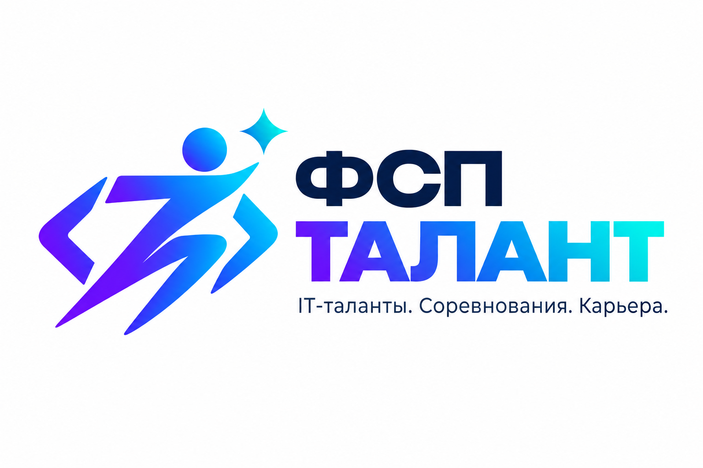

<p align="center">
  
</p>

# ФСП Талант

Платформа обратного найма для участников соревнований Федерации спортивного программирования (трек ФСП, LCT-2026). Работодатель не ждёт откликов: он описывает, кто ему нужен, получает подборку кандидатов с понятным разбором и сам отправляет приглашение с зарплатной вилкой. Имя и контакты кандидата открываются только после его согласия.

## Чем решение сильно

- **Грейд подтверждён, а не заявлен.** Адаптивный тест подстраивается под кандидата и заканчивается за 8–20 заданий. Задания генерируются заново для каждого человека, поэтому выученный ответ не помогает. Если ответ — целое число, его вводят с клавиатуры, и угадать его нельзя.
- **Результаты ФСП становятся доказательством.** Место в протоколе, размер команды, давность и разряд ЕВСК сводятся в отдельную ось профиля. У кого нет истории ФСП, тот ничего не теряет: ось просто не учитывается.
- **Каждое место в подборке объяснено.** Под карточкой видно, какие факторы сработали и с каким весом. До трёх кандидатов можно сравнить рядом, без имён и контактов.
- **Тест зависит от вакансии.** Навыки из описания вакансии меняют доли тем. Работодатель до публикации видит, какой тест получится, и три примера заданий.
- **Закон соблюдён с первого экрана.** Отдельные согласия по 152-ФЗ, журнал доступа к контактам, мгновенный отзыв согласия, удаление данных через 30 дней. Несовершеннолетние скрыты из поиска.
- **Решение сразу готово к работе.** Docker Compose, миграции, демо-данные, HTTPS на стенде, ночные резервные копии, 406 юнит-тестов и автоматический деплой из CI.

## Цифры, которые можно проверить

| Что | Результат | Команда |
|---|---|---|
| Точность теста вдали от границы грейда (2000 кандидатов) | 91,7 % | `python -m app.validation.assessment --n 2000 --seed 7` |
| Устойчивость повторной сдачи, каппа Коэна | 0,51 | та же |
| Случайное угадывание проходит тест | 0 % | та же |
| Подбор против поиска по ключевым словам, nDCG@10 | +0,040 и +0,051 | `python -m app.validation.matching` |

Команды запускаются из `backend/`. Методика и полные таблицы: [проверка теста](docs/VALIDATION_ASSESSMENT.md), [проверка подбора](docs/VALIDATION_MATCHING.md).

## Запуск

```bash
cp .env.example .env
docker compose up -d --build
docker compose exec -u appuser backend python -m seed.generate_seed
```

Миграции применяются при старте backend. Сайт открывается на http://localhost. Снаружи доступен только nginx; API (8010), фронтенд (3010), PostgreSQL (5432) и Redis (6379) слушают только 127.0.0.1.

Письма с кодами подтверждения приходят в Mailpit: http://localhost:8025. На стенде письма уходят через настоящий SMTP (`MAIL_MODE=smtp` и `SMTP_*` в `.env`). Как поднять стенд с HTTPS без покупки домена, описано в [deploy/README.md](deploy/README.md).

Демо-входы (пароль у всех `demo12345`, компании вымышленные):

| Кто | Email | Что показывает |
|-----|-------|----------------|
| Кандидат | fsp001@demo.talent | привязан ФСП ID, подтверждённые результаты, ожидающие приглашения |
| Кандидат | fsp002@demo.talent | история ФСП, специализация «информационная безопасность» |
| Кандидат | nofsp@demo.talent | без истории ФСП: категория по опросу и тесту |
| Работодатель | hr@sibcode.demo | три потребности с отобранными кандидатами, приглашения во всех статусах, отклики |

Демо-данные сразу показывают живую платформу: 40 вымышленных кандидатов уже прошли адаптивный тест через тот же сервис, что работает в API, у «Сибирского кода» есть три потребности, восемь приглашений в разных статусах и шесть откликов.

### Демонстрация за пять минут

1. **Работодатель** `hr@sibcode.demo`, раздел «Потребности», карточка «Backend на Python в платёжный сервис». Подборка упорядочена одной оценкой соответствия, у каждой карточки есть полосы факторов и блок «Почему в выдаче». Отметьте трёх кандидатов кнопкой «Сравнить»: факторы встанут рядом, лучший в каждой строке выделен.
2. Там же «Какой тест получится»: доли тем из текста потребности и три примера заданий без ответа.
3. «Пригласить» на карточке: роль, вилка до вычета НДФЛ, способ связи. Кандидат получает письмо и уведомление.
4. **Кандидат** `fsp001@demo.talent`: уведомление, приглашение, «Принять». У работодателя в «Приглашениях» открываются контакты, в журнале доступа появляется запись.
5. «Тест на грейд»: выбор уровня и языка кода (Python, JavaScript, Go, Java), задания по одному, в конце итог по темам.
6. Профиль, «Согласия», отзыв согласия на обработку: контакты закрываются сразу.
7. Документация API: http://localhost/docs.

## Аккаунты и согласия

- Обе роли регистрируются по email и подтверждают его кодом из шести цифр или ссылкой (ТЗ 2.2, п. 4). Код хранится только в виде HMAC, действует 30 минут, даёт пять попыток, повторно отправляется не чаще раза в минуту. Есть сброс пароля.
- История ФСП для регистрации не нужна (ТЗ 2.1). ФСП ID привязывается в профиле, когда участнику удобно. Для демонстрации подключён тестовый реестр: FSP2000–FSP2099 с паролем `test` ещё свободны, FSP1000–FSP1149 уже привязаны в демо-данных.
- Согласие на обработку персональных данных оформлено отдельным документом (ч. 1 ст. 9 152-ФЗ в редакции 156-ФЗ). Публичная страница требует ещё одного согласия, на распространение (ст. 10.1). Тексты лежат в `backend/app/legal/docs/`, в базе хранится версия и SHA-256 принятого текста.
- При регистрации платформа спрашивает «мне есть 18», а не дату рождения. После привязки ФСП дата берётся из протокола.
- Контакты отдаются работодателю только при действующем согласии. После отзыва они закрываются сразу, через 30 дней имя, контакты, ФСП ID и навыки стираются (ч. 5 ст. 21). Удаление аккаунта стирает их немедленно. Анонимные результаты соревнований и журнал согласий сохраняются.
- О каждом шаге найма вторая сторона узнаёт из письма и уведомления на сайте. В письмах нет данных другой стороны.
- Ошибки API приходят в одном формате с машинным кодом: [docs/API_ERRORS.md](docs/API_ERRORS.md).

## Две оси профиля

Грейд и результаты соревнований — разные вещи, и платформа их не смешивает. Грейд подтверждает тест; до теста он берётся из самооценки или стажа и помечается как заявленный. Ось «подтверждено ФСП» считается отдельно, версия методики `v2.0.0`:

```
p = 1 - (place - 0.5) / N                 процентиль Хазена
q = W(разряд ЕВСК) * p                    качество результата
w = 2^(-месяцы / 18) / sqrt(размер команды)
μ = (Σ w q + K μ0) / (Σ w + K)            K=2, μ0=0.30
σ = sqrt(0.04 / (Σ w + K))
ранжирование по LCB = μ - σ
```

Это байесовская оценка с нормальным априорным распределением N(0,30; τ²/K) и известной дисперсией наблюдения τ² = 0,04; веса w работают как дробные наблюдения. Ранжирование идёт по нижней границе LCB = μ − σ (около 84 % односторонней уверенности), поэтому один случайный успех не обгоняет стабильную серию. Командный результат снижает вес доказательства и расширяет σ, но не снижает уровень. Разряды МС и КМС требуют не меньше шести участников.

## Тест на грейд

Категория кандидата складывается из опроса (специализация, отрасль, цель: работа или стажировка), заявленного грейда и теста (ТЗ 2.1). Грейд подтверждается отдельно для каждой специализации. Шестая дисциплина ФСП «программирование систем ИИ» (ЕКП 2026) связана со специализацией ML.

- **Задания из параметрических семейств.** Девять семейств с вычисляемым ответом (Python, SQL, JavaScript, алгоритмы, графы, сети, безопасность, ML, встраиваемые системы) и пул концептуальных вопросов, у каждого пять уровней сложности. Ответ считает код, а юнит-тест `test_item_families.py` перезапускает каждый фрагмент в Python, Node.js, Go, Java или SQLite и сверяет ключ. Концептуальных вопросов не больше 30 %. Языковая модель во время теста не используется, поэтому сложность заданий сравнима между кандидатами.
- **Язык кода выбирает кандидат:** Python, JavaScript, Go или Java.
- **Модель IRT 3PL.** Вероятность угадать — 1/4, если ответ выбирают из четырёх вариантов, и 0,02, если число вводят. Следующее задание выбирается по информации в точке порога грейда, случайно среди трёх лучших, с учётом плана тем. Тест заканчивается, как только уровень определён с уверенностью 90 %.
- **Решение.** Грейд подтверждён при вероятности уровня от 75 %, повышение на ступень — от 90 %. Подтверждённый грейд не понижается. Повышение доступно раз в 90 дней, пересдача того же уровня — через 7 дней, прерванная попытка засчитывается.
- **Защита сессии.** Правильный ответ не уходит в браузер до конца теста, ответ принимается только на текущее задание по HMAC-токену, время засекает сервер.
- **Защита от утечки.** Для каждого ключа задания платформа следит, не растёт ли доля верных ответов сверх ожидаемой по способностям кандидатов. При z ≥ 3,5 ключ уходит в карантин. Статистика открыта: `GET /api/v1/public/assessment/items`.
- **Тест по вакансии.** Названные в вакансии навыки подтягивают свои семейства. Кандидат может пройти полный тест по вакансии или одно короткое задание для практики; оно не меняет грейд и отмечается на анонимной карточке.
- Навык с долей верных ответов от 75 % на трёх и более заданиях получает отметку «подтверждён тестом».

На 2000 смоделированных кандидатах тест прав в 91,7 % случаев, если кандидат дальше 0,5 от границы грейда. Каппа повторной сдачи — 0,51. Ввод числа вместо выбора из четырёх вариантов поднимает точность с 88,5 % и каппу с 0,42 на тех же людях. CI при каждом изменении повторяет проверку на 300 кандидатах и сверяет результат с порогами (`--check`).

## Подбор кандидатов

Работодатель описывает **потребность**: специализация, грейд, обязательные и желательные навыки, отрасль, стажировка. Каждое изменение сохраняется новой версией, а список отобранных кандидатов помнит, по какой версии выбран каждый, и показывает воронку. Для потребности платформа предлагает категории «специализация × грейд», где искать.

Порядок выдачи задаёт одна оценка соответствия, которую можно разложить на части (`app/services/matching.py`):

- Попадание в список решает соответствие потребности: навыки 0,50, грейд 0,20, специализация 0,20, текст 0,05, отрасль 0,05.
- Навык весит по силе доказательства: подтверждён тестом 1,0, найден цитатой в резюме 0,75, заявлен 0,55.
- Среди кандидатов с одинаковым соответствием выше тот, у кого сильнее тест и протокол ФСП. Нет истории ФСП — эта ось не учитывается и не штрафует.
- В разборе карточки есть строка «Лучше N % кандидатов категории» и строки «плюс / минус / инфо» по каждому фактору.

На двух синтетических наборах со скрытой правдой этот подбор обходит поиск по ключевым словам на 0,040 и 0,051 nDCG@10. Жюри может проверить его на своей разметке: `python -m app.validation.matching --import pairs.json`.

## Поиск и резюме

Поиск сначала отсекает лишнее в SQL: закрытые профили, несовершеннолетних без согласия представителя, неподходящие роль, грейд, дисциплину и разряд. Затем полнотекстовый ранг PostgreSQL и триграммы объединяются методом RRF (K = 60) вместе с рангом по результату теста. Карточка кандидата в выдаче анонимна: статус соревнования, год и диапазон процентиля, без названия события и точного места.

PDF-резюме разбирается и не сохраняется. Навыки из словаря попадают в паспорт сразу: у каждого видны источник (тест, цитата из резюме или заявление), дата и вес в подборке. Имя, телефон, Telegram, стаж, заявленный грейд и специализация предлагаются вместе с дословной цитатой из резюме и переносятся по кнопке «Применить». Если подключён GigaChat (`GIGACHAT_CREDENTIALS`), он добавляет навыки только с дословной цитатой из текста. Решение всегда остаётся за человеком.

## Удостоверения

Подтверждённый результат выдаётся как подписанное удостоверение по стандарту W3C Verifiable Credentials 2.0 (подпись `eddsa-jcs-2022`). Издатель — платформа: она подтверждает, что результат получен из системы ФСП. Любой может проверить подпись через `GET /api/v1/public/issuer` и `POST /api/v1/public/credentials/verify`.

## Интерфейс

Дизайн-система «Протокол» построена на [брендбуке ФСП](https://fsp-russia.ru/press/brandbook/): фирменные цвета, шрифт JetBrains Mono для заголовков и цифр, Golos Text для длинного текста, карта России с сетью региональных отделений на главной.

Подборка читается как протокол соревнований: место, категория, подтверждения и полосы факторов. Красный цвет есть только у приглашения, золото — только у разрядов. Светлая и тёмная темы, ширина экрана от 390 px, контраст текста не ниже WCAG 2.2 AA, анимации отключаются при `prefers-reduced-motion`. Окна приглашения и согласия держат фокус внутри и закрываются клавишей Escape. Шрифты, Swagger UI и карта лежат в проекте, внешних запросов нет. Токены, компоненты и таблица контраста — в [docs/DESIGN.md](docs/DESIGN.md), результаты проверки интерфейса — в [docs/UI_AUDIT_2026-10-06.md](docs/UI_AUDIT_2026-10-06.md).

## Защита данных

- Контакты видны только после принятия приглашения или собственного отклика кандидата. Согласие пишется в `consent_logs`, каждый просмотр контактов — в `access_logs`.
- Ответ на приглашение и отзыв согласия выполняются под блокировкой строки. На пару «работодатель — кандидат» действует ровно одно активное приглашение (уникальный индекс).
- Вход, регистрация и отправка писем ограничены по частоте. Если хранилище лимитов недоступно, эти методы отвечают 503 и не пропускают запросы без проверки.
- Именная страница и рейтинг недоступны несовершеннолетним.

## План развития

- Подключить API реестра ФСП: адаптер `RealFSPAdapter` готов принять спецификацию Федерации.
- Добавить в интерфейс оформление согласия законного представителя для участников младше 18 лет.
- Откалибровать трудность заданий по реальным ответам: инструмент готов (`python -m app.validation.calibrate`).
- Включить смысловой поиск по эмбеддингам (`EMBEDDINGS_MODE=model`).
- Добавить к удостоверениям статус отзыва и ротацию ключа подписи.

## Документация

- [Описание решения по разделу 3.4 ТЗ](docs/SOLUTION.md)
- [Проверка теста на грейд](docs/VALIDATION_ASSESSMENT.md)
- [Проверка подбора](docs/VALIDATION_MATCHING.md)
- [Дизайн-система](docs/DESIGN.md) и [проверка интерфейса](docs/UI_AUDIT_2026-10-06.md)
- [Коды ошибок API](docs/API_ERRORS.md)
- [Развёртывание стенда](deploy/README.md)
