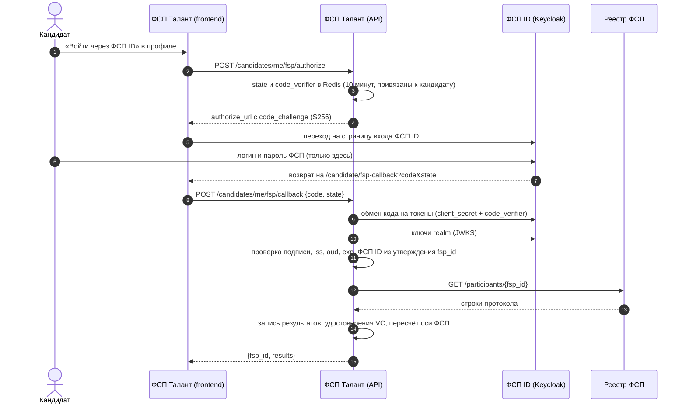
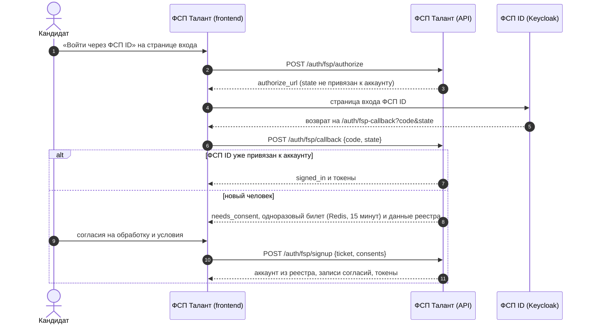

# Интеграция с реестром ФСП и ФСП ID

ТЗ не даёт ни API, ни структуры данных ФСП и просит команду решить, что получать и как показывать (раздел 2, 3.4). Ниже — что мы предлагаем Федерации и что уже работает в коде.

Короткий итог:

- **Вход через ФСП ID работает как OpenID Connect.** Платформа — обычный клиент Keycloak, поток кода авторизации с PKCE. В демо роль Keycloak играет помеченная страница этого сайта. Для подключения настоящего ФСП ID код менять не нужно, достаточно настроек в `.env`.
- **Из реестра берём только строки протокола:** соревнование, дисциплина, статус по ЕКП, место, число участников, командность, дата. Пол, контакты и документы не запрашиваем.
- **Результаты ФСП — отдельная ось профиля.** На грейд они не влияют. Кандидат без истории ФСП ничего не теряет: ось просто не учитывается (ТЗ 2.1).

## 1. Вход через ФСП ID (OpenID Connect, Keycloak)

ТЗ: «В дальнейшем ФСП ID будет работать на базе Keycloak, поэтому совместимость с этим решением упростит последующую интеграцию».



Свойства, которые проверяют тесты `backend/tests/unit/test_fsp_identity.py`:

- пароль ФСП вводится только на странице провайдера, платформа его не видит;
- `state` одноразовый и принадлежит одному кандидату: чужой `state` отклоняется;
- код одноразовый и привязан к `code_challenge`: перехваченный код без `code_verifier` этой сессии бесполезен;
- код выдаётся только для зарегистрированного `client_id` и адреса возврата;
- ID-токен проверяется по ключам realm: подпись, издатель, аудитория, срок. Токен для другого клиента, просроченный или подписанный чужим ключом отклоняется;
- вычисление `code_challenge` сверено с примером из RFC 7636.

### Режимы

| `FSP_ID_MODE` | Где вводят пароль | Что нужно |
|---|---|---|
| `mock` (демо) | Страница `/fsp-id/authorize` этого сайта с пометкой «Демо-провайдер». Реестр FSP2000–FSP2099, пароль `test` | Ничего |
| `oidc` | Страница входа Keycloak Федерации | `FSP_ID_ISSUER`, `FSP_ID_CLIENT_ID`, `FSP_ID_CLIENT_SECRET`, `FSP_ID_CLAIM` |

### Что настроить в Keycloak Федерации

1. Клиент `fsp-talent`: Client authentication — On (конфиденциальный клиент), Standard flow — On, остальные потоки выключены.
2. Valid redirect URIs: `https://<адрес стенда>/candidate/fsp-callback` (привязка) и `https://<адрес стенда>/auth/fsp-callback` (вход).
3. Advanced → Proof Key for Code Exchange Code Challenge Method: `S256`.
4. Client scopes → mapper типа «User Attribute»: атрибут пользователя с номером ФСП ID → утверждение `fsp_id` в ID-токене.
5. В `.env` платформы: `FSP_ID_MODE=oidc`, `FSP_ID_ISSUER=https://<keycloak>/realms/<realm>`, `FSP_ID_CLIENT_ID=fsp-talent`, `FSP_ID_CLIENT_SECRET=<секрет клиента>`.

Код: `backend/app/services/fsp/identity.py` (`KeycloakFspIdProvider`, `MockFspIdProvider`), методы API — `backend/app/api/v1/candidates.py` (`/me/fsp/authorize`, `/me/fsp/callback`), демо-провайдер — `backend/app/api/v1/fsp_id_demo.py`.

### Вход в платформу через ФСП ID

Федерация ответила, что ФСП ID — единая точка входа, а вход на хакатоне можно имитировать. Поэтому ФСП ID работает двумя способами: привязка к готовому аккаунту (схема выше) и вход без регистрации по email. Регистрация по email (ТЗ 2.2, п. 4) остаётся.



- Тот же поток кода с PKCE, что и привязка, но свой адрес возврата: `/auth/fsp-callback` (привязка — `/candidate/fsp-callback`). Код, выданный для одного адреса, другой поток не примет. `state` и код одноразовые.
- Без обязательных согласий (`terms`, `pd_candidate`) аккаунт не создаётся: 422 `consent_required`, билет не тратится. Повтор билета — 400 `fsp_ticket_invalid`.
- Такой аккаунт работает без email и пароля: личность подтверждает ФСП ID. Для связи кандидат добавляет Telegram или телефон в профиле, уведомления приходят в колокольчик.
- В Keycloak добавляется второй адрес возврата: `https://<адрес стенда>/auth/fsp-callback`.
- Как показать: «Вход» → «Войти через ФСП ID» → `FSP001` / `test` (аккаунт `fsp001@demo.talent` уже привязан, вход сразу) или любой из FSP2000–FSP2099 / `test` (новый человек, экран согласий).

Код: `backend/app/api/v1/auth.py` (`/fsp/authorize`, `/fsp/callback`, `/fsp/signup`), тесты — `backend/tests/unit/test_fsp_signin.py` (вход привязанного аккаунта, согласия до создания, одноразовые `state` и билет, разделение адресов возврата).

## 2. Контракт реестра ФСП

Предлагаемый контракт — один метод только на чтение. В режиме `FSP_MODE=real` его вызывает `HttpFSPAdapter` (`backend/app/services/fsp/registry.py`). В демо (`FSP_MODE=mock`) те же структуры отдаёт `MockFSPAdapter` с синтетическими протоколами.

```http
GET {FSP_API_URL}/participants/{fsp_id}
Authorization: Bearer {FSP_API_KEY}
Accept: application/json
```

```json
{
  "fsp_id": "FSP001",
  "display_name": "Иван Иванов",
  "region": "Томская область",
  "birth_date": "2003-05-12",
  "results": [
    {
      "event_id": "CR2025-ALG",
      "event_name": "Чемпионат России по спортивному программированию 2025",
      "discipline": "algorithmic",
      "competition_status": "russia_championship",
      "place": 3,
      "total_participants": 180,
      "regions_count": 52,
      "is_team": false,
      "team_size": 1,
      "role": "participant",
      "event_date": "2025-11-20",
      "protocol_url": "https://…"
    }
  ]
}
```

| Ответ | Что делает платформа |
|---|---|
| 200 | Записывает строки протокола, выдаёт по каждой подписанное удостоверение, пересчитывает ось ФСП |
| 404 | «Протоколы ФСП не найдены» (`fsp_not_found`), профиль остаётся без оси ФСП |
| другой код или неверная структура | 503 «Реестр ФСП сейчас не отвечает», ранее загруженные данные не трогаются |

Строка с неизвестной дисциплиной или местом вне `1…total_participants` пропускается, а не угадывается.

### Поля и зачем они нужны

| Поле | Зачем | Где используется |
|---|---|---|
| `discipline` | Какая из шести дисциплин ФСП: алгоритмическое, продуктовое, системы ИБ, БАС, робототехника, системы ИИ | Ось ФСП по дисциплинам, фильтр поиска |
| `competition_status` | Статус соревнования по ЕКП | Подпись строки протокола. В оценку не входит |
| `place`, `total_participants` | Класс результата: победитель, призёр, топ-10 %, верхняя половина, участие | Качество результата |
| `regions_count` | Показывается в карточке события, в оценку не входит | Карточка события |
| `ranks` | Разряд, дата присвоения и номер приказа по дисциплине | Профиль, фильтр «Разряд не ниже», PDF. В оценку не входит |
| `is_team`, `team_size` | Командный результат | Вес доказательства делится на √(размер команды): уверенность ниже, уровень не снижается |
| `event_date` | Давность | Затухание с полупериодом 18 месяцев |
| `birth_date` | Совершеннолетие | Профили младше 18 лет скрыты от работодателей без согласия законного представителя |
| `region` | Подпись в профиле | В скор подбора не входит |
| `display_name` | Подпись, если кандидат не указал имя сам | Видна работодателю только после согласия кандидата |

**Не запрашиваем:** пол, контакты, паспортные данные, место учёбы. Принцип минимизации из ст. 5 152-ФЗ: берём только то, что нужно для оценки.

Значения `competition_status`: `world`, `russia_championship`, `russia_cup`, `russia_youth`, `all_russian`, `federal_district`, `regional`, `other`.

### Аутентификация сервиса

В демо-контракте это ключ `Bearer`. В продакшене удобнее токен Keycloak по `client_credentials` того же клиента `fsp-talent` с отдельной ролью «чтение протоколов». Тогда доступ к реестру отзывается в одном месте вместе с входом.

## 3. Обновление данных

Протоколы по-прежнему загружаются при привязке ФСП ID. Повторно их забирает почасовая задача `sync_fsp_changes`: она спрашивает реестр, кто изменился после сохранённой отметки, и дописывает только новые строки уже привязанным участникам.

```http
GET {FSP_API_URL}/participants/changes?since=2026-10-01T00:00:00Z
→ {"fsp_ids": ["FSP001", "FSP017"], "next_since": "2026-10-06T12:00:00Z"}
```

Отметку хранит Redis (`fsp:changes:since`). Первый запуск смотрит на два часа назад. Повтор той же строки безопасен: пара (участник, соревнование) в таблице `results` уникальна, уже лежащая строка не пишется второй раз. В демо ту же выборку отдаёт `MockFSPAdapter`. Если Федерации удобнее push, подойдёт вебхук «протокол утверждён» с той же структурой и подписью HMAC.

## 4. Как результат становится доказательством

1. Строка протокола → класс результата по месту и размеру поля (`result_class`, методика `v3.2.0`): победитель 1,00 · призёр (2–3 место) 0,85 · топ-10 % 0,65 · верхняя половина 0,45 · участие 0. Победитель и призёр — при шести участниках и больше. В сумму дисциплины входят пять сильнейших событий. Статус соревнования не учитывается: по совету Федерации все соревнования одинаково важны. Разряд из этой строки не считается.
2. Вес результата = затухание с полупериодом 18 месяцев / √(размер команды). Вклад внутри команды не разделяется: команда снижает уверенность, а не уровень.
3. По дисциплине — байесовское сжатие к среднему и нижняя граница уровня (LCB). В подборке по потребности эта граница берётся по профильной дисциплине целиком, а по остальным — с весом 0,5 (`app/services/fsp/relevance.py`). Фильтр «дисциплина» оставляет одну дисциплину. Статус соревнования в выборе не участвует. Один случайный успех не обгоняет стабильную серию. Участие весит 0, поэтому профиль нельзя набрать онлайн-участиями. Проверка — `python -m app.validation.fsp_axis --seeds 3` из каталога `backend`: 2000 человек, зёрна 2026, 2027 и 2028, место в протоколе зависит от скрытой силы, а число онлайн-участий в нижней половине — нет. Считается боевой движок оси. В корреляцию не входят люди без единой строки протокола.

| Зерно | В корреляции | Спирмен LCB | Спирмен среднего места | Спирмен числа строк |
|---|---|---|---|---|
| 2026 | 1969 | 0,709 | 0,695 | 0,148 |
| 2027 | 1966 | 0,695 | 0,668 | 0,144 |
| 2028 | 1966 | 0,717 | 0,680 | 0,089 |
| среднее ± стандартное отклонение | | 0,707 ± 0,011 | 0,681 ± 0,014 | 0,127 ± 0,033 |

На каждом зерне LCB выше среднего места, а среднее место выше числа строк. Среднее место — средняя доля поля, которую человек оставил позади (выше значит финиш лучше). Ферма из 40 онлайн-участий в нижней половине даёт LCB 0,01, две победы — LCB 0,54. Грейд эта проверка не трогает.
4. Ось ФСП влияет на место кандидата внутри категории и никогда — на грейд: грейд даёт только тест специализации. Разряд — факт реестра (разряд, дата, приказ), а не расчёт по месту. Он показывается в профиле и фильтре «Разряд не ниже» и в оценку не входит. Формулы балла — в [README](../README.md#две-оси-профиля) и `backend/app/services/scoring/engine.py`, версия `v3.2.0`.

## ЕВСК 2026–2029

Действующий документ — приказ Минспорта России от 09.04.2026 № 299 «Об утверждении Единой всероссийской спортивной классификации», зарегистрирован Минюстом 05.06.2026 № 86925, вступил в силу 19.06.2026. Нормы по спортивному программированию — приложение № 77 (пункт 1.77). Прежний приказ от 11.01.2022 № 6 утратил силу.

Текст таблиц приложения № 77 сюда не загружался. Демо-реестр пока ставит разряд по нормам приказа № 6 в редакции от 22.04.2024, с пометкой `Приказ-демо-` в номере. Это не приказ органа власти. Срок действия разряда в продукт не заложен. Шестая дисциплина «программирование систем ИИ» есть в календаре ЕКП 2026; входит ли она в приложение № 77, владелец ещё не подтвердил, поэтому подпись «вне ЕВСК» не ставится.

- Обзор приказа: https://ppt.ru/obzory/vstupaet-v-silu/prikaz-minsporta-rossii-09-04-2026-299
- Текст приказа без приложений: https://pravo.ppt.ru/prikaz/minsport/n-299-340165
- Страница Минспорта: https://minsport.gov.ru/evsk-2026-2029-sportivnoe-programmirovanie/
5. По каждой строке выдаётся удостоверение W3C Verifiable Credentials 2.0 (`eddsa-jcs-2022`). Любой может проверить подпись: `GET /api/v1/public/issuer`, `POST /api/v1/public/credentials/verify`.

Сейчас издатель удостоверений — платформа: она подтверждает, что результат получен из системы ФСП. В продакшене издателем может стать сама Федерация со своим ключом, формат при этом не меняется.

## 5. Что видит работодатель

Карточка в выдаче анонимна: статус соревнования, год и диапазон процентиля («топ-5 %»). Названия события и точного места в ней нет, чтобы по ним нельзя было найти человека в открытом протоколе. После того как кандидат принял приглашение или откликнулся сам, работодатель видит имя и контакты. Каждый просмотр записывается в журнал доступа.
