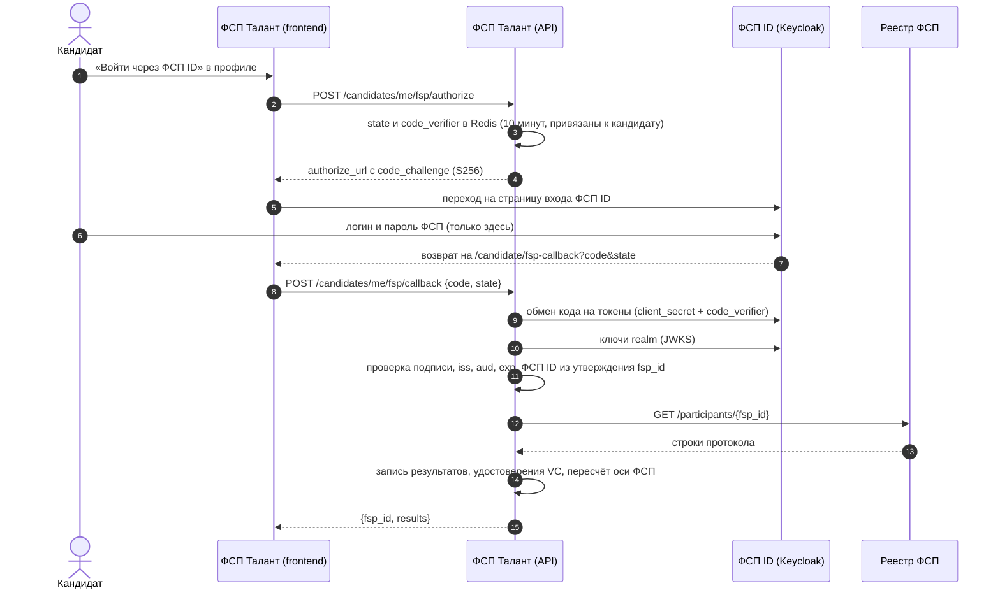

# Интеграция с реестром ФСП и ФСП ID

ТЗ не даёт ни API, ни структуры данных ФСП и просит команду решить, что получать и как показывать (раздел 2, 3.4). Ниже — что мы предлагаем Федерации и что уже работает в коде.

Короткий итог:

- **Вход через ФСП ID работает как OpenID Connect.** Платформа — обычный клиент Keycloak, поток кода авторизации с PKCE. В демо роль Keycloak играет помеченная страница этого сайта. Для подключения настоящего ФСП ID код менять не нужно, достаточно настроек в `.env`.
- **Из реестра берём только строки протокола:** соревнование, дисциплина, статус по ЕКП, место, число участников, командность, дата. Пол, контакты и документы не запрашиваем.
- **Результаты ФСП — отдельная ось профиля.** На грейд они не влияют. Кандидат без истории ФСП ничего не теряет: ось просто не учитывается (ТЗ 2.1).

## 1. Вход через ФСП ID (OpenID Connect, Keycloak)

ТЗ: «В дальнейшем ФСП ID будет работать на базе Keycloak, поэтому совместимость с этим решением упростит последующую интеграцию».



Свойства, которые проверяют тесты `backend/tests/unit/test_fsp_identity.py`:

- пароль ФСП вводится только на странице провайдера, платформа его не видит;
- `state` одноразовый и принадлежит одному кандидату: чужой `state` отклоняется;
- код одноразовый и привязан к `code_challenge`: перехваченный код без `code_verifier` этой сессии бесполезен;
- код выдаётся только для зарегистрированного `client_id` и адреса возврата;
- ID-токен проверяется по ключам realm: подпись, издатель, аудитория, срок. Токен для другого клиента, просроченный или подписанный чужим ключом отклоняется;
- вычисление `code_challenge` сверено с примером из RFC 7636.

### Режимы

| `FSP_ID_MODE` | Где вводят пароль | Что нужно |
|---|---|---|
| `mock` (демо) | Страница `/fsp-id/authorize` этого сайта с пометкой «Демо-провайдер». Реестр FSP2000–FSP2099, пароль `test` | Ничего |
| `oidc` | Страница входа Keycloak Федерации | `FSP_ID_ISSUER`, `FSP_ID_CLIENT_ID`, `FSP_ID_CLIENT_SECRET`, `FSP_ID_CLAIM` |

### Что настроить в Keycloak Федерации

1. Клиент `fsp-talent`: Client authentication — On (конфиденциальный клиент), Standard flow — On, остальные потоки выключены.
2. Valid redirect URIs: `https://<адрес стенда>/candidate/fsp-callback`.
3. Advanced → Proof Key for Code Exchange Code Challenge Method: `S256`.
4. Client scopes → mapper типа «User Attribute»: атрибут пользователя с номером ФСП ID → утверждение `fsp_id` в ID-токене.
5. В `.env` платформы: `FSP_ID_MODE=oidc`, `FSP_ID_ISSUER=https://<keycloak>/realms/<realm>`, `FSP_ID_CLIENT_ID=fsp-talent`, `FSP_ID_CLIENT_SECRET=<секрет клиента>`.

Код: `backend/app/services/fsp/identity.py` (`KeycloakFspIdProvider`, `MockFspIdProvider`), методы API — `backend/app/api/v1/candidates.py` (`/me/fsp/authorize`, `/me/fsp/callback`), демо-провайдер — `backend/app/api/v1/fsp_id_demo.py`.

Регистрация на платформе остаётся по email (ТЗ 2.2, п. 4), ФСП ID привязывается к готовому аккаунту. Следующий шаг — вход в платформу целиком через ФСП ID: тот же клиент, плюс создание аккаунта по первому входу.

## 2. Контракт реестра ФСП

Предлагаемый контракт — один метод только на чтение. В режиме `FSP_MODE=real` его вызывает `HttpFSPAdapter` (`backend/app/services/fsp/registry.py`). В демо (`FSP_MODE=mock`) те же структуры отдаёт `MockFSPAdapter` с синтетическими протоколами.

```http
GET {FSP_API_URL}/participants/{fsp_id}
Authorization: Bearer {FSP_API_KEY}
Accept: application/json
```

```json
{
  "fsp_id": "FSP001",
  "display_name": "Иван Иванов",
  "region": "Томская область",
  "birth_date": "2003-05-12",
  "results": [
    {
      "event_id": "CR2025-ALG",
      "event_name": "Чемпионат России по спортивному программированию 2025",
      "discipline": "algorithmic",
      "competition_status": "russia_championship",
      "place": 3,
      "total_participants": 180,
      "regions_count": 52,
      "is_team": false,
      "team_size": 1,
      "role": "participant",
      "event_date": "2025-11-20",
      "protocol_url": "https://…"
    }
  ]
}
```

| Ответ | Что делает платформа |
|---|---|
| 200 | Записывает строки протокола, выдаёт по каждой подписанное удостоверение, пересчитывает ось ФСП |
| 404 | «Протоколы ФСП не найдены» (`fsp_not_found`), профиль остаётся без оси ФСП |
| другой код или неверная структура | 503 «Реестр ФСП сейчас не отвечает», ранее загруженные данные не трогаются |

Строка с неизвестной дисциплиной или местом вне `1…total_participants` пропускается, а не угадывается.

### Поля и зачем они нужны

| Поле | Зачем | Где используется |
|---|---|---|
| `discipline` | Какая из шести дисциплин ФСП: алгоритмическое, продуктовое, системы ИБ, БАС, робототехника, системы ИИ | Ось ФСП по дисциплинам, фильтр поиска |
| `competition_status` | Статус соревнования по ЕКП | Разряд-эквивалент по нормам ЕВСК, вес результата |
| `place`, `total_participants` | Процентиль внутри соревнования | Качество результата |
| `regions_count` | Ценз ЕВСК для МС и КМС | Разряд-эквивалент |
| `is_team`, `team_size` | Командный результат | Вес доказательства `1/√m`: команда снижает уверенность, а не уровень |
| `event_date` | Давность | Затухание с полупериодом 18 месяцев |
| `birth_date` | Совершеннолетие | Профили младше 18 лет скрыты от работодателей без согласия законного представителя |
| `region` | Подпись в профиле | В скор подбора не входит |
| `display_name` | Подпись, если кандидат не указал имя сам | Видна работодателю только после согласия кандидата |

**Не запрашиваем:** пол, контакты, паспортные данные, место учёбы. Принцип минимизации из ст. 5 152-ФЗ: берём только то, что нужно для оценки.

Значения `competition_status`: `world`, `russia_championship`, `russia_cup`, `russia_youth`, `all_russian`, `federal_district`, `regional`, `other`.

### Аутентификация сервиса

В демо-контракте это ключ `Bearer`. В продакшене удобнее токен Keycloak по `client_credentials` того же клиента `fsp-talent` с отдельной ролью «чтение протоколов». Тогда доступ к реестру отзывается в одном месте вместе с входом.

## 3. Обновление данных

Сейчас протоколы загружаются при привязке ФСП ID. Для работы с реальным реестром предлагаем дельта-синхронизацию:

```http
GET {FSP_API_URL}/participants/changes?since=2026-10-01T00:00:00Z
→ {"fsp_ids": ["FSP001", "FSP017"], "next_since": "2026-10-06T12:00:00Z"}
```

Задача Celery раз в час запрашивает изменения и перечитывает протоколы только у привязанных участников. Если Федерации удобнее push, подойдёт вебхук «протокол утверждён» с той же структурой. Подпись — HMAC, повтор безопасен благодаря уникальному ключу (участник, соревнование) в таблице `results`.

## 4. Как результат становится доказательством

1. Строка протокола → разряд-эквивалент по нормам ЕВСК (`rank_equivalent`) → вес результата (МС 1,00 · КМС 0,85 · I 0,70 · II 0,55 · III 0,40 · юношеский 0,30 · без разряда 0,20).
2. Качество результата = вес × процентиль Хазена.
3. По дисциплине — байесовское сжатие к среднему и нижняя граница уровня (LCB). Один случайный успех не обгоняет стабильную серию. Формулы — в [README](../README.md#две-оси-профиля) и `backend/app/services/scoring/engine.py`.
4. По каждой строке выдаётся удостоверение W3C Verifiable Credentials 2.0 (`eddsa-jcs-2022`). Любой может проверить подпись: `GET /api/v1/public/issuer`, `POST /api/v1/public/credentials/verify`.

Сейчас издатель удостоверений — платформа: она подтверждает, что результат получен из системы ФСП. В продакшене издателем может стать сама Федерация со своим ключом, формат при этом не меняется.

## 5. Что видит работодатель

Карточка в выдаче анонимна: статус соревнования, год и диапазон процентиля («топ-5 %»). Названия события и точного места в ней нет, чтобы по ним нельзя было найти человека в открытом протоколе. После того как кандидат принял приглашение или откликнулся сам, работодатель видит имя и контакты. Каждый просмотр записывается в журнал доступа.
