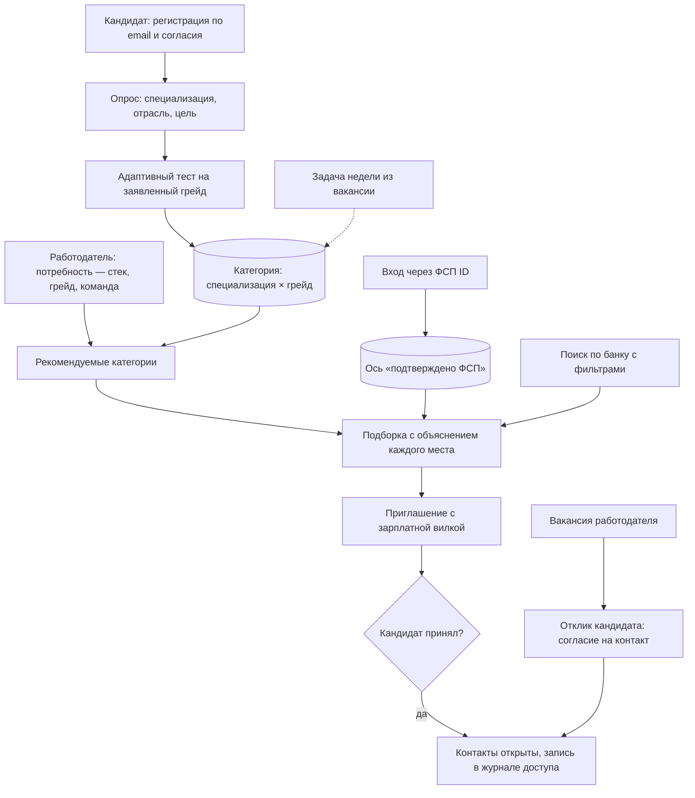
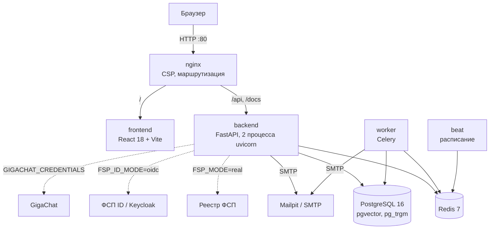

# ФСП Талант: сопроводительная документация

Документ отвечает на раздел 3.4 технического задания. Каждый пункт раздела — отдельная глава, порядок тот же. Все цифры получены запуском кода, команды приведены рядом.

| Пункт ТЗ 3.4 | Глава |
|---|---|
| Функциональная и компонентная архитектура | [1](#1-функциональная-архитектура), [2](#2-компонентная-архитектура) |
| Механика тестирования и устойчивость к распространению заданий | [3](#3-механика-тестирования) |
| Механика подбора и логика категоризации | [4](#4-механика-подбора-и-категоризация) |
| Процедура валидации и её результаты | [5](#5-процедура-валидации-и-результаты) |
| Схема интеграции с реестром ФСП | [6](#6-интеграция-с-реестром-фсп) |
| Описание API | [7](#7-api) |
| Библиотеки и компоненты с версиями | [8](#8-библиотеки-и-компоненты) |
| Инструкция по сборке, развёртыванию и запуску | [9](#9-сборка-развёртывание-и-запуск) |

## 0. Решение в двух абзацах

Кандидат регистрируется по email, проходит опрос (специализация, отрасль, цель: работа или стажировка), выбирает грейд и подтверждает его адаптивным тестом. Из этого складывается категория «специализация × грейд». Результаты соревнований ФСП не меняют грейд: это отдельная подтверждённая ось профиля. Кандидат без истории ФСП ничего не теряет.

Работодатель не ждёт откликов. Он описывает потребность: стек, специализацию, грейд, чем занимается команда. Платформа показывает, в каких категориях искать, и даёт подборку, где у каждого места есть объяснение. Работодатель сам отправляет приглашение с зарплатной вилкой. Имя и контакты кандидата открываются только после того, как кандидат принял приглашение. Классический путь тоже есть: вакансии, отклик, статусы.

## 1. Функциональная архитектура

### Роли и сценарии



### Что умеет каждый кабинет

| Кандидат (ТЗ 2.1) | Работодатель (ТЗ 2.1) |
|---|---|
| Профиль вручную или из PDF-резюме: ФИО, контакты, стек, грейд, стаж, софт-скиллы. Каждое поле предлагается с цитатой и переносится по кнопке | Профиль компании: отрасль, сайт, описание, ИНН с проверкой контрольной суммы. Превью приглашения глазами кандидата |
| Опрос, выбор грейда, адаптивный тест, итог по темам, история попыток | Потребность с версиями: изменения не теряют прежнюю подборку и отобранных |
| Категория и грейд, подтверждённые тестом. Пересдача на грейд ниже или выше с ограничением частоты | Рекомендуемые категории и подборка, у каждого кандидата — разбор факторов и «лучше N % категории» |
| Задача недели из вакансии работодателя и короткая практика по слабой теме | Поиск по всему банку: специализация, грейд, стек, дисциплина и разряд ФСП, только подтверждённые тестом |
| Входящие приглашения с вакансией, вилкой и профилем компании: принять или отклонить | Сравнение до трёх кандидатов рядом, без имён |
| Вакансии под профиль, отклик, статусы откликов | Приглашение без привязки к вакансии, статусы: отправлено, просмотрено, принято, отклонено, отозвано, истекло |
| Приватность: видимость карточки, согласия и их отзыв, удаление аккаунта, привязка ФСП ID | Вакансии с редактированием, отклики со сменой статуса |
| Уведомления на сайте и письма | Контакты только после согласия кандидата, кнопка «Какой тест получится» у вакансии и вкладка «Как проверим» у потребности |

## 2. Компонентная архитектура



Монолит с явными слоями (ТЗ 3.5): роутеры принимают запрос и проверяют права, бизнес-логика живёт в сервисах, которые не знают про HTTP, модели отвечают только за хранение. Внешние системы (реестр ФСП, ФСП ID, GigaChat, почта) подключены через адаптеры с флагом режима: в демо всё работает без внешних сервисов.

### Модули backend

| Слой | Каталог | Что внутри |
|---|---|---|
| API | `app/api/v1/` | 13 роутеров: auth, candidates, search, offers, vacancies, needs, assessment, employer, legal, notifications, public, ai, fsp-id-demo. Единый формат ошибок `app/api/errors.py` |
| Тест | `app/items/`, `app/services/cat.py`, `assessment.py`, `item_monitor.py`, `practice.py`, `vacancy_exam.py` | Параметрические семейства заданий, IRT 3PL, адаптивный выбор, мониторинг утечки, задача недели, тест по вакансии |
| Подбор | `app/services/matching.py`, `search/pipeline.py`, `categorization.py`, `skills.py` | Оценка соответствия, SQL-фильтры, полнотекстовый ранг и RRF, категории, нормализация навыков |
| ФСП | `app/services/fsp/`, `app/services/scoring/` | Реестр (mock и HTTP), ФСП ID (OIDC), ось ФСП: класс результата, давность, байесовское сжатие |
| Доверие | `app/services/vc/`, `identity.py`, `privacy.py`, `notify.py`, `inn.py` | Удостоверения VC 2.0, коды подтверждения, согласия и удаление данных, уведомления, проверка ИНН |
| Фоновые задачи | `app/workers/` | Пересчёт профилей, истечение приглашений, задача недели, очистка по 152-ФЗ |
| Проверка | `app/validation/` | Симуляция теста, проверка подбора, калибровка заданий |
| Данные | `app/models/`, `alembic/versions/` | 21 миграция, у каждой есть откат |

### Данные

Главные таблицы: `participants`, `skills`, `results` (строки протоколов ФСП), `discipline_scores` (ось ФСП), `category_assignments`, `test_sessions` и `test_session_items`, `grade_confirmations`, `item_stats` (статистика ключей заданий), `practice_attempts`, `employers`, `needs` и `need_versions`, `need_shortlist`, `offers`, `vacancies`, `applications`, `consents`, `consent_logs`, `access_logs`, `notifications`, `verifiable_credentials`.

## 3. Механика тестирования

ТЗ отвергает два решения: единый набор заданий (ответы разойдутся по рынку) и генерацию нейросетью под каждого (сложность несравнима). Мы используем третий путь.

**Параметрические семейства.** Семейство — шаблон задания с параметрами и кодом, который вычисляет правильный ответ. Каждый кандидат получает новые числа, строки и фрагменты кода, но сложность задаёт уровень семейства (1–5), а не случай. Девять семейств с вычисляемым ответом (Python, SQL, JavaScript, алгоритмы, графы, сети, безопасность, ML-метрики, встраиваемые системы) и пулы вопросов на понимание: у каждой специализации не меньше шести идей, у каждой идеи несколько формулировок. Юнит-тест `test_item_families.py` перезапускает каждый сгенерированный фрагмент в Python, Node.js, Go, Java, Kotlin, C# или SQLite и сверяет ключ. Языковая модель во время теста не используется.

**Почему утечка не помогает:**

- выученный ответ не подходит к новым параметрам;
- если ответ — целое число, его вводят с клавиатуры, вариантов на экране нет: угадать нельзя;
- правильный ответ не уходит в браузер до конца теста, ответ принимается только на текущее задание по HMAC-токену, время засекает сервер;
- если доля верных ответов по ключу растёт сверх ожидаемой по способностям кандидатов (z ≥ 3,5), ключ уходит в карантин. Статистика открыта: `GET /api/v1/public/assessment/items`;
- вторая попытка не повторяет вопросы на понимание: общих не больше 40 %.

**Адаптивность.** Модель IRT 3PL, оценка способности EAP. Следующее задание выбирается по информации в точке порога заявленного грейда, случайно среди трёх лучших, с учётом плана тем специализации. Тест заканчивается за 8–20 заданий, как только уровень определён с уверенностью 90 %.

**Решение о грейде.** Грейд даёт только основной тест специализации: не тест по вакансии и не результаты ФСП. Кандидат сам выбирает уровень, тест его подтверждает или нет; грейд подтверждён при вероятности уровня от 75 %. Тест на уровень подтверждает только этот уровень. Если результат уверенно выше (от 90 % за следующий порог), платформа предлагает отдельный тест на ступень выше, но сама грейд не повышает. Подтверждённый грейд не понижается (ТЗ 2). Не сдали — тест на уровень ниже доступен сразу, попытка не сгорает. Пересдача того же уровня — через 7 дней, прерванная попытка засчитывается. После смены грейда следующее повышение — через 90 дней. Для стажировки есть грейд «стажёр» на ступень ниже junior.

**Тест зависит от вакансии.** Навыки, названные в тексте вакансии или потребности, подтягивают свои семейства (`vacancy_exam.py`). Работодатель до публикации видит доли тем, цитаты, по которым определены навыки, и три примера заданий без ответа. Кандидат может пройти такой тест: он покажет результат по темам вакансии и подтвердит навыки, но грейд не изменит. В демо девять вакансий с описаниями: на них видно, как разные тексты дают разный тест.

**Регулярные задания (ТЗ 2.1).** Раз в неделю планировщик выбирает каждому активному кандидату открытую вакансию его специализации и присылает «задачу недели». Задание собирается из текста вакансии на тех же семействах. Грейд оно не меняет, а работодатель видит в карточке тему, результат и давность. После теста платформа ещё предлагает практику по самой слабой теме.

Подробно, с формулами и таблицами: [VALIDATION_ASSESSMENT.md](VALIDATION_ASSESSMENT.md).

## 4. Механика подбора и категоризация

**Категория** — специализация из опроса и грейд. Грейд берётся из теста по этой специализации. До теста грейд заявленный, и в выдаче он помечен как заявленный. Справочник: восемь специализаций (backend, frontend, fullstack, mobile, ML и системы ИИ, DevOps, информационная безопасность, встраиваемые системы и робототехника) и пять грейдов (стажёр, junior, middle, senior, lead).

**Ось ФСП** считается отдельно (версия методики `v3.0.0`) и влияет на место внутри категории, но не на грейд. Все соревнования весят одинаково, статус не учитывается. Место в протоколе → класс результата: победитель 1,00, призёр 0,85, топ-10 % 0,65, верхняя половина 0,45, участие 0,25. Давность → затухание с полупериодом 18 месяцев, командный результат → вес доказательства `1/√m`. По дисциплине — байесовское сжатие к среднему и ранжирование по нижней границе LCB = μ − σ: один случайный успех не обгоняет стабильную серию, а много участий без призов не обгоняют несколько побед. Разряд-эквивалент по ЕВСК показывается для справки и в оценку не входит.

**Порядок выдачи** задаёт одна оценка соответствия, разложимая на части (`app/services/matching.py`):

- попадание в список решает соответствие потребности: навыки 0,50, грейд 0,20, специализация 0,20, текст 0,05, отрасль 0,05;
- навык весит по силе доказательства: подтверждён тестом 1,0, найден цитатой в резюме 0,75, заявлен 0,55;
- среди кандидатов с одинаковым соответствием выше тот, у кого сильнее тест и протокол ФСП (ТЗ 2.1: «выше находятся те, у кого сильнее подтверждённый профиль и есть опыт участия в соревнованиях ФСП»);
- неприменимый фактор не учитывается: нет истории ФСП — ось выпадает, кандидат не теряет баллы;
- имя, пол, возраст и регион в оценку не входят. Это проверяет тест `test_fairness.py`.

**Объяснимость.** В карточке — строки «плюс / минус / инфо» по каждому фактору, веса, «лучше N % кандидатов категории», результат задачи недели с давностью. Сравнение до трёх кандидатов ставит факторы рядом.

**Уточнение без потери подборки (ТЗ 2.1).** Потребность хранится версиями. Отобранные кандидаты помнят, по какой версии их выбрали, и остаются в списке после правки фильтров.

**Поиск по банку.** Сначала SQL отсекает закрытые профили, несовершеннолетних без согласия представителя, неподходящие специализацию, грейд, дисциплину и разряд. Затем полнотекстовый ранг PostgreSQL и триграммы объединяются методом RRF (K = 60) с рангом по результату теста. Смысловой поиск по эмбеддингам включается флагом `EMBEDDINGS_MODE=model`.

## 5. Процедура валидации и результаты

Размеченных данных у хакатона нет (ТЗ 2), поэтому валидация построена на синтетике **со скрытой правдой**: модель видит только зашумлённые наблюдения, а качество считается по правде, которую модель не видела. Все проверки детерминированы и запускаются одной командой.

| Что проверяем (критерий ТЗ 6.2) | Результат | Команда (из `backend/`) |
|---|---|---|
| Соответствие эталону: точность решения вдали от границы грейда, 2000 кандидатов | 92,7 % | `python -m app.validation.assessment --n 2000 --seed 7` |
| Согласованность: каппа Коэна повторной сдачи с новыми заданиями | 0,48 | та же |
| Дискриминативность: медиана точечно-бисериальной корреляции, вводимый ответ | 0,26 | та же |
| Устойчивость к распространению: утечка у 30 % кандидатов, точность вдали от границы | 88,4 % с карантином ключей | та же |
| Угадывание проходит тест | 0 % | та же |
| Подбор против поиска по ключевым словам, nDCG@10 (два набора) | +0,064 и +0,048 | `python -m app.validation.matching`, `--seed 7` |
| Справедливость: смена имени, пола, региона не меняет порядок | выполняется | `pytest tests/unit/test_fairness.py` |
| Нагрузка: 40 пользователей одновременно | 0 ошибок, p95 поиска 69 мс | `python tests/load_api.py` |

CI при каждом изменении повторяет проверку теста на 300 кандидатах и падает, если нарушен хотя бы один порог (`--check`). Жюри может проверить подбор на своей разметке: `python -m app.validation.matching --import pairs.json`.

Подробно: [VALIDATION_ASSESSMENT.md](VALIDATION_ASSESSMENT.md), [VALIDATION_MATCHING.md](VALIDATION_MATCHING.md), [LOAD_TEST.md](LOAD_TEST.md).

## 6. Интеграция с реестром ФСП

- **Вход через ФСП ID** — OpenID Connect, поток кода с PKCE. Платформа — конфиденциальный клиент Keycloak: пароль ФСП вводится только на странице провайдера, ФСП ID приходит в проверенном ID-токене. В демо роль Keycloak играет помеченная страница этого сайта с тем же протоколом.
- **Реестр** — один метод только на чтение: строки протокола участника. Пол, контакты и документы не запрашиваем. В демо — синтетический реестр, в режиме `FSP_MODE=real` — HTTP-клиент по предложенному контракту.
- **Удостоверения** — каждая строка протокола выдаётся как W3C Verifiable Credential 2.0 с подписью `eddsa-jcs-2022`, проверка открыта.

Схема обмена, контракт, настройка Keycloak и дельта-синхронизация: [FSP_INTEGRATION.md](FSP_INTEGRATION.md).

## 7. API

Спецификация OpenAPI 3.1: http://localhost/openapi.json, Swagger UI: http://localhost/docs. Swagger отдаётся с того же адреса, без внешних CDN и встроенных скриптов, поэтому работает при строгой политике `script-src 'self'`. У каждого метода описаны запрос, ответ и коды ошибок.

| Группа | Методов | Что делает |
|---|---|---|
| auth | 10 | Регистрация по email с кодом, вход, сброс пароля, обновление токена |
| candidates | 13 | Профиль, опрос, видимость, PDF-резюме и PDF-профиль, приглашения, ФСП ID |
| assessment | 12 | Тест на грейд, история, разбор, практика и задача недели |
| needs | 11 | Потребности с версиями, подборка, сравнение, тест по потребности, отобранные |
| vacancies | 11 | Вакансии, редактирование, отклики и их статусы, контакты по отклику |
| public | 8 | Удостоверения и их проверка, публичный профиль, рейтинг, статистика заданий |
| legal | 5 | Тексты согласий, выдача и отзыв согласий |
| offers | 4 | Приглашения, отзыв, контакты после согласия |
| notifications | 3 | Колокольчик: список и прочтение |
| employer | 2 | Профиль компании |
| ai | 2 | Разбор резюме и текста запроса |
| search | 1 | Поиск по банку кандидатов |
| fsp-id-demo | 1 | Демо-провайдер ФСП ID |

Ошибки приходят в одном формате с машинным кодом: `{"error": {"code", "message", "details"}}`. Полный список кодов: [API_ERRORS.md](API_ERRORS.md), его сверяет с кодом юнит-тест.

## 8. Библиотеки и компоненты

Версии, на которых проходят тесты. Backend ставит их из `backend/requirements.lock`, frontend — из `frontend/package-lock.json`.

### Backend (Python 3.12)

| Библиотека | Версия | Лицензия | Зачем |
|---|---|---|---|
| FastAPI | 0.142.2 | MIT | HTTP API, OpenAPI |
| Starlette | 1.7.0 | BSD-3 | ASGI-основа FastAPI |
| Uvicorn | 0.54.0 | BSD-3 | ASGI-сервер |
| Pydantic / pydantic-settings | 2.13.5 / 2.15.0 | MIT | Схемы, валидация, настройки |
| SQLAlchemy | 2.1.3 | MIT | ORM, асинхронный доступ |
| asyncpg | 0.31.0 | Apache-2.0 | Драйвер PostgreSQL |
| Alembic | 1.20.0 | MIT | Миграции |
| pgvector (Python) | 0.5.0 | MIT | Тип vector для эмбеддингов |
| redis-py | 6.4.0 | MIT | Лимиты, состояние входа ФСП ID |
| Celery | 5.6.3 | BSD-3 | Фоновые задачи и расписание |
| python-jose | 3.5.0 | MIT | JWT и проверка ID-токена ФСП ID |
| bcrypt | 5.0.0 | Apache-2.0 | Хеши паролей |
| cryptography | 50.0.2 | Apache-2.0 / BSD | Ed25519 для удостоверений |
| httpx | 0.28.1 | BSD-3 | Клиент реестра ФСП и Keycloak |
| pypdf | 6.19.0 | BSD-3 | Текст из PDF-резюме |
| fpdf2 | 2.8.9 | LGPL-3.0 | PDF-профиль кандидата |
| pytest | 9.1.1 | MIT | Тесты |
| gigachat (необязательно) | ≥ 0.1.39 | MIT | ИИ-советник для резюме |
| sentence-transformers, torch (необязательно) | ≥ 3.0, ≥ 2.3 | Apache-2.0, BSD-3 | Смысловой поиск |

### Frontend (Node.js 20)

| Библиотека | Версия | Лицензия | Зачем |
|---|---|---|---|
| React, React DOM | 18.3.1 | MIT | Интерфейс |
| React Router | 6.30.6 | MIT | Маршруты |
| TanStack Query | 5.104.1 | MIT | Запросы и кеш |
| Zustand | 4.5.7 | MIT | Состояние входа |
| React Hook Form, Zod, @hookform/resolvers | 7.89.0, 3.25.76, 3.10.0 | MIT | Формы и проверка |
| Axios | 1.20.0 | MIT | HTTP-клиент |
| lucide-react | 0.447.0 | ISC | Иконки |
| date-fns, clsx, tailwind-merge | 3.6.0, 2.1.1, 2.6.1 | MIT | Утилиты |
| @fontsource-variable/jetbrains-mono, golos-text | 5.3.0 | OFL-1.1 | Шрифты брендбука, без внешних запросов |
| Vite, @vitejs/plugin-react | 6.4.3, 4.7.0 | MIT | Сборка |
| TypeScript | 5.9.3 | Apache-2.0 | Типы |
| Tailwind CSS, PostCSS, Autoprefixer | 3.4.19, 8.5.28, 10.6.1 | MIT | Стили |

### Инфраструктура

| Компонент | Версия | Лицензия |
|---|---|---|
| PostgreSQL + pgvector + pg_trgm | 16 (образ `pgvector/pgvector:pg16`) | PostgreSQL License |
| Redis | 7.2 (`redis:7.2-alpine`) | BSD-3 |
| nginx | `nginx:alpine` | BSD-2 |
| Mailpit | `axllent/mailpit` | MIT |
| Caddy (публичный стенд) | 2 (`caddy:2-alpine`) | Apache-2.0 |
| Swagger UI | 5.33.1 (в репозитории) | Apache-2.0 |

Всё — открытое ПО (ТЗ 3.5). Исходный код решения открыт, не скомпилирован и не обфусцирован, лицензия MIT ([LICENSE](../LICENSE)).

## 9. Сборка, развёртывание и запуск

```bash
git clone https://github.com/KonkovDV/fsp-talent.git && cd fsp-talent
make demo          # Windows: см. docs/INSTALL.md, три команды PowerShell
```

Сайт http://localhost, API http://localhost/docs, письма http://localhost:8025. Пошаговая инструкция с требованиями, проверкой, тестами, сбросом и частыми проблемами: [INSTALL.md](INSTALL.md). Публичный стенд с HTTPS: [deploy/README.md](../deploy/README.md).

## 10. Безопасность и 152-ФЗ

- Отдельные согласия на обработку (ч. 1 ст. 9 152-ФЗ) и на распространение для публичной страницы (ст. 10.1). В базе хранятся версия и SHA-256 принятого текста.
- Контакты кандидата видны только после принятия приглашения или собственного отклика и только при действующем согласии. Каждый просмотр — запись в журнале доступа.
- Отзыв согласия закрывает контакты сразу, через 30 дней задача стирает имя, контакты, ФСП ID и навыки (ч. 5 ст. 21). Удаление аккаунта стирает их немедленно.
- Несовершеннолетние скрыты из поиска и рейтинга без согласия законного представителя.
- Пароли — bcrypt. Ключ подписи токенов уникален для установки. Пароль ФСП платформа не видит (OIDC). Коды подтверждения хранятся только в виде HMAC.
- Лимиты на вход, регистрацию, письма, приглашения и поиск. Если хранилище лимитов недоступно, вход и регистрация закрываются, а не пропускают запросы.
- Решение о найме принимает человек: платформа ранжирует и объясняет, но не отсеивает автоматически (ст. 16 152-ФЗ).

## 11. За рамками MVP

Концепции защиты от фиктивных вакансий и интеграции с ATS: [TRUST_AND_ATS.md](TRUST_AND_ATS.md). Дорожная карта — в [README](../README.md#что-дальше).
