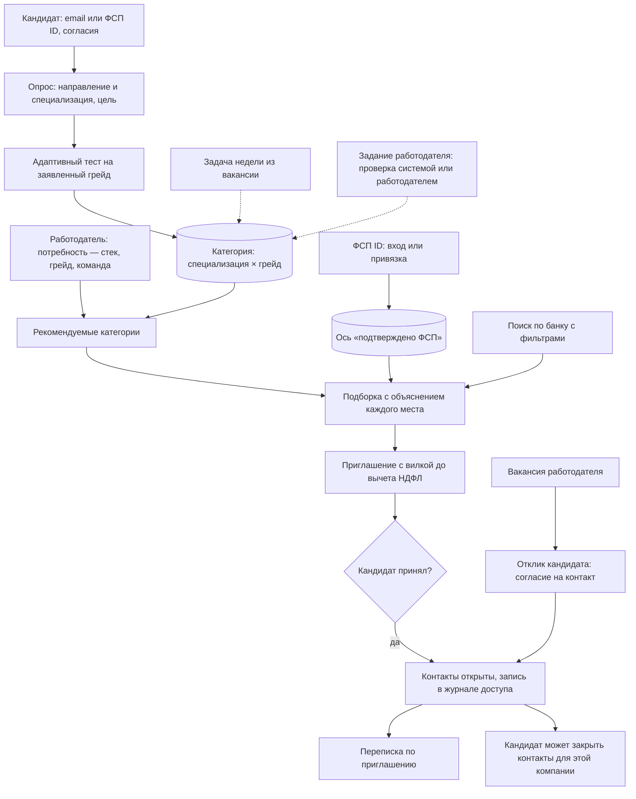
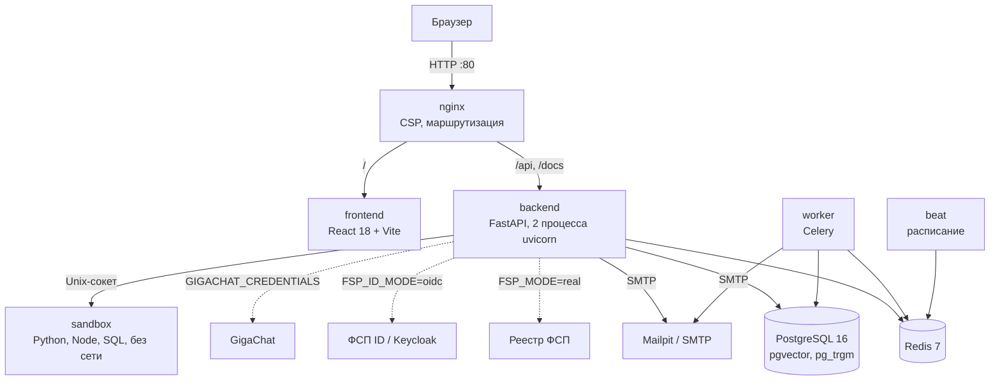

# ФСП Талант: сопроводительная документация

Документ отвечает на раздел 3.4 технического задания. Каждый пункт раздела — отдельная глава, порядок тот же. Все цифры получены запуском кода, команды приведены рядом.

| Пункт ТЗ 3.4 | Глава |
|---|---|
| Функциональная и компонентная архитектура | [1](#1-функциональная-архитектура), [2](#2-компонентная-архитектура) |
| Механика тестирования и устойчивость к распространению заданий | [3](#3-механика-тестирования) |
| Механика подбора и логика категоризации | [4](#4-механика-подбора-и-категоризация) |
| Процедура валидации и её результаты | [5](#5-процедура-валидации-и-результаты) |
| Схема интеграции с реестром ФСП | [6](#6-интеграция-с-реестром-фсп) |
| Описание API | [7](#7-api) |
| Библиотеки и компоненты с версиями | [8](#8-библиотеки-и-компоненты) |
| Инструкция по сборке, развёртыванию и запуску | [9](#9-сборка-развёртывание-и-запуск) |

## 0. Решение в двух абзацах

Кандидат регистрируется по email или входит через ФСП ID, проходит опрос (направление и специализация, цель: работа или стажировка, предметная область по желанию), выбирает грейд и подтверждает его адаптивным тестом. Из этого складывается категория «специализация × грейд». Результаты соревнований ФСП не меняют грейд: это отдельная подтверждённая ось профиля. По ФСП ID без входа видны только дисциплина, год, корзина места и статус соревнования. Протокол соревнования — не цифровой след и не грейд. Если реестр молчит, кандидат может загрузить файл: строка появляется у него на странице и в балл не входит. Порядок внутри категории на странице жюри — места по подтверждающему тесту, без имени и без номера аккаунта. Открытые вакансии рядом называет компанию и должность. Имени и контактов в этих ответах нет. Тот же текст может забрать мессенджер. Кандидат без истории ФСП ничего не теряет.

У компании есть публичная страница: название, открытые вакансии и уровень доверия. Почты компании и имён кандидатов на ней нет. Ссылка стоит в приглашении.

В шапке кабинета кнопка «Куда нажать» отвечает ссылкой на раздел этой роли. На странице жюри тот же вопрос без входа ведёт только на публичные страницы. Вопрос на сервере не хранится и наружу не отправляется: ни в модель, ни в профиль.

Работодатель не ждёт откликов. Он описывает потребность: стек, специализацию, грейд, чем занимается команда. Платформа показывает, в каких категориях искать, и даёт подборку, где у каждого места есть объяснение. Работодатель сам отправляет приглашение с вилкой до вычета НДФЛ (рядом показывается сумма на руки по шкале ст. 224 НК) и может дать кандидату своё задание. Имя и контакты кандидата открываются только после того, как кандидат принял приглашение. Логин публичного кода хранится как контакт: на карточке до согласия только пометка, в балл он не входит. Свидетельство о навыках добавляет цитату к навыку и грейд не ставит. Навык, уже подтверждённый тестом, файл не понижает. Дальше стороны переписываются на платформе, а кандидат может закрыть контакты для одной компании. Классический путь тоже есть: вакансии, отклик, статусы. В тексте вакансии подписываются просьба денег у кандидата, зарплата мимо оформления и отбор по внешности. Такая вакансия остаётся открытой, грейд не меняется.

## 1. Функциональная архитектура

### Роли и сценарии



### Что умеет каждый кабинет

| Кандидат (ТЗ 2.1) | Работодатель (ТЗ 2.1) |
|---|---|
| Профиль вручную или из PDF-резюме: ФИО, контакты, стек, грейд, стаж, софт-скиллы. Каждое поле предлагается с цитатой и переносится по кнопке | Профиль компании: сфера, сайт, описание, ИНН с проверкой контрольной суммы. Превью приглашения глазами кандидата |
| Опрос, выбор грейда, адаптивный тест, итог по темам, история попыток. Путь к следующему грейду: навыки, которые есть у людей этой ступени и которых нет в профиле; навык виден, если его назвали не меньше пяти. Рядом — открытые потребности той же специализации, до которых не хватает одного обязательного навыка. Грейд и балл подбора эти списки не меняют | Потребность с версиями: изменения не теряют прежнюю подборку и отобранных |
| Категория и грейд, подтверждённые тестом. Пересдача на грейд ниже или выше с ограничением частоты. На стенде есть пробный проход из 15 заданий и 5 минут | Рекомендуемые категории и подборка, у каждого кандидата — разбор факторов и «лучше N % категории» |
| Задания от работодателей (общие для специализации и адресные), задача недели из вакансии и короткая практика по слабой теме | Поиск по всему банку: специализация, грейд, стек, дисциплина и разряд ФСП, только подтверждённые тестом |
| Входящие приглашения с вакансией, вилкой и профилем компании: принять или отклонить, переписка после принятия, закрыть контакты для одной компании. Шкала ожиданий своей категории: четверти только если названных сумм не меньше пяти | Сравнение до четырёх кандидатов рядом, без имён. Свои задания кандидатам: с эталоном (проверяет система) или открытые (проверяет работодатель) |
| Вакансии под профиль, отклик, статусы откликов | Приглашение без привязки к вакансии, статусы: отправлено, просмотрено, принято, отклонено, отозвано, истекло |
| Приватность: видимость карточки, согласия и их отзыв, скачать свои данные, сменить пароль, удаление аккаунта, вход через ФСП ID и привязка | Вакансии с редактированием, отклики со сменой статуса. В разделе «Компания» — скачать свои данные и сменить пароль |
| Уведомления на сайте и письма | Контакты только после согласия кандидата, переписка по принятому приглашению, кнопка «Какой тест получится» у вакансии и вкладка «Как проверим» у потребности |

## 2. Компонентная архитектура



Монолит с явными слоями (ТЗ 3.5): роутеры принимают запрос и проверяют права, бизнес-логика живёт в сервисах, которые не знают про HTTP, модели отвечают только за хранение. Внешние системы (реестр ФСП, ФСП ID, GigaChat или YandexGPT, почта) подключены через адаптеры с флагом режима: в демо всё работает без внешних сервисов. На публичном стенде вместо nginx стоит Caddy 2.10: он принимает 80 и 443 и сам получает сертификат. Локальная схема на рисунке от этого не меняется.

### Модули backend

| Слой | Каталог | Что внутри |
|---|---|---|
| API | `app/api/v1/` | 24 модуля роутеров, собранных в `router.py`: auth, candidates, resumes, favorites, search, needs, vacancies, offers, interviews, messages, tasks, assessment, employer, moderation, methodist, integrations, passport, legal, notifications, public, problems, guide, ai, fsp-id-demo. Единый формат ошибок `app/api/errors.py` |
| Тест | `app/items/`, `app/services/cat.py`, `assessment.py`, `item_monitor.py`, `practice.py`, `vacancy_exam.py` | Параметрические семейства заданий, IRT 3PL, адаптивный выбор, мониторинг утечки, задача недели, тест по вакансии, пробный проход |
| Подбор | `app/services/matching.py`, `search/pipeline.py`, `categorization.py`, `skills.py` | Оценка соответствия, SQL-фильтры, полнотекстовый ранг и RRF, категории, нормализация навыков |
| ФСП | `app/services/fsp/`, `app/services/scoring/` | Реестр (mock и HTTP), ФСП ID (OIDC), ось ФСП: класс результата, давность, байесовское сжатие |
| Доверие | `app/services/vc/`, `identity.py`, `privacy.py`, `notify.py`, `inn.py` | Удостоверения VC 2.0, коды подтверждения, согласия и удаление данных, уведомления, проверка ИНН |
| Задания и переписка | `app/services/tasks.py`, `app/api/v1/tasks.py`, `messages.py` | Задания от работодателя, проверка ответа, строка в карточке, переписка по приглашению |
| Фоновые задачи | `app/workers/` | Пересчёт профилей, истечение приглашений, задача недели, очистка по 152-ФЗ |
| Проверка | `app/validation/` | Симуляция теста, проверка подбора, калибровка заданий |
| Данные | `app/models/`, `alembic/versions/` | одна начальная миграция, у неё есть откат |

### Данные

Главные таблицы: `participants`, `skills`, `results` (строки протоколов ФСП), `discipline_scores` (ось ФСП), `category_assignments`, `test_sessions` и `test_session_items`, `grade_confirmations`, `item_stats` (статистика ключей заданий), `practice_attempts`, `employer_tasks` и `task_submissions` (задания работодателя и ответы), `employers`, `needs` и `need_versions`, `need_shortlist`, `offers`, `offer_messages`, `vacancies`, `applications`, `consents`, `consent_logs`, `access_logs`, `notifications`, `verifiable_credentials`.

У `participants` в той же начальной миграции есть `last_login_at`. По нему `GET /api/v1/public/jury-free` (только при `DEMO_MODE`) возвращает адрес жюри, в который дольше всех не входили. В ответе нет ничего, кроме адреса. Ночной сброс это поле не очищает.

## 3. Механика тестирования

Единый набор заданий расходится по рынку. Задание, сочиненное моделью под одного человека, нельзя сравнить с соседним по сложности.

**Параметрические семейства.** Семейство — шаблон задания с параметрами и кодом, который вычисляет правильный ответ. Каждый показ — новый изоморф: другие числа, строки и фрагменты кода. В оценке изоморфы одного уровня делят родителя. Различимость `a` — априор семейства, по ответам в банк она не записывается. Трудность `b` задаёт уровень (от −2,2 до 1,8). Страница «Как устроен тест» показывает `a` каждого семейства. Сложность не берётся из случайных чисел конкретного показа. Семнадцать семейств с вычисляемым ответом (Python, SQL, JavaScript, алгоритмы, графы, сети, безопасность, ML-метрики, встраиваемые системы, границы и расхождения тестов, метрики и доли аналитика, непокрытые требования и шаги цепочки, пакеты и опоздания в конвейере данных) и пулы вопросов на понимание: у специализаций с вопросами на понимание не меньше шести идей, у каждой идеи несколько формулировок. У тестирования план из четырёх семейств с вычисляемым ответом. У аналитика их шесть, у инженерии данных четыре плюс вопросы на понимание конвейера. Юнит-тест `test_item_families.py` перезапускает каждый сгенерированный фрагмент в Python, Node.js, Go, Java, Kotlin, C# или SQLite и сверяет ключ. Языковая модель во время теста не используется.

**Почему утечка не помогает:**

- выученный ответ не подходит к новым параметрам;
- если ответ — целое число, его вводят с клавиатуры, вариантов на экране нет: угадать нельзя;
- правильный ответ не уходит в браузер до конца теста, ответ принимается только на текущее задание по HMAC-токену, время засекает сервер. Ключ в строке задания подписан отдельно: если номер правильного варианта в базе не сходится с подписью, ответ не входит в θ. Повтор той же отправки несёт Idempotency-Key и не открывает вторую попытку;
- если доля верных ответов по ключу растёт сверх ожидаемой по способностям кандидатов (z ≥ 3,5) или то же показывает накопленная сумма избытка, ключ уходит в карантин. Статистика открыта: `GET /api/v1/public/assessment/items`;
- вторая попытка не повторяет вопросы на понимание: общих не больше 40 %.

**Модель угроз: скрипт или ассистент, который отвечает за кандидата.** Цель атакующего — получить подтверждённый грейд выше настоящего. Что стоит на пути сегодня:

| Защита | Как работает | Где в коде |
|---|---|---|
| Новый экземпляр на каждый показ | Числа и фрагменты кода генерируются заново, ключ чужого экземпляра сдаёт 0 %; заранее собранная база ответов бесполезна | `backend/app/items/`, `python -m app.validation.assessment --n 2000 --seed 7` |
| Контроль экспозиции и карантин | Выбор задания штрафует частые ключи (Симпсон–Хеттер); ключ с избытком верных ответов z ≥ 3,5 после 30 ответов перестаёт выдаваться | `services/cat.py`, `services/item_monitor.py:19–20` |
| Быстрый верный ответ | Верный ответ на задание с кодом быстрее 4 секунд считается по семейству; три таких в одном семействе помечают попытку для разбора. Отдельно идёт накопленная сумма (CUSUM) доли верных и скорости по семейству | `services/assessment.py:59–60, 84–97, 100–127` |
| Уход со вкладки и копирование условия | Каждое событие пишется в отметки сессии | `services/session_marks.py` |
| Несогласованность ответов | lz* < −1,645 даёт отметку и предложение пересдать | `services/person_fit.py:17`, `services/assessment.py:666–668` |
| Штраф в выдаче | Отмеченная попытка теста на грейд умножает оценку соответствия в подборке на 0,85, работодатель видит строку «Место умножено на 0,85. Грейд не изменён» | `services/session_marks.py:4–9, 49–60`, `services/search/pipeline.py:809` |
| Вопросы на понимание | До 30 % плана теста — задания на понимание с лимитом 75 секунд; вторая попытка повторяет их не больше чем на 40 % | `items/registry.py:46`, `services/assessment.py:57, 453–490` |

**Что атакующий получает в лучшем случае.** Один тест подтверждает только заявленный грейд: следующая ступень — отдельный тест, автоматического прыжка нет (`services/cat.py`). Повтор того же грейда — не раньше чем через 7 дней (`RETAKE_INTERVAL_DAYS`, `services/assessment.py:56`). Отмеченная попытка стоит ниже в выдаче, а работодатель видит отметку. Контакты открываются только после приглашения и согласия, дальше — задания работодателя и собеседование, где решение принимает человек.

**Следующие шаги.** Прогон локальной модели на 200 изоморфах каждой специализации с долей решённых по семействам и уровням; семейства, которые модель решает чаще 80 %, получают меньший вес в плане теста. Задания «объясни подход» с проверкой работодателем. Прокторинг для тестов, которые идут в найм напрямую. Задания теста, где кандидат пишет и запускает код, — в той же песочнице без сети, где уже работают практические задачи (`services/sandbox/`). Аномальное время ответа как признак подсказанного задания — [van der Linden & Guo, 2008](https://doi.org/10.1007/s11336-007-9046-8).

**Задачи прошлых соревнований ФСП (концепция расширения).** Постановщик допускает их как дополнительные, если защититься от тех, кто их уже решал. Задачи из открытых архивов ФСП — отдельный необязательный блок, в грейд он не входит, θ не меняет и показывается отдельной строкой. Кандидат, у которого в реестре есть запись об участии в соревновании X, задач X не получает. Задачи с опубликованным разбором старше заданного срока исключаются: разбор делает их выученными. Приёмочный тест: участник соревнования X не получает ни одной задачи X.

**Адаптивность.** Модель IRT 3PL, способность оценивается методом EAP. Следующее задание берётся там, где оно лучше всего разделяет людей у порога заявленного грейда. Из пяти лучших срабатывает Симпсон–Хеттер. Пока по ключу нет своей статистики показов, выбор равномерный. Ключ, который уже показывали чаще целевых 0,40, берётся с вероятностью «цель / доля». Эта доля считается по всем специализациям сразу. В симуляции самый частый ключ занимает 34 % показов. Внутри одной специализации тот же ключ видят до 69 % её сессий: узкая специализация почти не упирается в цель 0,40. План тем специализации учитывается.

Тест длится от 8 до 20 заданий и заканчивается, когда вероятность уровня выходит за 10 % или 90 %. Если вопрос о следующем уровне уже закрыт, раньше может остановить обобщённое отношение правдоподобия у порога (зона ±0,25, порог ln 9). На экране кандидат видит уверенность и оценку θ с погрешностью.

После основного теста, если ответы плохо сходятся с оценкой (поправка Снейдерса ниже −1,645), платформа предлагает пересдать. Это не вывод о списывании. Верный ответ на задание с кодом быстрее четырёх секунд копится по семейству: три таких ответа помечают попытку для разбора. Грейд и карантин ключа от пометки не меняются. Кривые информации, погрешность и показы по семействам открыты на странице «Как устроен тест» (`/method`).

**Решатель одной семьи.** В сессии не больше пяти заданий одной семьи. Перебор потолков 3, 4 и 5 и правило складного ножа на 2000 кандидатах и зерне 7 записан в [VALIDATION_ASSESSMENT.md](VALIDATION_ASSESSMENT.md). В живом тесте потолок 5.

**Решение о грейде.** Грейд даёт только основной тест специализации: не тест по вакансии, не результаты ФСП и не буква в номере сертификата. Буква сохраняется и на карточке кандидата написано, что в поиск она не входит. Кандидат сам выбирает уровень, тест его подтверждает или нет; грейд подтверждён при вероятности уровня от 75 %. Тест на уровень подтверждает только этот уровень. Если результат уверенно выше (от 90 % за следующий порог), платформа предлагает отдельный тест на ступень выше, но сама грейд не повышает. Подтверждённый грейд не понижается (ТЗ 2). Не сдали — тест на уровень ниже доступен сразу, попытка не сгорает. Если те же ответы подтверждают ступень ниже по правилу теста на неё (априор в её пороге, вероятность от 75 %, тот же нож по семействам), кандидат может принять её кнопкой без отдельного теста. Предложение снимается, как только начат новый основной тест этой специализации. Пересдача того же уровня — через 7 дней, прерванная попытка засчитывается. После смены грейда следующее повышение — через 90 дней. Для стажировки есть грейд «стажёр» на ступень ниже junior. Грейд в опросе выбирается обязательно: без него опрос не сохраняется. Стаж только подсказывает выбор («по стажу 6 лет обычно выбирают сеньора») и сам грейд не назначает. **Правило первого подтверждения:** первый подтверждённый грейд — точка отсчёта, а не смена, поэтому паузу не запускает. Кандидат, который осторожно выбрал junior и подтвердил его, может сразу пройти тест на ступень выше; уже это повышение запускает паузу 90 дней. Так осторожный выбор не наказывается, а лестница без теста не проходится.

**Пробный проход на стенде.** Когда включён демо-режим, кандидат может пройти 15 заданий за 5 минут (по 20 секунд на задание). Итог подписан как пробный: грейд не подтверждается, категория не создаётся, поиск эту попытку не видит.

**Длина теста.** Сессия заканчивается на 20-м задании. Одно продолжение до 6 заданий на 2000 кандидатах и зерне 7 даёт 76,9 % сдавших среди тех, кто на уровне при пороге 77 % и ложные сдачи 9,8 % при пороге 8,5 %. Складной нож при потолке 5: 69,0 % сдавших среди тех, кто на уровне, при пороге 71 %, точность вдали от порога 88,9 % при пороге 91 %. Живой тест идёт до 20 заданий и с потолком 5.

Неотправленный ответ текущего задания пишется на сервер с номером версии. После перезагрузки поле заполняется снова. Вкладка со старым номером получает отказ и не затирает более новый черновик. В балл черновик не входит, пока кандидат не нажмёт «Ответить».

На обзоре кандидата одна строка говорит, какой подтверждённый навык закрыл бы больше всего открытых вакансий. Грейд от этой подсказки не меняется.

**Тест зависит от вакансии.** Навыки, названные в тексте вакансии или потребности, подтягивают свои семейства (`vacancy_exam.py`). Работодатель до публикации видит доли тем, цитаты, по которым определены навыки, и три примера заданий без ответа. Кандидат может пройти такой тест: он покажет результат по темам вакансии и подтвердит навыки, но грейд не изменит. В демо девять вакансий с описаниями: на них видно, как разные тексты дают разный тест.

**Регулярные задания от работодателя (ТЗ 2.1).** Федерация уточнила, что регулярное задание пишет работодатель. Работодатель создаёт задание в разделе «Задания» или кнопкой «Дать задание» в карточке кандидата. Тип ответа — число (эталон — целое), выбор одного из 2–8 вариантов, код из лаборатории, короткий шаблон или открытый текст до 4000 знаков. Число, выбор, код и шаблон проверяет система. Модель ответ не оценивает. Эталон кандидату не показывается, пока он сам не ответил. Открытый ответ получает статус «на проверке», работодатель ставит «зачтено / не зачтено» с комментарием. Задание можно выложить для всех кандидатов специализации или дать одному кандидату из поиска или подборки (по анонимному id карточки), можно привязать к вакансии и задать срок. Один ответ на задание, не больше 30 заданий в сутки от компании. Вердикт появляется в анонимной карточке строкой «Задание работодателя «…»: зачтено, вчера». Грейд задание не меняет. Уведомления (колокольчик и письмо) не содержат данных другой стороны.

**Задача недели.** Кроме заданий работодателя, раз в неделю планировщик выбирает каждому активному кандидату открытую вакансию его специализации и присылает «задачу недели», собранную платформой из текста вакансии на тех же семействах. Грейд она не меняет, работодатель видит в карточке тему, результат и давность. После теста платформа ещё предлагает практику по самой слабой теме.

Подробно, с формулами и таблицами: [VALIDATION_ASSESSMENT.md](VALIDATION_ASSESSMENT.md).

## 4. Механика подбора и категоризация

**Категория** — специализация из опроса и грейд. Грейд берётся из теста по этой специализации. До теста грейд заявленный: в выдаче он помечен как заявленный и в оценке соответствия весит 0,85 от подтверждённого, поэтому кандидат с неподтверждённым грейдом стоит ниже такого же с подтверждённым. Справочник: одиннадцать специализаций (backend, frontend, fullstack, mobile, ML и системы ИИ, DevOps, информационная безопасность, встраиваемые системы и робототехника, тестирование, аналитика, инженерия данных) и пять грейдов (стажёр, junior, middle, senior, lead). У человека одна категория. Фильтр дисциплины в поиске ограничивает нижнюю границу оси ФСП выбранной дисциплиной.

**Ось ФСП** считается отдельно (методика `v4.1.0`: участие не входит в балл, LCB — лучшее подмножество до пяти результатов, ось монотонна). Она двигает место внутри категории и грейд не ставит. Разряд берётся из реестра и в балл не входит.

Заявленный грейд весит 0,85 от подтверждённого, `GRADE_MODEL` = `legacy`. Ожидаемая релевантность на трёх зёрнах: nDCG@10 0,649, P@10 0,632, завышенный грейд в первой десятке 20,1 % (`python -m app.validation.matching --check`).

Все соревнования весят одинаково, статус не учитывается. В подборке по потребности профильная дисциплина входит целиком, остальные — с весом 0,5. Для безопасности результат по ИБ важнее робототехники. Если у специализации нет своей дисциплины, берётся лучший результат по всем. Фильтр дисциплины оставляет только выбранную. Фактор «Запрос» смотрит на слова и, если вектор включён, на смысл запроса в доле 15% к 85% слов. Модель выключена или ничего не вернула — остаётся прежний порядок по словам. Ось ФСП и результат теста в этот фактор не входят. Таблица подбора от этого не сдвигается: симулятор хранит одну нижнюю границу на человека, без разбивки по дисциплинам. Пара «ИБ 0,5 против алгоритмики 0,6» проверяется в `tests/unit/test_fsp_relevance.py`. Команда `python -m app.validation.matching --check` проходит.

Место в протоколе переводится в класс: победитель 1,00, призёр 0,85, топ-10 % 0,65, верхняя половина 0,45, участие 0. Давность затухает с полупериодом 18 месяцев. Командный результат делит вес доказательства на `√m`. Поле из N человек умножает вес на 1 − e^(−N/30), в пул идут не больше двух результатов за месяц: объём малых полей не обгоняет одну победу в большом (v4.1.0). Участие (класс 0) остаётся в профиле и в балл не входит. Нижняя граница — максимум по подмножествам результатов не длиннее пяти, пустое подмножество включено: новый результат никогда не понижает оценку, а история не бывает ниже пустой (с v4.0.0). Оценка сжимается к среднему и ранжируется по нижней границе LCB = μ − σ. Один случайный успех не обгоняет стабильную серию. Участия без призов среднее не поднимают. Разряд из реестра показывается для справки и в оценку не входит. На карточке рядом пишется та же оценка как среднее ± неопределённость и число событий. В балл и в грейд входит только нижняя граница, среднее минус неопределённость. Elo-MMR по полным протоколам сюда не подставляется: реестр отдаёт место и размер поля, а не рейтинг каждого соперника.

**Статус поиска работы.** «Ищу работу» попадает в поиск и в подборку. «Открыт к предложениям» тоже виден, но карточка это помечает. «Не ищу» уходит из выдачи, и приглашение ему не отправляется.

**Порядок выдачи** задаёт одна оценка соответствия, разложимая на части (`app/services/matching.py`). Ключ сортировки: минус оценка соответствия, минус слитый ранг, минус нижняя граница оси ФСП, идентификатор (`order_pool` в `app/services/search/pipeline.py`). Ярус и порядок «сначала категория» в поиске не используются; их таблицы — в [VALIDATION_MATCHING.md](VALIDATION_MATCHING.md).

- попадание в список решает соответствие потребности: навыки 0,50, грейд 0,20, специализация 0,20, текст 0,05, предметная область 0,05, город и формат 0,05, когда вакансия их называет. Рядом, отдельно от этого балла и от нижней границы ФСП, стоит взаимная пригодность: квалификация в степени 0,55, возможность (вилка и формат) в степени 0,30, намерение искать в степени 0,15. Нулевая возможность обнуляет взаимное число, навыки его не спасают. Человек из списка не исчезает: на карточке написано, что не сошлась вилка или формат;
- навык весит по силе доказательства: подтверждён тестом 1,0, найден цитатой в резюме 0,75, заявлен 0,55;
- регион в балл не входит. Команда `python -m app.validation.fairness` проверяет правило четырёх пятых на двух метках с одинаковыми баллами и не печатает цифру живого банка;
- у стажёра и джуниора две и больше приметы роста (активный поиск, четыре навыка, навык с теста, стажёр который ищет работу) пишутся строкой на карточке. Балл и грейд не двигаются;
- подтверждение старше полугода уменьшает вклад теста: до года остаётся 0,85, старше года — 0,70. Даты нет — вклад прежний, опубликованный порядок без дат не сдвигается. Грейд от давности не меняется;
- внутри категории выше тот, у кого сильнее тест и протокол ФСП (ТЗ 2.1). Тест и ФСП входят с весом 0,4 к соответствию, причём ФСП только поднимает доказательства над тестом (`T + 0,5·max(0, F − T)`) и никогда их не опускает; вес умножается на близость к запрошенной специализации и грейду, поэтому сильный профиль из соседней категории не обгоняет подходящий, а внутри категории подтверждённый грейд и сильный результат стоят выше одного лишнего заявленного навыка. Вклад теста и ФСП виден в карточке («+9 к баллу»). Проверка: Спирмен порядка внутри категории со скрытой силой 0,236 ± 0,033 против 0,011 у сортировки по резюме, `python -m app.validation.matching` (docs/VALIDATION_MATCHING.md);
- неприменимый фактор не учитывается: нет истории ФСП — ось выпадает, кандидат не теряет баллы;
- если и потребность, и кандидат назвали вилку до вычета НДФЛ, итоговое место — гармоническое среднее соответствия и вероятности, что кандидат примет вилку. Пока одна из сторон вилку не назвала, этот множитель не входит и таблица подбора не меняется. Вилка, которая не дотягивает до ожидания, опускает карточку и пишет, на сколько процентов. Если поднять верх вилки на 15 % закроет ожидание ещё хотя бы одному человеку и таких ожиданий не меньше пяти, подборка говорит, до какой суммы и скольких это коснётся. Прежний отказ из-за вилки снижает эту вероятность (множитель 0,85, не больше трёх раз);
- когда у подтверждения есть погрешность, фактор теста берёт вероятность на нижней границе θ̂ − 1,64·SE. Если у сессии есть число верных ответов, туда же входит нижняя граница Уилсона этой доли, и фактор оставляет меньшую из двух. На стенде это число читает агрегат `app_answer_counts`: работодатель видит счётчик, а не текст задания и не ключ. В синтетике погрешности нет, а доля берётся как 12 ответов с числом верных, округлённым из вероятности уровня. Доля верных по теме на экране результата считается тем же интервалом и место в списке не задаёт;
- кандидат без теста занимает одно место в каждом десятке, если его оценка не хуже последнего в десятке больше чем на 0,08. Уже стоящий в десятке остаётся на своём месте;
- больше двух открытых приглашений опускает карточку на 0,02 за каждое следующее, но не больше чем на 0,10;
- имя, пол, возраст и регион в оценку не входят. Скрытая группа с теми же профессиональными фактами проходит правило четырёх пятых. Это проверяет тест `test_fairness.py`. В выборе заданий теста региона тоже нет: на `python -m app.validation.assessment --n 2000 --seed 7` четыре метки назначены отдельным генератором, максимальная доля одного ключа в группах 33 %, 35 %, 33 % и 37 %, отношение меньшей к большей 0,88.

**Объяснимость.** В карточке — строки «плюс / минус / инфо» по каждому фактору, у каждой строки машинный код и, где источник однозначен, метка «тест», «ФСП», «заявлено», «вилка» или «очередь». Рядом веса, «лучше N % кандидатов категории», результат задачи недели и вердикт по заданию работодателя с давностью. Сравнение до четырёх кандидатов ставит факторы рядом. Если кого-то из выбранных уже нет в выдаче, сравнение отвечает 404. Если один обязательный навык — единственный пробел хотя бы у одного человека и в пуле не меньше пяти, подборка называет этот навык.

**Уточнение без потери подборки (ТЗ 2.1).** Текст вакансии можно вставить в форму: правила вытаскивают специализацию, грейд, обязательный и желательный стек, вилку, формат и город. Навыки, похожие по словам на словарь, пишутся отдельно: «проверьте перед сохранением». Сами в обязательный стек они не попадают. Внешняя модель для этого не нужна. Вставленный текст сам сайт не открывает. Отдельная кнопка читает одну открытую ссылку: переход по редиректу не выполняется, внутренний адрес отклоняется, соединение идёт на адрес, который уже прошёл эту проверку. Прокси из окружения процесса не используется. Обхода проверки сайта вакансий нет. Черновик не сохраняется, пока работодатель сам не нажмёт «Создать». Над подборкой написано, сколько человек в банке и сколько осталось по условиям этой потребности. Потребность хранится версиями. Отобранные кандидаты помнят, по какой версии их выбрали, и остаются в списке после правки фильтров. Над списком три числа воронки, а кнопки оставляют на экране один шаг: отобрано, приглашено или отказ. Счётчики при этом не сужаются. Скрытая карточка тоже остаётся скрытой: пометка относится к потребности, а не к версии, и чужую подборку не меняет. Прошлую версию можно вернуть: её параметры становятся новой версией, список отобранных не трогается. Правка с устаревшим номером версии отклоняется.

**Жалоба.** Кандидат жалуется на приглашение или открытую вакансию. Три разных человека и нижняя граница Уилсона не ниже 10 % жалоб на приглашения за 30 дней ставят компанию на паузу: новые приглашения отвечают «Приглашения приостановлены до проверки». Снять паузу может только команда `python -m app.services.trust release <инн>`. Подробности — в [TRUST_AND_ATS.md](TRUST_AND_ATS.md).

**Практика.** Приглашение можно пометить как практику. Этап сдвигается только вперёд: отправлено, отбор, пробный срок, выход. Балл подборки и грейд от этапа не меняются.

**Интерес.** В избранном компания ставит карточке «приоритет». Специалист отмечает интерес к компании. Компания видит этот факт на анонимной карточке и в приглашении, без имени.

**Собеседование.** После принятия компания предлагает от одного до трёх времён (дата, время по Москве, формат, ссылка или адрес). Там же можно дать задание на код: из библиотеки или своим текстом. Черновик кандидата сохраняется, прошлые снимки листаются. Пометка «спор» остаётся заметкой и не меняет грейд. Модель это задание не оценивает. Кандидат выбирает одно. Обе стороны скачивают один файл календаря: начало записано как `DTSTART;TZID=Europe/Moscow`. Итог «прошёл», «не прошёл» или «не пришёл» меняет вероятность согласия на следующее приглашение этой же компании: прохождение умножает её на 1,10 и не поднимает выше 1, непрохождение — на 0,85, неявка — на 0,70. Чужие компании этот итог не видят. Внешний календарь не подключается.

**Приглашение.** Вилка ниже ожиданий кандидата показывает подсказку и не блокирует отправку. Повтор той же отправки с тем же ключом не создаёт второе приглашение. Одно ожидающее приглашение на пару работодатель–кандидат. Отказ без причины не сохраняется: зарплата, формат, стек, «не ищет» или другое. Доли причин и квартили ожиданий по категории показываются, когда в ячейке не меньше пяти человек. Условия отправленного приглашения не редактируются.

**Поиск по банку.** Сначала SQL отсекает закрытые профили, несовершеннолетних без согласия представителя, неподходящие специализацию, грейд, дисциплину и разряд. Анкета «Как вы нанимаете» не показывает компании уровень. Пока ответов нет, список прежний. Меньше трёх «да» убирает из списка подтверждённых тестом senior и lead и оставляет на карточке специализацию, грейд и стек: город, стаж и строки ФСП скрыты. Имя и контакты по-прежнему только после согласия. На экране только число скрытых карточек. Если заданы и специализация, и грейд, в списке по умолчанию остаётся точная пара, соседний грейд той же специализации и смежная специализация того же грейда. Два шага сразу не входят. Фильтр поиска может оставить только точную пару или любой грейд этой специализации: балл от этого не меняется, сужается только список. У потребности и у вакансии поле `grade_match`: `exact`, `plus_minus` или `any`, по умолчанию `plus_minus`. Плюс-минус — та же специализация и один шаг грейда. Смежная специализация в этот режим не входит. На карточке это уже написано: «смежная специализация» или «грейд выше / ниже». Точная пара по-прежнему выше. Затем полнотекстовый ранг PostgreSQL и триграммы объединяются методом RRF (K = 60) с рангом по результату теста. Okapi BM25 считается отдельно (`app/services/search/bm25.py`). Выдача объединяет полнотекстовый ранг PostgreSQL, триграммы и ранг по результату теста. Смысловой поиск по эмбеддингам включается флагом `EMBEDDINGS_MODE=model`. Отдельная модель пары «запрос–текст навыков» включается только вместе: `CROSS_ENCODER_MODE=model` и имя локальной модели в `CROSS_ENCODER_MODEL`, например `BAAI/bge-reranker-v2-m3`. Она переставляет верхние 50 этого фактора. Хвост списка остаётся в прежнем порядке слов. Библиотеки или файла весов нет — порядок остаётся прежним. Навыки, грейд и нижняя граница ФСП в этот фактор не входят. Платный адрес для этого не вызывается.

### Искусственный интеллект: какие модели, как и зачем

Платформа работает и без моделей: навыки из резюме достаёт словарь с правилами, грейд даёт тест с проверкой ответа кодом, порядок выдачи задаёт формула из этого раздела. Модели только подсказывают и выключаются флагами.

| Модель | Где работает | Что делает | Как включить |
|---|---|---|---|
| GigaChat (по умолчанию GigaChat-2-Pro) | облако Сбера, Россия | предлагает дополнительные навыки из резюме; черновики учебных заданий для автора банка | `AI_ENABLED=true` и ключ `GIGACHAT_CREDENTIALS` |
| YandexGPT, Cloud.ru Foundation Models, MWS GPT | облака Яндекса, Cloud.ru и МТС, Россия | то же, что GigaChat, вместо него | демо-пульт «Модерация» → «ИИ-провайдер», только под вторым фактором |
| YandexGPT Pro 5.1 | облако Яндекса | основная модель, когда выбран YandexGPT | `YANDEX_MODEL=yandexgpt-5.1/latest` |
| YandexGPT Lite 5 | облако Яндекса | вторая модель: сверяет черновик задания и видит только условие | `YANDEX_CHECK_MODEL=yandexgpt-5-lite/latest` |

> **URI моделей YandexGPT сверяются при включении.** Официальная страница моделей Yandex AI Studio из нашей сети отдаёт капчу. Вторичные источники 2026 года расходятся: `gpt://<folder>/yandexgpt-5.1` и `yandexgpt-5-lite` ([toolarium, май 2026](https://toolarium.ru/yandexgpt-obzor-vozmozhnosti/)) против `yandexgpt/rc` для Pro 5.1 и `yandexgpt/latest` для Pro 5 ([aisrc.ru](https://aisrc.ru/models/yandexgpt)). Ключа для проверки вызовом у нас нет. Перед включением YandexGPT сверьте `YANDEX_MODEL` со [страницей моделей](https://yandex.cloud/ru/docs/ai-studio/concepts/generation/models). По умолчанию модель не используется (`AI_ENABLED=false`).
| deepvk/USER-bge-m3 | на своём сервере, библиотека sentence-transformers | векторы профилей для поиска по смыслу запроса | `EMBEDDINGS_MODE=model` |
| локальная модель пары, например BAAI/bge-reranker-v2-m3 | свой сервер, sentence-transformers | переставляет верхние 50 фактора «Запрос». Навыки, грейд и нижняя граница ФСП не меняются | `CROSS_ENCODER_MODE=off`, пока не задано имя модели |

- В модель уходит только обезличенный текст: функция `for_model` (`app/services/ai/assistant.py`) заменяет имя, email, телефон и Telegram метками, и слой провайдеров (`app/services/ai/providers.py`) применяет её к каждому запросу. Без ключа запросов во внешний сервис нет.
- Провайдера можно сменить без перезапуска, но только из закрытого списка: адреса зашиты в код, поля «URL» нет. Ключ хранится зашифрованным AES-GCM и в ответах API не возвращается. Перед вызовом имя хоста должно резолвиться только в публичные адреса, редиректы запрещены (OWASP SSRF Prevention). Яндексу уходит заголовок `x-data-logging-enabled: false`, чтобы запросы не сохранялись. Менять ключи можно только после `python -m app.services.totp enroll`; без включённого провайдера работает GigaChat из настроек сервера.
- **Мнение ИИ по карточке** (Потребности → карточка кандидата) — только совет рекрутеру, на балл и порядок не влияет. Модель получает пронумерованные факты обезличенной карточки, без имени, контактов, города и текста резюме. Каждый пункт должен ссылаться на факты. Пункт без ссылки, с числом не из фактов или о защищённом признаке (возраст, пол, семья, здоровье, национальность, место жительства) отбрасывается, и экран показывает, сколько отброшено. Ответ помечен как сгенерированный ИИ, решение остаётся за человеком (EU AI Act, ст. 14 и 50; NIST AI RMF). Ответ кэшируется на сутки по хэшу фактов, лимит 30 вызовов в час на компанию, `app/services/ai/second_opinion.py`.
- Навык от модели принимается, только если он дословно цитируется в резюме и сводится к словарю навыков. Кандидат подтверждает каждый навык сам.
- Черновик задания пишет одна модель, проверяет другая и видит только условие. Черновик в тест не попадает, его разбирает человек: на демо-пульте «Модерация» очередь `item_drafts` со статусами «ждёт», «одобрен», «отклонён» и заметкой без имён и контактов. Одобренный черновик — заготовка для автора семейства заданий.
- Модели не ставят грейд, не ранжируют кандидатов и не проверяют ответы теста. Решение о приглашении принимает работодатель (ст. 16 152-ФЗ).
- Письменный ответ (VS.3) разрешает облачные модели, в том числе зарубежные, и предпочитает открытые. Мы оставили GigaChat: запрос обезличен, оплату API берём на себя, на машине проверки видеокарты нет.
- Векторная модель открытая и работает локально: данные кандидатов за пределы сервера не уходят. Без неё поиск остаётся лексическим и по формуле.
- Передача обезличенного резюме в GigaChat описана в согласии кандидата (`backend/app/legal/docs/pd_candidate.md`, версия 1.2).

## 5. Процедура валидации и результаты

Размеченных данных у хакатона нет (ТЗ 2), поэтому валидация построена на синтетике **со скрытой правдой**: модель видит только зашумлённые наблюдения, а качество считается по правде, которую модель не видела. Все проверки детерминированы и запускаются одной командой.

| Что проверяем (критерий ТЗ 6.2) | Результат | Команда (из `backend/`) |
|---|---|---|
| Соответствие эталону: точность решения вдали от границы грейда, 2000 кандидатов | 91,5 % | `python -m app.validation.assessment --n 2000 --seed 7` |
| Согласованность: каппа Коэна повторной сдачи с новыми заданиями | 0,47 | та же |
| Дискриминативность: медиана точечно-бисериальной корреляции, вводимый ответ | 0,22 | та же |
| Устойчивость к распространению: утечка у 30 % кандидатов, точность вдали от границы | 91,4 % с карантином ключей | та же |
| Ложные сдачи при утечке без карантина и с ним, на тех же людях | 18,2 % и 13,2 % | та же |
| Лестница: тест на middle сдают настоящие junior, middle, senior | 6,4 %, 70,5 %, 99,2 % | та же |
| Угадывание проходит тест | 0 % | та же |
| Точность классификации по Руднеру у порога заявленного грейда | 83,5 % | та же |
| Перекрытие заданий между кандидатами одной симуляции | 15,2 % | та же |
| Подбор, nDCG@10 на трёх зёрнах: полная модель и сортировка по резюме | 0,649 ± 0,006 и 0,620 ± 0,005 | `python -m app.validation.matching` |
| Порядок внутри категории, Спирмен со скрытой силой: полная модель, без теста, без ФСП, по резюме | 0,236, 0,172, 0,195, 0,011 | та же |
| Завышенный грейд в первой десятке: полная модель и по резюме | 20,1 % и 28,1 % | та же |
| Настоящий грейд ниже грейда потребности, первая десятка: полная модель и по резюме | 19,5 % и 30,9 % | та же |
| Чужие объекты по идентификатору (другой работодатель, другой кандидат) | 0 ответов 2xx из 240 запросов | `python tests/smoke_api.py` |
| Справедливость: смена имени, пола, региона не меняет порядок | выполняется | та же процедура подбора |
| Нагрузка: 40 пользователей одновременно | 0 ошибок, p95 поиска 69 мс | `python tests/load_api.py` |

Короткая проверка порогов на 300 кандидатах и подборе запускается командой `make evaluate`. Список требований и одна команда без базы — `make accept` ([requirements_trace.md](requirements_trace.md)). Жюри может проверить подбор на своей разметке: `python -m app.validation.matching --pairs ../docs/examples/jury_pairs.jsonl`.

Слепая разметка видит только заявленный профиль и в одном случае из пяти сдвигает оценку на ступень. Против меток, посчитанных по скрытой правде, каппа Коэна 0,46 при зерне разметчика 2027 (`python -m app.validation.matching --check`). Это другое зерно, чем зерно набора, и веса подбора по этой каппе не подгонялись. Набор профилей жюри лежит в `app/validation/resources` и проверяется командой `python -m app.validation.jury_pack app/validation/resources/jury_profiles.json` (и тем же CSV). В базу он не пишется. Страница «Режим жюри» (`/jury`) ведёт к двум демо-входам и к публичным страницам: отдельной роли жюри нет. `make evaluate` гоняет эту проверку вместе с тестом на 300 кандидатах (зерно 7), подбором, набором жюри и полными прогонами теста на 2 000 и 5 000. В CI остаётся короткий прогон на 300: полные таблицы длиннее обычной проверки стенда.

На 5000 кандидатах, то же зерно 7, точность вдали от границы 92,4 %, каппа пересдачи 0,49, точность по Руднеру 83,6 %, перекрытие заданий 16,9 %. Команда: `python -m app.validation.assessment --n 5000 --seed 7`. Опубликованная таблица выше считается на 2000.

Подробно: [VALIDATION_ASSESSMENT.md](VALIDATION_ASSESSMENT.md), [VALIDATION_MATCHING.md](VALIDATION_MATCHING.md), [LOAD_TEST.md](LOAD_TEST.md).

## 6. Интеграция с реестром ФСП

- **Вход через ФСП ID** — OpenID Connect, поток кода с PKCE. Платформа — конфиденциальный клиент Keycloak: пароль ФСП вводится только на странице провайдера, ФСП ID приходит в проверенном ID-токене. В демо роль Keycloak играет помеченная страница этого сайта с тем же протоколом.
- **Реестр** — один метод только на чтение: строки протокола участника. Пол, контакты и документы не запрашиваем. В демо — синтетический реестр, в режиме `FSP_MODE=real` — HTTP-клиент по предложенному контракту.
- **Удостоверения** — каждая новая строка протокола выдаётся как W3C Verifiable Credential 2.0 типа OpenBadgeCredential с подписью `eddsa-jcs-2022`. У хранимого удостоверения есть статус отзыва (`GET /api/v1/public/credentials/{id}/status`): подпись при отзыве не переписывается, статус начинает отвечать, что удостоверение отозвано. Краткая карточка подписывает только год, статус соревнования и корзину места, без названия события и без имени. Проверка: http://localhost/badge. Тот же ключ опубликован как did:web хоста: `/.well-known/did.json`. Имени в этом документе нет.

Схема обмена, контракт, настройка Keycloak и дельта-синхронизация: [FSP_INTEGRATION.md](FSP_INTEGRATION.md).

## 7. API

Спецификация OpenAPI 3.1: http://localhost/openapi.json, Swagger UI: http://localhost/docs. Swagger отдаётся с того же адреса, без внешних CDN и встроенных скриптов, поэтому работает при строгой политике `script-src 'self'`. У каждого метода описаны запрос, ответ и коды ошибок.

| Группа | Методов | Что делает |
|---|---|---|
| candidates | 33 | Профиль, опрос, видимость, резюме и PDF-профиль, результаты ФСП и удостоверения, приглашения и ответ на них, закрытие контактов для компании, привязка ФСП ID, согласие законного представителя, жалобы |
| public | 24 | Проверка удостоверений и их статус, DID издателя, публичный профиль и компании, рейтинг категории, методика и веса, статистика заданий, проверка подбора на своей разметке, согласие представителя, флаг демо-стенда и свободный аккаунт жюри |
| moderation | 18 | Стол модерации: второй фактор TOTP, жалобы и выгрузка CSV, аккаунты, подозрительные вилки, черновики заданий, закрытие вакансий, провайдеры языковой модели |
| auth | 17 | Регистрация по email с кодом, вход кандидата и работодателя, гостевой вход, вход и регистрация через ФСП ID, сброс и смена пароля, обновление токена, выгрузка своих данных |
| assessment | 17 | План теста, старт, ответы и черновик, пауза между попытками, история и разбор, оспаривание, отказ от понижения, практика и задача недели |
| needs | 17 | Потребности с версиями и черновиком из текста или ссылки, подборка, сравнение, тест по потребности, отобранные и скрытые, заметка модели по карточке |
| vacancies | 11 | Вакансии, редактирование, отклики и их статусы, контакты по отклику |
| employer | 10 | Профиль компании, практика найма, репутация, избранное, песочница ATS |
| interviews | 9 | Слоты собеседования, выбор времени, файл календаря, итог; задание с кодом по приглашению и его оспаривание |
| tasks | 8 | Задания от работодателя: создание, лаборатория, ответы, проверка открытого ответа, закрытие; задания для кандидата |
| integrations | 8 | Вебхуки для ATS: адреса, смена ключа, журнал доставок, проверочная отправка, выгрузка |
| offers | 7 | Предпросмотр и отправка приглашения, рыночные квартили вилки, список, отзыв, контакты после согласия |
| legal | 5 | Тексты согласий, выдача и отзыв согласий |
| methodist | 4 | Мониторинг банка заданий: карантин, возврат задания, журнал |
| notifications | 3 | Колокольчик: список и прочтение |
| passport | 3 | Паспорт навыков: выпуск и публичная страница |
| search | 2 | Поиск по банку кандидатов; витрина банка «специализация × грейд» |
| ai | 2 | Разбор резюме и текста запроса |
| problems | 2 | Каталог кодов ошибок RFC 9457 |
| messages | 2 | Переписка по принятому приглашению |
| guide | 1 | «Где это сделать»: ссылка на страницу кабинета по вопросу, без профиля и без модели |
| fsp-id-demo | 1 | Демо-провайдер ФСП ID |
| health | 1 | Проверка здоровья |

Всего 205 методов. Счёт по первому тегу метода в спецификации OpenAPI: `python -c "from app.main import app; print(sum(k in ('get', 'post', 'put', 'patch', 'delete') for m in app.openapi()['paths'].values() for k in m))"` в `backend/`.

Ошибки приходят в одном формате с машинным кодом: `{"error": {"code", "message", "details"}}`. Полный список кодов: [API_ERRORS.md](API_ERRORS.md).

## 8. Библиотеки и компоненты

Версии, на которых проходят тесты. Backend ставит их из `backend/requirements.lock`, frontend — из `frontend/package-lock.json`. Полный перечень, включая тестовые пакеты, инструменты документации и материалы, с лицензиями — [THIRD_PARTY.md](THIRD_PARTY.md).

### Backend (Python 3.12)

| Библиотека | Версия | Лицензия | Зачем |
|---|---|---|---|
| FastAPI | 0.142.2 | MIT | HTTP API, OpenAPI |
| Starlette | 1.7.0 | BSD-3 | ASGI-основа FastAPI |
| Uvicorn | 0.54.0 | BSD-3 | ASGI-сервер |
| Pydantic / pydantic-settings | 2.13.5 / 2.15.0 | MIT | Схемы, валидация, настройки |
| SQLAlchemy | 2.1.3 | MIT | ORM, асинхронный доступ |
| asyncpg | 0.31.0 | Apache-2.0 | Драйвер PostgreSQL |
| Alembic | 1.20.0 | MIT | Миграции |
| pgvector (Python) | 0.5.0 | MIT | Тип vector для эмбеддингов |
| redis-py | 6.4.0 | MIT | Лимиты, состояние входа ФСП ID |
| Celery | 5.6.3 | BSD-3 | Фоновые задачи и расписание |
| PyJWT | 2.15.1 | MIT | JWT и проверка подписи ID-токена ФСП ID по набору ключей поставщика |
| argon2-cffi | 25.1.0 | MIT | Хеши новых паролей, Argon2id |
| bcrypt | 5.0.0 | Apache-2.0 | Проверка старых хешей паролей |
| cryptography | 50.0.2 | Apache-2.0 / BSD | Ed25519 для удостоверений |
| httpx | 0.28.1 | BSD-3 | Клиент реестра ФСП и Keycloak |
| pypdf | 6.19.0 | BSD-3 | Текст из PDF-резюме |
| fpdf2 | 2.8.9 | LGPL-3.0 | PDF-профиль кандидата |
| pytest | 9.1.1 | MIT | Тесты |
| gigachat (необязательно) | ≥ 0.1.39 | MIT | ИИ-советник для резюме |
| sentence-transformers, torch (необязательно) | ≥ 3.0, ≥ 2.3 | Apache-2.0, BSD-3 | Смысловой поиск |

### Frontend (Node.js 20)

| Библиотека | Версия | Лицензия | Зачем |
|---|---|---|---|
| React, React DOM | 18.3.1 | MIT | Интерфейс |
| React Router | 6.30.6 | MIT | Маршруты |
| TanStack Query | 5.104.1 | MIT | Запросы и кеш |
| Zustand | 4.5.7 | MIT | Состояние входа |
| React Hook Form, Zod, @hookform/resolvers | 7.89.0, 3.25.76, 3.10.0 | MIT | Формы и проверка |
| Axios | 1.20.0 | MIT | HTTP-клиент |
| lucide-react | 0.447.0 | ISC | Иконки |
| qrcode-generator | 2.0.4 | MIT | QR-код ссылки на удостоверение и паспорт навыков, рисуется в браузере |
| date-fns, clsx, tailwind-merge | 3.6.0, 2.1.1, 2.6.1 | MIT | Утилиты |
| @fontsource-variable/jetbrains-mono, golos-text | 5.3.0 | OFL-1.1 | Шрифты брендбука, без внешних запросов |
| Vite, @vitejs/plugin-react | 6.4.3, 4.7.0 | MIT | Сборка |
| TypeScript | 5.9.3 | Apache-2.0 | Типы |
| Tailwind CSS, PostCSS, Autoprefixer | 3.4.19, 8.5.28, 10.6.1 | MIT | Стили |

### Инфраструктура

| Компонент | Версия | Лицензия |
|---|---|---|
| PostgreSQL + pgvector + pg_trgm | 16 (образ `pgvector/pgvector:pg16`) | PostgreSQL License |
| Redis | 7.2 (`redis:7.2-alpine`) | BSD-3 |
| nginx | `nginx:1.28-alpine` | BSD-2 |
| Mailpit | `axllent/mailpit:v1.31.4` | MIT |
| Caddy (публичный стенд) | 2.10 (`caddy:2.10-alpine`) | Apache-2.0 |
| Swagger UI | 5.33.1 (в репозитории) | Apache-2.0 |

Всё — открытое ПО (ТЗ 3.5). Исходный код решения открыт, не скомпилирован и не обфусцирован, лицензия MIT ([LICENSE](../LICENSE)).

## 9. Сборка, развёртывание и запуск

```bash
git clone https://github.com/KonkovDV/fsp-talent.git && cd fsp-talent
make demo          # Windows: см. docs/INSTALL.md, три команды PowerShell
```

Сайт http://localhost, API http://localhost/docs, письма http://localhost:8025. Пошаговая инструкция с требованиями, проверкой, тестами, сбросом и частыми проблемами: [INSTALL.md](INSTALL.md). Публичный стенд с HTTPS: [deploy/README.md](../deploy/README.md).

## 10. Безопасность и 152-ФЗ

- Отдельные согласия на обработку (ч. 1 ст. 9 152-ФЗ) и на распространение для публичной страницы (ст. 10.1). В базе хранятся версия и SHA-256 принятого текста.
- Контакты кандидата видны только после принятия приглашения или собственного отклика и только при действующем согласии. Каждый просмотр — запись в журнале доступа.
- Отзыв согласия закрывает контакты сразу, через 30 дней задача стирает имя, контакты, ФСП ID и навыки (ч. 5 ст. 21). Перед отзывом диалог перечисляет, что именно произойдёт: карточка уйдёт из поиска, контакты закроются, страница выключится или запишется только сам отзыв. Удаление аккаунта стирает данные немедленно.
- При эксплуатации персональные данные граждан РФ ведутся в базах на территории РФ (ч. 5 ст. 18). Демонстрационный стенд запускается там, где его подняли, и эту локализацию не обещает.
- Неправомерная или случайная передача персональных данных: уведомление Роскомнадзора в течение 24 часов и результаты внутреннего расследования в течение 72 часов (ч. 3.1 ст. 21, редакция от 24.06.2025). Стенд такое уведомление не отправляет.
- Если модель включена, резюме уходит к ней без имени, почты, телефона и Telegram. Разбор запроса работодателя идёт правилами, без модели. Черновик задания запрашивается только когда задана вторая, другая модель: в запрос входят специализация, тема и уровень, без резюме. Черновик сохраняется как принятый, лишь если обе модели назвали один ключ и этого ключа нет в тексте условия. В банк заданий и в сессию теста он не попадает.
- Решение задачи с кодом выполняется в контейнере `sandbox` без сети (`network_mode: none`). В нём Python, Node и один SELECT к памяти SQLite. Запись, вторая команда и ответ задачи в контейнер не входят. Корень только для чтения, capabilities сброшены, не больше 64 процессов, 256 МБ и полпроцессора. Переменных из `.env` у контейнера нет. API обращается к нему только через Unix-сокет на общем томе, с токеном. На запуск — новая папка, 3 секунды, 2 секунды процессора. В песочницу уходят исходник и входы примеров. Ожидаемые ответы остаются в API, он и сравнивает. Если песочница не отвечает, сдача не сохраняется и не считается неверной (503). Без контейнера, только локально, Python запускается дочерним процессом с запретом сокетов.
- Песочница: решению на Python и SQL ядро не даёт ни `fork`, ни потоков (`RLIMIT_NPROC` = 0), поэтому оно не уйдёт через `setsid()` из группы процессов, которую убивает таймаут. Node ограничен `pids_limit` контейнера. Код кандидата выполняется под отдельным uid 10001 в отдельном контейнере, без `SECRET_KEY` и без доступа к базе. Сокет имеет права `0660`, к нему подключается только API: его контейнер входит в группу 10001 (`group_add`). `SANDBOX_REQUIRED` по умолчанию `true`: запасной запуск кода внутри API нужно включить явно (`SANDBOX_REQUIRED=false`, только для тестов и ноутбука).
- Несовершеннолетние скрыты из поиска и рейтинга без согласия законного представителя. Согласие не заменяет дату рождения.
- Возраст и согласие. Регистрация открыта с 15 лет. По позиции Роскомнадзора (письмо от 11.03.2022 № 08-15154; разъяснения 27.08.2025) с 14 лет человек может сам дать согласие на обработку своих данных, до 14 лет его даёт законный представитель. Мы строже: карточка кандидата 15–17 лет не показывается работодателям, пока представитель не подтвердит согласие по подписанной ссылке (`backend/app/services/guardian.py`). Причина — речь о трудоустройстве: с 15 лет допускается только лёгкий труд (ст. 63 ТК РФ), а постановщики в Q&A просили участия родителей. Согласие на обработку ПДн оформляется отдельным документом (ст. 9 152-ФЗ в редакции с 01.09.2025).
- Новые пароли — Argon2id (19 МиБ, две итерации, одна дорожка). Старый хеш bcrypt при входе проверяется и сразу переписывается. Ключ подписи токенов уникален для установки. Пароль ФСП платформа не видит (OIDC). Коды подтверждения хранятся только в виде HMAC.
- Срок access-токена — решение по дизайну. Access-токен — подписанный JWT на 60 минут (`ACCESS_TOKEN_EXPIRE_MINUTES`, `backend/app/core/config.py:68`), сервер не хранит список выданных токенов. Каждый запрос сверяет эпоху токена с аккаунтом (`backend/app/api/deps.py:37`), поэтому смена и сброс пароля (`api/v1/auth.py:501, 535`), повтор старого refresh (`auth.py:614–616`), закрытие входа модератором (`api/v1/moderation.py:198–199`), удаление и блокировка аккаунта гасят все access-токены сразу. Выход гасит refresh-поколение на сервере (`auth.py:623–649`) и стирает access-токен в браузере (`frontend/src/api/client.ts:180–181`); копия токена, снятая до выхода, живёт не дольше оставшихся до 60 минут. Чтобы закрыть все сессии немедленно, достаточно сменить пароль.
- Ошибка API — RFC 9457 (`application/problem+json`): класс E01–E20, путь в `type`, конкретный код в `error.code`. Каталог классов открыт без входа: `GET /api/v1/problems`. Поле `detail` для старых клиентов не менялось.
- Почта, телефон, Telegram, почта представителя и способ связи в приглашении хранятся как AES-256-GCM (NIST SP 800-38D: nonce 96 бит, метка 128 бит, дополнительные данные — таблица, поле и строка). Вход ищет HMAC почты, не шифртекст.
- Лимиты на вход, регистрацию, письма, приглашения и поиск. Если хранилище лимитов недоступно, вход и регистрация закрываются, а не пропускают запросы.
- Решение о найме принимает человек: платформа ранжирует и объясняет, но не отсеивает автоматически (ст. 16 152-ФЗ).
- Стол модерации демо-работодателя показывает числа по банку, выгружает жалобы в CSV без имени пожаловавшегося и может закрыть вход компании или кандидата. Печатный вход `hr@sibcode.demo` и собственный вход стола закрыть нельзя. Строка в базе остаётся, карточка уходит из поиска.
- Чужая потребность, чужое задание, чужая сессия теста и чужая переписка отвечают так же, как отсутствующие. Те же таблицы закрыты политиками строк. На публичном стенде API, worker и beat входят как `fsp_app` и не читают чужие строки от имени владельца базы. Локальный Compose входит как владелец и переключается на `fsp_app`. Работодатель не видит ключи заданий.

Сверка с OWASP ASVS уровня 1 — не сертификат. Строка говорит, что уже есть в коде и чего нет.

| Тема | Есть | Нет |
|---|---|---|
| Вход | Пароли Argon2id, старый bcrypt переписывается при входе, подтверждение почты кодом, лимит попыток. Если хранилище лимитов недоступно, вход закрывается. Второй фактор TOTP (RFC 6238) для стола модерации, включается консольной командой `python -m app.services.totp enroll` | Второй фактор для кандидатов и работодателей |
| Сессия | Access-токен на 60 минут в заголовке. Refresh на 30 дней лежит в HttpOnly-cookie и при обмене получает новый номер поколения. Пять неверных паролей подряд с одного адреса закрывают вход в этот аккаунт с этого адреса на 15 минут; владелец с другого адреса входит. Весь аккаунт закрывается только после 100 неверных подряд (NIST SP 800-63B §5.2.2), опубликованные демо-аккаунты целиком не закрываются. Окна в одну минуту на «аккаунт × адрес» и на адрес в Redis остаются. Обновление и выход по этой cookie требуют второй cookie `fsp_csrf` и тот же токен в заголовке `X-CSRF-Token`. Клиент API, который присылает refresh в теле, эту проверку не проходит. Выход увеличивает номер поколения, смена пароля и удаление аккаунта увеличивают эпоху. Вход через ФСП ID — PKCE S256. Keycloak realm `fsp` входит в Compose | Access-токен лежит в `localStorage` и до истечения срока выход его не гасит. Демо-вход ФСП ID остаётся страницей провайдера, пока `FSP_ID_MODE=mock` |
| Доступ к чужим объектам | Чужая потребность, задание, сессия теста и переписка отвечают так же, как отсутствующие. RLS на потребностях, приглашениях, сессиях и подтверждениях грейда. На публичном стенде соединение — роль `fsp_app` без прав суперпользователя и без `BYPASSRLS`. Ключи заданий работодатель не читает | Миграции идут от владельца базы, он суперпользователь. Сид, воркер и публичные страницы включают обход политик флагом приложения: у `fsp_app` такого права нет, сброс роли к владельцу не возвращает |
| Криптография и канал | Подпись удостоверений Ed25519, коды подтверждения — HMAC. Заголовки nginx и Caddy: `X-Frame-Options`, `nosniff`, `Referrer-Policy`, CSP с `script-src 'self'`, `script-src-attr 'none'`, `base-uri 'self'` и `form-action 'self'`. Встроенного скрипта на странице нет, поэтому nonce в разметку не подставляется, `Permissions-Policy` без камеры, микрофона и геолокации. Тот же набор ставит и сам API. Вход ограничен через Redis и закрывается, если Redis недоступен. Тело больше 10 МБ получает 413. `/.env` и `/.git` отвечают 404 | Локальный стенд отвечает по HTTP. HTTPS и HSTS есть у публичного стенда за Caddy |
| Данные | Отдельные согласия с версией и SHA-256, отзыв, удаление аккаунта (слово «удалить» и пароль, если он есть), журнал просмотра контактов | Уведомление Роскомнадзора стенд не отправляет |
| Ошибки | RFC 9457, классы E01–E20, код машины в `error.code`. Каталог: `GET /api/v1/problems` | В интерфейсе человек видит текст из `error.message` |
| Зависимости | Перечень Python-зависимостей собран из `requirements.lock` | Подпись образов в реестре |

## 11. Дальше

Защита от фиктивных вакансий и связь с ATS описаны в [TRUST_AND_ATS.md](TRUST_AND_ATS.md). Боевой ФСП ID и реестр — в [FSP_INTEGRATION.md](FSP_INTEGRATION.md) и разделе 11 ниже.

Публичная страница кандидата получает короткий адрес вместе с постоянным именем стенда. Трудность заданий и веса подбора калибруются командой `python -m app.validation.calibrate` на настоящих ответах и откликах. Карантин ключа считает z и CUSUM; вернуть ключ можно после разбора. По сессии копится остаток ответа относительно модели: это пометка семейства, не карантин и не грейд. Удостоверение подписывается `eddsa-jcs-2022`, вход идёт по OIDC. OID4VCI и ЕСИА подключаются на контурах ФСП и государства.

Грейд ставит тест специализации. Сессия заканчивается на 20-м задании, в одной семье не больше пяти заданий. Заявленный грейд весит 0,85 от подтверждённого.

Основная категория одна. Вторая специализация, подтверждённая отдельным тестом, в выдаче этой роли стоит на карточке, а основная остаётся строкой рядом. В подборке профильная дисциплина входит целиком, результат другой дисциплины учитывается с весом 0,5. Фильтр дисциплины ограничивает нижнюю границу одной дисциплиной. Уход со вкладки во время теста записывается как пометка и грейд не меняет. Законченный тест можно оспорить: запись не видна работодателю, пересмотр ручной, грейд кнопкой не меняется.

## 12. Словарь терминов

| Термин | Что значит |
|---|---|
| θ (тета) | Оценка способности кандидата на общей шкале заданий. Чем выше, тем сильнее |
| IRT | Теория ответа на задание: вероятность верного ответа зависит от θ и параметров задания |
| EAP | Оценка θ как среднего апостериорного распределения после каждого ответа |
| SE | Стандартная ошибка оценки θ: чем меньше, тем увереннее тест |
| Вероятность уровня | Доля апостериорного распределения θ выше порога грейда. Грейд подтверждается от 75 % |
| LCB | Нижняя граница доверительного интервала. Ось ФСП и фактор теста берут её, а не точечную оценку |
| CUSUM | Накопительная сумма отклонений. По ключу это второй сигнал утечки и карантин. По сессии это остаток ответа относительно модели: только пометка, грейд не меняется |
| Руднер | Точность и согласованность классификации по грейду, вычисленные из θ и SE |
| nDCG@10 | Насколько первая десятка выдачи близка к идеальному порядку, от 0 до 1 |
| P@10, MAP | Доля релевантных в первой десятке; средняя точность по всему списку |
| Спирмен | Ранговая корреляция; в проверке подбора — порядок внутри категории против скрытой силы |
| ДИ, бутстреп | Доверительный интервал; бутстреп — оценка интервала повторной выборкой потребностей |
| Каппа Коэна | Согласие двух оценок сверх случайного, от 0 до 1 |
| RRF | Слияние нескольких ранжирований по обратному рангу в поиске |
| HMAC | Подпись сообщения секретным ключом: ключ ответа, ссылка представителя |
| JWT | Подписанный токен доступа |
| OIDC, PKCE | Протокол входа через ФСП ID и защита кода авторизации от перехвата |
| RLS | Политики строк в PostgreSQL: работодатель и кандидат видят только свои строки |
| IDOR | Доступ к чужому объекту по его идентификатору; проверка стенда обходит все такие маршруты |
| SBOM | Перечень зависимостей сборки, подписывается в CI |
