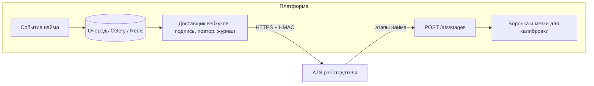

# Защита от фиктивных вакансий и интеграция с ATS

ТЗ (раздел 2): «Будет плюсом: механизм защиты от фиктивных вакансий и недобросовестных работодателей, интеграция с внутренними ATS-системами работодателей». От команды здесь ожидают концепцию и архитектурный подход. Ниже отмечено, что из этого уже работает в коде, а что предлагается следующим шагом.

## 1. Защита от фиктивных вакансий и недобросовестных работодателей

### От чего защищаемся

| Угроза | Чем вредит |
|---|---|
| Фиктивная вакансия ради сбора контактов | Утечка персональных данных, спам кандидатам |
| Вилка-приманка: в приглашении 300 тыс., на интервью 120 тыс. | Подрывает главное отличие платформы: условия видны до общения |
| Массовая рассылка одного шаблона всем подряд | Обратная механика превращается в спам |
| Компания-однодневка или выдача себя за другую компанию | Кандидат доверяет бренду, которого нет |
| Сбор открытых протоколов ФСП, чтобы найти человека | Обход анонимности карточки |

### Что уже работает

| Мера | Где в коде |
|---|---|
| Контакты кандидата закрыты до его согласия: принятого приглашения или собственного отклика. Каждый просмотр пишется в журнал доступа | `app/api/v1/offers.py`, `app/api/v1/vacancies.py`, таблица `access_logs` |
| Кандидат закрывает контакты для одной компании, не отзывая согласие целиком: «Приглашения» → «Закрыть контакты для этой компании». Закрываются все принятые приглашения и отклики этой компании, пока она не получит новое принятое приглашение; компания видит 403 `contacts_revoked`, попытки после закрытия пишутся в журнал | `POST /candidates/me/offers/{id}/revoke-contacts`, `consent_logs`, `access_logs` |
| Переписка открывается только после принятия приглашения, после закрытия контактов — только чтение. Не больше 60 сообщений в час, уведомление без текста сообщения | `app/api/v1/messages.py` |
| Зарплатная вилка «от–до» обязательна в приглашении и вакансии, «до» не меньше «от», есть верхняя граница | `OfferCreate`, `VacancyIn` |
| Не больше 50 приглашений в сутки от одной компании | `_OFFERS_PER_DAY`, `app/api/v1/offers.py` |
| Одно активное приглашение на пару «компания — кандидат» (уникальный индекс) | миграции, `app/services/offers.py` |
| Приглашение истекает через 14 дней, кандидат видит срок | `expires_at`, задача `expire_offers` |
| ИНН проверяется по контрольной сумме ФНС без внешних запросов. Кандидат видит в приглашении, указан ли ИНН | `app/services/inn.py`, `company_profile.inn_given` |
| Профиль компании (сфера, сайт, описание) кандидат видит до принятия решения | `/candidate/offers`, «О компании» |
| Карточка в выдаче анонимна: статус соревнования, год и диапазон процентиля без названия события и места | `app/services/search/pipeline.py` |
| Уведомления не несут данных другой стороны | `app/services/notify.py` |
| Лимиты на вход, регистрацию и письма. Если хранилище лимитов недоступно, эти методы закрываются, а не пропускают запросы | `app/core/ratelimit.py` |

### Что предлагаем дальше

**Уровни доверия к компании.** Кандидат видит уровень рядом с названием, поиск и лимиты зависят от него.

| Уровень | Как получить | Что даёт |
|---|---|---|
| 0. Новая | Почта подтверждена | 10 приглашений в сутки, у кандидата пометка «новая компания» |
| 1. Реквизиты | ИНН прошёл контрольную сумму, по ЕГРЮЛ (ФНС, API «ЕГРЮЛ/ЕГРИП») компания действующая, название совпадает | 50 приглашений в сутки |
| 2. Домен | Почта на домене сайта компании, сайт отвечает и указан в ЕГРЮЛ или подтверждён записью DNS TXT | Метка «реквизиты и домен подтверждены» |
| 3. Партнёр ФСП | Компания — партнёр или спонсор соревнований ФСП | Метка Федерации, приоритет в «задаче недели» |

**Сигналы от кандидатов.** После интервью кандидат отвечает на один вопрос: «Условия совпали с приглашением?» и может нажать «Пожаловаться» с причиной (вилка не совпала, вакансии нет, спам). Доля «не совпали» и жалоб считается по компании со сглаживанием к среднему, как ось ФСП. Так новая компания с одной жалобой не тонет, а системная проблема видна.

**Автоматические правила.** Порог жалоб замораживает рассылку до ручной проверки. Вилка ниже рыночной медианы категории в 2 раза или выше в 3 раза отправляется на проверку: медиану платформа считает сама по приглашениям той же «специализации × грейда». Одинаковый текст в сотне приглашений за час снижает лимит.

**Решение остаётся за человеком.** Автоматика только ставит в очередь модерации и ограничивает лимит. Блокировка — решение модератора, компания видит причину и может её оспорить.

## 2. Интеграция с ATS работодателя

Цель — чтобы рекрутер работал в своей ATS (Хантфлоу, Talantix, E-Staff, Greenhouse), а платформа была источником кандидатов с подтверждённой категорией.

### Принципы

- **Платформа отдаёт события, а не базу.** ATS получает только кандидатов, которые сами согласились на контакт: приняли приглашение или откликнулись. До этого из платформы уходит только анонимная категория.
- **Данные передаются по тем же правилам, что видит работодатель в кабинете.** Отзыв согласия и закрытие контактов для компании отправляют событие удаления, и ATS этой компании обязана удалить контакты (ст. 21 152-ФЗ).
- **Два направления:** платформа → ATS (вебхуки и экспорт) и ATS → платформа (статусы найма для воронки и для будущей калибровки подбора).

### Вебхуки (платформа → ATS)

Работодатель указывает в кабинете адрес и получает секрет. Каждое событие — `POST` с телом JSON и заголовком `X-FSP-Talent-Signature: sha256=<HMAC(secret, body)>`. Доставка с повтором (1 мин, 5 мин, 30 мин, 2 ч), идемпотентность по `event_id`.

| Событие | Когда | Что внутри |
|---|---|---|
| `offer.accepted` | Кандидат принял приглашение | Приглашение, категория, подтверждения, контакты, PDF-профиль по ссылке |
| `offer.declined` | Кандидат отклонил | Приглашение, причина, если указана |
| `application.created` | Кандидат откликнулся на вакансию | Вакансия, категория, контакты |
| `consent.withdrawn` | Кандидат отозвал согласие | `candidate_ref` для удаления |
| `contacts.revoked` | Кандидат закрыл контакты для этой компании | `candidate_ref` для удаления у этой компании |

```json
{
  "event_id": "8c1d…",
  "type": "offer.accepted",
  "created_at": "2026-10-06T12:00:00Z",
  "employer_id": "…",
  "candidate": {
    "ref": "c_5f2…",
    "name": "…", "email": "…", "telegram": "…",
    "category": {"specialization": "backend", "grade": "middle", "grade_source": "assessed"},
    "skills": [{"name": "Python", "source": "test", "confirmed_at": "2026-09-30"}],
    "fsp": [{"discipline": "algorithmic", "lcb": 0.42, "best_rank": "КМС"}],
    "profile_pdf": "https://…/api/v1/…/profile.pdf"
  },
  "offer": {"role": "Backend-разработчик", "salary_from": 230000, "salary_to": 300000, "work_format": "remote"}
}
```

Формат кандидата совместим по смыслу с JSON Resume. Для ATS, которые принимают только резюме-файл, есть стандартизированный PDF-профиль: он уже формируется (`/api/v1/candidates/me/profile.pdf`).

### Статусы найма (ATS → платформа)

`POST /api/v1/ats/stages` с `candidate_ref` и этапом: `screening`, `interview`, `offer`, `hired`, `rejected`. Платформа показывает этапы в воронке работодателя и копит размеченные пары «потребность — кандидат — итог». Это и есть данные для калибровки подбора: сейчас валидация идёт на синтетике, потому что меток найма у хакатона нет (`docs/VALIDATION_MATCHING.md`). Скрипт `python -m app.validation.matching --import pairs.json` уже принимает такие пары.

### Пример: Хантфлоу

1. Вебхук `offer.accepted` → создание кандидата методом API Хантфлоу «добавить кандидата» с источником «ФСП Талант» и прикреплённым PDF-профилем.
2. Привязка к вакансии Хантфлоу по `need_id` или `vacancy_id`, который работодатель сопоставил в кабинете.
3. Вебхук Хантфлоу о смене этапа → `POST /api/v1/ats/stages` платформы.

### Архитектура



Доставщик — отдельная задача Celery: очередь и повторы уже есть в стенде. Журнал доставок виден работодателю в кабинете.
