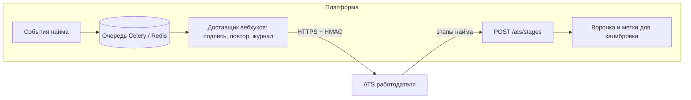

# Защита от фиктивных вакансий и интеграция с ATS

ТЗ (раздел 2) просит концепцию защиты от фиктивных вакансий и связи с ATS работодателя. Ниже — что уже работает и что остаётся концепцией.

## 1. Защита от фиктивных вакансий и недобросовестных работодателей

### От чего защищаемся

| Угроза | Чем вредит |
|---|---|
| Фиктивная вакансия ради сбора контактов | Утечка персональных данных, спам кандидатам |
| Вилка-приманка: в приглашении 300 тыс., на интервью 120 тыс. | Подрывает главное отличие платформы: условия видны до общения |
| Массовая рассылка одного шаблона всем подряд | Обратная механика превращается в спам |
| Компания-однодневка или выдача себя за другую компанию | Кандидат доверяет бренду, которого нет |
| Сбор открытых протоколов ФСП, чтобы найти человека | Обход анонимности карточки |

### Что уже работает

| Мера | Где в коде |
|---|---|
| Контакты кандидата закрыты до его согласия: принятого приглашения или собственного отклика. Каждый просмотр пишется в журнал доступа | `app/api/v1/offers.py`, `app/api/v1/vacancies.py`, таблица `access_logs` |
| Кандидат закрывает контакты для одной компании, не отзывая согласие целиком: «Приглашения» → «Закрыть контакты для этой компании». Закрываются все принятые приглашения и отклики этой компании, пока она не получит новое принятое приглашение; компания видит 403 `contacts_revoked`, попытки после закрытия пишутся в журнал | `POST /candidates/me/offers/{id}/revoke-contacts`, `consent_logs`, `access_logs` |
| Переписка открывается только после принятия приглашения, после закрытия контактов — только чтение. Не больше 60 сообщений в час, уведомление без текста сообщения | `app/api/v1/messages.py` |
| Зарплатная вилка «от–до» обязательна в приглашении и вакансии, не ниже 27 093 ₽ (МРОТ с 01.01.2026, 429-ФЗ) в месяц до вычета НДФЛ (минимум с 1 января 2025 года, `MIN_MONTHLY_GROSS`), «до» не меньше «от», есть верхняя граница. Ссылка `http` или `www` в способе связи не принимается | `OfferCreate`, `VacancyIn`, `InviteDialog.tsx` |
| Не больше 50 приглашений в сутки от одной компании | `_OFFERS_PER_DAY`, `app/api/v1/offers.py` |
| Одно активное приглашение на пару «компания — кандидат» (уникальный индекс) | миграции, `app/services/offers.py` |
| Приглашение истекает через 14 дней, кандидат видит срок | `expires_at`, задача `expire_offers` |
| ИНН проверяется по контрольной сумме ФНС без внешних запросов. Кандидат видит в приглашении, указан ли ИНН | `app/services/inn.py`, `company_profile.inn_given` |
| Профиль компании (сфера, сайт, описание) кандидат видит до принятия решения | `/candidate/offers`, «О компании» |
| Карточка в выдаче анонимна: статус соревнования, год и диапазон процентиля без названия события и места | `app/services/search/pipeline.py` |
| Уведомления не несут данных другой стороны | `app/services/notify.py` |
| Лимиты на вход, регистрацию и письма. Если хранилище лимитов недоступно, эти методы закрываются, а не пропускают запросы | `app/core/ratelimit.py` |

**Репутация из фактов.** За 180 дней кандидат видит три доли и срок на платформе: как часто компания отвечает после согласия, как часто дело доходит до собеседования, сколько жалоб пришлось на приглашения. Доля — нижняя граница Уилсона (коэффициент 1,64) и появляется от пяти случаев, иначе написано «мало данных». Одной цифры «хорошая компания» нет: демо-балл рядом с ней по-прежнему помечен как демо-таблица. Число считает `compute_trust_score`: старт 3, затем отзывы, отметка реестра, тендеры и разрыв вилки. Реестр Минцифры и госзакупки не вызываются. На публичной странице компании балл написан той же фразой, что в приглашении.

**Уровни доверия, которые уже считаются.** Уровень не хранится: он выводится из фактов. 0 — почта подтверждена, 10 приглашений в сутки и одна открытая вакансия. 1 — ИНН прошёл контрольную сумму (ЕГРЮЛ не подключён, так и написано в метке), 50 приглашений и 3 вакансии. 2 — домен почты совпадает с доменом сайта, 50 приглашений и 10 вакансий. 3 — партнёр ФСП, флаг ставит только `python -m app.services.trust partner <почта>`, 50 приглашений и 30 вакансий. Кандидат видит метку рядом с названием. Через API уровень не записывается.

### Что предлагаем дальше

Проверка компании по ЕГРЮЛ и подтверждение домена записью DNS пока не подключены. Когда появятся, они усилят уровни 1 и 2, не заменив их.

**Жалоба, которая уже работает.** В приглашении кандидат нажимает «Пожаловаться» и выбирает причину: не вакансия, сбор данных, зарплата не та, оскорбление или другое. Одна жалоба на одно приглашение или одну вакансию. За 30 дней компания уходит на проверку, если пожаловались не меньше трёх разных людей и нижняя граница Уилсона доли жалоб среди её приглашений не ниже 0,10 (коэффициент 1,64). Новые приглашения тогда отвечают 403: «Приглашения приостановлены до проверки». Снять паузу можно только вручную: `python -m app.services.trust release <ИНН>`. Жалобы при этом не удаляются. Одна жалоба или три жалобы от одного человека компанию не останавливают.

**Автоматические правила.** Порог жалоб замораживает рассылку до ручной проверки. Вилка, у которой верх ниже половины медианы ожиданий в категории, помечается и видна кандидату как «вилка ниже рынка». Вилка, у которой низ выше этой медианы втрое, попадает на стол модерации. Отправке обе не мешают. Медиана та же, что на странице рынка: ожидания кандидатов категории, и только если их не меньше пяти. Одинаковый текст в сотне приглашений за час снижает лимит.

**Решение остаётся за человеком.** Автоматика только ставит в очередь модерации и ограничивает лимит. Блокировка — решение модератора, компания видит причину и может её оспорить.

## 2. Интеграция с ATS работодателя

Цель — чтобы рекрутер работал в своей ATS (Хантфлоу, Talantix, E-Staff, Greenhouse), а платформа была источником кандидатов с подтверждённой категорией.

### Принципы

- **Только согласившиеся.** ATS получает только кандидатов, которые сами согласились на контакт: приняли приглашение или откликнулись. До этого из платформы уходит только анонимная категория.
- **Те же правила, что в кабинете.** Отзыв согласия и закрытие контактов для компании отправляют событие удаления, и ATS этой компании обязана удалить контакты (ст. 21 152-ФЗ).
- **Два направления.** Из платформы в ATS идут вебхуки и экспорт, из ATS в платформу — статусы найма: они нужны для воронки и для будущей калибровки подбора.

### Вебхуки (платформа → ATS)

Работодатель указывает адрес на странице «Интеграции» и один раз видит секрет. Событие подписывается по Standard Webhooks (`webhook-id`, `webhook-timestamp`, `webhook-signature: v1,…` от строки `id.timestamp.body`) и старым заголовком `X-FSP-Talent-Signature`. Приёмник старше пяти минут по часам отклоняется. Повтор: 1 мин, 5 мин, 30 мин, 2 ч, 12 ч; ответ 410 повторов не получает. Чужой адрес — только https и только публичный хост, редиректы не идём. Приёмник стенда — кнопка на той же странице. Живое событие несёт категорию и, после согласия, контакты. Навыки, результаты ФСП и PDF из примера ниже в эту доставку пока не входят. Квитанция на странице «Компания» по-прежнему подписывает пример и никуда его не отправляет.

| Событие | Когда | Что внутри |
|---|---|---|
| `offer.accepted` | Кандидат принял приглашение | Приглашение, категория, подтверждения, контакты, PDF-профиль по ссылке |
| `offer.declined` | Кандидат отклонил | Приглашение, причина, если указана |
| `application.created` | Кандидат откликнулся на вакансию | Вакансия, категория, контакты |
| `consent.withdrawn` | Кандидат отозвал согласие | `candidate_ref` для удаления |
| `contacts.revoked` | Кандидат закрыл контакты для этой компании | `candidate_ref` для удаления у этой компании |

```json
{
  "event_id": "8c1d…",
  "type": "offer.accepted",
  "created_at": "2026-10-06T12:00:00Z",
  "employer_id": "…",
  "candidate": {
    "ref": "c_5f2…",
    "name": "…", "email": "…", "telegram": "…",
    "category": {"specialization": "backend", "grade": "middle", "grade_source": "assessed"},
    "skills": [{"name": "Python", "source": "test", "confirmed_at": "2026-09-30"}],
    "fsp": [{"discipline": "algorithmic", "lcb": 0.42, "best_rank": "КМС"}],
    "profile_pdf": "https://…/api/v1/…/profile.pdf"
  },
  "offer": {"role": "Backend-разработчик", "salary_from": 230000, "salary_to": 300000, "work_format": "remote"}
}
```

Формат кандидата совместим по смыслу с JSON Resume. Для ATS, которые принимают только резюме-файл, есть стандартизированный PDF-профиль: он уже формируется (`/api/v1/candidates/me/profile.pdf`).

### Статусы найма (ATS → платформа)

`POST /api/v1/ats/stages` с `candidate_ref` и этапом: `screening`, `interview`, `offer`, `hired`, `rejected`. Платформа показывает этапы в воронке работодателя и копит размеченные пары «потребность — кандидат — итог». Это и есть данные для калибровки подбора: сейчас валидация идёт на синтетике, потому что меток найма у хакатона нет (`docs/VALIDATION_MATCHING.md`). Скрипт `python -m app.validation.matching --import pairs.json` уже принимает такие пары.

### Пример: Хантфлоу

1. Вебхук `offer.accepted` → создание кандидата методом API Хантфлоу «добавить кандидата» с источником «ФСП Талант» и прикреплённым PDF-профилем.
2. Привязка к вакансии Хантфлоу по `need_id` или `vacancy_id`, который работодатель сопоставил в кабинете.
3. Вебхук Хантфлоу о смене этапа → `POST /api/v1/ats/stages` платформы.

### Архитектура



Доставщик — отдельная задача Celery: очередь и повторы уже есть в стенде. Журнал доставок виден работодателю в кабинете.

## 3. Карта соответствия: EU AI Act и NIST AI RMF

Регламент (ЕС) 2024/1689 (AI Act) в России не действует. Мы берём его как ориентир лучшей практики: ИИ для подбора, фильтрации откликов и оценки кандидатов отнесён к высокому риску (Приложение III, п. 4(a)). Сроки применения обязанностей для систем Приложения III здесь не называем, они зависят от решений ЕС. Вторая рамка — NIST AI RMF 1.0 (NIST AI 100-1, doi:10.6028/NIST.AI.100-1), функции GOVERN, MAP, MEASURE, MANAGE. Таблица не сертификат: каждая строка указывает на код или документ, который это делает, и на то, чего нет.

| Требование | Что у нас | Где | Чего нет |
|---|---|---|---|
| AI Act ст. 9, NIST MAP — управление рисками | Риски и ограничения записаны рядом с каждой валидацией; атаки (утечка ключей, накрутка навыков, угадывание) смоделированы | `docs/VALIDATION_ASSESSMENT.md`, `docs/VALIDATION_MATCHING.md` | Отдельного реестра рисков с владельцами |
| AI Act ст. 10 — данные | Бенчмарк подбора синтетический, генератор и SHA-256 набора печатаются; пол и национальность продукт не собирает | `backend/app/validation/matching.py` | Проверки на живых размеченных парах |
| AI Act ст. 12 — журналирование | Каждый ответ теста — строка `test_session_items`, сессия — `test_sessions`; согласия — `consent_logs` (только добавление); просмотр контактов — `access_logs`; споры о грейде — `grade_disputes` | `backend/app/models/assessment.py`, `backend/app/models/audit.py` | Журнала каждой выдачи подбора с версией ранжирования |
| AI Act ст. 13 — прозрачность | Причины места в выдаче («Почему в подборке»); формулы опубликованы; статистика заданий открыта без входа: `GET /api/v1/public/assessment/items` | `backend/app/services/matching.py` (`Reason`), `backend/app/api/v1/public.py` | Карточки модели на каждую версию ранжирования |
| AI Act ст. 14 — человеческий надзор | Решение о найме принимает работодатель: платформа ранжирует, но не отсеивает; пересмотр решения теста вручную за 5 рабочих дней; тест не понижает подтверждённый грейд | `backend/app/services/session_marks.py` (`DISPUTE_TEXT`), `backend/app/services/assessment.py`, `docs/SOLUTION.md` §10 | Интерфейса оператора для разбора споров со сроком |
| AI Act ст. 15, NIST MEASURE — точность и устойчивость | AUC, nDCG, κ, экспозиция заданий, правило 4/5 по метке, которая не входит в балл | `docs/VALIDATION_*.md`, `python -m app.validation.fairness` | Мониторинга этих чисел на живом трафике |
| NIST MANAGE — реакция | Утёкшие ключи заданий уходят на карантин (z и CUSUM); публичные рейтинги показываются только при k ≥ 5 в ячейке | `backend/app/services/assessment.py`, `backend/app/api/v1/public.py` (`BANK_MIN`) | Регламента вывода модели из эксплуатации |
| NIST GOVERN — ответственность | Роли и права модерации выдаются только консольной командой; 152-ФЗ: согласия, отзыв, удаление | `docs/SOLUTION.md` §10 | Назначенного ответственного за ИИ-риски у оператора |
