# Руководство пользователя стенда

Как пройти по платформе четырьмя ролями: кандидат, работодатель, член жюри и законный представитель несовершеннолетнего кандидата. Маршруты взяты из `frontend/src/App.tsx`, названия разделов — из меню кабинетов (`frontend/src/components/Layout.tsx`).

Адрес публичного стенда — https://89-124-65-102.sslip.io, локальной установки — http://localhost (запуск: [INSTALL.md](INSTALL.md)). Ниже пути даны от корня сайта: `/login` значит https://89-124-65-102.sslip.io/login или http://localhost/login. Пароль всех демо-аккаунтов — `demo12345`, список аккаунтов — [README](../README.md#демо-аккаунты).

## Карта страниц

| Путь | Кто | Что там |
|---|---|---|
| `/` | все | Главная: что делает платформа, вход для обеих ролей |
| `/login`, `/register`, `/verify`, `/forgot` | все | Вход, регистрация, ввод кода из письма, сброс пароля |
| `/fsp-id/authorize` | кандидат | Страница провайдера ФСП ID на демо-стенде: номер участника и пароль |
| `/jury` | без входа | Страница для жюри: быстрый вход в демо-аккаунты, методика, проверка удостоверения, подбор на своей разметке |
| `/method` | без входа | Как устроен тест, цифры проверки с командами |
| `/evaluate` | без входа | Расчёт nDCG@10 подбора на своих парах «потребность — кандидат» |
| `/badge` | без входа | Проверка подписи удостоверения ФСП (W3C VC 2.0) |
| `/leaderboard` | без входа | Порядок внутри категории по подтверждающему тесту, без имён: сначала вероятность уровня P(pass), при равенстве — оценка θ (поле `theta` в ответе API) |
| `/passport/:id` | без входа | Паспорт навыков кандидата по ссылке или QR-коду |
| `/p/:id` | без входа | Публичная страница кандидата, если он дал согласие на распространение |
| `/companies/:id` | без входа | Публичная страница компании: название, открытые вакансии, уровень доверия |
| `/guardian` | законный представитель | Подтверждение согласия на обработку данных кандидата 15–17 лет |
| `/legal` | все | Тексты согласий и правил |
| `/candidate/…` | кандидат | Обзор, Профиль, Тест на грейд, Задания, Приглашения, Вакансии, Результаты ФСП |
| `/employer/…` | работодатель | Обзор, Потребности, Поиск, Избранное, Задания, Приглашения, Вакансии, Компания, Интеграции, Модерация, Методист |

## Путь за 12 экранов

Весь обратный найм — от первого входа до принятого приглашения — на двенадцати экранах стенда.

1. **Главная: путь для жюри и демо-вход**

   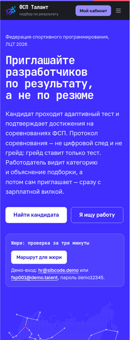

2. **Страница жюри: методика, проверка удостоверения, расчёт подбора**

   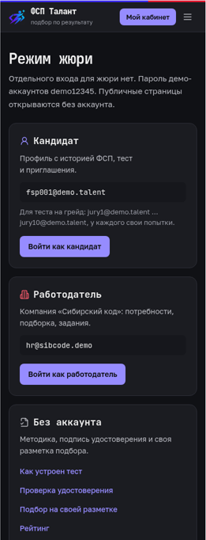

3. **Регистрация по почте с кодом подтверждения**

   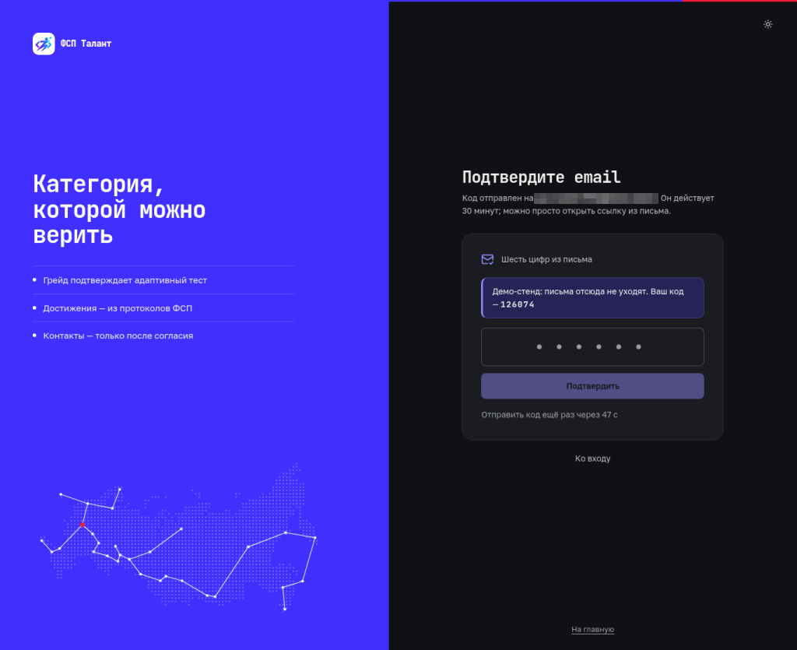

4. **Кабинет кандидата: категория, подтверждения и готовность профиля** (демо-аккаунт `fsp001@demo.talent`)

   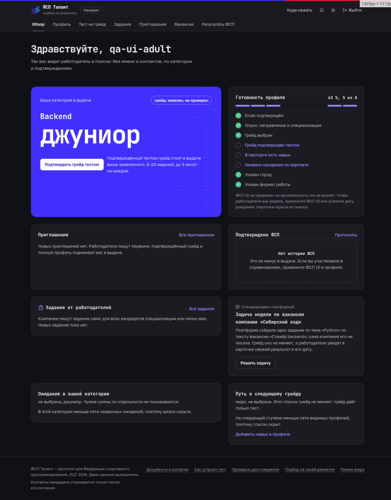

5. **Задание адаптивного теста: свои числа и код у каждого**

   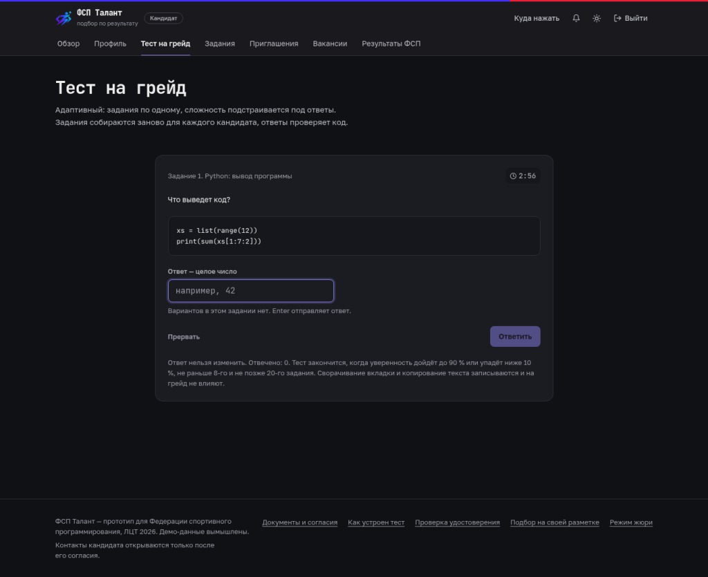

6. **Итог пробного теста: темы и вероятность грейда**

   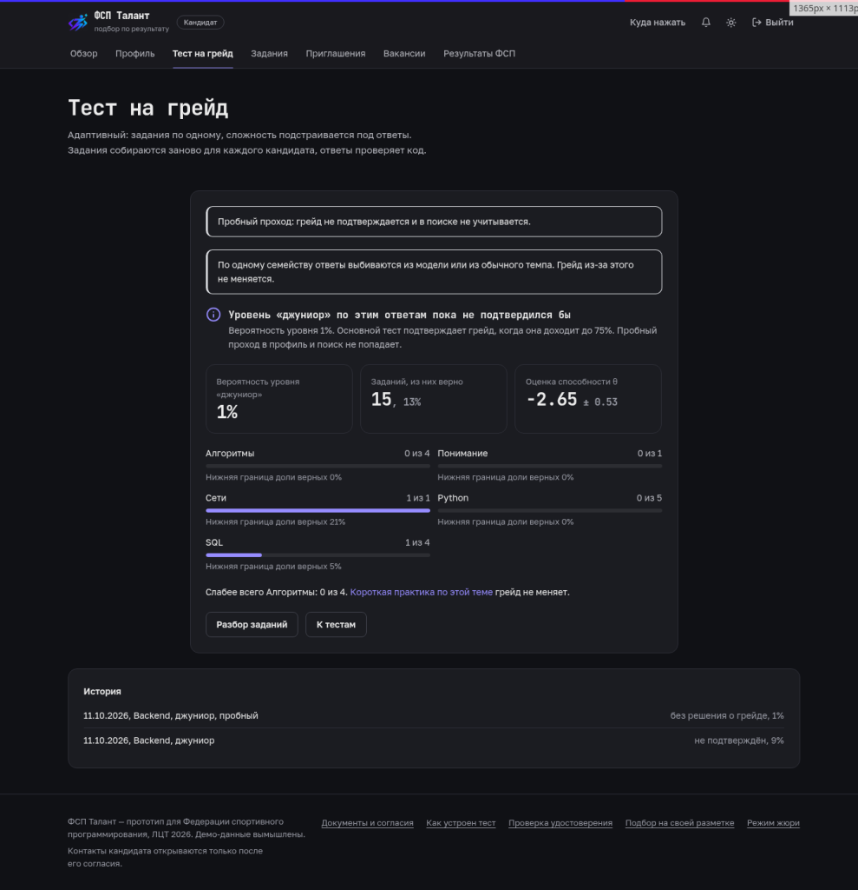

7. **Резюме PDF: навыки предлагаются с цитатой**

   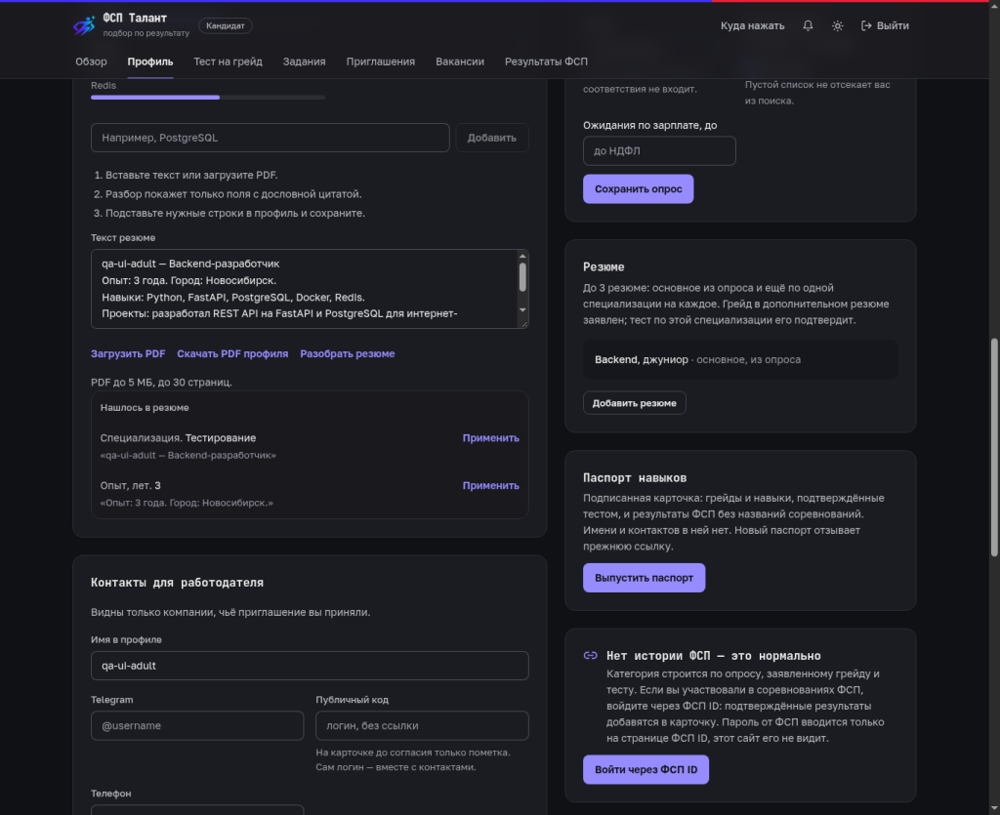

8. **Работодатель: потребность создана**

   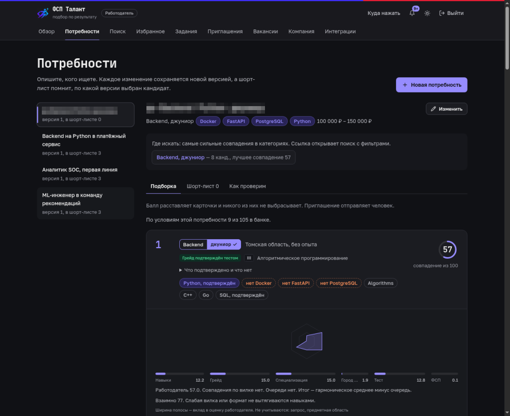

9. **Подборка: место, категория, подтверждения и объяснение**

   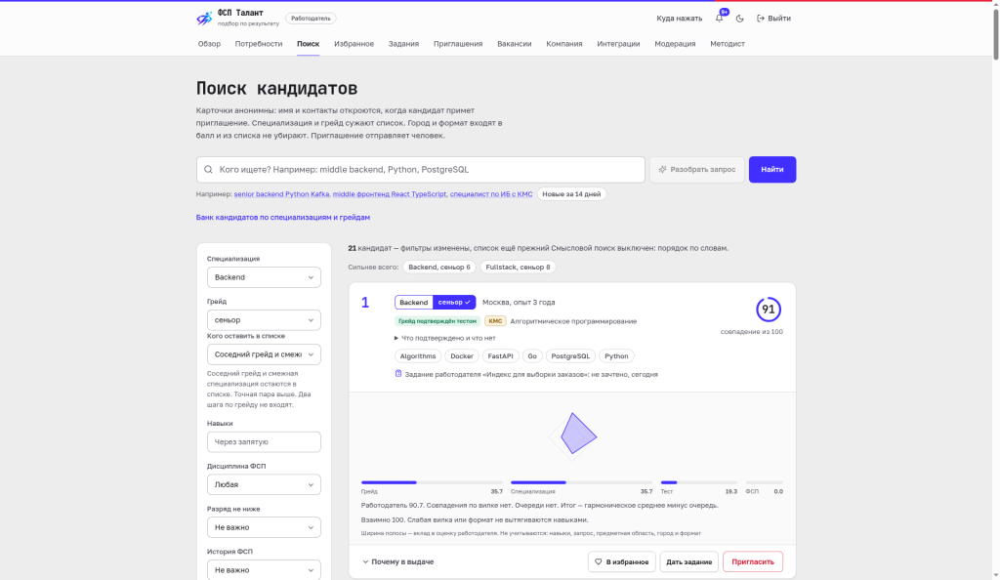

10. **Приглашение с вилкой «от–до»**

   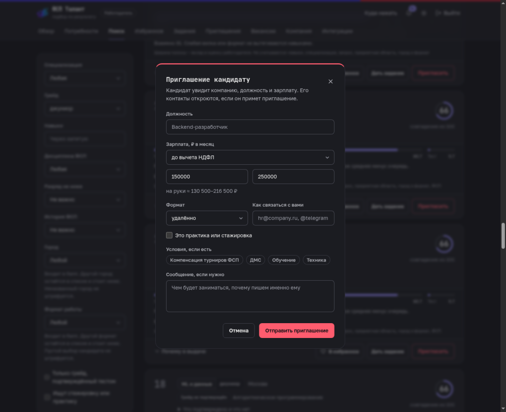

11. **Кандидат принимает приглашение — контакты открываются**

12. **Работодатель видит статусы приглашений**

   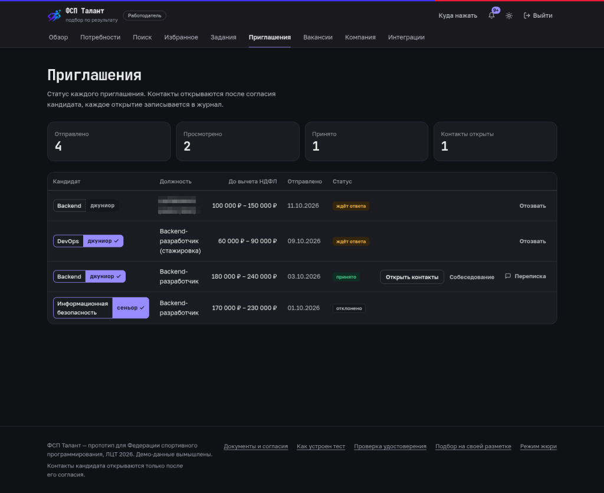

## Кандидат

### Вход

- **По почте.** `/register` → роль «кандидат», email, пароль, отметка «Мне исполнилось 18 лет» или «Мне 15, 16 или 17 лет», согласия. На `/verify` вводится код из письма. Локально письмо лежит в Mailpit (http://localhost:8025). На стенде без почтовой учётки код показывается на экране подтверждения.
- **Через ФСП ID.** `/login` → «Войти через ФСП ID». Пароль вводится на странице провайдера, платформа получает проверенный ID-токен (OpenID Connect с PKCE). На демо-стенде провайдер — страница `/fsp-id/authorize`: `FSP001` / `test` входит в привязанный аккаунт `fsp001@demo.talent`, свободный номер из `FSP2000`…`FSP2099` / `test` после экрана согласий создаёт новый аккаунт из демо-реестра.
- **Готовые аккаунты.** `fsp001@demo.talent` (есть история ФСП и приглашения), `fsp002@demo.talent` (информационная безопасность), `nofsp@demo.talent` (без истории ФСП). Для прохождения с нуля — `jury1@demo.talent` … `jury10@demo.talent`.

### Разделы кабинета

| Раздел | Путь | Что делать |
|---|---|---|
| Обзор | `/candidate` | Опрос: направление и специализация, грейд, цель (работа или стажировка), предметная область по желанию. Здесь же категория, готовность профиля, задача недели, ожидающие приглашения и подсказка, какой навык откроет больше вакансий |
| Профиль | `/candidate/profile` | Профиль вручную или из PDF-резюме: каждое поле предлагается с цитатой и переносится по кнопке. Контакты для работодателя, мягкие навыки, «Куда не предлагать», статус поиска работы. Блок «История опроса»: каждое сохранение опроса, новые сверху. «Скачать PDF профиля». Согласия и их отзыв, видимость, привязка ФСП ID, «Паспорт навыков» → «Выпустить паспорт», выгрузка своих данных, смена пароля, удаление аккаунта |
| Тест на грейд | `/candidate/assessment` | Выбор уровня и языка кода (Python, JavaScript, Go, Java, Kotlin, C#) → «Начать тест». 8–20 заданий, ответ вводится. В конце — итог по темам и подтверждённый грейд. Не сдали — тест на уровень ниже доступен сразу; пересдача того же уровня — через 7 дней. На демо-стенде есть «Пробный тест» на 15 заданий и 5 минут, грейд он не подтверждает |
| Задания | `/candidate/tasks` | Задания работодателей: общие для специализации и адресные. С эталоном ответ проверяет система, открытое задание — работодатель. Грейд задания не меняют |
| Приглашения | `/candidate/offers` | Компания, вакансия, вилка до вычета НДФЛ и страница компании видны до решения. «Принять» открывает компании имя и контакты, затем доступны «Переписка» и выбор времени собеседования из одного–трёх, предложенных компанией (время московское). «Закрыть контакты для этой компании» отзывает доступ одной компании, остальные не затрагиваются. Можно пожаловаться на приглашение |
| Вакансии | `/candidate/vacancies` | Вакансии под профиль, «Откликнуться», свои отклики и их статусы. Пока грейд не подтверждён тестом, видны все открытые вакансии, новые сверху; на вакансию с грейдом кнопка ведёт на тест («Сначала тест на грейд»). Отклик сам по себе даёт согласие на контакт с этой компанией |
| Результаты ФСП | `/candidate/results` | Строки протоколов из реестра ФСП и присвоенные разряды. Это отдельная ось профиля: она поднимает кандидата внутри категории, грейд не меняет. Нет истории — ничего не теряется |

## Работодатель

### Вход

- **Регистрация.** `/register` → роль «работодатель»: рабочий email, пароль, название компании, ИНН по желанию (проверяется контрольная сумма). Код подтверждения — как у кандидата.
- **Готовый аккаунт.** `hr@sibcode.demo` — компания «Сибирский код» с тремя потребностями, приглашениями во всех статусах, вакансиями с откликами и заданиями.

### Разделы кабинета

| Раздел | Путь | Что делать |
|---|---|---|
| Обзор | `/employer` | Сводка: потребности, приглашения, отклики, что ждёт решения |
| Потребности | `/employer/needs` | Создать потребность: специализация, грейд, обязательные и желательные навыки, предметная область, чем занимается команда, вилка, формат, город. Вставленный текст вакансии заполняет черновик. Дальше: «Где искать» (рекомендованные категории), подборка с полосами факторов и «Почему в выдаче», «Сравнить» до четырёх кандидатов без имён, вкладка «Как проверим» (каким получится тест), шорт-лист, версии потребности, «Пригласить» |
| Поиск | `/employer/search` | Поиск по всему банку: специализация, грейд, стек, «Только грейд, подтверждённый тестом», дисциплина и «Разряд не ниже». Витрина «специализация × грейд» с числом кандидатов в ячейке |
| Избранное | `/employer/favorites` | Отложенные карточки кандидатов |
| Задания | `/employer/tasks` | Своё задание для всех кандидатов специализации или «Дать задание» одному из карточки. С эталоном проверяет система, открытое проверяет работодатель: «Зачтено» или «Не зачтено» с комментарием. Вердикт появляется строкой в анонимной карточке |
| Приглашения | `/employer/offers` | Статусы: отправлено, просмотрено, принято, отклонено, отозвано, истекло. У принятых — имя, контакты, «Переписка», «Собеседование». Если кандидат закрыл контакты, компания видит `contacts_revoked`, переписка только для чтения |
| Вакансии | `/employer/vacancies` | Вакансии с вилкой «от–до», отклики и смена их статуса, «Показать контакты» по отклику |
| Компания | `/employer/company` | Профиль компании, ИНН, предпросмотр приглашения глазами кандидата, выгрузка данных, смена пароля |
| Интеграции | `/employer/integrations` | События для ATS (подписанные вебхуки) и журнал доставки; концепция — [TRUST_AND_ATS.md](TRUST_AND_ATS.md) |
| Модерация, Методист | `/employer/moderation`, `/employer/methodist` | Только для сотрудников с правами методиста. Права выдаются с консоли сервера (`python -m app.services.staff`), опубликованным демо-логинам они не даются: жалобы и пауза компании, статистика банка, карантин ключей заданий, черновики заданий. Вход на пульт модерации закрывается вторым фактором (TOTP) |

Приглашение не отправить без вилки «от–до» и способа связи. Лимит — до 50 приглашений в сутки после проверки ИНН, до проверки — 10.

## Член жюри

1. Откройте `/jury`: там кнопки входа в демо-аккаунты и ссылки на страницы без входа.
2. Кандидатский путь с нуля: `/login` → «Взять свободный аккаунт жюри». Кнопка подставляет тот из `jury1@demo.talent` … `jury10@demo.talent`, в который дольше всех не входили. У аккаунтов жюри пустой опрос, дата рождения уже указана, полный тест проходится без пауз и лимитов попыток, результат сразу попадает в категорию и поиск.
3. Работодательский путь: `hr@sibcode.demo` → «Потребности» → «Backend на Python в платёжный сервис».
4. Проверки без входа: методика теста `/method`, подпись удостоверения `/badge`, подбор на своей разметке `/evaluate` (до 500 пар, файл JSONL или вставка текста).
5. Стенд каждую ночь в 04:10 МСК возвращается в исходное состояние: опросы и тесты `jury1@demo.talent`…`jury10@demo.talent` очищаются, пароли демо-аккаунтов прежние.

Короткий маршрут на 5 минут — в [README](../README.md#для-жюри-5-минут). Полный сценарий — ниже.

### Полный сценарий из ТЗ 3.3

Шаги идут в том порядке, в каком их требует показать ТЗ. Примерно 10 минут.

| # | Кто | Что сделать | Что увидеть |
|---|---|---|---|
| 1 | Новый кандидат | `/register`: email, пароль, «Мне исполнилось 18 лет», согласия. Код из письма (локально — Mailpit, на стенде без почты — на экране подтверждения) | Регистрация по email с подтверждением (ТЗ 2.2, п. 4). Истории ФСП не нужно |
| 1а | Кандидат через ФСП ID | `/login` → «Войти через ФСП ID», свободный номер из FSP2000–FSP2099, пароль `test` | Единая точка входа: пароль вводится на странице провайдера, затем экран согласий, аккаунт создаётся из реестра. `FSP001` / `test` сразу входит в привязанный аккаунт |
| 2 | Он же | Обзор → опрос: направление и специализация, цель, предметная область (необязательно) | Категория появилась, грейд помечен как заявленный и в подборке стоит ниже подтверждённого |
| 3 | Он же | «Тест на грейд»: уровень и язык кода (Python, JavaScript, Go, Java, Kotlin, C#) | 8–20 заданий, у каждого кандидата свои параметры. Числовой ответ вводится, вариантов нет. В конце — итог по темам и подтверждённый грейд; при уверенном результате выше — предложение отдельного теста на ступень выше |
| 4 | Он же | Профиль → «Войти через ФСП ID», FSP2000–FSP2099, пароль `test` | Вход как в Keycloak (OIDC): пароль вводится на странице провайдера. Результаты из протоколов появляются отдельной осью |
| 5 | Работодатель `hr@sibcode.demo` | Потребности → «Backend на Python в платёжный сервис» | «Где искать»: рекомендованные категории. Подборка по одной оценке соответствия с полосами факторов и «Почему в выдаче» |
| 6 | Он же | Отметить трёх кандидатов «Сравнить»; вкладка «Как проверим» | Факторы рядом, без имён. Доли тем из текста потребности, цитаты и три примера заданий |
| 7 | Он же | Поиск: специализация, грейд, стек, «Только грейд, подтверждённый тестом», «Разряд не ниже» | Поиск по всему банку с фильтрами (ТЗ 2.1) |
| 8 | Он же | Задания → «Платёж списался дважды» → ответ кандидата → «Зачтено» с комментарием; или «Дать задание» в карточке кандидата | Задание пишет работодатель. С эталоном проверяет система, открытое — работодатель. Вердикт появляется строкой в анонимной карточке |
| 9 | Он же | «Пригласить»: роль, вилка до вычета НДФЛ, способ связи | Без вилки приглашение не отправить. Кандидат получает уведомление и письмо |
| 10 | Кандидат `fsp001@demo.talent` | Задания → «Индекс для выборки заказов» → ответить | Адресное задание от работодателя проверено системой сразу, эталон виден только после ответа. Грейд не меняется |
| 11 | Он же | Приглашения → «Принять» → «Переписка» | Компания, вакансия, вилка и профиль компании видны до решения. У работодателя открываются контакты, в журнале доступа — запись. Стороны пишут друг другу в переписке по приглашению |
| 12 | Он же | Вакансии → «Откликнуться»; Обзор → «Задача недели» | Классический отклик со статусами. Короткое задание, собранное платформой из вакансии: грейд не меняет, работодатель видит свежий результат |
| 13 | Он же | Приглашения → «Закрыть контакты для этой компании»; или Профиль → согласия → отозвать согласие | Контакты закрываются сразу: для одной компании (она видит `contacts_revoked`, переписка только для чтения) или для всех |
| 14 | Он же | Профиль → «Паспорт навыков» → «Выпустить паспорт» | Ссылка `/passport/<id>` и QR-код: подтверждённые грейды, навыки из теста и сводка ФСП без имени. Подпись Ed25519 проверяется на странице, при перевыпуске старый паспорт отзывается |
| 15 | Работодатель `hr@sibcode.demo` | Потребность → карточка → «Мнение ИИ по карточке» (если подключена модель) | Сильные стороны, что проверить и вопросы для интервью, у каждого пункта факт карточки. Пометка «не влияет на балл и порядок» |

## Законный представитель

Регистрация открыта с 15 лет. Кандидат 15–17 лет не виден работодателям, пока законный представитель не подтвердит согласие на обработку его данных (ч. 6 ст. 9 152-ФЗ).

1. Кандидат регистрируется с отметкой «Мне 15, 16 или 17 лет» и указывает дату рождения.
2. На «Обзоре» в карточке согласия представителя он вводит email родителя или другого законного представителя. Свой адрес входа указать нельзя. Писем представителю — не больше трёх в сутки.
3. Представитель получает письмо со ссылкой вида `/guardian#token=…`. Подпись в ссылке привязана к кандидату и к этому адресу: если адрес в профиле сменить, старая ссылка перестаёт работать. Токен стоит после `#` и не попадает в журналы сервера.
4. На странице `/guardian` представитель читает, что увидят работодатели, и нажимает «Даю согласие». Анонимная карточка кандидата появляется в поиске. Имя и контакты по-прежнему открываются только после того, как кандидат сам примет приглашение.

На демо-стенде без почты (`DEMO_MODE` и `DEMO_SHOW_CODE`) ссылка дополнительно показывается в той же карточке на «Обзоре» самого кандидата, кроме общих демо-адресов `@demo.talent` и `.demo`.

## Если что-то не получается

| Что случилось | Что сделать |
|---|---|
| Код подтверждения не пришёл | Локально — Mailpit http://localhost:8025. На стенде без почты код показан на экране подтверждения. Повторный код — через минуту |
| «Вход закрыт на 15 минут» | К этому адресу пять раз подряд ввели неверный пароль, в том числе кто-то посторонний: адреса жюри опубликованы. Подождите 15 минут или войдите под другим аккаунтом из `jury1@demo.talent`…`jury10@demo.talent` (кнопка «Взять свободный аккаунт жюри») |
| Тест не даёт пересдать уровень | Пересдача того же уровня — через 7 дней, тест на уровень ниже — сразу. У `jury1@demo.talent`…`jury10@demo.talent` на демо-стенде пауз нет |
| В карточке нет имени и контактов | Так и задумано: они открываются только после принятия приглашения или отклика кандидата |
| Работодатель видит `contacts_revoked` | Кандидат закрыл контакты для этой компании; переписка остаётся только для чтения |
