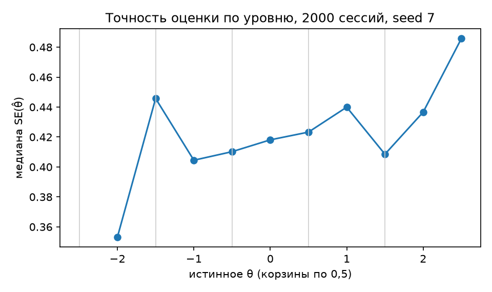
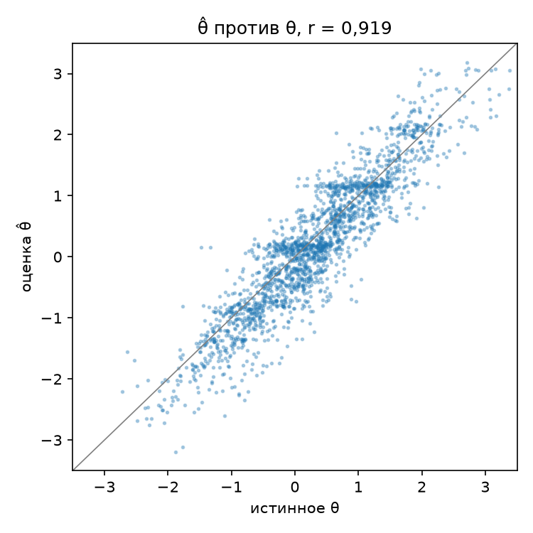
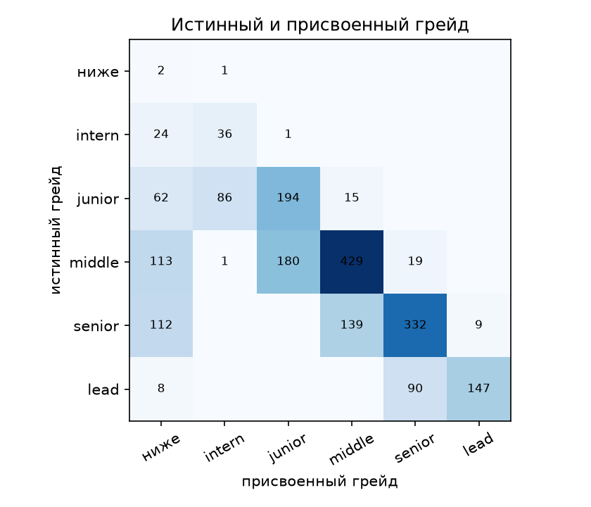
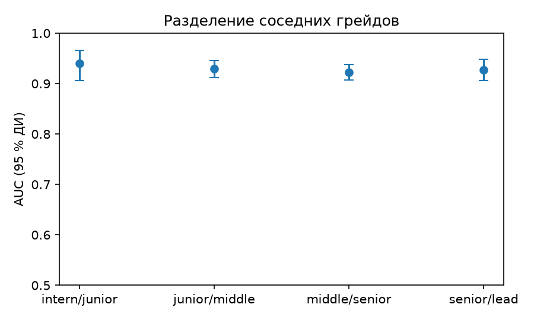

# Проверка теста на грейд

ТЗ (раздел 2) требует тест, устойчивый к утечке: без единого набора вопросов и без вызова языковой модели на каждого кандидата. Там же названы устойчивость повторной сдачи и различающая сила заданий. Все три свойства проверены симуляцией через те же функции, что работают в API (`app/services/cat.py`, `app/services/item_monitor.py`), так что цифры ниже описывают именно рабочий код.

Обозначения простыми словами:

| Обозначение | Что значит |
|---|---|
| θ | Настоящий уровень знаний кандидата на общей шкале теста (в симуляции он известен заранее) |
| θ̂ | Оценка этого уровня по ответам кандидата |
| SE | Погрешность оценки θ̂: чем меньше, тем увереннее тест |
| IRT 3PL | Модель, которая связывает уровень человека, сложность задания (b), его различающую силу (a) и шанс угадать (c) |
| EAP | Способ оценки уровня: среднее по всем уровням, взвешенное их правдоподобием после ответов |
| Информация Фишера | Насколько задание помогает отличить уровень чуть выше порога от уровня чуть ниже |
| GLR | Последовательная проверка гипотез: тест останавливается, как только ответ «выше порога или ниже» статистически ясен |
| Экспозиция | Доля кандидатов, которым показали одно и то же задание; метод Симпсона–Хеттера её ограничивает |
| Каппа Коэна | Согласие двух решений (например, первой и повторной сдачи) с поправкой на случайное совпадение: 1 — полное, 0 — как наугад |
| AUC | Как часто тест ставит более сильного кандидата выше более слабого: 1 — всегда, 0,5 — наугад |
| ДИ | Доверительный интервал: диапазон, в котором с заданной уверенностью лежит настоящее значение |

## Как устроен тест

- **Задания — параметрические семейства** (`backend/app/items/families/`): 17 семейств с вычисляемым ответом (Python, SQL, JavaScript, алгоритмы, графы, сети, безопасность, ML-метрики, встраиваемые системы, границы и расхождения тестов, метрики и доли аналитика, непокрытые требования и шаги цепочки, пакеты и опоздания в конвейере данных) и 2 концептуальных пула. У каждого семейства 5 уровней сложности. Правильный ответ получается запуском фрагмента кода, SQL-запроса или формулы; юнит-тест `test_item_families.py` перезапускает каждый сгенерированный фрагмент отдельно — в Python, Node.js и SQLite — и сверяет ответ.
- **Ключи проверены исполнением, отдельной командой.** `cd backend && python -m app.validation.key_check --variants 20` генерирует по 20 вариантов на каждый уровень каждого семейства с кодом и заново исполняет их отдельным процессом (Python, Node.js, SQLite, bash, Go; Java — если установлена). Прогон 11.10.2026 на машине без Java: **исполнено 1875 вариантов, совпали с ключом все 1875**, 25 вариантов на Java не проверены (нет исполнителя, засчитаны отдельно, а не как совпадение). Графы сверяются отдельным юнит-тестом через Беллмана–Форда. При расхождении команда завершается с ошибкой.
- **Числовой ответ вводится.** Если у задания с кодом правильный ответ — целое число, кандидат печатает его сам: вариантов на экране нет. Так устроены Python, SQL, подсчёт операций, графы, границы тестов, метрики аналитика и часть заданий по JavaScript, сетям и встраиваемым системам: в симуляции ниже это 79 % выданных заданий. Ответы вроде шестнадцатеричной строки, адреса или десятичной дроби остаются выбором из четырёх: их формат вводить неоднозначно.
- **Никакого смешения специализаций**: тест backend собирается только из семейств backend по плану (Python 30 %, SQL 25 %, алгоритмы 20 %, …). Концептуальных вопросов не больше 30 %.
- **IRT 3PL**: P = c + (1 − c)·σ(a(θ − b)). Угадывание c = 0,02 для вводимого числа и c = 1/4 для четырёх вариантов. Оценка способности θ считается как среднее апостериорного распределения на сетке (EAP), априорное распределение центрировано на пороге заявленного грейда. Селектор берёт ожидаемое c семейства на этом уровне (`expected_guess`): долю вводимых ответов считает по 24 сгенерированным заданиям, до того как выбран экземпляр.
- **Почему это важно на пороге.** Информация задания 3PL при θ = b и a = 1 равна (P − c)²(1 − P) / ((1 − c)² P), где P = (1 + c) / 2. При c = 0,25 это 0,15, при c = 0 это 0,25: четыре варианта оставляют 60 % информации задания ровно на границе грейда.
- **Адаптивный выбор под решение о грейде**: задание выбирается по информации Фишера в точке порога, а не в текущей оценке θ; среди пяти лучших — случайно; доли тем ограничены планом; слишком часто выдаваемые ключи получают штраф.
- **Остановка**: не меньше 8 и не больше 20 заданий. Тест заканчивается, когда апостериорная вероятность уровня выходит за 10 % или 90 % и вопрос о следующем уровне уже ясен. Раньше этого его может остановить обобщённое отношение правдоподобия (GLR) у порога: зона безразличия ±0,25, порог ln 9 при ошибках 10 % с каждой стороны. Остановка случается только если отношение и апостериорное распределение смотрят в одну сторону. Критерий Вальда в файле есть и в решение не входит: останавливает GLR. Пробный проход из 15 заданий и 5 минут останавливается по счётчику, без GLR. Среди пяти лучших заданий срабатывает Симпсон–Хеттер, когда по ключу уже есть доля показов.
- **Решение**: грейд подтверждён при P(θ ≥ порог) ≥ 75 %. Тест на уровень подтверждает только этот уровень: при P(θ ≥ следующий порог) ≥ 90 % сессия рекомендует отдельный тест на ступень выше, но грейд не повышает. Не сдали, а те же ответы дают P(θ ≥ порог ступени ниже) ≥ 75 % при априоре в этом пороге и нож держится — кандидат может принять ступень ниже без отдельного теста. Подтверждённый грейд не понижается; хранится отдельно для каждой специализации. Тест по вакансии и пробный проход из 15 заданий грейд не меняют. Грейд «стажёр» стоит на ступень ниже junior: порог θ = −2,5, и под него выбираются задания первого уровня.
- **Навыки, подтверждённые тестом**: ≥ 75 % верных ответов по навыку на ≥ 3 заданиях; в профиле они отмечены `test_confirmed` и отличаются от заявленных.
- **Мониторинг утечки**: по каждому ключу «семейство:уровень» (и по каждому статичному вопросу) копится z = (верных − ожидаемых)/sd, где ожидание считается по θ, оценённой **без заданий того же семейства**: так утёкшее семейство не завышает θ и не прячет сигнал. Рядом копится односторонняя накопленная сумма избытка верных ответов. При z ≥ 3,5 или при пересечении порога этой суммы на 30+ ответах ключ уходит в карантин: больше не выдаётся, а его ответы не учитываются. Статистика открыта: `GET /api/v1/public/assessment/items`.
- **Калибровка**: `python -m app.validation.calibrate` пересчитывает сдвиги трудности по реальным ответам (тоже без своего семейства) и обнуляет счётчики дрейфа.
- **Защита сессии**: правильный ответ не покидает сервер до конца теста; у вводимого задания варианты тоже остаются на сервере. Ответ принимается только на текущее задание по HMAC-токену; время засекает сервер (3 минуты на задание с кодом, 75 секунд на вопрос); прерванная или просроченная сессия считается попыткой; пересдача того же уровня — через 7 дней; после проваленного теста тест на уровень ниже доступен сразу.

## Симуляция

Кандидаты: θ ~ N(0,3; 1), специализация случайна среди всех одиннадцати направлений, включая инженерию данных. 60 % заявляют свой истинный грейд, 30 % — на ступень выше, 10 % — ниже. «Правда» специально не совпадает с моделью сервиса: у каждого ключа свой неизвестный сервису сдвиг трудности N(0; 0,3²) и множитель дискриминации U(0,8; 1,2). Задание вводимое с той долей, которую реально даёт его генератор. Перед мониторингом прогнана когорта для калибровки.

Сценарии «без утечки» и «все задания с вариантами» проходят одни и те же кандидаты, поэтому форматы ответа сравниваются напрямую. Сценарии с утечкой — отдельные когорты того же размера.

Симуляция: 2000 кандидатов на сценарий, зерно генератора 7. Команда: `python -m app.validation.assessment --n 2000 --seed 7`. Ответ вводится в 83 % выданных заданий.

| Сценарий | Точность «сдал/не сдал» | Точность вне ±0,5 от порога | Сдали из тех, кто на уровне | Ложно сдали | Ложная рекомендация теста выше | Заданий: среднее / 90 % | Решено до лимита | Экспозиция по всем | В специализации (макс. по 11) | Доля концептуальных |
|---|---|---|---|---|---|---|---|---|---|---|
| Без утечки | 77.8% | 91.7% | 71.9% | 7.4% | 0.9% | 14.3 / 20 | 63% | 41% | 72% | 7% |
| Без утечки, все задания с вариантами | 72.0% | 84.4% | 64.4% | 8.6% | 0.7% | 16.3 / 20 | 49% | 46% | 68% | 13% |
| Утечка у 30 %, без мониторинга | 79.8% | 91.2% | 79.4% | 19.2% | 2.9% | 14.1 / 20 | 64% | 41% | 72% | 7% |
| Утечка у 30 %, ключи на карантине | 77.0% | 88.9% | 73.6% | 13.4% | 1.7% | 14.7 / 20 | 59% | 48% | 83% | 9% |

41 % — доля от всех специализаций сразу. Внутри одной специализации самый частый ключ видят до 72 % её сессий (mobile, `js_eval:3`). Перекрытие ключей внутри специализации 33,5 %. Доля считается по всем сессиям, Симпсон–Хеттер с целью 0,40. Команда та же.


| Специализация | Людей | Макс. доля ключа | Ключ |
|---|---|---|---|
| analyst | 193 | 51% | py_eval:4 |
| backend | 180 | 51% | py_eval:4 |
| data | 175 | 55% | py_eval:4 |
| devops | 193 | 50% | py_eval:4 |
| embedded | 166 | 67% | emb_bits:3 |
| frontend | 199 | 70% | js_eval:3 |
| fullstack | 183 | 68% | js_eval:3 |
| ml | 175 | 50% | py_eval:4 |
| mobile | 174 | 72% | js_eval:3 |
| qa | 187 | 53% | qa_checks:4 |
| security | 175 | 50% | emb_bits:3 |

**Экспозиция экземпляров против порогов Duolingo English Test.** Ключ — это семейство и уровень, а не одно задание: числа, таблицы и код у каждого кандидата свои. Поэтому 69 % не значит «каждый второй видел то же задание». Отдельный прогон той же чистой когорты с генерацией заданий даёт каждому выданному заданию отпечаток sha256 (семейство, уровень, условие или статический ключ, код; ответ из них следует) и считает на одних и тех же сессиях обе меры. Ориентир — рамка безопасности DET: экспозиция задания ≤ 10 %, перекрытие тестов ≤ 15 % (go.duolingo.com/security_framework, со ссылкой на Way, 1998). Ключевые доли в этом прогоне немного отличаются от таблицы выше, потому что генерация расходует тот же поток случайных чисел.

Команда: `cd backend && python -m app.validation.instance_exposure --n 2000 --seed 7`

```
Сессий 2000, зерно 7, заданий на сессию в среднем 13.9.
Порог DET: экспозиция ≤ 10%, перекрытие ≤ 15%.
| Уровень | Макс. экспозиция по всем | Макс. в специализации | Перекрытие в специализации |
|---|---|---|---|
| Ключ (семейство:уровень) | 34.0% | 70.4% | 32.9% |
| Экземпляр (sha256) | 5.7% | 13.1% | 1.3% |

| Специализация | Людей | Ключ: макс. | Ключ | Экземпляр: макс. | Перекрытие ключей | Перекрытие экземпляров |
|---|---|---|---|---|---|---|
| analyst | 193 | 47.7% | sql_query:4 | 5.2% | 32.5% | 0.5% |
| backend | 180 | 43.9% | py_eval:4 | 11.1% | 29.0% | 1.6% |
| data | 175 | 50.9% | py_eval:4 | 10.3% | 33.2% | 0.4% |
| devops | 193 | 44.6% | sec_decode:2 | 11.4% | 29.6% | 1.5% |
| embedded | 166 | 66.9% | emb_bits:3 | 12.7% | 33.7% | 1.7% |
| frontend | 199 | 70.4% | js_eval:3 | 12.1% | 34.5% | 3.0% |
| fullstack | 183 | 69.4% | js_eval:3 | 13.1% | 37.0% | 1.5% |
| ml | 175 | 44.6% | py_eval:3 | 7.4% | 31.1% | 0.6% |
| mobile | 174 | 67.8% | js_eval:3 | 12.1% | 36.4% | 1.8% |
| qa | 187 | 42.8% | sql_query:5 | 9.1% | 32.8% | 1.3% |
| security | 175 | 52.6% | emb_bits:3 | 10.3% | 32.1% | 0.9% |

Флаг low_variety (экземпляр > 10% в специализации): algo_ops 13.1%, concept_bank 11.4%, concept_http 10.6%, net_ipv4 10.4%, py_eval 10.3%
```

Итог: по экземплярам экспозиция 5,7 % по всем и до 13,1 % внутри специализации, перекрытие внутри специализации 1,3 % — ниже порога DET 15 %. По экспозиции внутри специализации порог 10 % превышают пять семейств с малым числом вариантов (флаг `low_variety`, до 13,1 %); это и есть измеримая часть F12: им нужны новые изоморфы или концепт-задания.

Повторный тест: 1000 кандидатов проходят тест дважды, задания каждый раз новые.

| Формат | Тот же итог «сдал/не сдал» | Каппа Коэна | То же вне ±0,5 от порога | Тот же грейд | Корреляция оценок θ |
|---|---|---|---|---|---|
| Числовой ответ вводится | 74% | 0.47 | 84% | 62% | 0.86 |
| Все задания с вариантами | 70% | 0.41 | 77% | 57% | 0.84 |

Различающая сила заданий в сценарии «без утечки». r — точечно-бисериальная корреляция ответа с оценкой способности по остальным семействам теста.

| Формат ответа | Ключей с ≥ 30 ответами | Медиана r | Ключей с r ≥ 0,20 | Верно у тех, кто на 0,5 слабее задания | Верно у тех, кто на 0,5 сильнее |
|---|---|---|---|---|---|
| Число вводится | 52 | 0.22 | 62% | 29% | 72% |
| Выбор из четырёх | 16 | 0.15 | 19% | 55% | 80% |

- Мониторинг утечки: из 37 утёкших ключей с ≥ 30 ответами пойманы 18, ложных срабатываний среди остальных — 1; на чистых данных — 5 из 68 ключей.
- Случайное угадывание проходит тест в 0.0% случаев (все задания с вариантами — 0.0%).
- Точный грейд в сценарии «без утечки»: 57.0%, в пределах одной ступени: 84.0%, завышение: 2.2%.
- Оценка способности против истинной θ, без утечки: r(θ̂, θ) = 0.919, RMSE = 0.452; экспресс-режим: r = 0.922, RMSE = 0.448. Экспресс не хуже полного, потому что полный тест останавливается, как только ясно решение о грейде (в среднем 14,3 задания), а экспресс всегда даёт 15: точность θ̂ вдали от порога полному не нужна.
- Взвешенная каппа повторного теста (квадратичные веса по грейду): 0.58.
- Ключ от другого экземпляра того же семейства: сдают 0.0%. Ключ от того же экземпляра (фиксированный банк): сдают 100.0%.
- Второй сигнал утечки (CUSUM): поймано 13 утёкших ключей, ложных тревог на чистых данных — 2. Карантин ставится, если сработал z или CUSUM.
- Калибровка различимости, средняя ошибка a: 0.146 и 0.283. В банк пишется априор семейства.
- Порог по теме: точность 55.4%, ложные сдачи 3.0%. В решении о грейде его нет.
- Точность классификации по Руднеру у порога заявленного грейда: 83.5%, согласованность 79.0%. Вероятность принятого решения по апостериорному распределению: 83.5%.

79,0 % — согласованность без порога решения: вероятность просто быть по ту же сторону разреза. Продукт сдаёт при вероятности уровня от 0,75, то есть при θ̂ ≥ порог + 0,6745·SE. По этому правилу модель предсказывает повторное совпадение решения 76,1 %, измеренное на повторе — 73,6 %. Многоклассовая точность по Руднеру, шесть классов от «ниже стажёра» до lead, — 58,8 %. ECE вероятности уровня — 0,084: в корзине 0–0,1 доля тех, кто на самом деле не ниже порога, 15,9 % при средней p_pass 6,7 %; в корзине 0,2–0,3 — 54,8 % при средней 25,0 %. Та же команда.

- Перекрытие заданий: в среднем другой кандидат этой же симуляции видел 15.2% заданий данного кандидата. Максимальная экспозиция ключа — в таблице выше.
- Два теста одного кандидата: во втором в среднем 70.4% заданий совпадают с первым по семейству и уровню. Сами задания собираются заново, а ключ от другого экземпляра того же семейства сдаёт 0.0%.
- Карантин на тех же людях и тех же случайных потоках: ложные сдачи 18.2% без мониторинга и 13.2% с карантином.
- Экспозиция по регионам: четыре метки назначены отдельным генератором и в выбор задания не входят. Максимальная доля одного ключа в группах: 33%, 35%, 33%, 37%. Отношение меньшей к большей: 0.88.

**Посткалибровка вероятности уровня (измерение, в продукт не внесена).** Изотоническая регрессия (Zadrozny & Elkan 2002, doi:10.1145/775047.775151) обучена на зерне 7 и проверена на отложенном зерне 8. Команда: `cd backend && python -m app.validation.calibration_check --n 2000 --fit-seed 7 --test-seed 8`.

```
ECE, обучение на зерне 7: до 0.084.
ECE на отложенном зерне 8: до 0.135, после изотонической 0.052.
```

На отложенном зерне ECE падает с 0,135 до 0,052. В продукте остаётся исходная p_pass: от неё зависит правило «подтверждён при p ≥ 0,75», и замена шкалы — отдельное решение владельца с полным перепрогоном валидации.

Матрица «истинный грейд по θ × грейд, который назначила сессия» в сценарии «без утечки». Строка «ниже» — способность ниже стажёра или сессия не назначила грейд.

| Истинный \ назначенный | ниже | intern | junior | middle | senior | lead |
|---|---|---|---|---|---|---|
| ниже | 2 | 1 | 0 | 0 | 0 | 0 |
| intern | 24 | 36 | 1 | 0 | 0 | 0 |
| junior | 62 | 86 | 194 | 15 | 0 | 0 |
| middle | 113 | 1 | 180 | 429 | 19 | 0 |
| senior | 112 | 0 | 0 | 139 | 332 | 9 |
| lead | 8 | 0 | 0 | 0 | 90 | 147 |

Лестница: все кандидаты проходят тест на middle. Доля сдавших по истинному грейду.

| Истинный грейд | Кандидатов | Сдали тест middle |
|---|---|---|
| ниже | 3 | 0.0% |
| intern | 61 | 0.0% |
| junior | 357 | 6.4% |
| middle | 742 | 70.5% |
| senior | 592 | 99.2% |
| lead | 245 | 100.0% |

Точность решения по расстоянию до порога. Те же 2000 сессий «без утечки», seed 7; корзины по |θ − порог заявленного грейда|. Одна кривая связывает 78,5 % в целом и 91,5 % вне ±0,5: ошибки собраны у порога, где решение трудно для любого теста (Rudner 2005, doi:10.7275/56a5-6b14).

| \|θ − порог\| | Людей | Верное решение (95 % ДИ) | Ложно сдали среди тех, кто ниже | Сдали среди тех, кто на уровне |
|---|---|---|---|---|
| 0–0,1 | 186 | 48,4 % (41,4–55,4) | 22,7 % | 32,5 % |
| 0,1–0,2 | 178 | 52,2 % (45,5–59,6) | 23,5 % | 42,5 % |
| 0,2–0,3 | 194 | 65,5 % (58,8–72,2) | 7,5 % | 51,2 % |
| 0,3–0,5 | 354 | 74,3 % (69,8–78,8) | 7,6 % | 65,3 % |
| 0,5–1 | 887 | 89,7 % (87,6–91,7) | 1,1 % | 85,9 % |
| > 1 | 201 | 99,5 % (98,5–100,0) | 0,0 % | 99,5 % |

Точность не убывает с расстоянием. В полосе 0,1 от порога решение близко к монете: 48,4 %. Ошибки там в основном в сторону «не сдал»: правило сдачи P ≥ 0,75 строже середины, поэтому сдают только 32,5 % тех, кто на уровне. Сняты на main до расширения банка; после него будут перезапущены. Воспроизвести: `cd backend && python -m app.validation.cut_distance --n 2000 --seed 7` (sha256 вывода `c4e9f787…`, два прогона совпали). Код: `app/validation/cut_distance.py`, тест `tests/unit/test_cat_baselines.py`.

### Три атаки, коротко

Цифры ниже — те же, что в таблицах этого файла и в README. Команда: `python -m app.validation.assessment --n 2000 --seed 7`.

| Атака | Что выходит |
|---|---|
| Случайное угадывание | Сдают 0 % |
| 30 % кандидатов знают ответы главного семейства | Точность вдали от порога 91,2 %. Карантин на тех же людях снижает ложные сдачи с 19,2 % до 13,4 % и находит 18 ключей из 34 |
| Ключ от другого экземпляра того же семейства | Сдают 0 %. Ключ от того же экземпляра, как в заранее опубликованном банке, сдаёт 100 % |

Первая защита — генерация: у каждого кандидата свои числа и фрагменты кода. Карантин — вторая: ключ, по которому верных ответов больше, чем ждёт модель, перестаёт выдаваться.

Что показывают таблицы:

- **Вводимое число против выбора из четырёх.** На одних и тех же 2000 людях точность вне ±0,5 от порога растёт с 84,4 % до 91,7 %, а доля сдавших среди тех, кто действительно на уровне, — с 64,4 % до 71,9 %. Тест укорачивается с 16,3 до 14,3 задания, а до лимита заканчиваются 63 % сессий вместо 49 %.
- **Повторная сдача.** Каппа Коэна учитывает совпадение «сдал / не сдал» сверх случайного: 0,49 против 0,43 у формата с вариантами. Вне ±0,5 от порога итог совпадает в 87 % пар против 76 %, корреляция двух оценок θ — 0,86 против 0,84.
- **Различающая сила.** Медиана r = 0,24, и порог 0,20 проходят 62 % таких ключей. Кандидат на 0,5 слабее задания решает его в 29 % случаев, а на 0,5 сильнее — в 72 %. У выбора из четырёх медиана r = 0,13: слабый кандидат добирает до 56 % за счёт угадывания.
- **Где тест ошибается.** Ширина полосы одного грейда — 1,0, и вне ±0,5 от порога тест прав в 91,7 % случаев. Кандидата в пределах ±0,3 от порога за 20 заданий нельзя уверенно отнести к одной стороне: это свойство самой задачи, а не конкретного теста.
- **Утечка ответов.** Даже если 30 % кандидатов знают ответы главного семейства своей специализации, точность вне ±0,5 от порога остаётся 91,2 % без мониторинга и 88,9 % с карантином. Карантин проверяется на тех же людях и тех же случайных потоках, что и прогон без него, и снижает долю ложно сдавших с 19,2 % до 13,4 % и находит 18 утёкших ключей из 34, с одним ложным срабатыванием на остальных. На чистых данных карантин отмечает 6 ключей из 78. Первая линия защиты — генерация: каждый кандидат получает новые экземпляры заданий.
- **Угадывание и завышение.** доля случайных угадывателей, сдавших тест, — 0 %. Ложная рекомендация теста на ступень выше без утечки — 0,9 %: грейд при этом не меняется. Точный грейд совпадает в 57,4 % случаев, в пределах одной ступени — в 84,7 %, завышение — 2,1 %. Взвешенная каппа повторного теста — 0,56. Лестница «все проходят тест на middle» показывает, где тест разделяет: сдают 7,3 % настоящих junior, 70,4 % настоящих middle и 98,3 % настоящих senior. Точность классификации по Руднеру у порога заявленного грейда — 83,4 %, согласованность — 79,1 %. Другой кандидат той же симуляции видел в среднем 14,9 % заданий. Матрица выше показывает, что завышение больше чем на ступень почти не встречается.
- **Чужой ключ.** Ключ от другого экземпляра того же семейства не проходит: сдают 0 %. Ключ от того же экземпляра, как в заранее опубликованном банке, даёт 100 %. Второй сигнал утечки ловит 11 утёкших ключей и на чистых данных даёт 3 ложные тревоги. Вместе с z карантин отмечает 18 из 34.
- **Порог по теме и различимость.** Если слабая тема блокирует сдачу, ложные сдачи 3,9 % и точность решения 54,9 %. Оценка различимости даёт среднюю ошибку a 0,268 при 0,147 у априора. В решении о грейде порога по теме нет. В банк пишется априор семейства.
- **Потолок заданий одной семьи.** Команда `python -m app.validation.assessment --family-grid --n 2000 --seed 7`. Клетка принимается, только если сразу: ложные сдачи при утечке не выше 12 %, без утечки не выше 8 %, сдали из тех, кто на уровне не ниже 71 %, точность вдали от порога не ниже 91 %, средняя длина не выше 15. Потолок 5 без ножа — живой тест: 18,2 %, 7,7 %, 73,0 %, 91,5 %, 14,3. Потолок 5 с ножом: 12,0 %, 6,7 %, 69,0 %, 88,9 %, 14,3. В сессии не больше 5 заданий одной семьи.

Эти свойства закреплены в CI: при каждом изменении запускается `python -m app.validation.assessment --n 300 --seed 7 --check`, и сборка падает, если нарушен хотя бы один порог: точность вне ±0,5 не ниже 85 %, ложно сдавшие не больше 12 %, ложная рекомендация теста выше не больше 3 %, каппа пересдачи не ниже 0,35, случайное угадывание не больше 2 %, медиана r не ниже 0,20 для вводимого числа и 0,15 для выбора из четырёх, сдача с ключом от другого экземпляра того же семейства не больше 2 %, а ложных сдач с карантином не больше, чем без него на тех же людях. Всего 9 порогов.

Вводимый ответ сравнивается на сервере функцией `same_number`: она принимает лишние пробелы, знак плюс и типографский минус, так что формат записи не влияет на результат. Когда накопятся реальные ответы, команда `python -m app.validation.calibrate` уточнит трудность каждого ключа по ним.

Воспроизвести: `cd backend && python -m app.validation.assessment --n 2000 --seed 7`.

### Как читать каппу 0,49 и долю показов 72 %

**Каппа 0,49 — это каппа Коэна, не взвешенная.** Её считают по парам «первый тест — повторный тест на новых заданиях» у одного человека и спрашивают одно: совпал ли итог «сдал / не сдал» сверх случайного совпадения. 0 — совпадение как у случайного решения, 1 — полное. По шкале Ландиса и Коха (Landis & Koch, 1977, doi:10.2307/2529310) 0,41–0,60 — умеренное согласие. С чем сравнивать:

- **С другим форматом на тех же людях.** Выбор из четырёх вариантов даёт 0,43, вводимый ответ — 0,49; совпадение итога вне ±0,5 от порога 87 % против 76 %, корреляция двух θ 0,86 против 0,84.
- **С зоной у порога.** Каппа считается по всем парам, включая кандидатов в пределах ±0,3 от порога, которых за 20 заданий нельзя уверенно отнести к одной стороне. У решений вне одной стандартной ошибки от порога повтор даёт тот же итог в 82,7 % (80,1–85,4 %), у пограничных — 54,3 % (раздел «Зона неопределённости решения о грейде»).
- **С длиной теста.** Тест в среднем занимает 14,3 задания из 20 и останавливается, как только решение уверенное. Перебор порогов остановки на этой длине не поднимает каппу выше 0,49 (раздел «Перебор порогов остановки»).
- **Со взвешенной каппой.** Квадратичные веса по грейду (`_quadratic_kappa`, `app/validation/assessment.py:446`): промах на две ступени стоит дороже промаха на одну. Для одного теста — 0,56, для итогового грейда после пути продукта — 0,85, если «не подтверждён» стоит ниже стажёра, и 0,76 при исходном порядке (раздел «Итоговый грейд после пути»); тот же грейд при повторе — около 65 %.

Поэтому одна сессия не ставит окончательный грейд у порога: человек идёт по пути продукта, и решение о найме принимает работодатель после собеседования.

**Доля показов 72 % — у ключа `js_eval:3` в сессиях mobile**, у frontend 70 %, у fullstack 68 % (таблица в разделе «Симуляция»). Ключ — это семейство и уровень, а не текст: каждый показ — новый экземпляр с другими числами и кодом, ответ от чужого экземпляра того же семейства проходит в 0 % случаев. Причина — глубина банка: JavaScript занимает 50 % плана frontend, 35 % mobile и 25 % fullstack (`BLUEPRINTS`, `app/items/registry.py:32`), а семейство JavaScript в банке одно (`js_eval`, `app/items/families/javascript.py:80`). Симпсон–Хеттер в опубликованном прогоне считает долю по всем сессиям, поэтому узкий ключ проходит под целью 0,40. Живой банк считает долю внутри специализации; калибровка K на отложенных зёрнах снижала максимум до 0,51–0,55, но стоила точности, поэтому в продукт не вошла (раздел «Знаменатель Симпсон–Хеттер»). Следующий шаг — расширение банка: новые семейства для frontend, mobile и devops.

### Разделяющая сила: AUC соседних грейдов

Для каждой пары соседних истинных грейдов считается AUC: вероятность того, что у случайного кандидата старшего грейда оценка θ̂ выше, чем у случайного кандидата младшего. Ничья считается за половину. Это U Манна–Уитни, делённое на n₁·n₂ (Hanley & McNeil 1982, doi:10.1148/radiology.143.1.7063747). 95 % интервал строится перцентильным бутстрапом: 1000 повторов, каждый грейд перевыбирается отдельно, поэтому размеры групп не меняются. Зерно бутстрапа фиксировано, отчёт воспроизводим. Сценарий «без утечки», 2000 кандидатов, seed 7, каждый проходит тест своего заявленного грейда.

| Пара грейдов | Людей (младший / старший) | AUC | 95 % ДИ |
|---|---|---|---|
| intern / junior | 61 / 357 | 0,923 | 0,894–0,947 |
| junior / middle | 357 / 742 | 0,921 | 0,904–0,936 |
| middle / senior | 742 / 592 | 0,931 | 0,916–0,944 |
| senior / lead | 592 / 245 | 0,901 | 0,876–0,925 |
| среднее по парам | — | 0,919 | — |

Воспроизвести: `cd backend && python -m app.validation.assessment --n 2000 --seed 7` — сценарий «без утечки», n = 2000, зерно генератора 7; бутстрап B = 1000 с фиксированным зерном.

Экспресс-режим жюри (до 15 вопросов, 5 минут): тот же банк, тот же выбор заданий, те же люди. Короткий тест разделяет грейды немного хуже, в среднем 0,921 против 0,930. У пары middle / senior экспресс чуть выше полного (0,926 против 0,923), разница внутри интервала.

| Пара грейдов | Людей | AUC экспресс | 95 % ДИ | AUC полный |
|---|---|---|---|---|
| intern / junior | 61 / 357 | 0,925 | 0,894–0,950 | 0,923 |
| junior / middle | 357 / 742 | 0,925 | 0,908–0,941 | 0,921 |
| middle / senior | 742 / 592 | 0,922 | 0,906–0,935 | 0,931 |
| senior / lead | 592 / 245 | 0,914 | 0,893–0,935 | 0,901 |
| среднее по парам | — | 0,921 | — | 0,919 |

Та же команда (`--n 2000 --seed 7`) печатает и эту таблицу: экспресс-сессии идут на тех же 2000 людях с лимитом 15 заданий.

Истинный грейд берётся из θ симуляции, поэтому это проверка на синтетике, а не на реальных людях. Код: `auc` и `adjacent_auc` в `app/validation/assessment.py`, тесты в `tests/unit/test_adjacent_auc.py`.

#### Покрытие интервала θ̂ ± z·SE

θ̂ — среднее апостериорного распределения, SE — его стандартное отклонение (априор в пороге заявленного грейда). Доля сессий, где истинная θ лежит внутри θ̂ ± z·SE. Если заявленная неопределённость честна, доля близка к номиналу, а SD величины (θ̂ − θ)/SE близко к 1 (Cook, Gelman & Rubin 2006, doi:10.1198/106186006X136976; Bock & Mislevy 1982, doi:10.1177/014662168200600405). Те же 2000 людей, seed 7.

| Режим, группа | Людей | ±1·SE (номинал 68,3 %) | ±1,645·SE (90 %) | ±1,96·SE (95 %) | SD (θ̂ − θ)/SE |
|---|---|---|---|---|---|
| полный тест, все | 2000 | 68,8 % | 89,2 % | 94,4 % | 0,98 |
| полный, intern | 61 | 63,9 % | 86,9 % | 90,2 % | 0,94 |
| полный, junior | 357 | 69,2 % | 88,5 % | 93,3 % | 1,01 |
| полный, middle | 742 | 67,0 % | 88,3 % | 93,3 % | 1,00 |
| полный, senior | 592 | 74,2 % | 91,4 % | 96,8 % | 0,90 |
| полный, lead | 245 | 62,9 % | 88,6 % | 94,7 % | 1,03 |
| экспресс, все | 2000 | 66,4 % | 89,2 % | 94,6 % | 0,99 |

В целом покрытие у номинала: на 95 % — 94,4 %, недобор 0,6 п. п. По грейдам разброс шире: у intern 90,2 % при номинале 95 %, у senior интервал с запасом (96,8 %). Это след априора в пороге заявленного грейда: он тянет θ̂ к порогу, и у краёв шкалы интервал смещён. Группа «ниже» (3 человека) в таблицу не вынесена. Калибровка вероятности сдачи — отдельная задача, см. посткалибровку p_pass. Сняты на main до расширения банка; после него будут перезапущены. Воспроизвести: `cd backend && python -m app.validation.interval_coverage --n 2000 --seed 7` (sha256 `f6a88956…`, два прогона совпали). Код: `app/validation/interval_coverage.py`.

### Рисунки

Рисунки строит `python docs/tools/make_figures.py` из корня репозитория. Когорта та же: «без утечки», 2000 кандидатов, seed 7. Чисел, которых нет в таблицах выше, на рисунках нет.









## Слитая база: доля знающих ответы K = 0, 5, 25, 100 %

Худший случай утечки: K % кандидатов знают ответы на главное семейство заданий своей специализации, например по опубликованному решателю. Кандидаты и их случайные потоки одни и те же во всех строках, меняется только K. Монитор утечки сначала учится на отдельной когорте с той же долей K, затем попавшие под подозрение ключи уходят в карантин, и тест проходит основная когорта. Так же устроен основной прогон, только там K = 30 %.

Команда (около 3 минут):

```
cd backend && PYTHONPATH=. python ../docs/tools/leak_grid.py --n 2000 --seed 7
```

| K, % | Монитор | Верное «сдал/не сдал» | Ложно сдали (ниже грейда) | Грейд выше истины | Ключей в карантине |
|---|---|---|---|---|---|
| 0 | нет | 78,5 % | 8,1 % | 2,1 % | — |
| 0 | да | 78,6 % | 8,1 % | 2,2 % | 4 |
| 5 | нет | 78,6 % | 10,3 % | 2,7 % | — |
| 5 | да | 77,2 % | 8,9 % | 2,4 % | 11 |
| 25 | нет | 79,5 % | 17,8 % | 4,7 % | — |
| 25 | да | 77,0 % | 13,2 % | 3,5 % | 19 |
| 100 | нет | 83,5 % | 41,1 % | 10,8 % | — |
| 100 | да | 79,5 % | 24,0 % | 6,2 % | 27 |

Как читать:

- Главная цифра — «ложно сдали»: доля тех, кто ниже заявленного грейда, но сдал. Без утечки это 8 %. Если слито всё главное семейство и его знают все (K = 100), доля вырастает до 41 %, а с карантином монитора — до 24 %. Монитор срезает примерно половину вреда, но не весь.
- «Верное сдал/не сдал» при большой утечке растёт. Это не улучшение: знающим ответы сильным кандидатам проще сдать, и счёт в эту сторону выигрывает за счёт ложных сдач. Смотреть на эту колонку в отрыве от «ложно сдали» нельзя.
- При K = 0 монитор отправил в карантин 4 ключа. Это ложные тревоги на чистых данных, точность от них не страдает.
- Один прогон, одно зерно, без доверительных интервалов. Числа — из симуляции на тех же моделях, что и основной отчёт, а не из данных людей.

## Отдельный прогон на 5000

Команда: `python -m app.validation.assessment --n 5000 --seed 7`. Ответ вводится в 82% выданных заданий. Порог по теме на этих 5000: точность 55.9%, ложные сдачи 4.3%. Оценка различимости: ошибка a 0.145 и 0.267. В решении о грейде порога по теме нет, в банк пишется априор. Эта таблица стоит рядом с прогоном на 2000 и в пороги CI не входит.

| Сценарий | Точность «сдал/не сдал» | Точность вне ±0,5 от порога | Сдали из тех, кто на уровне | Ложно сдали | Ложная рекомендация теста выше | Заданий: среднее / 90 % | Решено до лимита | Макс. экспозиция ключа | Доля концептуальных |
|---|---|---|---|---|---|---|---|---|---|
| Без утечки | 78.4% | 92.4% | 73.4% | 8.4% | 1.0% | 14.2 / 20 | 63% | 40% | 7% |
| Без утечки, все задания с вариантами | 70.9% | 85.1% | 63.3% | 9.0% | 0.8% | 16.4 / 20 | 49% | 47% | 13% |
| Утечка у 30 %, без мониторинга | 78.9% | 91.3% | 77.7% | 17.8% | 2.8% | 14.3 / 20 | 63% | 40% | 7% |
| Утечка у 30 %, ключи на карантине | 76.9% | 89.1% | 73.4% | 13.3% | 2.0% | 14.7 / 20 | 59% | 50% | 10% |

Повторный тест: 2500 кандидатов проходят тест дважды, задания каждый раз новые.

| Формат | Тот же итог «сдал/не сдал» | Каппа Коэна | То же вне ±0,5 от порога | Тот же грейд | Корреляция оценок θ |
|---|---|---|---|---|---|
| Числовой ответ вводится | 75% | 0.49 | 84% | 60% | 0.85 |
| Все задания с вариантами | 70% | 0.39 | 77% | 55% | 0.83 |

| Формат ответа | Ключей с ≥ 30 ответами | Медиана r | Ключей с r ≥ 0,20 | Верно у тех, кто на 0,5 слабее задания | Верно у тех, кто на 0,5 сильнее |
|---|---|---|---|---|---|
| Число вводится | 55 | 0.21 | 56% | 31% | 72% |
| Выбор из четырёх | 18 | 0.14 | 22% | 55% | 80% |

- Мониторинг утечки: из 38 утёкших ключей с ≥ 30 ответами пойманы 25, ложных срабатываний среди остальных — 1; на чистых данных — 12 из 73 ключей.
- Случайное угадывание проходит тест в 0.0% случаев (все задания с вариантами — 0.0%).
- Точный грейд в сценарии «без утечки»: 56.8%, в пределах одной ступени: 84.6%, завышение: 2.3%.
- Взвешенная каппа повторного теста (квадратичные веса по грейду): 0.51.
- Ключ от другого экземпляра того же семейства: сдают 0.0%. Ключ от того же экземпляра (фиксированный банк): сдают 100.0%.
- Второй сигнал утечки (CUSUM): поймано 15 утёкших ключей, ложных тревог на чистых данных — 2. Карантин ставится, если сработал z или CUSUM.
- Точность классификации по Руднеру у порога заявленного грейда: 83.6%, согласованность 79.3%. Вероятность принятого решения по апостериорному распределению: 83.6%.
- Перекрытие заданий: в среднем другой кандидат этой же симуляции видел 16.9% заданий данного кандидата.
- Экспозиция по регионам на этом прогоне: 42%, 40%, 40%, 37%, отношение меньшей к большей 0.89. В опубликованную проверку справедливости входит прогон на 2000.

| Истинный \ назначенный | ниже | intern | junior | middle | senior | lead |
|---|---|---|---|---|---|---|
| ниже | 11 | 1 | 0 | 0 | 0 | 0 |
| intern | 58 | 104 | 6 | 0 | 0 | 0 |
| junior | 123 | 209 | 506 | 24 | 0 | 0 |
| middle | 319 | 2 | 439 | 988 | 58 | 0 |
| senior | 245 | 0 | 0 | 405 | 856 | 28 |
| lead | 24 | 0 | 0 | 0 | 218 | 376 |

## Итоговый грейд после пути

Одна сессия отвечает на вопрос «сдал ли заявленный уровень». Продукт ведёт человека дальше: не сдал — до двух шагов вниз, попытка не сгорает; если те же ответы подтверждают ступень ниже, человек принимает её и путь заканчивается; сдал и сессия рекомендует ступень выше — один отдельный тест на неё. Итог — последний подтверждённый грейд или «не подтверждён». Подтверждённый грейд вниз не сдвигается. Команда та же: `python -m app.validation.assessment --n 2000 --seed 7`.

| Путь | Точный грейд | ±1 | Завышение | Занижение | Не подтверждён | Сессий | Заданий |
|---|---|---|---|---|---|---|---|
| Первый | 64,5 % | 98,9 % | 2,4 % | 32,2 % | 1,0 % | 1,24 | 18,4 |
| Повторный | 65,4 % | 98,7 % | 2,3 % | 31,4 % | 1,1 % | 1,28 | 18,6 |

Завышение после пути 2,4 %, порог проверки 5 %. Согласованность двух независимых путей: каппа Коэна итогового грейда 0,53, взвешенная каппа 0,85 при «не подтверждён» ниже стажёра и 0,76 при исходном порядке.

Повтор всей процедуры одним человеком. Команда `cd backend && python -m app.validation.assessment --n 2000 --seed S`, строка «Тот же итоговый грейд в обоих путях». «Не подтверждён» считается ступенью ниже стажёра.

| Зерно | Тот же грейд | Тот же или соседний | κw двух путей | κw, «не подтверждён» ниже стажёра |
|---|---|---|---|---|
| 7 | 64,8 % | 99,5 % | 0,76 | 0,85 |
| 201 | 62,6 % | 99,5 % | 0,70 | 0,85 |
| 202 | 66,8 % | 99,8 % | 0,73 | 0,85 |
| 203 | 65,4 % | 99,7 % | 0,74 | 0,86 |
| 204 | 66,3 % | 99,7 % | 0,80 | 0,86 |
| 205 | 64,7 % | 99,6 % | 0,79 | 0,85 |
| Отложенные 201–205, среднее | 65,2 % | 99,7 % | 0,75 | 0,85 |

Слабое место честно: точное совпадение грейда при повторе около 65 %. Расхождение почти всегда на одну ступень: сессия подтверждает заявленный грейд, а у границы второй путь может остановиться ступенью ниже. Разброс κw между зёрнами 0,70–0,80, поэтому одно значение без зерна не публикуем.

**Про две каппы.** Взвешенная каппа штрафует промах пропорционально квадрату расстояния между категориями, значит важен их порядок. В исходном расчёте «не подтверждён» стоит последней категорией, после lead: расхождение «не подтверждён — стажёр» считается как промах через всю шкалу. На шкале способности «не подтверждён» ниже стажёра; при таком порядке κw двух путей 0,85–0,86 на всех шести зёрнах и почти не скачет. Обе цифры печатает одна команда, строка «Согласованность двух путей». Матрицы и доли совпадения от порядка не зависят. Порядок категорий мы заметили 11.10.2026 при сверке методики; исходную цифру 0,75 оставляем рядом, чтобы было видно, что изменилось только упорядочение, а не тест. Рядом с любой из двух каппа ставим «тот же грейд 65 %».

До кнопки «принять ступень ниже» тот же расчёт давал 65,1 % точного грейда, 30,9 % заниженных, 1,69 сессии и 25,2 задания на человека. Принятие из той же сессии убирает в среднем 0,44 отдельного теста, точность не теряется.

Те же 2000 человек и тот же первый путь, команда не менялась. Занижение — подтверждённый грейд ниже истинного; человек без грейда в эту долю не входит. В нижней половине своего грейда (θ − порог < 0,5) занижено 48,8 % из 964, в верхней — 14,7 % из 1033. Кто заявил грейд ниже истинного, занижен в 73,7 % случаев (171 человек); кто заявил верно — в 30,1 % (1260); кто заявил выше — в 20,7 % (566). Доля сдавших именно тест заявленного уровня по θ − порог этого грейда, шаг 0,25: 0,8 %, 3,8 %, 7,1 %, 13,7 %, 38,5 %, 63,2 %, 77,7 %, 91,7 %, 94,7 %. Доля 0,5 приходится на θ − порог = +0,116. Порог 0,75 сдвигает сдачу вверх от разреза и сильнее задевает нижнюю половину грейда.

| Истинный \ итоговый | ниже | intern | junior | middle | senior | lead |
|---|---|---|---|---|---|---|
| ниже | 3 | 0 | 0 | 0 | 0 | 0 |
| intern | 19 | 42 | 0 | 0 | 0 | 0 |
| junior | 0 | 112 | 240 | 5 | 0 | 0 |
| middle | 0 | 4 | 233 | 483 | 22 | 0 |
| senior | 0 | 0 | 1 | 188 | 388 | 15 |
| lead | 0 | 0 | 0 | 1 | 83 | 161 |

## Ошибка модели, фиксированная форма, чужие сессии

Ответ в этих трёх строках рисуется четырёхпараметрической кривой, которую оценщик не знает: различимость умножается на exp(N(0, σ)), трудность сдвигается на N(0, σ), угадывание растёт на равномерный шаг до 0,1, верхняя асимптота 0,95. Оценщик считает номинальной трёхпараметрической моделью. Та же команда на 2000 человек, зерно 7.

| σ | Точность вне ±0,5 от порога | Ложно сдали | Каппа повтора |
|---|---|---|---|
| 0,15 | 92,8 % | 10,0 % | 0,47 |
| 0,30 | 93,1 % | 9,1 % | 0,44 |
| 0,50 | 92,6 % | 9,3 % | 0,39 |

При σ = 0,30 точность вдали от порога 93,1 % и ложные сдачи 9,1 % остаются внутри порогов 85 % и 12 %. При σ = 0,50 тоже. Калибровка на реальных ответах — первый шаг пилота: здесь ошибка модели задана, а не измерена.

Фиксированная форма: 40 заданий всех уровней специализации backend, 3000 человек, способность из нормального распределения с нулём и единичной дисперсией. Медиана скорректированной корреляции задания с суммой остальных 0,32, доля заданий с корреляцией не ниже 0,2 — 92 %. В адаптивном тесте медиана для вводимого ответа 0,24: задание видит узкий диапазон способностей, поэтому корреляция ниже.

Атака «20 сессий»: 80 человек с истинным грейдом на ступень ниже middle сдают тест на middle. Честная сдача 5,0 %. После 20 чужих сессий на middle, если засчитать верным только повторившийся экземпляр (семейство, уровень и параметры), сдают 7,5 %. Фиксированный банк сдают 100 %. Атака не нулевая: 20 чужих сессий дают небольшой прирост к честной сдаче. На 80 людях разница 2 человека, поэтому отдельно прогнано 400 человек на зёрнах 7, 201, 202, 203: честно 5,8 / 4,0 / 5,8 / 7,5 %, после атаки 7,5 / 5,0 / 6,8 / 8,0 % (+0,5…+1,8 п. п.); на парных случайных потоках (тот же человек, тот же поток заданий) 5,0 % → 7,5 %, +2,5 п. п. Причина — экземпляры с малым числом параметров изредка повторяются. Прирост держится в пределах нескольких процентных пунктов, а фиксированный банк проходится полностью.

## Перебор порогов остановки

Каппа повторной сдачи в опубликованном прогоне 0,49 (таблица перебора ниже — из прежнего прогона и на 13f4cc5 не пересчитывалась). Команда `python -m app.validation.assessment --n 2000 --seed 7 --grid` перебирает длину 20 и 24, пороги отношения правдоподобия 0,10 и 0,05 и ширину зоны 0,25 и 0,35. Клетку можно принять только если каппа не ниже 0,52, средняя длина не выше 16,5 и держатся все 9 прежних проверок. Константы теста те же: каппа в переборе не выше 0,49.

| Длина | α = β | Зона | Каппа | Точность вне ±0,5 | Ложно сдали | Средняя длина | 9 проверок | Принять |
|---|---|---|---|---|---|---|---|---|
| 20 | 0,10 | 0,25 | 0,47 | 91,5 % | 7,7 % | 14,3 | нет | нет |
| 20 | 0,10 | 0,35 | 0,49 | 92,3 % | 9,0 % | 14,0 | да | нет |
| 20 | 0,05 | 0,25 | 0,49 | 91,5 % | 7,7 % | 14,3 | нет | нет |
| 20 | 0,05 | 0,35 | 0,49 | 91,5 % | 7,7 % | 14,3 | нет | нет |
| 24 | 0,10 | 0,25 | — | — | — | — | нет | нет |
| 24 | 0,10 | 0,35 | — | — | — | — | нет | нет |
| 24 | 0,05 | 0,25 | — | — | — | — | нет | нет |
| 24 | 0,05 | 0,35 | — | — | — | — | нет | нет |

Длина 24 в переборе не используется: для части специализаций подбор задания останавливается. Медиана r выбора из четырёх на этом зерне 0,1498, в таблице выше она печатается как 0,15. Каппа в переборе не выше 0,49 при пороге клетки 0,52.

## Адаптивный тест против линейной формы и случайного набора

Зачем адаптивность. Те же 2000 человек, та же скрытая правда (сдвиги трудности и различимости), та же калибровка банка, что в основном прогоне, seed 7. Сравниваются четыре способа: (а) продукт — задания у порога, остановка GLR, 8–20 заданий; (б) тот же выбор заданий, но всегда L штук; (в) одна линейная форма на специализацию: L заданий по темам плана и равномерно по уровням 1–5; (г) случайный набор: L ключей банка специализации, у каждого свои. Решение о грейде у всех одно и то же (`cat.decide`, априор в пороге заявленного грейда). L = 14 (средняя длина продукта, округлённо) и L = 20 (потолок продукта). Литература: Weiss & Kingsbury 1984, doi:10.1111/j.1745-3984.1984.tb01040.x; Spray & Reckase 1996, doi:10.3102/10769986021004405.

| Способ | Заданий | Точность «сдал/не сдал» | Вне ±0,5 от порога | Ложно сдали | Смещение θ̂ | RMSE θ̂ | Грейд по правилу: точно / ±1 | Грейд по θ̂: точно | κw грейда по θ̂ |
|---|---|---|---|---|---|---|---|---|---|
| продукт | 14,3 | 78,5 % | 91,5 % | 7,7 % | −0,113 | 0,452 | 57,0 % / 84,0 % | 73,8 % | 0,794 |
| адаптивный, 14 | 14 | 71,7 % | 83,5 % | 4,4 % | −0,149 | 0,462 | 54,0 % / 87,8 % | 68,1 % | 0,797 |
| линейная форма, 14 | 14 | 62,4 % | 74,5 % | 9,1 % | −0,156 | 0,557 | 45,5 % / 86,3 % | 61,0 % | 0,723 |
| случайный набор, 14 | 14 | 64,6 % | 76,1 % | 7,0 % | −0,164 | 0,549 | 47,6 % / 86,6 % | 62,1 % | 0,735 |
| адаптивный, 20 | 20 | 75,6 % | 90,0 % | 7,0 % | −0,116 | 0,407 | 58,2 % / 89,3 % | 72,5 % | 0,802 |
| линейная форма, 20 | 20 | 69,5 % | 80,2 % | 4,2 % | −0,125 | 0,477 | 54,4 % / 90,0 % | 67,0 % | 0,786 |
| случайный набор, 20 | 20 | 67,0 % | 79,9 % | 9,7 % | −0,132 | 0,491 | 51,2 % / 89,5 % | 65,0 % | 0,735 |

Продукт минус линейная форма на тех же людях, доля верных решений «сдал/не сдал», парный бутстреп 1000 повторов:

| Против | Все | Вне ±0,5 от порога |
|---|---|---|
| линейной формы из 14 | +16,1 п. п. (95 % ДИ +13,6…+18,4) | +17,0 п. п. (+14,2…+19,9) |
| линейной формы из 20 | +8,9 п. п. (+6,6…+11,2) | +11,3 п. п. (+8,7…+13,9) |

Сколько заданий нужно до SE ≤ 0,5 и SE ≤ 0,4 (прогоны по 20 заданий; среднее среди дошедших, в скобках доля дошедших): адаптивный выбор — 10,4 (95,0 %) и 16,5 (75,0 %); линейная форма — 16,5 (74,1 %) и не доходит ни один (0,0 %); случайный набор — 16,1 (71,3 %) и 19,6 (1,5 %).

Что видно, без прикрас:
- Решение у порога — главное, ради чего тест адаптивный. Продукт за 14,3 задания в среднем точнее линейной формы из 20 заданий (91,5 % против 80,2 % вне ±0,5).
- Ложные сдачи у продукта 7,7 %. Это больше, чем у адаптивного теста из 14 (4,4 %) и линейной формы из 20 (4,2 %): ранняя остановка GLR иногда сдаёт тех, кто чуть ниже порога. Цена укороченного теста видна здесь.
- Грейд по правилу «±1» у продукта ниже, чем у любых форм фиксированной длины (84,0 % против 86–90 %): продукт решает про заявленный грейд и рано останавливается, а «не подтверждён» считается промахом. Для итогового грейда есть отдельная процедура пути (раздел «Итоговый грейд после пути»).
- Грейд по θ̂ на всей шкале (κw): на 14 заданиях адаптивный выбор лучше линейной формы (0,794 против 0,723). На 20 заданиях разница почти пропадает (0,802 против 0,786): выбор заданий нацелен на порог, а не на точность θ по всей шкале.
- Смещение θ̂ отрицательное у всех способов (−0,11…−0,16): априор стоит в нижней границе заявленного грейда и тянет оценку вниз.

Синтетика: правда берётся из модели симуляции, реальных людей здесь нет. Числа сняты на main до расширения банка семействами frontend / devops / mobile; после его вливания таблица будет перезапущена той же командой. Воспроизвести: `cd backend && python -m app.validation.cat_baselines --n 2000 --seed 7` (около 5 минут; sha256 вывода `94061c5e…`, два прогона совпали). Код: `app/validation/cat_baselines.py`, общая когорта — `app/validation/sim_base.py`, тесты — `tests/unit/test_cat_baselines.py`.

## Потолок семьи и складной нож

Измерение: `python -m app.validation.assessment --family-grid --n 2000 --seed 7`. Клетка принимается, только если сразу ложные сдачи при утечке не выше 12 %, без утечки не выше 8 %, сдали из тех, кто на уровне не ниже 71 %, точность вдали от порога не ниже 91 %, средняя длина не выше 15. В продукте потолок 5 без ножа: 18,2 %, 7,7 %, 73,0 %, 91,5 %, 14,3. Потолок 5 с ножом: 12,0 %, 6,7 %, 69,0 %, 88,9 %, 14,3.

## Знаменатель Симпсон–Хеттер

### 09.10.2026. Симпсон–Хеттер по специализации с калиброванным K

Знаменатель доли показов — сессии своей специализации, прогрев 20 сессий этой специализации. Вероятность взять ключ из окна — константа K, десять итераций на зёрнах 101–105, цель 0,40. Проверка один раз на 201–205. Команда: `python -m app.validation.assessment --sh-holdout --n 500`. Публичные зёрна не использовались.

| Зерно | max в специализации было | стало | Δ точности вне ±0,5, п.п. | Δ каппы |
|---|---|---|---|---|
| 201 | 0,773 | 0,523 | −1,87 | +0,000 |
| 202 | 0,775 | 0,550 | −1,42 | +0,011 |
| 203 | 0,791 | 0,514 | +1,17 | −0,010 |
| 204 | 0,816 | 0,553 | −1,49 | −0,015 |
| 205 | 0,755 | 0,528 | −0,78 | +0,010 |

Максимум внутри специализации в этом опыте около 0,55, каппа повтора сдвигается не больше чем на 0,02. Точность вдали от порога на трёх зёрнах из пяти ниже больше чем на 1 процентный пункт. Выученные константы K в продукт не входят. Живой банк считает долю показов среди завершённых сессий той же специализации и сравнивает её с той же целью 0,40. Опубликованная таблица выше по-прежнему считает знаменатель по всем сессиям: отсюда 69 % у `js_eval:3`.

## Продление у границы

Измерение: `python -m app.validation.assessment --n 2000 --seed 7 --extend`. На 2000 кандидатах, зерно 7: 76,9 % сдавших среди тех, кто на уровне при пороге 77 %, ложные сдачи 9,8 % при пороге 8,5 %, занижение после пути 27,4 % при пороге 26 %. Живой тест заканчивается на 20-м задании.

## Зона неопределённости решения о грейде

Решение по первому тесту называется **пограничным**, если оценка лежит в пределах одной стандартной ошибки от порога целевого грейда: |θ̂ − порог| < SE. Это видно в момент решения, истинная θ для этого не нужна. Повторный тест с новыми заданиями считается отдельно для уверенных и пограничных решений. 95 % доверительный интервал — перцентильный бутстреп (2000 повторов, фиксированное зерно). Протокол зафиксирован до прогона, порог 1·SE не подбирался: зерно 7 — основное, зёрна 201–205 — отложенные.

| Зерно | Доля пограничных | Тот же итог у уверенных (95 % ДИ) | Тот же итог у пограничных |
|---|---|---|---|
| 7 | 28,2 % | 82,7 % (80,1–85,4 %) | 54,3 % |
| 201 | 30,8 % | 81,4 % (78,5–84,2 %) | 65,6 % |
| 202 | 28,6 % | 80,7 % (77,7–83,8 %) | 55,6 % |
| 203 | 30,1 % | 77,4 % (74,2–80,5 %) | 59,8 % |
| 204 | 28,6 % | 83,3 % (80,5–85,9 %) | 61,2 % |
| 205 | 28,5 % | 78,7 % (75,8–81,8 %) | 60,7 % |

**Вывод.** Разделение работает: уверенные решения повторяются на 15–28 п. п. чаще пограничных. Целевой порог для уверенных решений — 85 %; в среднем на отложенных зёрнах 80,3 %, и ни один интервал не лежит целиком выше 85 %. Около 30 % решений пограничные. Это свойство задачи: ширина полосы грейда 1,0, а SE теста из 8–20 заданий около 0,6 (см. «Где тест ошибается»). С 11.10.2026 карточка кандидата помечает подтверждённый тестом грейд «на границе уровня», если |θ̂ − порог| < SE (`cat.is_borderline`). Грейд при этом не меняется и не скрывается. Продление теста у границы реализовано (`cat.ALLOW_EXTEND`), но выключено: в разделе «Продление у границы» оно не прошло пороги, и без нового замера оно не включается. Команда: `python -m app.validation.assessment --n 2000 --seed 7` (и `--seed 201` … `205`). Источники метода: Eggen (1999), Thompson (2009) — классификационный CAT с зоной безразличия; Livingston & Lewis (1995) — согласованность решений.

## Почему ±1 ступень — 84 %, а не 95–100 %

Тест подтверждает заявленный грейд, а не ищет настоящий. Если сессия не сдала заявленный уровень, грейд остаётся «не подтверждён», и основной отчёт считает это промахом, раз настоящий грейд у человека есть. Кроме того, классов шесть (от «ниже стажёра» до lead): чем больше ступеней, тем строже мера «±1 ступень».

Команда: `cd backend && python -m app.validation.grade_misses --n 2000 --seed 7`

```
Без утечки, 2000 кандидатов, зерно 7.
±1 по всем сессиям: 84.0%. Вне ±1: заявил выше и не подтверждён 12.9%; не подтверждён при заявленном не выше настоящего 3.0%; подтверждён, но дальше ступени 0.10%.
Подтверждено 84.0% сессий, среди них ±1: 99.9%.
```

Итог: из 16 % промахов 12,9 п. п. — люди, заявившие грейд выше настоящего и не подтвердившие его; так и задумано. Ложный отказ при честной заявке — 3,0 %. Среди подтверждённых грейдов ±1 — 99,9 %. Продукт и пороги не менялись.

## Сопоставимые строки

Эти строки считают метрики в распространённых определениях (верное решение, κw против истинного грейда). Правила продукта они не меняют. Команда: `cd backend && python -m app.validation.assessment --n 2000 --seed S --parity`. Она печатает ту же чистую когорту («без утечки»), что и основной отчёт, на тех же случайных числах, поэтому 77,8 %, 92,6 % и 71,9 % на зерне 7 совпадают с основной таблицей. Грейд по θ̂ отрезается от оценки способности по тем же порогам `CUTS`, без ограничения заявленным грейдом (`ability_grade`, только в валидации). κw — квадратичные веса по шкале «ниже, intern … lead». 95 % ДИ — бутстреп, 1000 повторов.

| Зерно | Анкета: точный грейд | База «верить анкете»: верное решение | Тест: верное решение | Завышение не подтверждено | Честный грейд подтверждён | κw анкеты | κw грейда продукта (строгая) | κw грейда по θ̂ (95 % ДИ) |
|---|---|---|---|---|---|---|---|---|
| 7 | 63,0 % | 71,5 % | 77,8 % | 92,6 % | 71,9 % | 0,828 | 0,513 | 0,864 (0,852–0,876) |
| 201 | 63,1 % | 72,9 % | 76,9 % | 89,7 % | 72,1 % | 0,829 | 0,586 | 0,873 (0,863–0,884) |
| 202 | 64,0 % | 73,5 % | 82,1 % | 91,9 % | 78,6 % | 0,832 | 0,537 | 0,881 (0,871–0,891) |
| 203 | 63,7 % | 72,5 % | 75,5 % | 94,5 % | 68,4 % | 0,832 | 0,465 | 0,861 (0,848–0,872) |
| 204 | 65,3 % | 73,8 % | 77,2 % | 92,4 % | 71,8 % | 0,845 | 0,529 | 0,870 (0,857–0,882) |
| 205 | 66,0 % | 75,5 % | 77,4 % | 93,0 % | 72,3 % | 0,841 | 0,530 | 0,868 (0,856–0,879) |
| 201–205, среднее | 64,4 % | 73,6 % | 77,8 % | 92,3 % | 72,6 % | 0,836 | 0,529 | 0,871 |

Как это читать, без прикрас:
- Раньше мы оценивали базу «верить анкете» примерно в 60 %, и эта оценка не подтвердилась. На деле анкета называет точный грейд в 63–66 % случаев, а решение «сдал / не сдал» по анкете верно в 71,5–75,5 %. Тест выигрывает у анкеты 4–6 п. п. по точности решения. Зато он отсекает 92 % завышений, а анкета не отсекает ни одного.
- κw грейда из анкеты (0,83) выше, чем у грейда, который назначает продукт (0,51–0,53). Продукт не ставит грейд выше заявленного, а несданный грейд у него уходит в «ниже». Поэтому κw продукта против истины мала, хотя сама оценка способности точная: κw грейда по θ̂ 0,87, r(θ̂, θ) = 0,919. Строку «по θ̂» мы показываем только рядом со строгой 0,51.
- Строгие цифры повтора не меняются: κw двух путей 0,85 на зерне 7 и 0,85 на отложенных зёрнах («не подтверждён» ниже стажёра; при исходном порядке 0,76 и 0,75 ± 0,04), тот же грейд при повторе 64,8 % и 65,2 %, κw повтора одного теста 0,56 и 0,55, тот же итог у уверенных решений 82,7 % и 80,3 % (`python -m app.validation.assessment --n 2000 --seed S`).
- Всё это синтетика, реальных людей тут нет.

## Кривые сигналов честности

Команда: `cd backend && python -m app.validation.detector_curves` (2000 честных и 2000 сессий с утечкой половины ключей на зерно, зёрна 7 и 201–205, около 35 с). Статистику считают функции продукта (`integrity_level`, `note_pace`, `person_fit`, `note_family_cusum`), скрипт только перебирает пороги. В отличие от `app.validation.integrity`, уходы со вкладки и копирование одинаковы в обеих группах, поэтому баллы риска не отделяют группы за счёт самой модели. Сигналы только просят посмотреть человека и грейд не меняют. Это проверка на модели: настоящее распределение времени ответов ещё не известно.

**Баллы риска (уровень «умеренный»+)**

| Порог | зерно 7 | зерно 201 | зерно 202 | зерно 203 | зерно 204 | зерно 205 | среднее 201–205 |
|---|---|---|---|---|---|---|---|
| 1 | 91.0% / 8.1% | 91.0% / 8.9% | 90.5% / 9.2% | 91.3% / 8.2% | 90.3% / 8.8% | 91.1% / 8.6% | 90.9% / 8.8% |
| 2 ★ | 90.5% / 0.5% | 90.4% / 0.5% | 90.2% / 0.8% | 89.9% / 0.9% | 89.5% / 0.9% | 90.2% / 0.7% | 90.0% / 0.7% |
| 3 | 7.3% / 0.1% | 7.7% / 0.0% | 9.2% / 0.0% | 8.3% / 0.0% | 7.8% / 0.1% | 7.8% / 0.1% | 8.2% / 0.0% |
| 4 | 0.1% / 0.0% | 0.1% / 0.0% | 0.3% / 0.0% | 0.1% / 0.0% | 0.1% / 0.0% | 0.1% / 0.0% | 0.1% / 0.0% |

**Быстрые маловероятные верные ответы**

| Порог | зерно 7 | зерно 201 | зерно 202 | зерно 203 | зерно 204 | зерно 205 | среднее 201–205 |
|---|---|---|---|---|---|---|---|
| 1 | 98.0% / 5.5% | 97.3% / 6.0% | 97.5% / 5.1% | 97.9% / 5.6% | 97.5% / 5.7% | 97.7% / 5.8% | 97.6% / 5.6% |
| 2 ★ | 90.5% / 0.4% | 90.3% / 0.4% | 90.2% / 0.4% | 89.9% / 0.5% | 89.4% / 0.8% | 90.2% / 0.6% | 90.0% / 0.5% |
| 3 | 78.2% / 0.1% | 76.8% / 0.0% | 76.6% / 0.1% | 76.1% / 0.1% | 76.8% / 0.1% | 77.2% / 0.1% | 76.7% / 0.1% |
| 4 | 60.7% / 0.0% | 59.5% / 0.0% | 59.5% / 0.0% | 58.7% / 0.1% | 60.2% / 0.0% | 60.5% / 0.0% | 59.6% / 0.0% |
| 5 | 43.1% / 0.0% | 41.6% / 0.0% | 43.1% / 0.0% | 41.9% / 0.0% | 43.1% / 0.0% | 43.0% / 0.0% | 42.5% / 0.0% |

**Согласованность ответов lz***

| Порог | зерно 7 | зерно 201 | зерно 202 | зерно 203 | зерно 204 | зерно 205 | среднее 201–205 |
|---|---|---|---|---|---|---|---|
| -1 | 56.7% / 12.8% | 56.7% / 13.0% | 54.4% / 13.1% | 56.9% / 12.2% | 54.5% / 13.0% | 54.7% / 12.7% | 55.4% / 12.8% |
| -1.282 | 48.0% / 9.1% | 48.6% / 8.8% | 46.7% / 9.4% | 47.9% / 8.4% | 46.2% / 9.0% | 46.9% / 8.6% | 47.2% / 8.8% |
| -1.645 ★ | 38.7% / 5.5% | 38.1% / 4.9% | 37.6% / 5.4% | 37.8% / 4.6% | 36.0% / 5.1% | 37.5% / 5.3% | 37.4% / 5.1% |
| -2 | 28.9% / 2.6% | 29.8% / 2.9% | 29.6% / 2.9% | 29.8% / 2.7% | 28.6% / 3.4% | 29.1% / 2.7% | 29.4% / 2.9% |
| -2.326 | 22.4% / 1.4% | 22.3% / 1.2% | 23.5% / 1.8% | 22.8% / 1.6% | 21.2% / 2.1% | 22.2% / 1.5% | 22.4% / 1.6% |

**CUSUM по семействам**

| Порог | зерно 7 | зерно 201 | зерно 202 | зерно 203 | зерно 204 | зерно 205 | среднее 201–205 |
|---|---|---|---|---|---|---|---|
| 1 | 98.3% / 71.1% | 98.6% / 72.8% | 98.3% / 72.5% | 98.0% / 72.0% | 98.5% / 71.4% | 97.7% / 71.0% | 98.2% / 71.9% |
| 1.3 | 93.3% / 54.2% | 93.6% / 54.9% | 93.9% / 54.7% | 93.0% / 53.9% | 94.1% / 54.5% | 92.7% / 52.6% | 93.5% / 54.1% |
| 1.6 ★ | 75.6% / 8.7% | 74.9% / 8.4% | 76.6% / 8.3% | 75.9% / 8.1% | 78.0% / 8.6% | 76.9% / 8.3% | 76.5% / 8.3% |
| 2 | 48.5% / 2.6% | 46.7% / 2.2% | 48.9% / 2.2% | 47.9% / 2.2% | 50.6% / 1.9% | 50.0% / 2.1% | 48.9% / 2.1% |
| 2.5 | 18.2% / 0.1% | 17.5% / 0.2% | 17.4% / 0.4% | 17.8% / 0.1% | 18.9% / 0.3% | 18.7% / 0.2% | 18.1% / 0.3% |

В ячейке: поймано / ложно.

Что видно честно. Баллы риска и быстрые маловероятные ответы на порогах продукта ловят около 90 % сессий с утечкой при 0,5–0,7 % ложных у честных. Согласованность ответов lz* при пороге −1,645 ловит только 37 % при 5 % ложных: в одиночку это слабый сигнал, поэтому он лишь помечает сессию. CUSUM по семействам при пороге 1,6 даёт 8 % ложных у честных — это много для отдельного решения, в продукте он тоже только помечает. Сигнал утечки по ключу (z и CUSUM в `item_monitor`) работает по ключам, а не по сессиям, и считается в основном отчёте.
