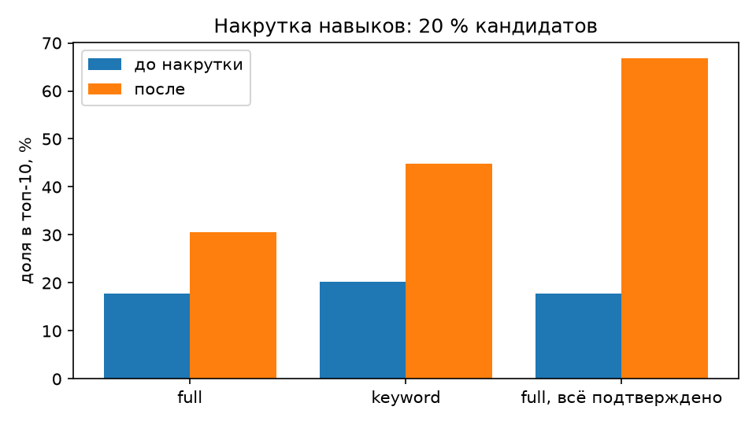

# Проверка подбора кандидатов

Механика подбора даёт 35 % оценки решения. Качество подбора проверено на синтетическом наборе со **скрытой правдой**: подбор видит только зашумлённые наблюдения, как в жизни, а релевантность считается по правде. Код проверки: `backend/app/validation/matching.py`. Ранжирует та же функция `app.services.matching.score`, что работает в API.

## Как устроена оценка соответствия

- Попадание в список решает соответствие потребности: навыки 0,50, грейд 0,20, специализация 0,20, текст запроса 0,05, предметная область 0,05, город и формат 0,05. Город и формат выпадают из балла, если потребность их не называет. Несовпадение снижает этот фактор и человека из выдачи не убирает.
- Навык засчитывается с весом доказательства: подтверждён тестом 1,0, цитатой из резюме 0,75, заявлен 0,55. Близкая технология (MySQL вместо PostgreSQL) даёт частичный зачёт 0,3.
- Грейд: точное совпадение 1,0, на ступень выше 0,6, на ступень ниже 0,35; грейд без подтверждения тестом умножается на 0,85.
- **Порядок внутри категории** задают доказательства: тест (сила результата — нижняя граница вероятности уровня) и протокол ФСП (нижняя граница доверительного интервала, LCB), поровну. Они добавляются к соответствию с весом 0,4. Вес умножается на близость к запрошенной категории (специализация и грейд), поэтому сильный профиль из соседней категории не обгоняет подходящий. Половина веса есть у каждого в категории, вторая половина растёт с покрытием навыков: без нужных навыков одни баллы теста не поднимают наверх.
- Итог: внутри одной категории подтверждённый тестом грейд стоит выше заявленного, а один лишний заявленный навык не перекрывает сильный тест (закреплено в `backend/tests/unit/test_matching.py`).
- Неприменимый фактор не учитывается, веса остальных нормируются. Если в потребности нет предметной области или у кандидата нет истории ФСП, фактор выпадает, и кандидат не теряет баллы (ТЗ 2.1).
- Каждая строка объяснения несёт машинный код и источник (тест, ФСП, заявлено, вилка). У строк теста и ФСП в карточке виден их вклад в балл, например «+9 к баллу».
- Для потребности дополнительно подбираются **рекомендуемые категории**: ячейки «специализация × грейд» с самыми сильными совпадениями.

## Синтетический набор

Кандидат: специализация, способность θ ~ N(0, 1), реальные навыки. Наблюдения искажены так, как это бывает в анкетах: заявленные навыки теряют 25 % реальных и добавляют около 15 % ложных; 30 % заявленных навыков подтверждены цитатой; заявленный грейд у 30 % кандидатов на ступень выше реального и у 10 % ниже; тест проходят 45 %, он подтверждает реальные навыки и уровень; у 55 % есть история ФСП с LCB, связанной с θ.

Релевантность (0–3) считается только по правде: 3 — та же специализация, все обязательные навыки реальны, грейд совпадает; 2 — специализация та же или смежная, навыки реальны, грейд отличается не больше чем на ступень; 1 — реальна хотя бы половина навыков; 0 — иначе. Формулу оценки разметка не видит. Город и формат дописываются после меток, отдельным зерном, и в релевантность не входят.

## Что измеряем

- **nDCG@10** (нормированный дисконтированный совокупный выигрыш): насколько первые десять мест близки к идеальному порядку по релевантности, от 0 до 1.
- **P@10**: доля кандидатов с оценкой 2–3 в первой десятке. Если размеченных пар меньше десяти (файл жюри), считается по всем: P@min(10, n).
- **MAP** (средняя точность): насколько высоко стоят все релевантные кандидаты, а не только первая десятка.
- **Спирмен внутри категории**: ранговая корреляция порядка среди людей той категории, которую видит работодатель (та же специализация и показанный грейд), со скрытой способностью θ. Выше ноля — сильные стоят выше. Потребности, где в категории меньше пяти человек, пропускаются.
- **Завышенный грейд в топ-10**: доля людей в первой десятке, у которых показанный грейд выше реального.
- **95 % ДИ** (доверительный интервал): бутстреп по потребностям, 1000 повторов.
- **Поиск по ключевым словам (BM25)**: так ищет обычная полнотекстовая система. Текст потребности — специализация, грейд, обязательные и желательные навыки; текст профиля — специализация, показанный грейд и все заявленные навыки, без различия, подтверждён навык или нет. Ранжирует Okapi BM25 с учебными константами k1 = 1,2 и b = 0,75; редкость слова (IDF) и средняя длина считаются по тому же банку кандидатов. Город и формат — условия, а не ключевые слова, и в тексты не входят. Константы не подбирались на наборе. Код: `bm25_rank`, `need_text`, `profile_text` в `matching.py`.
- **Базовая линия «по резюме»**: число заявленных обязательных навыков, затем специализация и заявленный грейд. Это сильная база: она знает структуру потребности (какие навыки обязательны, какой грейд нужен) и сравнивает поля, а не слова.

## Результаты

### Набор с зерном 2026

Команда: `cd backend && python -m app.validation.matching`. 800 кандидатов, 78 потребностей с релевантными кандидатами. На Linux x86-64 (CI, Python 3.12 и 3.13) SHA-256 набора `1ebff9bbea1c3a3efa08684a86e3094bc6ec88a1867014ad655e9bd12ffc7e00`. Хэш считается по сырому JSON. С 11.10.2026 набор хранит проваленную попытку теста (`failed_grade`, раздел «Проваленный тест»), поэтому хэш сменился; прежний на Linux — `c83ce73df96d2f7cc7e1f4bd4b1d1fbf8f661d5fa482cf25b340b65c24100f49`. Другая сборка математики меняет хвост `gauss`, поэтому на Windows хэш другой. Таблицы ниже сняты на Linux, Python 3.12.

Порядок в таблице — тот же, что видит работодатель. Последнее место каждой десятки может занять человек без теста, если его балл не ниже чем на 0,08. Строка «без квоты для новичков» — прежняя сортировка только по баллу.

| Ранжирование | nDCG@10 | 95 % ДИ nDCG | P@10, оценка ≥ 2 | MAP | Спирмен внутри категории | 95 % ДИ Спирмена | Завышенный грейд в топ-10 | Настоящий грейд ниже потребности |
|---|---|---|---|---|---|---|---|---|
| Случайный порядок | 0.034 | 0.025…0.044 | 0.035 | 0.043 | -0.006 | -0.075…0.064 | 30.0 % | 44.0 % |
| Поиск по ключевым словам (BM25): текст потребности против текста профиля | 0.562 | 0.522…0.602 | 0.541 | 0.515 | 0.029 | -0.035…0.089 | 26.8 % | 33.7 % |
| Базовая линия «по резюме»: заявленные навыки и грейд | 0.615 | 0.575…0.656 | 0.565 | 0.548 | 0.018 | -0.048…0.083 | 27.4 % | 32.7 % |
| ФСП Талант: оценка соответствия | 0.653 | 0.612…0.695 | 0.662 | 0.613 | 0.359 | 0.302…0.415 | 22.7 % | 18.1 % |
|   без квоты для новичков | 0.652 | 0.612…0.695 | 0.662 | 0.613 | 0.358 | 0.300…0.413 | 22.8 % | 18.1 % |
|   без весов доверия к навыкам | 0.661 | 0.621…0.701 | 0.677 | 0.617 | 0.301 | 0.244…0.358 | 24.5 % | 21.9 % |
|   без теста | 0.639 | 0.595…0.681 | 0.647 | 0.607 | 0.184 | 0.122…0.245 | 22.9 % | 19.5 % |
|   без оси ФСП | 0.653 | 0.614…0.696 | 0.673 | 0.615 | 0.322 | 0.259…0.379 | 23.5 % | 20.8 % |
|   без теста и без ФСП | 0.665 | 0.626…0.710 | 0.673 | 0.626 | 0.034 | -0.026…0.088 | 28.2 % | 26.5 % |
|   без близких технологий | 0.660 | 0.621…0.704 | 0.668 | 0.612 | 0.336 | 0.282…0.391 | 22.8 % | 19.1 % |

«Завышенный грейд в топ-10» — показанный грейд выше настоящего. «Настоящий грейд ниже потребности» — настоящее ниже грейда, который просит потребность; это второе определение завышения, его используют чужие работы.

### Три зерна

Та же команда печатает таблицу по зёрнам 2026, 2027 и 2028, чтобы вывод не держался на одном удачном наборе.

| Ранжирование | nDCG@10 | P@10, оценка ≥ 2 | Спирмен внутри категории | Завышенный грейд в топ-10, % | Настоящий грейд ниже потребности, % |
|---|---|---|---|---|---|
| Поиск по ключевым словам (BM25): текст потребности против текста профиля | 0.568 ± 0.009 | 0.526 ± 0.020 | 0.032 ± 0.024 | 27.5 ± 1.0 | 32.1 ± 1.6 |
| Базовая линия «по резюме»: заявленные навыки и грейд | 0.620 ± 0.005 | 0.559 ± 0.021 | 0.011 ± 0.017 | 28.1 ± 1.8 | 30.9 ± 2.1 |
| ФСП Талант: оценка соответствия | 0.652 ± 0.019 | 0.636 ± 0.025 | 0.374 ± 0.017 | 21.5 ± 2.9 | 14.7 ± 3.0 |
| без теста | 0.647 ± 0.008 | 0.633 ± 0.015 | 0.172 ± 0.012 | 20.9 ± 2.6 | 18.3 ± 1.2 |
| без оси ФСП | 0.651 ± 0.020 | 0.640 ± 0.031 | 0.340 ± 0.018 | 21.9 ± 3.2 | 16.6 ± 3.6 |
| без теста и без ФСП | 0.669 ± 0.004 | 0.648 ± 0.023 | 0.016 ± 0.016 | 27.6 ± 2.2 | 24.7 ± 1.7 |

Та же команда следом печатает, из чего сложился завышенный грейд. На этих зёрнах он целиком заявленный: 21,5 % у полной модели и 28,1 % по резюме. Доля, где завышенную ступень подтвердил тест, — 0,0 % в обеих строках. Тест подтверждает заявленную ступень, только когда способность уже у её порога, и тогда скрытый грейд не ниже показанного. Порядок выдачи этот разрез не меняет.

На зерне 7 (`python -m app.validation.matching --seed 7 --seeds 0`): nDCG@10 0,699 у полной модели и 0,626 по резюме, Спирмен внутри категории 0,325 и −0,040, завышенный грейд в топ-10 22,3 % и 30,7 %.

## Непройденный тест на заявленном грейде

Изменение от 11.10.2026 (DoR-N7). Кандидат выбирает грейд G и проходит тест на G. Тест не пройден, значит апостериорная вероятность θ ≥ порог G ниже порога сдачи (`app/services/cat.py`). Раньше такой кандидат ранжировался по заявленному G, как будто теста не было, а навыки, подтверждённые в той же попытке, поднимали его в категории G. Теперь подбор читает грейд на ступень ниже проваленного: `grade_for_matching` в `app/services/matching.py`. Карточка показывает выбранный грейд со статусом «не подтверждён» и строкой объяснения `GRADE_TEST_FAILED` («тест на «мидл» не пройден, в подборе учтён «джуниор»»). Человек не скрыт, он опущен (Q&A FTT.4). Подтверждённый грейд правило не трогает. Проваленная попытка на ступень выше показанного грейда тоже ничего не меняет. Поиск берёт последнюю попытку по специализации, кроме экспресс-пробы и теста по вакансии (`latest_failed_targets` в `app/services/session_marks.py`). В синтетическом наборе платформа видит ту же попытку как поле `failed_grade`. Метки релевантности и скрытая правда не изменились. Без теста (строка «без теста») правило выключено вместе с тестом. Параметров нет, на наборе ничего не подбиралось.

Принцип — ранжирование по вероятности релевантности (Robertson, 1977, doi:10.1108/eb026647): кандидата ставят по тому, что о нём известно, а непрошедшая классификационная попытка CAT — свидетельство против заявленной ступени (Eggen и Straetmans, 2000, doi:10.1177/00131640021970862).

До и после, та же команда `python -m app.validation.matching --check`, зёрна 2026–2028, среднее ± стандартное отклонение:

| Полная модель | nDCG@10 | P@10 | Спирмен внутри категории | Завышенный грейд в топ-10, % | Настоящий грейд ниже потребности, % |
|---|---|---|---|---|---|
| до: проваленный тест не учитывается | 0,649 ± 0,006 | 0,632 ± 0,019 | 0,236 ± 0,033 | 20,1 ± 3,1 | 19,5 ± 2,7 |
| после: грейд на ступень ниже проваленного | 0,652 ± 0,019 | 0,636 ± 0,025 | 0,374 ± 0,017 | 21,5 ± 2,9 | 14,7 ± 3,0 |

Порядок внутри категории стал заметно точнее: Спирмен 0,236 → 0,374. Людей с настоящим грейдом ниже потребности в первой десятке меньше: 19,5 % → 14,7 %. nDCG@10 и P@10 выросли в пределах разброса. Доля «показанный грейд выше настоящего» выросла на 1,4 п. п.: кандидат с проваленным G теперь попадает в выдачу потребностей на G−1, а карточка показывает выбранный им G со статусом «не подтверждён». По второму определению завышения, настоящий грейд ниже потребности, этот же человек не завышен. С проваленным тестом полная модель на зерне 2028 обгоняет строку «без теста» по nDCG@10 со значимой разницей: +0,0245, 95 % ДИ +0,0034…+0,0449, p = 0,0222. До изменения было +0,0054 и p = 0,4732.

Разделы «Ярус соответствия», «Сначала категория», «Доля завышенного грейда», «Полоса у сдавшего грейд», «Подъём оси ФСП», «Атака накруткой навыков», «Неподтверждённый грейд» и предрегистрированный эксперимент сняты до этого изменения. Таблицы «Ярус соответствия» и «Сначала категория» пересняты на коммите `7aacb2f` (до N7, `FSP_LIFT = "boost"`, Linux): их строка текущего порядка совпадает со строкой «до» в таблице выше.

## Ярус соответствия

Ярус — целая часть от деления балла соответствия (навыки, грейд, роль, текст, отрасль) на ширину Δ. Внутри яруса выше стоит грейд, подтверждённый тестом, затем текущий балл. Человек из более низкого яруса не обгоняет верхний за счёт теста.

Перебор ширин 0,02, 0,03, 0,05, 0,08 и 0,10 на зёрнах 2026, 2027 и 2028, 800 кандидатов и 80 потребностей. Команда: `python -m app.validation.matching --tier-delta 0.02,0.03,0.05,0.08,0.10`. Правило выбора: наибольший Спирмен среди ширин, у которых nDCG полной модели не ниже nDCG без теста и без ФСП больше чем на 0,005. В этом прогоне ярус включён у обеих строк, поэтому nDCG строки «без теста и без ФСП» в таблице относится к порядку с ярусом и не заменяет 0,669 у текущего порядка.

| Δ | nDCG полная | nDCG без теста и без ФСП | разница | Спирмен | завышенный грейд, % | проходит порог nDCG |
|---|---|---|---|---|---|---|
| 0.02 | 0.660 | 0.668 | -0.009 | 0.094 | 24.6 | нет |
| 0.03 | 0.659 | 0.668 | -0.009 | 0.107 | 24.3 | нет |
| 0.05 | 0.657 | 0.668 | -0.011 | 0.126 | 22.7 | нет |
| 0.08 | 0.652 | 0.668 | -0.016 | 0.156 | 21.0 | нет |
| 0.10 | 0.647 | 0.668 | -0.022 | 0.169 | 19.0 | нет |

Ни одна ширина не удерживает nDCG в пределах 0,005 от строки без теста и без ФСП. Ширина 0,02 даёт Спирмен 0,094 и завышенный грейд 24,6 %. У порядка по баллу эти цифры 0,236 и 20,1 %. Выдача сортируется по баллу.

## Сначала категория

Класс 0 — показанные специализация и грейд совпадают с потребностью. Класс 1 — та же специализация и грейд на одну ступень рядом, либо соседняя специализация с точным грейдом. Класс 2 — остальные. Внутри класса порядок прежний: балл, затем нижняя граница оси ФСП. Параметров нет. Команда: `python -m app.validation.matching --order category_first`. Поиск сортирует по баллу.

Приёмка на среднем по зёрнам 2026, 2027 и 2028: nDCG@10 не ниже 0,665, P@10 не ниже 0,651, Спирмен внутри категории не ниже 0,22, завышенный грейд не выше 19,8 %.

| Порядок | nDCG@10 | P@10 | Спирмен | завышенный грейд, % |
|---|---|---|---|---|
| Текущий, только балл | 0,649 ± 0,006 | 0,632 ± 0,019 | 0,236 ± 0,033 | 20,1 ± 3,1 |
| Сначала категория | 0,648 ± 0,014 | 0,608 ± 0,028 | 0,236 ± 0,033 | 21,5 ± 2,5 |

Спирмен 0,236 в обоих порядках. У «сначала категория» nDCG@10 0,648, P@10 0,608, завышенный грейд 21,5 %. У порядка по баллу — 0,649, 0,632 и 20,1 %. Человек точной категории без нужных навыков иначе оказывается выше человека соседней категории с полным набором навыков. Поиск сортирует по баллу.

## Парные сравнения

Метка релевантности — роль, навыки и грейд. Скрытая сила θ внутри грейда в неё не входит, поэтому её не подгоняли под результат. nDCG отвечает за категорию. Спирмен внутри категории — вторая метрика, объявленная заранее: она как раз про порядок внутри грейда.

Полная модель минус сравнение, по потребностям. 95 % интервал — бутстреп среднего, 10 000 повторов. p — доля перестановок знака, у которых модуль среднего не меньше наблюдаемого. Команда: `python -m app.validation.matching`.

| Зерно | Сравнение | Δ nDCG@10 | 95 % ДИ | p | Δ Спирмен |
|---|---|---|---|---|---|
| 2026 | поиск по ключевым словам | +0,0901 | +0,0562…+0,1252 | 0,0000 | +0,3306 |
| 2026 | по резюме | +0,0373 | +0,0001…+0,0743 | 0,0531 | +0,3413 |
| 2026 | без теста | +0,0138 | −0,0083…+0,0354 | 0,2321 | +0,1748 |
| 2026 | без оси ФСП | −0,0006 | −0,0090…+0,0083 | 0,8899 | +0,0375 |
| 2026 | без доказательств | −0,0122 | −0,0316…+0,0076 | 0,2319 | +0,3257 |
| 2027 | поиск по ключевым словам | +0,0553 | +0,0216…+0,0882 | 0,0014 | +0,3824 |
| 2027 | по резюме | +0,0131 | −0,0232…+0,0485 | 0,4920 | +0,4001 |
| 2027 | без теста | −0,0213 | −0,0461…+0,0035 | 0,0888 | +0,2316 |
| 2027 | без оси ФСП | +0,0035 | −0,0033…+0,0107 | 0,3535 | +0,0350 |
| 2027 | без доказательств | −0,0349 | −0,0603…−0,0103 | 0,0074 | +0,3909 |
| 2028 | поиск по ключевым словам | +0,1065 | +0,0673…+0,1447 | 0,0000 | +0,3152 |
| 2028 | по резюме | +0,0465 | +0,0058…+0,0858 | 0,0259 | +0,3492 |
| 2028 | без теста | +0,0245 | +0,0034…+0,0449 | 0,0222 | +0,2023 |
| 2028 | без оси ФСП | +0,0016 | −0,0065…+0,0092 | 0,6975 | +0,0310 |
| 2028 | без доказательств | −0,0023 | −0,0307…+0,0266 | 0,8726 | +0,3574 |

На зерне 2027 Δ nDCG@10 против строки «без доказательств» равна −0,0349, интервал не накрывает ноль (p = 0,0074). На том же зерне Спирмен внутри категории выше на 0,391. На зёрнах 2026 и 2028 интервал накрывает ноль. Потребности без единой метки ≥ 2: 2, 3 и 3 из 80. В среднее nDCG они не входят. У полной модели P@min(10, R) — 0,662, 0,612 и 0,660, R-precision — 0,568, 0,535 и 0,569.

## Против двух баз: заголовочные цифры

Одна и та же разметка, те же зёрна 2026–2028 и те же метрики. Для каждой потребности с релевантными кандидатами считается разность «полная модель минус база», потребности трёх зёрен объединяются (232), 95 % ДИ — парный перцентильный бутстреп среднего, 10 000 повторов, зерно повторной выборки 11. Модель, пороги `--check` и предрегистрация не менялись; BM25 добавлен как ещё одна строка сравнения. Таблицу печатает та же команда `cd backend && python -m app.validation.matching --check`:

| База | nDCG@10 базы | Δ nDCG@10 | 95 % ДИ | P@10 базы | Δ P@10 | 95 % ДИ | nDCG модели выше / ниже |
|---|---|---|---|---|---|---|---|
| поиск по ключевым словам (BM25) | 0,568 | +0,084 | +0,064…+0,105 | 0,526 | +0,110 | +0,089…+0,131 | 70 % / 30 % |
| сортировка по резюме | 0,620 | +0,032 | +0,011…+0,054 | 0,559 | +0,077 | +0,053…+0,103 | 57 % / 42 % |

Полная модель на тех же потребностях: nDCG@10 0,652, P@10 0,636. Обе разности положительны, интервалы не накрывают ноль. По отдельным зёрнам интервал Δ против BM25 выше нуля на всех трёх (таблица «Парные сравнения»), против резюме — на 2026 и 2028.

Как читать размер разрыва: в синтетическом наборе текст профиля — ровно специализация, грейд и названия навыков из той же таксономии, без синонимов, опечаток и длинных описаний опыта. Словам здесь не мешают синонимы и опечатки. Цифры чужих работ «против BM25» сняты на других данных и разметке, напрямую с этой не сравниваются. Сильнее всего модель отличается от обеих баз порядком внутри категории: Спирмен со скрытой силой 0,374 против 0,032 у BM25 и 0,011 у резюме.

## Выводы

- Против поиска по ключевым словам (BM25) nDCG@10 выше на +0,084 (95 % ДИ +0,064…+0,105), P@10 — на +0,110 (+0,089…+0,131). Против сортировки по резюме — +0,032 (+0,011…+0,054) и +0,077 (+0,053…+0,103). Парный бутстреп по 232 потребностям трёх зёрен.
- Подбор обходит базовую линию «по резюме» на всех трёх зёрнах: nDCG@10 0,652 ± 0,019 против 0,620 ± 0,005, P@10 0,636 ± 0,025 против 0,559 ± 0,021.
- Внутри категории порядок у базовой линии случаен (Спирмен 0,011), у полной модели 0,374 ± 0,017. Без теста он падает до 0,172, без оси ФСП — до 0,340, без обоих — до 0,016. Тест и ФСП работают именно здесь: они поднимают сильных внутри показанного грейда, а проваленная попытка опускает тех, кто тест на свой грейд не сдал.
- Завышенный грейд в первой десятке — показанный грейд выше настоящего: 28,1 % по резюме, 21,5 % у полной модели. Весь этот остаток — заявленный грейд, не подтверждённый тестом (0,0 % в обеих строках). Второе определение, настоящий грейд ниже грейда потребности, на тех же трёх зёрнах 30,9 % и 14,7 %. Работодатель реже видит наверху человека, который приписал себе ступень.
- Доказательства почти не двигают nDCG: без теста и ФСП он 0,669, с ними 0,652. Разметка ставит 3 за точный грейд и полный набор навыков и не различает силу внутри категории, поэтому порядок по силе её не улучшает. Польза теста и ФСП — точный порядок внутри категории и меньше завышенных грейдов наверху. Город и формат в метку не входят, поэтому их вес 0,05 чуть сдвигает nDCG и Спирмен относительно набора без этих полей.
- Слепая разметка смотрит только на заявленный профиль и в одном случае из пяти сдвигает оценку на ступень. Против меток, посчитанных по скрытой правде, каппа Коэна 0,46 при зерне разметчика 2027. Веса по каппе не подгоняются. На файле жюри скрытой правды нет, поэтому каппа и Спирмен там не считаются.

### Проверка в CI

`python -m app.validation.matching --check` падает, если полная модель не выше базовой линии и случайного порядка по nDCG@10, если nDCG@10 на зерне 2026 ниже 0,65, если тест или ось ФСП не поднимают Спирмен внутри категории и если завышенных грейдов в топ-10 не меньше, чем по резюме. Шаг стоит в задании `test-backend`.

Критерий для теста и оси ФСП сменён с фиксированного порога на доверительный интервал (11.10.2026). Раньше `--check` требовал, чтобы изъятие каждого доказательства снижало Спирмен на зерне 2026 не меньше чем на 0,04. Это число было выбрано вручную, смотрело на одно зерно и не учитывало разброс по потребностям. Теперь правило задаёт знак эффекта, а не его размер: для каждого изъятия разность «полная модель минус строка» по Спирмену внутри категории считается парно по потребностям, потребности трёх зёрен 2026–2028 объединяются, и нижняя граница 95 % бутстреп-интервала среднего (10 000 повторов, тот же расчёт, что у парного Δ nDCG@10) должна быть выше нуля. Правило принято до прогона, порог не подбирался. Таблицу печатает та же команда:

| Сравнение | Δ Спирмен, 2026 | Δ Спирмен, 2027 | Δ Спирмен, 2028 | Сводно | 95 % ДИ | Потребностей | Проходит |
|---|---|---|---|---|---|---|---|
| без теста | +0,1748 | +0,2316 | +0,2023 | +0,2018 | +0,1701…+0,2335 | 206 | да |
| без оси ФСП | +0,0375 | +0,0350 | +0,0310 | +0,0346 | +0,0260…+0,0443 | 206 | да |

Тест и ось ФСП поднимают порядок внутри категории на каждом из трёх зёрен, и интервал обоих эффектов не накрывает ноль. Вклад ФСП меньше, чем до учёта проваленного теста: часть категории, которую раньше упорядочивала только ось ФСП, теперь упорядочивает проваленная попытка.

## Разметка жюри

Своих пар у хакатона нет. Файл для жюри — JSONL, одна пара на строку: потребность, наблюдаемый профиль кандидата и оценка 0…3. Оценки независимы от формулы. Команда из каталога репозитория:

```bash
cd backend && python -m app.validation.matching --pairs ../docs/examples/jury_pairs.jsonl
```

Она печатает nDCG@10, P@min(10, n) и MAP. Без консоли то же считает страница `/evaluate`: файл или текст уходит в `POST /api/v1/public/evaluate` (до 500 пар и 256 КБ, 10 запросов в минуту с адреса), ответ — три строки: модель, «по резюме» и случайный порядок, плюс sha256 набора. Ещё в ответе есть `per_need` — по каждой потребности P@min(10, n) и nDCG@10 модели и сортировки «по резюме» и топ-5 модели с оценками, — и `paired_delta`: средняя по потребностям разница nDCG@10 «модель − по резюме» с 95 % бутстреп-ДИ (1000 повторов, зерно 11, как у агрегата). На странице это раскрывающаяся таблица «По потребностям». В ней подсвечены строки, где у модели доля релевантных в топе ниже, чем у сортировки по резюме. Пары не сохраняются, банк кандидатов не читается. Три строки примера:

```json
{"need": {"id": "n1", "role": "backend", "grade": "middle", "skills": ["Python", "PostgreSQL"]}, "candidate_id": "c1", "candidate": {"observed": {"role": "backend", "grade": "middle", "grade_source": "assessed", "skills": {"Python": "test_confirmed", "PostgreSQL": "test_confirmed"}, "test_p": 0.9, "fsp_lcb": 0.6, "industry": "fintech"}}, "label": 3}
{"need": {"id": "n1", "role": "backend", "grade": "middle", "skills": ["Python", "PostgreSQL"]}, "candidate_id": "c2", "candidate": {"observed": {"role": "backend", "grade": "junior", "grade_source": "declared", "skills": {"Python": "self_reported"}, "test_p": null, "fsp_lcb": null, "industry": "fintech"}}, "label": 1}
{"need": {"id": "n1", "role": "backend", "grade": "middle", "skills": ["Python", "PostgreSQL"]}, "candidate_id": "c3", "candidate": {"observed": {"role": "ml", "grade": "senior", "grade_source": "declared", "skills": {"Python": "self_reported"}, "test_p": null, "fsp_lcb": 0.4, "industry": "fintech"}}, "label": 0}
```

Тот же расчёт принимает JSON в формате `--export`: `python -m app.validation.matching --import pairs.json`.

**Как проверить подбор самому за 2 минуты.** Откройте `/evaluate`, режим «Разметить самому», выберите потребность и нажмите «Начать». Страница по одной покажет восемь карточек из слепого листа `blind_pairs_2029.csv`: трое из верха модели, трое из верха сортировки по резюме и двое случайных, перемешаны. Балла модели и того, из какого списка карточка, не видно. На каждую ставите 0–3 кнопкой или клавишей: 0 — не подходит, 1 — слабо, 2 — с оговорками, 3 — подходит полностью. После восьмой карточки или по кнопке «Готово» оценки уходят в тот же `POST /api/v1/public/evaluate` в формате JSONL выше, и страница показывает nDCG@10 и P@5 модели, сортировки по резюме и случайного порядка на ваших метках. nDCG@10 — насколько высоко стоят те, кому вы дали больше баллов; P@5 — доля оценок 2 и 3 среди первых пяти. Восемь оценок одного человека — маленькая выборка, итог может перевернуть пара других оценок, поэтому это проверка на глаз, а не замена разметки двумя людьми. Оценки хранятся только в браузере (localStorage). Лист для страницы — `frontend/src/data/blindSheet.json`, его собирает `python scripts/blind_sheet_web.py docs/examples/blind_pairs_2029.csv frontend/src/data/blindSheet.json` из листа и ключа; тексты карточек те же, что в CSV, кроме строки о тесте. В CSV у 33 карточек из списка в разделе про двух ИИ-оценщиков ошибочно стоит «Теста нет», и ещё у восьми — тоже, хотя человек проходил тест. Скрипт повторяет генератор с параметрами выгрузки, сверяет его с ключом и пишет правду: «Тест на грейд … не сдан», а если навыки отмечены «тест», то добавляет, что они подтверждены этой попыткой. Если генератор с ключом не совпадёт, строку о тесте он убирает. Профили, которые уходят на расчёт, остаются как в ключе, поэтому метрики не меняются.

## Слепая разметка: лист и расчёт

Лист на двоих оценщиков готов. Команда из каталога `backend`:

```bash
python -m app.validation.matching --blind-export ../docs/examples/blind_pairs_2029.csv --needs 25 --per-need 8 --seed 2029
```

200 пар: 25 потребностей, в каждой 8 карточек (три из верха модели, три из верха сортировки по резюме, две случайные, затем перемешаны). В листе только наблюдаемый профиль: специализация, грейд заявлен или подтверждён тестом, навыки, сводка теста и оси ФСП. Скрытой правды и балла подбора нет. Кандидаты в листе синтетические, из генератора с зерном 2029. Колонка `label` пустая: двое ставят 0…3 независимо, не видя друг друга.

Взвешенная каппа двух заполненных файлов: `python -m app.validation.matching --kappa a.csv b.csv`. Вес расхождения `(i − j)² / 9`. Порог годности 0,6. Ниже него правила уточняют на десяти парах и размечают лист заново.

Слияние, среднее с округлением вниз: `python -m app.validation.matching --merge-raters a.csv b.csv --merged merged.jsonl`. Рядом с первым файлом должен лежать ключ `a.key.json` из той же выгрузки: в нём те же наблюдаемые факты, без скрытой правды. Дальше `python -m app.validation.matching --pairs merged.jsonl` печатает nDCG@10, P@min(10, n) и MAP модели и сортировки по резюме на этих парах, с 95 % доверительным интервалом по потребностям.

### Слепая разметка: два ИИ-оценщика (11.10.2026)

**Кто размечал лист.** Оба оценщика — автоматические, на основе языковых моделей (LLM-as-judge): оценщик A и оценщик B. Работали они порознь, по одной и той же рубрике из шкалы 0–3. Каждый видел только `blind_pairs_2029.csv`: ни ключа `*.key.json`, ни баллов модели, ни чужого листа. Разметка лежит в `docs/examples/ai_rater_a.csv` и `ai_rater_b.csv`, слитые метки — в `ai_raters_merged.jsonl`, полный вывод команд — в [`ai_raters_result.md`](examples/ai_raters_result.md).

Рубрика в сжатом виде: 3 — специализация совпадает, грейд не ниже нужного, есть все или почти все навыки, ключевые подтверждены тестом или резюме; 2 — специализация та же или смежная, грейд на ступень ниже или часть навыков только заявлена; 1 — смежная специализация, грейд сильно ниже или не подтверждён, навыки в основном заявлены или отсутствуют; 0 — другая специализация и нет ключевых навыков. Ось ФСП и предметная область — слабый плюс при прочих равных, завышенный грейд без теста — минус.

**Согласие.** Квадратично взвешенная κ 0,974, κ Коэна 0,937, точное совпадение 191 пара из 200 (95,5 %). Все девять расхождений — ровно на одну ступень, через ступень оценщики не расходились ни разу. Порог годности 0,6 пройден с большим запасом.

Оговорка к этой цифре обязательна: оба оценщика — языковые модели и, скорее всего, работают на одной базовой модели. Высокая κ между двумя ИИ говорит о том, что рубрика однозначна для такого читателя: два автоматических оценщика по ней приходят к одному ответу. Согласия экспертов-людей она не заменяет. Общая базовая модель означает общие искажения: где она ошибается, оба оценщика ошибаются одинаково, и κ этого не покажет. Поэтому 0,974 — проверка рубрики, а не подтверждение того, что HR оценил бы подбор так же.

**Метрики модели на согласованных метках.** Пары слиты штатным `--merge-raters` (среднее с округлением вниз; распределение 0/1/2/3 — 37/72/67/24), метрики посчитал `--pairs`. В расчёт попали 25 потребностей и 171 кандидат.

| Ранжирование | nDCG@10 | 95 % ДИ nDCG | MAP |
|---|---|---|---|
| Случайный порядок | 0,788 | 0,746…0,830 | 0,628 |
| Базовая линия «по резюме» | 0,866 | 0,835…0,900 | 0,746 |
| ФСП Талант: оценка соответствия | 0,928 | 0,895…0,957 | 0,904 |
|   без весов доверия к навыкам | 0,884 | 0,852…0,916 | 0,843 |
|   без теста | 0,941 | 0,915…0,966 | 0,885 |
|   без оси ФСП | 0,923 | 0,891…0,953 | 0,878 |
|   без теста и без ФСП | 0,959 | 0,934…0,980 | 0,893 |
|   без близких технологий | 0,942 | 0,912…0,967 | 0,931 |

Как это читать:

- Модель ставит подходящих выше, чем сортировка по резюме: nDCG@10 0,928 против 0,866, MAP 0,904 против 0,746. Интервалы почти расходятся (0,895…0,957 и 0,835…0,900), но парного теста эта команда не делает, поэтому строгой значимости мы не заявляем.
- Абсолютные числа высокие из-за устройства листа, а не только из-за модели. В каждой потребности всего 8 карточек, и шесть из них уже взяты из верха модели или резюме, поэтому даже случайный порядок получает 0,788. С синтетической таблицей выше (0,65 на 800 кандидатах) эти цифры не сравниваются.
- P@10 одинаковый у всех строк, 0,455: карточек меньше десяти, P@min(10, n) считается по всем восьми и порядок не различает. В таблицу он не вынесен.
- Без теста и ФСП nDCG выше, 0,959 против 0,928. Это то же, что на синтетике: рубрика оценивает категорию и навыки и почти не различает силу внутри категории, а тест и ФСП работают именно там. Скрывать эту строку мы не стали.
- Спирмен внутри категории и завышенный грейд здесь не считаются: в парах нет скрытой правды. AUC модуль не считает вовсе.
- Вывод не держится на одном оценщике. На метках только A модель даёт 0,939 против 0,866 по резюме, на метках только B — 0,918 против 0,865 (тот же `--merge-raters` с одним файлом дважды, затем `--pairs`).

**Где рубрика оказалась неясной.** Оба оценщика выписали места, где рубрике не хватает определений. Их нужно закрыть до разметки людьми, иначе люди разойдутся там же, где ИИ договорились молча.

Оценщик A и как он решал:

1. Не определено, какие специализации «смежные». A считал смежными ML, аналитику и инженерию данных между собой, а также Fullstack, фронтенд и бэкенд.
2. Для завышенного грейда без теста не задана величина штрафа. A снимал одну ступень.
3. Не сказано, как сочетать грейд, подтверждённый тестом, с навыками, которые только заявлены. A ставил 2.
4. Не определено «почти все» при трёх требуемых навыках.
5. Противоречие в данных: в карточке «Теста нет», а навыки помечены «(тест)» (p003, p011, p013, p015, p029).

Оценщик B:

1. То же противоречие: «Теста нет» при навыках с пометкой «(тест)».
2. Как считать «почти все» при трёх навыках: два из трёх — это уже «почти все» или нет?
3. Смежная специализация без нужных навыков: по букве рубрики это 1, хотя по сути такая пара ближе к 0.

**Противоречие «Теста нет» — ошибка генератора листа, а не рубрики.** Мы проверили пары по ключу. У p003, p011, p013, p015 и p029 в `observed` есть навыки `test_confirmed`, но `test_p`, `test_n` и `test_correct` пустые, грейд `declared`. Таких карточек в листе 33 из 200: p003, p011, p013, p015, p021, p029, p030, p039, p047, p058, p062, p063, p067, p082, p088, p093, p100, p103, p104, p117, p125, p139, p148, p156, p170, p171, p183, p185, p187, p188, p189, p191, p193. Причина в `make_dataset`: человек прошёл тест, но не набрал порог грейда (`test_p < 0,75`). Тогда `test_p` обнуляется, а навыки, подтверждённые тем же тестом, остаются помеченными «тест». `_candidate_card` смотрит только на `test_n` и пишет «Теста нет».

Список исправлений для генератора листа (в этом PR не сделаны: правка `make_dataset` меняет синтетический набор и все хеши выше):

1. В `make_dataset` не обнулять результат несданного теста: хранить `test_p`, `test_n` и `test_correct` всегда, когда тест был, а порог 0,75 решает только `grade_source`.
2. Если менять набор нельзя, то хотя бы в `_candidate_card`: при навыках `test_confirmed` и пустом `test_n` писать «Тест пройден ниже порога грейда» вместо «Теста нет».
3. Добавить в `write_blind_sheet` проверку: строка «Теста нет» и пометка «(тест)» в одной карточке — ошибка выгрузки.
4. Unit-тест на это сочетание и перевыгрузка `blind_pairs_2029.csv` с ключом перед разметкой людьми.
5. В рубрику дописать: список смежных специализаций, штраф за завышенный грейд без теста (например, одна ступень, как у A), правило для «грейд по тесту, навыки заявлены», порог «почти все» (например, все, кроме одного, при трёх и более навыках) и что ставить смежной специализации без нужных навыков.

На ИИ-разметку эта ошибка влияет так: 33 пары оценщики видели с противоречивой карточкой и разрешали его каждый по-своему. Числа выше посчитаны на листе как есть, без исправлений.

**Что дальше.** Дальше лист разметят люди, и он для этого готов: `blind_pairs_2029.csv` и та же рубрика. Перед раздачей лист стоит перевыгрузить с исправленным генератором, а в рубрику внести уточнения из списков выше. Числа людей впишем сюда же рядом с этими, какими бы они ни вышли. До тех пор результат выше — проверка рубрики и пайплайна на ИИ-оценщиках, а не подтверждение качества подбора у HR.

Воспроизвести из каталога `backend`:

```bash
python -m app.validation.matching --kappa ../docs/examples/ai_rater_a.csv ../docs/examples/ai_rater_b.csv
python -m app.validation.matching --pairs ../docs/examples/ai_raters_merged.jsonl
```

Чтобы пересобрать `ai_raters_merged.jsonl`, скопируйте оба листа во временный каталог, положите рядом с первым ключ `blind_pairs_2029.key.json` под именем `ai_rater_a.key.json` и запустите `--merge-raters`.

## Доля завышенного грейда

Команда из каталога `backend`:

```bash
python -m app.validation.matching --overclaim 0,0.25,0.5,0.75 --seed 2026
```

Доля — это люди, заявившие грейд на ступень выше настоящего. Остальные в этом прогоне заявляют истинный грейд. Обычный набор, где 30 % завышают и 10 % занижают, эта кривая не заменяет.

| Доля | nDCG модели | nDCG по резюме | Спирмен модели | Спирмен по резюме | Завышенный грейд в топ-10, модель | Завышенный грейд в топ-10, по резюме |
|---|---|---|---|---|---|---|
| 0 % | 0,767 | 0,706 | 0,147 | 0,050 | 0,0 % | 0,0 % |
| 25 % | 0,706 | 0,643 | 0,227 | 0,055 | 18,5 % | 25,4 % |
| 50 % | 0,677 | 0,603 | 0,270 | 0,056 | 34,0 % | 45,5 % |
| 75 % | 0,639 | 0,555 | 0,210 | 0,024 | 56,7 % | 66,7 % |

Модель выше сортировки по резюме по nDCG на каждой напечатанной доле, включая нулевую. Разрыв растёт вместе с долей завышения: 0,061, 0,063, 0,074 и 0,084. Когда никто не завышает грейд, тест всё равно отличает людей по навыкам и роли, поэтому сортировка по резюме не обгоняет модель.

## Полоса у сдавшего грейд

Непроверенный грейд даёт полосе «Тест» 0,20. Сдавший на грейд потребности не опускается ниже 0,25, даже если нижняя граница доли верных ответов меньше. Команда на отложенных зёрнах, публичные 7 и 2026–2028 в решении не участвовали:

```bash
python -m app.validation.matching --pass-floor --seeds 4001,4002,4003,4004,4005
```

На всех пяти зёрнах Δ nDCG@10 и Δ Спирмен в категории равны нулю: в генераторе нижняя граница у сдавших уже выше полосы, порядок не сдвинулся. Вместе 0,0000, 95 % ДИ [0,0000; 0,0000]. Порог «не хуже» выполнен, полоса включена. На зерне 2026 nDCG и P@10 с полосой и без неё совпали.

## Подъём оси ФСП

### 11.10.2026. Подъём включён в продукт

С 11.10.2026 в продукте `FSP_LIFT = "boost"`. Решение нормативное: по ТЗ 2.1 и ответу постановщика E08 результаты ФСП — дополнительное доказательство, и их привязка не должна опускать кандидата. Синтетическая разметка ставит 3 за точный грейд и полный набор навыков и не различает силу внутри категории, поэтому она не может решить этот вопрос. Цена на трёх публичных зёрнах: nDCG@10 0,650 → 0,649, P@10 0,631 → 0,632, Спирмен внутри категории 0,237 → 0,236. `--check` проходит. Свойство «история ФСП не понижает оценку» закреплено property-тестом `tests/unit/test_fsp_lift_property.py` (hypothesis, 3 000 примеров).

### 11.10.2026. Подъём на отложенных зёрнах: результат приёмки и следующий шаг

Команда `python -m app.validation.matching --holdout` (зёрна 4001–4005, нижняя граница из событий движка) на main @ 0507edc завершается с кодом 1:

| Зерно | Δ nDCG@10 | Δ Спирмен в категории |
|---|---|---|
| 4001 | −0,0156 | +0,0025 |
| 4002 | −0,0185 | +0,0044 |
| 4003 | −0,0156 | −0,0014 |
| 4004 | −0,0072 | +0,0083 |
| 4005 | −0,0180 | +0,0198 |

nDCG@10 −0,0150 (95 % ДИ −0,0195…−0,0104), Спирмен +0,0065. Нижняя граница nDCG ниже порога −0,005, порог по Спирмену выполнен. Подъём оставлен в продукте по нормативной причине (абзац выше); его цена на отложенных зёрнах — около 0,015 nDCG@10. Следующий шаг — перекалибровать величину подъёма на разметке пилота ([Границы применимости](../README.md#границы-применимости)).

### Ошибка измерения теста в синтетике

В генераторе вероятность уровня у прошедших тест — точная функция скрытой θ, без ошибки измерения. Настоящая сессия оценивает θ с ошибкой (RMSE ≈ 0,47, `python -m app.validation.assessment --n 2000 --seed 7`). Команда `python -m app.validation.matching --test-noise 0.47` добавляет такую ошибку; эталон по умолчанию и его SHA-256 не меняются.

| Три зерна 2026–2028 | Без ошибки (эталон) | Ошибка 0,47 |
|---|---|---|
| nDCG@10 полной модели | 0,652 | 0,647 |
| P@10 | 0,636 | 0,631 |
| Спирмен внутри категории | 0,374 | 0,315 |
| Δ nDCG@10 против сортировки по резюме (95 % ДИ) | +0,032 (+0,011…+0,054) | +0,027 (+0,007…+0,048) |
| Δ nDCG@10 против BM25 (95 % ДИ) | +0,084 (+0,064…+0,105) | +0,079 (+0,060…+0,098) |

Около 16 % порядка внутри категории даёт «идеальный» тест генератора. С реалистичной ошибкой преимущество над обеими базами остаётся значимым.

### 09.10.2026. Ось только поднимает доказательства

Нижняя граница — максимум по подмножествам не длиннее пяти событий, пустое подмножество остаётся в переборе. В подборке фактор ФСП может только поднять доказательства над тестом: `T + 0,5·max(0, F − T)`. Команда:

```bash
python -m app.validation.matching --fsp-events --seeds 4001,4002,4003,4004,4005
```

Столбец «до» в этом опыте тоже считается на нижней границе по подмножествам событий, а не на пяти сильнейших событиях выдачи: сравнили только правило подъёма.

| Зерно | Δ nDCG@10 | Δ Спирмен в категории |
|---|---|---|
| 4001 | −0,0156 | +0,0025 |
| 4002 | −0,0185 | +0,0044 |
| 4003 | −0,0156 | −0,0014 |
| 4004 | −0,0072 | +0,0083 |
| 4005 | −0,0180 | +0,0198 |

Вместе (переснято 11.10.2026 на текущем main): nDCG@10 −0,0150, 95 % ДИ [−0,0195; −0,0104]. Спирмен в категории +0,0065. Собственный порог команды (нижняя граница Δ nDCG@10 ≥ −0,005) **не пройден**, команда завершается с кодом 1; порог Спирмена (≥ −0,01) пройден. Подъём ФСП оставлен в продукте как нормативное решение (ТЗ 2.1, ответ E08), а не потому что он улучшает подборку. На этом варианте движка ферма из 40 онлайн-участий даёт LCB 0,16, две победы — 0,54, Спирмен LCB на зёрнах 2026–2028 — 0,752 ± 0,002. В выдаче пять сильнейших событий и среднее теста с осью ФСП. Участие входит в нижнюю границу: история с нулевым классом говорит о силе. Ответ E08: достижения не заменяют тест. Поднять доказательства над пустой историей можно результатом выше её уровня.

## Атака накруткой навыков

20 % кандидатов дописывают в профиль все навыки своей специализации. Истина и метки релевантности не меняются. Сравнивается доля этих же людей в топ-10 до накрутки и после. Команда: `python -m app.validation.matching --stuffing 0.2` (зерно 2026, 800 кандидатов, 80 потребностей). 95 % ДИ — бутстреп по потребностям. Контрольная строка «всё подтверждено» показывает, что было бы, если бы платформа считала каждый заявленный навык подтверждённым.

| Метод | В топ-10 до накрутки | В топ-10 после (95 % ДИ) | Доля в своей специализации | nDCG@10 после |
|---|---|---|---|---|
| Продукт | 17,8 % | 30,5 % (26,5 %…34,5 %) | 18,4 % | 0,6346 |
| Ключевые слова | 20,2 % | 44,9 % (40,5 %…49,6 %) | 18,4 % | 0,5668 |
| Продукт, если всё заявленное считать подтверждённым | 17,8 % | 66,8 % (62,5 %…71,0 %) | 18,4 % | 0,5558 |

**Ограничение.** Накрутка в продукте даёт +12,7 п. п. в топ-10. Это вдвое меньше, чем при поиске по словам (+24,7 п. п.), и в четыре раза меньше, чем если бы заявления не отличались от подтверждений (+49,0 п. п.). Полностью эффект не гасится: незаявленный навык ничего не даёт, а заявленный без подтверждения тестом или резюме немного весит. План: снизить вес только заявленных навыков, когда у кандидата есть тест той же специализации, и показывать работодателю долю подтверждённых навыков на карточке. Методика близка к исследованию чувствительности ранжирования к возмущениям (arXiv:2501.04316). Код: `stuff_skills` и `stuffing_study` в `app/validation/matching.py`, тесты в `tests/unit/test_skill_stuffing.py`.




## Неподтверждённый грейд: показывать, опускать или скрывать

Вопрос из Q&A FTT.4: что делать с кандидатом, грейд которого тест ещё не подтвердил. Сравниваются три политики на одной и той же выдаче продукта. Метки релевантности не меняются, поэтому скрытый релевантный кандидат засчитывается как потеря. Команда: `python -m app.validation.matching --unconfirmed` (зерно 2026, 800 кандидатов, 80 потребностей, из них 78 с релевантными). Δ считается к порядку продукта, парно по потребностям; 95 % ДИ — бутстреп по потребностям, 1000 повторов.

| Политика | nDCG@10 | Δ nDCG@10 (95 % ДИ) | P@10 | Δ P@10 (95 % ДИ) | Релевантные без подтверждения в топ-20 |
|---|---|---|---|---|---|
| Как в продукте: общий порядок по баллу | 0,6528 | 0 | 0,6526 | 0 | 47,0 % |
| Все неподтверждённые после подтверждённых | 0,4735 | −0,1792 (−0,2151…−0,1390) | 0,4654 | −0,1872 (−0,2282…−0,1449) | 0,0 % |
| Неподтверждённые скрыты | 0,4735 | −0,1792 (−0,2151…−0,1390) | 0,4654 | −0,1872 (−0,2282…−0,1449) | 0,0 % |
| Балл, неподтверждённым × 0 | 0,4742 | −0,1785 (−0,2142…−0,1385) | 0,4654 | −0,1872 (−0,2282…−0,1449) | 0,0 % |
| Балл, неподтверждённым × 0,25 | 0,4742 | −0,1785 (−0,2142…−0,1385) | 0,4654 | −0,1872 (−0,2282…−0,1449) | 0,1 % |
| Балл, неподтверждённым × 0,5 | 0,4821 | −0,1707 (−0,2031…−0,1325) | 0,4769 | −0,1756 (−0,2141…−0,1359) | 12,7 % |
| Балл, неподтверждённым × 0,75 | 0,5727 | −0,0801 (−0,1001…−0,0585) | 0,6026 | −0,0500 (−0,0731…−0,0269) | 32,9 % |
| Балл, неподтверждённым × 1 | 0,6525 | −0,0003 (−0,0009…+0,0001) | 0,6513 | −0,0013 (−0,0038…+0,0000) | 47,1 % |

В продукте неподтверждённый кандидат остаётся в выдаче с пометкой «Грейд не подтверждён», а место ему задаёт балл. Опускание и скрытие совпадают по построению: в пуле 166 кандидатов с подтверждённым грейдом из 800, поэтому при опускании топ-20 целиком состоит из подтверждённых, то есть из тех же людей, что и при скрытии. Сетка множителей монотонна: чем сильнее штраф неподтверждённым, тем ниже nDCG@10 и тем меньше релевантных возвращается в топ-20. Множитель 1 практически совпадает с порядком продукта. Обе политики теряют около 0,18 nDCG@10, и интервал далеко от нуля. Синтетика: доля протестированных 45 %, грейд подтверждается при p ≥ 0,75 (`make_dataset`). Код: `unconfirmed_study` в `app/validation/matching.py`, тесты в `tests/unit/test_unconfirmed_policy.py`.

## Ранжирование по ожидаемому выигрышу: предрегистрированный эксперимент (11.10.2026)

Протокол, гипотезы и правило решения зафиксированы в `docs/PREREG_MATCHING_2026-10.md` коммитом `37fcb8f` **до** первого запуска на отложенных зёрнах 5001–5010. Отложенные зёрна запускались один раз. Команды: `python -m app.validation.expected_gain --holdout` и то же с `--overclaim 0.0` и `--overclaim 0.45`. Это измерение: порядок в продукте не менялся.

Названия строк: `eg_full` — ожидаемый выигрыш с тестом и ФСП; `eg_no_evidence` — та же модель, откалиброванная без теста и ФСП; `product_full` и `product_no_evidence` — продукт и его абляция из основной таблицы.

### Основной запуск (генератор по умолчанию)

```
seeds 5001…5010 (10), λ=0.3, overclaim=None
| Ранжирование | nDCG@10 | Спирмен в категории | Завышенный грейд в топ-10 |
|---|---|---|---|
| eg_full | 0.6931 | 0.140 | 25.2 % |
| eg_no_evidence | 0.6878 | -0.004 | 28.1 % |
| product_full | 0.6709 | 0.231 | 21.2 % |
| product_no_evidence | 0.6867 | 0.007 | 27.9 % |

| Сравнение | Метрика | Δ | 95 % ДИ | p |
|---|---|---|---|---|
| eg_full − eg_no_evidence | ndcg | +0.0052 | +0.0007…+0.0097 | 0.0221 |
| eg_full − eg_no_evidence | rho | +0.1448 | +0.1341…+0.1557 | 0.0000 |
| eg_full − product_full | ndcg | +0.0221 | +0.0118…+0.0323 | 0.0000 |
| eg_full − product_full | rho | -0.0906 | -0.1064…-0.0748 | 0.0000 |
| eg_full − product_no_evidence | ndcg | +0.0064 | -0.0023…+0.0151 | 0.1443 |
| eg_full − product_no_evidence | rho | +0.1332 | +0.1192…+0.1472 | 0.0000 |
```

### Устойчивость: убеждения заморожены, у генератора другая доля завышения

```
seeds 5001…5010 (10), λ=0.3, overclaim=0.0
| Ранжирование | nDCG@10 | Спирмен в категории | Завышенный грейд в топ-10 |
|---|---|---|---|
| eg_full | 0.7721 | 0.104 | 0.0 % |
| eg_no_evidence | 0.7864 | -0.030 | 0.0 % |
| product_full | 0.7701 | 0.189 | 0.0 % |
| product_no_evidence | 0.7926 | -0.014 | 0.0 % |

| Сравнение | Метрика | Δ | 95 % ДИ | p |
|---|---|---|---|---|
| eg_full − eg_no_evidence | ndcg | -0.0143 | -0.0181…-0.0104 | 0.0000 |
| eg_full − eg_no_evidence | rho | +0.1341 | +0.1222…+0.1463 | 0.0000 |
| eg_full − product_full | ndcg | +0.0020 | -0.0088…+0.0126 | 0.7023 |
| eg_full − product_full | rho | -0.0844 | -0.1000…-0.0684 | 0.0000 |
| eg_full − product_no_evidence | ndcg | -0.0205 | -0.0297…-0.0114 | 0.0000 |
| eg_full − product_no_evidence | rho | +0.1180 | +0.1036…+0.1326 | 0.0000 |
```

```
seeds 5001…5010 (10), λ=0.3, overclaim=0.45
| Ранжирование | nDCG@10 | Спирмен в категории | Завышенный грейд в топ-10 |
|---|---|---|---|
| eg_full | 0.7061 | 0.126 | 37.6 % |
| eg_no_evidence | 0.6914 | -0.011 | 40.2 % |
| product_full | 0.6963 | 0.205 | 31.8 % |
| product_no_evidence | 0.6904 | -0.006 | 39.9 % |

| Сравнение | Метрика | Δ | 95 % ДИ | p |
|---|---|---|---|---|
| eg_full − eg_no_evidence | ndcg | +0.0147 | +0.0104…+0.0190 | 0.0000 |
| eg_full − eg_no_evidence | rho | +0.1369 | +0.1264…+0.1476 | 0.0000 |
| eg_full − product_full | ndcg | +0.0098 | -0.0006…+0.0198 | 0.0619 |
| eg_full − product_full | rho | -0.0794 | -0.0944…-0.0646 | 0.0000 |
| eg_full − product_no_evidence | ndcg | +0.0157 | +0.0070…+0.0243 | 0.0003 |
| eg_full − product_no_evidence | rho | +0.1316 | +0.1182…+0.1454 | 0.0000 |
```

### Итог по гипотезам

- **H1 подтверждена.** Тест и ФСП поднимают nDCG@10 модели над её же абляцией: +0,0052, 95 % ДИ +0,0007…+0,0097, p 0,022. Эффект малый.
- **H2 подтверждена.** Новая модель выше продукта по nDCG@10: +0,022 (ДИ +0,012…+0,032). Над абляцией продукта (0,687) она **не** значима: +0,0064, p 0,14.
- **H3 — цена, как и объявлено.** Спирмен внутри категории 0,140 против 0,231 у продукта (−0,091, ДИ −0,106…−0,075).
- **H4 — ниже продукта.** Завышенный грейд в топ-10: 25,2 % против 21,2 %.
- **Устойчивость не подтверждена полностью.** Если в генераторе никто не завышает грейд, а убеждения откалиброваны на 30 % завышения, полная модель проигрывает своей абляции: −0,014, значимо. При 45 % завышения выигрывает: +0,015. Выигрыш держится на том, что калибровка совпадает с реальной долей завышения.

**Решение по правилу предрегистрации.** H1 и H2 подтверждены, значит переключать продукт допустимо только отдельным PR за флагом, и решает владелец. Наша рекомендация — **не переключать до заморозки**: выигрыш по nDCG малый и зависит от калибровки, а цена (порядок внутри категории и завышенный грейд наверху) — как раз то, ради чего в продукте есть тест и ФСП. На реальных данных частоты P(навык | доверие) и P(грейд | источник) нужно пересчитать по тестам (`grade_posterior.fail_table`) и разметке жюри, после этого повторить проверку.

## Неблагоприятное воздействие: правило 4/5 и Skew@k

Раньше `app.validation.fairness` проверял правило только на синтетическом примере. Теперь он считает его на этом же наборе подбора, в продуктовом порядке `rank(..., "full")`.

- **Пул** — кандидаты специализации потребности (отклик на вакансию). **Отбор** — место в топ-10 пула. **Балл** — место в верхней половине пула, это вариант для скоринговых инструментов из правил DCWP к NYC Local Law 144 (редакция 06.04.2023: доля выше медианы).
- **Impact ratio (IR)** — доля группы, делённая на самую высокую долю. Ниже 0,8 — признак неблагоприятного воздействия по 29 CFR 1607.4(D). Доли суммируются по всем потребностям и зёрнам, 95 % ДИ — бутстреп по потребностям (B = 1000). Группы с n < 5 выводятся, но не сравниваются.
- **Skew@k** (Geyik, Ambler, Kenthapadi, KDD 2019, doi:10.1145/3292500.3330691) = ln(доля метки в топ-k / доля в пуле), объединённо по потребностям. 0 — топ повторяет пул, −0,22 — примерно на пятую часть меньше.
- **Метки.** Регион — четыре округа, отдельный генератор, в балл не входит. Язык кода — один язык из реальных навыков кандидата; он связан со специализацией, поэтому пул и режется по специализации. Участие в ФСП — **ось балла по ТЗ**, разница там ожидаема и не является дискриминацией, строка дана отдельно для прозрачности. Пол и национальность продукт не собирает, проверить их нельзя и не нужно.

Команда (≈ 1 мин):

```
cd backend && python -m app.validation.fairness
```

Вывод:

```
Зёрна 2026..2035 (10), кандидатов 800, потребностей 80 на зерно, всего потребностей 800. Пул = кандидаты роли потребности.
| Метка | Группа | n | Доля в топ-10 | IR отбора [95 % ДИ] | Доля выше медианы | IR балла [95 % ДИ] | Skew@10 | Skew@20 |
|---|---|---|---|---|---|---|---|---|
| Регион | ЦФО | 15258 | 0.136 | 0.962 [0.908; 1.000] | 0.501 | 1.000 [0.982; 1.000] | -0.008 | +0.007 |
| Регион | СЗФО | 14800 | 0.142 | 1.000 [0.975; 1.000] | 0.497 | 0.993 [0.970; 1.000] | +0.031 | +0.003 |
| Регион | СФО | 14291 | 0.136 | 0.958 [0.903; 1.000] | 0.497 | 0.993 [0.970; 1.000] | -0.012 | -0.002 |
| Регион | ПФО | 13893 | 0.136 | 0.957 [0.905; 1.000] | 0.491 | 0.981 [0.957; 0.999] | -0.013 | -0.008 |
| Язык кода | Python | 16952 | 0.144 | 0.875 [0.738; 0.965] | 0.507 | 0.898 [0.833; 0.945] | +0.050 | +0.033 |
| Язык кода | без языка | 16398 | 0.129 | 0.780 [0.656; 0.865] | 0.478 | 0.847 [0.786; 0.892] | -0.066 | -0.044 |
| Язык кода | JavaScript | 6004 | 0.142 | 0.863 [0.725; 0.960] | 0.504 | 0.893 [0.827; 0.941] | +0.036 | +0.018 |
| Язык кода | TypeScript | 5727 | 0.133 | 0.804 [0.665; 0.898] | 0.505 | 0.896 [0.831; 0.947] | -0.034 | -0.008 |
| Язык кода | Kotlin | 2945 | 0.143 | 0.869 [0.711; 0.983] | 0.498 | 0.883 [0.815; 0.936] | +0.042 | +0.011 |
| Язык кода | Swift | 2554 | 0.130 | 0.786 [0.657; 0.888] | 0.486 | 0.862 [0.799; 0.910] | -0.058 | -0.025 |
| Язык кода | C++ | 2093 | 0.139 | 0.840 [0.683; 0.987] | 0.494 | 0.875 [0.806; 0.937] | +0.009 | -0.002 |
| Язык кода | Rust | 1952 | 0.135 | 0.817 [0.670; 0.954] | 0.490 | 0.868 [0.801; 0.932] | -0.019 | -0.002 |
| Язык кода | C | 1581 | 0.154 | 0.936 [0.754; 1.000] | 0.544 | 0.964 [0.883; 1.000] | +0.117 | +0.044 |
| Язык кода | Go | 558 | 0.127 | 0.771 [0.571; 0.966] | 0.462 | 0.820 [0.723; 0.913] | -0.077 | -0.077 |
| Язык кода | C# | 506 | 0.121 | 0.731 [0.521; 0.949] | 0.470 | 0.834 [0.709; 0.956] | -0.130 | -0.082 |
| Язык кода | Java | 491 | 0.165 | 1.000 [0.845; 1.000] | 0.564 | 1.000 [0.947; 1.000] | +0.183 | +0.177 |
| Язык кода | PHP | 481 | 0.135 | 0.819 [0.596; 1.000] | 0.495 | 0.877 [0.778; 0.961] | -0.016 | +0.058 |
| Участие в ФСП (ось балла по ТЗ) | есть ФСП | 31845 | 0.148 | 1.000 [1.000; 1.000] | 0.509 | 1.000 [1.000; 1.000] | +0.071 | +0.045 |
| Участие в ФСП (ось балла по ТЗ) | нет ФСП | 26397 | 0.125 | 0.848 [0.812; 0.884] | 0.482 | 0.947 [0.931; 0.965] | -0.094 | -0.058 |
Регион: мин. IR отбора 0.957, мин. IR балла 0.981, порог 0.8 — проходит
Язык кода: мин. IR отбора 0.731, мин. IR балла 0.820, порог 0.8 — ниже 4/5
Участие в ФСП (ось балла по ТЗ): мин. IR отбора 0.848, мин. IR балла 0.947, порог 0.8 — проходит
```

**Вывод.** Регион проходит с запасом: минимальный IR отбора 0,957, балла 0,981, |Skew@10| ≤ 0,031. Участие в ФСП проходит порог (0,848 и 0,947), хотя входит в балл. **Находка:** по языку кода точечный IR отбора ниже 4/5 у двух малых групп: C# 0,731 (506 мест, ДИ 0,521…0,949) и Go 0,771 (558 мест, ДИ 0,571…0,966); обе около 1 % пула, оба ДИ включают 0,8, IR по баллу 0,834 и 0,820. По правилам DCWP такие малые группы отчитываются с оговоркой; порог мы не правим. Это синтетика, на живых данных отчёт нужно повторить.

**Разбор причины (11.10.2026).** Та же команда теперь печатает таблицу «Разбор по языку кода». Порог 4/5 не трогаем, балл подбора тоже не менялся.

| Язык | Мест в пулах | Доля в пуле | IR против самой большой группы (Python) | Релевантных мест (метка ≥ 2) | Доля в топ-10 среди релевантных |
|---|---|---|---|---|---|
| Python | 16952 | 29,1 % | 1,000 | 7592 | 0,236 |
| Go | 558 | 1,0 % | 0,881 | 6 | 0,333 |
| C# | 506 | 0,9 % | 0,835 | 14 | 0,571 |
| Java (опорная группа в IR) | 491 | 0,8 % | 1,142 | 11 | 0,455 |
| PHP | 481 | 0,8 % | 0,936 | 8 | 0,625 |

Почему так выходит:
- **Опорная группа сама крошечная.** IR делится на самую высокую долю, а её дала Java: 491 место, 0,8 % пула, всего 11 релевантных мест. Если делить на самую большую группу, Python, то IR у C# 0,835, у Go 0,881. Оба выше 0,8.
- **Подбор не отсекает релевантных из этих групп.** В топ-10 попадают 57 % релевантных C#-мест и 33 % релевантных Go-мест. У Python таких 24 %.
- **Почему у этих групп вообще мало мест в топ-10.** Генератор потребностей почти не просит C#, Go, Java и PHP: релевантных мест у них 1–3 %, у Python 45 %. Нерелевантные кандидаты попадают в топ-10 за счёт факторов, не связанных с навыками, а при n ≈ 500 точечная оценка IR сильно шумит. У обоих 95 % ДИ включает 0,8.
- **Пробела в словаре навыков нет.** Отбор среди релевантных у этих групп выше, чем у Python, поэтому синонимы и маппинг навыков менять не нужно.
- **Правило DCWP.** Группы меньше 2 % пула (Go, C#, Java, PHP) можно не включать в расчёт IR, и в таблице они помечены «< 2 %». Вывод «ниже 4/5» в основной строке мы оставляем как есть.
- Это синтетика. На реальных откликах отчёт нужно повторить.

**IR при равной истинной релевантности.** Та же команда печатает ещё одну таблицу. Сырой IR смешивает две причины: у группы меньше мест, которые действительно подходят потребности, или порядок опускает её при той же релевантности. Нечестна только вторая. Поэтому доля в топ-10 сравнивается с опорой (Python) внутри слоёв одной скрытой метки 0–3, слои сводятся отношением Мантеля–Хензеля (точечная оценка, 10 зёрен, ДИ не считали).

| Язык | Мест в пулах | Сырой IR против Python | IR при равной релевантности |
|---|---|---|---|
| Go | 558 | 0,881 | 1,728 |
| C# | 506 | 0,835 | 1,618 |
| Java | 491 | 1,142 | 2,153 |
| PHP | 481 | 0,936 | 1,829 |
| TypeScript | 5727 | 0,919 | 0,932 |
| Kotlin | 2945 | 0,992 | 0,932 |
| **Swift** | 2554 | 0,897 | **0,758** |

- Для C# и Go низкий сырой IR объясняется релевантностью: при той же метке они попадают в топ-10 чаще Python.
- **Находка: Swift.** Сырой IR 0,897 проходит порог, а при равной релевантности выходит 0,758, ниже 0,8. Значит, при той же истинной пригодности Swift-кандидаты стоят ниже. Балл подбора до сдачи не меняем, в планах пилота — разобрать этот слой.

## Лестница баз

Та же разметка и те же потребности (с хотя бы одной меткой ≥ 2), что у `evaluate`. P@5 и P@10 — доля кандидатов с меткой ≥ 2 среди первых 5 и 10. «Лучше / хуже» — доля потребностей, где nDCG@10 полной модели строго выше или ниже базы. «Самоописание» сортирует по заявленным специализации и грейду, без навыков, теста и ФСП (метод `self`, только в валидации). Команда: `cd backend && python -m app.validation.matching --ladder`; для отложенных зёрен добавить `--seeds 4001,4002,4003,4004,4005`.

Зёрна 2026–2028, 232 потребности:

| Ранжирование | nDCG@10 | P@5 | P@10 | Модель лучше / хуже |
|---|---|---|---|---|
| случайный порядок | 0,040 | 0,028 | 0,032 | 100 % / 0 % |
| самоописание | 0,530 | 0,543 | 0,525 | 74 % / 25 % |
| BM25 | 0,568 | 0,605 | 0,526 | 70 % / 30 % |
| сортировка по резюме | 0,620 | 0,652 | 0,559 | 57 % / 42 % |
| ФСП Талант | 0,652 | 0,664 | 0,636 | — |

Отложенные зёрна 4001–4005, 390 потребностей:

| Ранжирование | nDCG@10 | P@5 | P@10 | Модель лучше / хуже |
|---|---|---|---|---|
| случайный порядок | 0,041 | 0,032 | 0,032 | 100 % / 0 % |
| самоописание | 0,577 | 0,570 | 0,528 | 63 % / 37 % |
| BM25 | 0,582 | 0,587 | 0,511 | 65 % / 35 % |
| сортировка по резюме | 0,637 | 0,650 | 0,551 | 55 % / 45 % |
| ФСП Талант | 0,652 | 0,663 | 0,628 | — |

У нас разрыв с базой «по резюме» небольшой, потому что эта база сильная: она уже сортирует по заявленным навыкам, специализации и грейду. Значимость разницы против резюме и BM25 приведена в разделе «Против двух баз» (парный бутстреп).

## По протоколам опубликованных методов

Чтобы цифры подбора можно было сравнить с цифрами других опубликованных решений, тот же продуктовый порядок посчитан ещё по двум градуированным протоколам. Формулу подбора и её веса мы не меняли и на этих зёрнах ничего не подбирали. Меняются только правило разметки по скрытой истине, отбор потребностей и определения метрик.

- **Протокол A**, шкала 0–3. 0: другая специализация, истинный грейд дальше чем на ступень или нет ни одного обязательного навыка. 1: соседний грейд или меньше 1/3 обязательных навыков. 2: целевой грейд и приемлемые навыки, либо грейд на ступень выше запроса и не меньше 1/3 навыков. 3: целевой грейд, не меньше 2/3 обязательных навыков и θ в верхней половине грейда. Минус 1 за несовпадение формата работы (зарплату наш синтетический мир не моделирует). Потребности, где меньше трёх кандидатов с оценкой ≥ 2, пропускаются.
- **Протокол B**, полезность u = специализация (1, смежная 0,4) × грейд (1 тот же, 0,75 на ступень выше, 0,45 на ступень ниже) × (0,25 + 0,75 × доля обязательных навыков) × положение внутри грейда. Оценка 3 при u ≥ 0,8, 2 при u ≥ 0,6, 1 при u ≥ 0,4. Пропускаются потребности без кандидатов с оценкой ≥ 2.
- **В обоих протоколах:** nDCG@10 с выигрышем $2^{\mathrm{rel}} - 1$, скидкой $1/\log_2(i+1)$ и идеалом по всему пулу, P@10 как доля оценок ≥ 2 на десяти местах, MRR по первому кандидату с оценкой ≥ 2. Пул 800 кандидатов, 80 потребностей на зерно, 95 % ДИ — бутстреп по потребностям.

| Протокол | Зёрна | nDCG@10 [95 % ДИ] | P@10 | MRR | Потребностей |
|---|---|---|---|---|---|
| Строгий (наш, основной) | 2026–2028 | 0,652 [0,628; 0,678] | 0,636 | 0,817 | 232 |
| Строгий (наш, основной) | 4001–4005 | 0,652 [0,635; 0,668] | 0,628 | 0,813 | 390 |
| A | 2026–2028 | 0,607 [0,589; 0,628] | 0,540 | 0,852 | 214 |
| A | 4001–4005 | 0,598 [0,582; 0,613] | 0,514 | 0,845 | 354 |
| B | 2026–2028 | 0,666 [0,644; 0,686] | 0,638 | 0,918 | 237 |
| B | 4001–4005 | 0,660 [0,645; 0,675] | 0,627 | 0,887 | 393 |
| A, поиск по ключевым словам (BM25) | 2026–2028 | 0,399 [0,379; 0,420] | 0,356 | 0,627 | 214 |

Одинаковый протокол не делает цифры сопоставимыми с чужими: синтетические миры разные. У нас тест прошли только 45 % кандидатов, 30 % завышают грейд, а заявленные навыки теряют четверть настоящих и на 15 % ложны. Поэтому сравнивать стоит с базами на той же разметке (строка BM25), а не с числами из других проектов.

Проверка: `python -m app.validation.matching --protocol all` (то же, что `python -m app.validation.protocols`); база: `python -m app.validation.protocols --protocol a --method bm25`.
